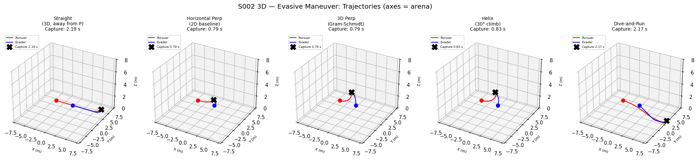
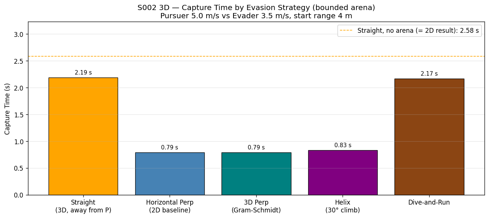
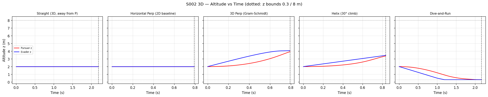
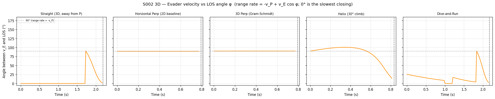
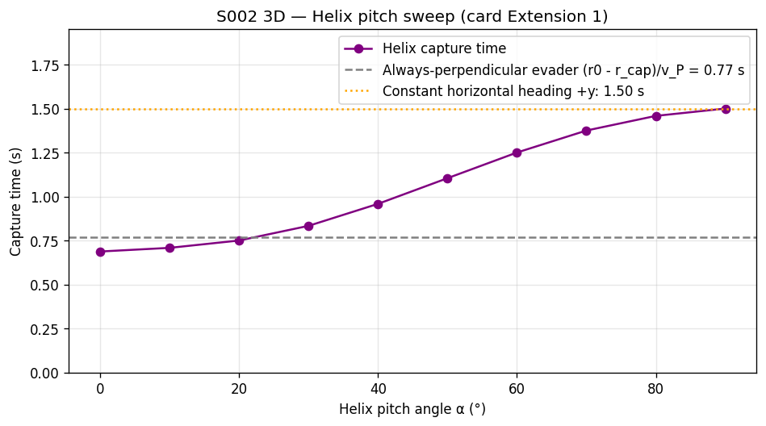
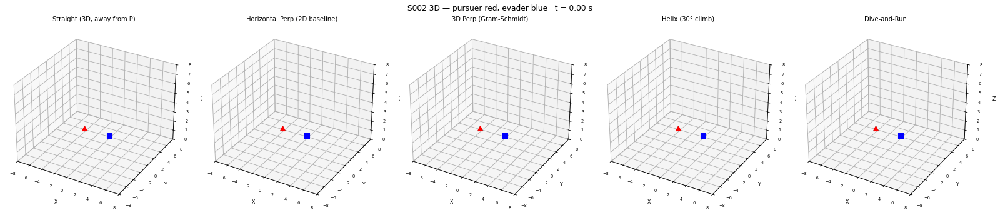

# S002 3D Upgrade — Evasive Maneuver

**Domain**: Pursuit & Evasion | **Difficulty**: ⭐⭐⭐ | **Status**: ✅ Completed

---

## Problem Definition

**Setup**: one pure-pursuit pursuer against one evader in a bounded 3D arena ($x, y \in [-8, 8]$ m, $z \in [0.3, 8]$ m). The pursuer (5 m/s) is faster than the evader (3.5 m/s), so capture is certain; the question is which evasion tactic delays it longest, and whether using altitude helps.

**Roles**:
- **Pursuer**: pure pursuit in full 3D — always flies at the evader's current position.
- **Evader**: one of five tactics: straight escape (baseline), horizontal perpendicular (the 2D strategy), 3D perpendicular, helix and dive-and-run.

**Objective**: compare capture times and test the card's claim that 3D tactics (helix, dive) extend capture time over the 2D baseline.

---

## Mathematical Model

### Pursuer — pure pursuit in 3D

$$\mathbf{v}_P = v_P \frac{\mathbf{p}_E - \mathbf{p}_P}{\|\mathbf{p}_E - \mathbf{p}_P\|}$$

### Range rate

With $\varphi$ the angle between the evader's velocity and the line of sight $\hat{\mathbf{r}} = (\mathbf{p}_E - \mathbf{p}_P)/\|\mathbf{p}_E - \mathbf{p}_P\|$:

$$\dot r = -v_P + v_E \cos\varphi$$

Straight escape ($\varphi = 0$) gives the slowest closing speed $v_P - v_E = 1.5$ m/s. Any perpendicular escape ($\varphi = 90^\circ$), horizontal or vertical, gives $\dot r = -v_P$.

### Evader tactics

| Tactic | Velocity |
|--------|----------|
| `straight` | $\mathbf{v}_E = v_E \hat{\mathbf{r}}$ |
| `horizontal_perp` | $v_E \mathbf{R}_{90^\circ} \hat{\mathbf{r}}_{xy}$, $v_z = 0$ |
| `perp_3d` | $\mathbf{e} = \hat{\mathbf{z}} - (\hat{\mathbf{z}}\cdot\hat{\mathbf{r}})\hat{\mathbf{r}}$, $\mathbf{v}_E = v_E \mathbf{e}/\|\mathbf{e}\|$ (fallback $\hat{\mathbf{x}}$ if $\|\mathbf{e}\| < 10^{-4}$) |
| `helix` | $v_E[-\cos\alpha\sin\omega t,\ \cos\alpha\cos\omega t,\ \sin\alpha]$, $\omega = v_E\cos\alpha / R_{helix}$ |
| `dive_and_run` | for $t < 1$ s: $v_z = -(2 - 0.5)/1 = -1.5$ m/s, remaining speed $\sqrt{v_E^2 - v_z^2} = 3.16$ m/s horizontally away from the pursuer; then `straight` |

### Arena

Both drones are clipped to the arena box. When the evader's command points out of a wall, the outward component is removed and the rest is rescaled to the full $v_E$ (the evader slides along the wall). If nothing is left, it moves along the free axis with the most room.

### Capture

$$\|\mathbf{p}_P - \mathbf{p}_E\| < r_{capture} = 0.15 \text{ m}$$

---

## Key Parameters

| Parameter | Value |
|-----------|-------|
| Pursuer speed $v_P$ | 5.0 m/s |
| Evader speed $v_E$ | 3.5 m/s |
| Initial pursuer position | (-2, 0, 2) m |
| Initial evader position | (2, 0, 2) m |
| Capture radius | 0.15 m |
| Arena | $x, y \in [-8, 8]$ m, $z \in [0.3, 8]$ m |
| Helix radius $R_{helix}$ | 1.5 m |
| Helix pitch angle $\alpha$ | 30° (sweep 0–90° in 10° steps) |
| Dive | 2 m → 0.5 m in 1.0 s |
| Control frequency | 48 Hz |
| Max simulation time | 30 s |

---

## Implementation

```
src/base/drone_base.py                                   # Point-mass drone base class
src/01_pursuit_evasion/3d/s002_3d_evasive_maneuver.py    # Main simulation script
```

```bash
conda activate drones
python src/01_pursuit_evasion/3d/s002_3d_evasive_maneuver.py
```

---

## Results

| Tactic | Capture time | Mean closing speed | Evader z range | Capture point |
|--------|-------------|--------------------|----------------|---------------|
| **Straight** | **2.19 s** | 1.77 m/s | 2.00 m | (8.00, 1.60, 2.00) — on the x = 8 wall |
| Dive-and-run | 2.17 s | 1.79 m/s | 0.30–2.00 m | (8.00, 1.17, 0.30) — floor/wall edge |
| Helix (α = 30°) | 0.83 s | 4.62 m/s | 2.00–3.46 m | (0.36, 1.53, 3.46) |
| Horizontal perp (2D baseline) | 0.79 s | 4.87 m/s | 2.00 m | (0.66, 1.96, 2.00) |
| 3D perp (Gram-Schmidt) | 0.79 s | 4.87 m/s | 2.00–4.08 m | (0.93, 0.00, 4.08) |

Analytical checks printed by the script ($r_0 = 4$ m):
- Any perpendicular escape: $(r_0 - r_{capture})/v_P = 3.85/5 = 0.77$ s; simulated 0.79 s for both perpendicular tactics.
- Straight escape without the arena: $(r_0 - r_{capture})/(v_P - v_E) = 2.57$ s; simulated 2.58 s, the same as the 2D S002 result.
- Straight escape in the arena: the evader reaches the x = 8 wall at 1.71 s with 1.43 m of range left. If the pursuer then closed at the full 5 m/s, capture would come at 1.97 s (lower bound). The evader slides along the wall for 22 steps, so capture comes at 2.19 s.

**Helix pitch sweep** (card Extension 1):

| α | 0° | 10° | 20° | 30° | 40° | 50° | 60° | 70° | 80° | 90° |
|---|----|-----|-----|-----|-----|-----|-----|-----|-----|-----|
| Capture time (s) | 0.69 | 0.71 | 0.75 | 0.83 | 0.96 | 1.10 | 1.25 | 1.38 | 1.46 | 1.50 |

A constant horizontal heading of +y (no climb, no turn) is captured at 1.50 s, the same as α = 90° (a straight vertical climb).

**Key findings**:
1. **Altitude gives no advantage against a 3D pure-pursuit pursuer.** Straight escape (2.19 s) is still the best tactic, exactly as in 2D. Dive-and-run (2.17 s) does as well only because its run phase *is* straight escape; the dive itself costs a little, since it pins the evader on the floor (z = 0.3 m from 1.2 s on) and then in the floor/wall corner.
2. **The arena costs the straight evader 0.39 s.** Unbounded, it survives 2.58 s; the x = 8 wall cuts that to 2.19 s.
3. **Horizontal perp and 3D perp are identical in range terms by construction.** Both keep $\varphi = 90^\circ$ at all times, so $\dot r = -v_P$ and capture comes at $(r_0 - r_{capture})/v_P \approx 0.79$ s for *any* start range. The 3D version only climbs instead of turning sideways (capture at z = 4.08 m instead of 2.00 m).
4. **The card's helix argument does not hold.** At $t = 0$ the helix velocity is perpendicular to the LOS for every α, so $\cos\theta_0 = 0$, not $\sin\alpha$. Higher pitch helps only because the helix turns more slowly ($\omega \propto \cos\alpha$) and becomes closer to a constant heading; a horizontal constant heading gives the same 1.50 s as a vertical climb. Pure pursuit is rotationally symmetric about the LOS, so the climb itself adds nothing.

**3D trajectories** (axes = arena; pursuer red, evader blue, × = capture):



**Capture time comparison** (dashed line: straight escape without the arena):



**Altitude vs time** — only perp_3d, helix and dive-and-run leave z = 2 m; the dive reaches the 0.3 m floor at 1.2 s:



**Angle φ between the evader's velocity and the LOS** — straight and dive-and-run stay near 0° until they hit a wall; both perpendicular tactics sit at 90°:



**Helix pitch sweep**:



**Animation** (all five tactics side by side, runs until the last capture at 2.19 s; finished panels freeze):



### Deviations from the scenario card

| Card | This implementation | Reason |
|------|--------------------|--------|
| Four tactics: horizontal perp, 3D perp, helix, dive-and-run | Added a fifth, `straight` escape | Review finding: straight escape is the best 2D tactic, so without it the 3D comparison had no real baseline |
| Arena $[-8, 8]^3$ m with $z \in [0.3, 8]$ m | Enforced as $x, y \in [-8, 8]$, $z \in [0.3, 8]$ with wall sliding for the evader | The lower z bound 0.3 m overrides −8; the evader keeps full speed along walls so tactics stay comparable |
| Pursuer: "Pure Pursuit or PNG" | Pure pursuit only | PNG is the card's Extension 3 |
| Helix: $\cos\theta_0 \approx \sin\alpha$, "optimal α ≈ 30°" | Not reproduced: $\theta_0 = 90^\circ$ for every α; capture time rises monotonically with α up to 1.50 s at 90° | See Key finding 4 |
| Objective: quantify how 3D tactics extend capture time over the 2D baseline | No 3D tactic beats straight escape | See Key finding 1 |
| Expected output: all four tactics "on the same 3D axes"; elevation subplot next to a top-down view | One 3D panel per tactic; altitude shown in a separate altitude-vs-time figure | Five overlapping trajectories in one 3D axes are unreadable |

---

## Extensions

1. Proportional-navigation pursuer (card Extension 3): with a lead-angle pursuer, perpendicular or helical escape may finally pay off.
2. Turn-rate or climb-rate limited pursuer, so that vertical manoeuvres can exploit a real vertical tracking lag.
3. Energy-aware evasion: $P = k_h v_z^2 + k v^2$ (card Extension 2).
4. Arena-aware escape: pick the escape heading with the longest free run (e.g. toward the far corner) instead of directly away from the pursuer.

---

## Related Scenarios

- Original 2D version: [S002 Evasive Maneuver](../../../../scenarios/01_pursuit_evasion/S002_evasive_maneuver.md)
- 3D card: [S002 3D Upgrade — Evasive Maneuver](../../../../scenarios/01_pursuit_evasion/3d/S002_3d_evasive_maneuver.md)
- Prerequisite: [S001 Basic Intercept](../../../../scenarios/01_pursuit_evasion/S001_basic_intercept.md)
- Next: [S003 Low-Altitude Tracking](../../../../scenarios/01_pursuit_evasion/S003_low_altitude_tracking.md)

## References

- Shneydor, N.A. (1998). *Missile Guidance and Pursuit*. Horwood.
