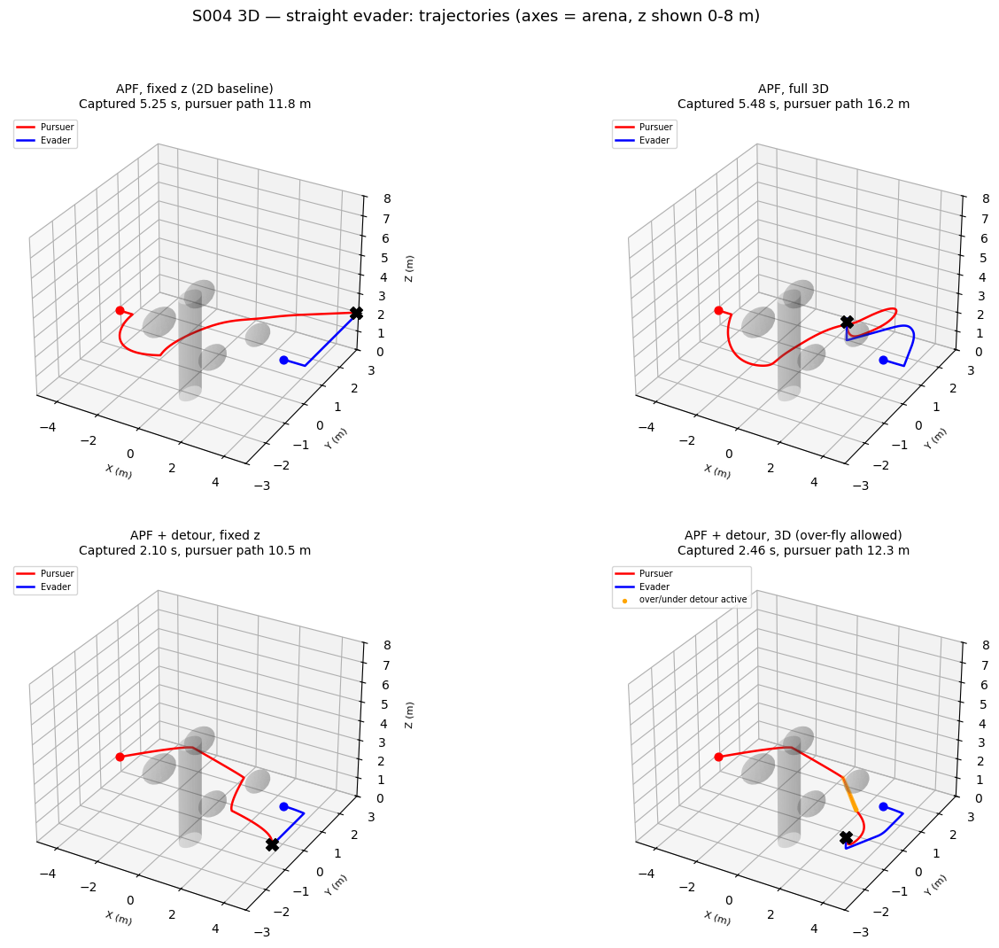
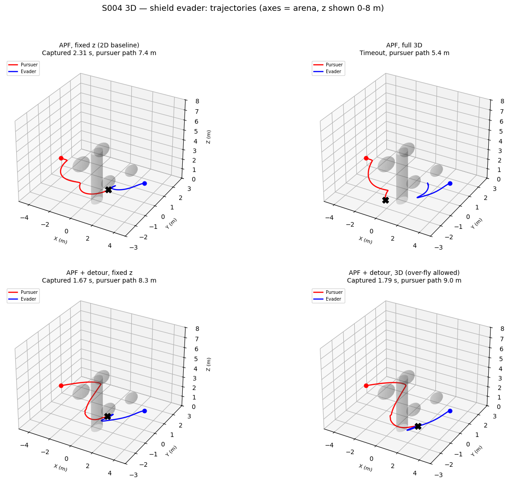
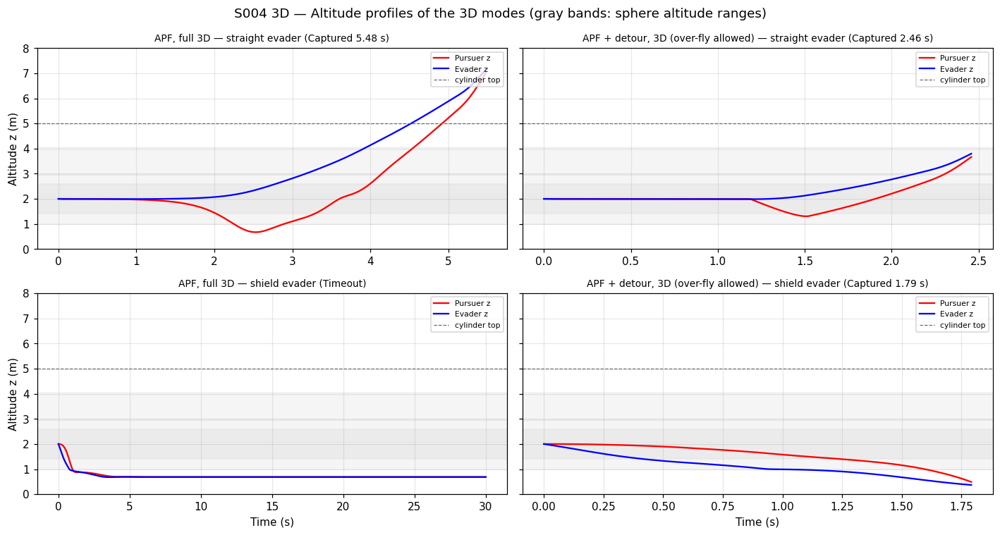
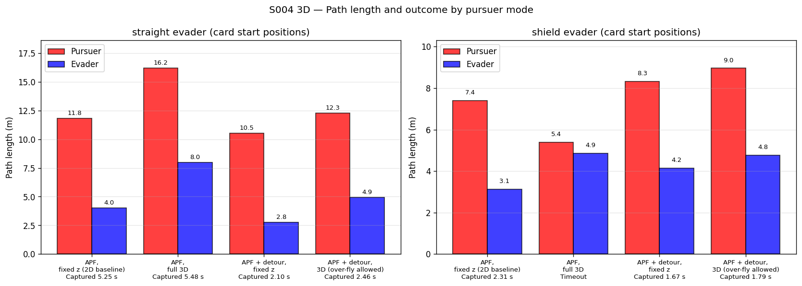
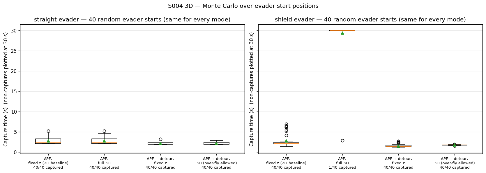
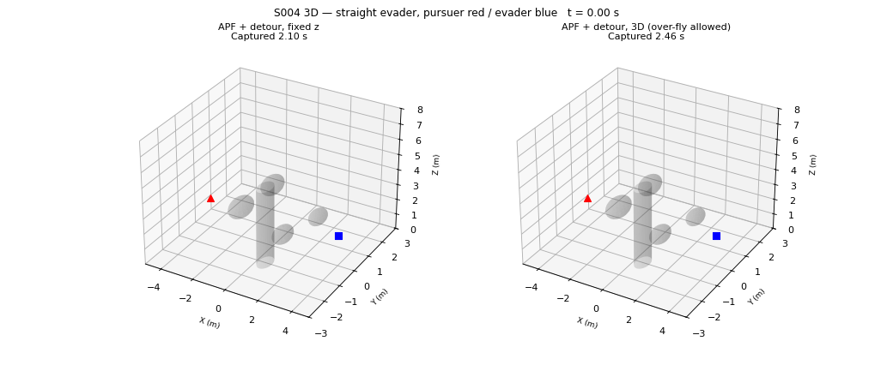

# S004 3D Upgrade — Obstacle-Course Chase

**Domain**: Pursuit & Evasion | **Difficulty**: ⭐⭐⭐⭐ | **Status**: ✅ Completed

---

## Problem Definition

**Setup**: a pursuer chases an evader through four spheres at different heights and one tall vertical cylinder. As in the fixed 2D S004, the chase takes place inside a walled arena ($x \in [-5, 5]$, $y \in [-3, 3]$ m, here with $z \in [0.3, 10]$ m), so the evader cannot run out of the obstacle course.

**Roles**:
- **Pursuer**: attractive-repulsive potential field (APF), in four modes (2 × 2): plain APF or APF plus a detour waypoint, each either held at z = 2 m (2D baseline) or free in 3D. Only the 3D detour mode may choose to fly over or under an obstacle.
- **Evader**: either straight escape + APF (as in 2D), or the card's **altitude shield**: hide low behind the tall cylinder, on the side away from the pursuer.

**Objective**: test the card's claim that 3D routing (over-flying obstacles) shortens the pursuer's path and capture time, and whether the altitude shield helps the evader.

---

## Mathematical Model

### APF velocity (both agents)

$$\mathbf{v}_{cmd} = \mathbf{v}_{att} + \mathbf{v}_{rep}, \qquad \mathbf{v}_{att} = v_{max}\frac{\mathbf{p}_{T} - \mathbf{p}}{\|\mathbf{p}_{T} - \mathbf{p}\|}$$

$$\mathbf{v}_{rep,i} = K_{rep}\left(\frac{1}{\rho_i} - \frac{1}{\rho_0}\right)\frac{1}{\rho_i^2}\,\hat{\mathbf{n}}_i \quad (\rho_i < \rho_0)$$

Spheres: $\rho_i = \|\mathbf{p} - \mathbf{c}_i\| - r_i$ with the full 3D normal. Cylinder: $\rho = \|\mathbf{p}_{xy} - \mathbf{c}_{xy}\| - r_c$ with a horizontal normal, active only for $z_{bot} \le z \le z_{top}$. The command is clamped to $v_{max}$ and the next position is clipped to the arena (hard walls, the agent slides along them). In fixed-z modes the z components are zeroed and both agents stay at z = 2 m.

### Detour waypoint (over-fly decision)

If the straight segment $P \to E$ passes within $r_i + m$ ($m$ = 0.8 m) of an obstacle, take the first such obstacle and its nearest point $\mathbf{q}$ on the segment. Candidate waypoints $\mathbf{w} = \mathbf{q} + s\,\hat{\mathbf{u}}$ lie at distance $r_i + m$ from the centre, along directions perpendicular to the segment:

- left/right: $\hat{\mathbf{u}} = \pm\,\hat{\mathbf{z}} \times \hat{\mathbf{l}}$ (all detour modes)
- over/under: $\hat{\mathbf{u}} = \pm(\hat{\mathbf{z}} - (\hat{\mathbf{z}}\cdot\hat{\mathbf{l}})\hat{\mathbf{l}})$ for spheres, and over the top ($z_{top} + m$) for the cylinder (3D detour only)

A candidate must be inside the arena and at least 0.5 m from every obstacle surface. The pursuer flies toward the candidate with the shortest $\|\mathbf{w} - \mathbf{p}_P\| + \|\mathbf{p}_E - \mathbf{w}\|$. It keeps its previous choice unless another is shorter by more than 0.5 m. The waypoint already gives clearance, so detour pursuers keep only a short-range safety repulsion ($\rho_0$ = 0.4 m).

### Altitude-shield evader

$$\mathbf{s} = \mathbf{c}_{cyl,xy} + (r_c + 1.0)\,\frac{\mathbf{c}_{cyl,xy} - \mathbf{p}_{P,xy}}{\|\mathbf{c}_{cyl,xy} - \mathbf{p}_{P,xy}\|}, \quad s_z = 1.0 \text{ m (3D) or 2.0 m (fixed z)}$$

The evader flies at $v_E$ toward $\mathbf{s}$, plus APF repulsion.

### Capture and collision

$\|\mathbf{p}_P - \mathbf{p}_E\| < 0.15$ m is a capture; entering an obstacle (plus 0.05 m) is a crash.

---

## Key Parameters

| Parameter | Value |
|-----------|-------|
| Pursuer start | (-4, 0, 2) m |
| Evader start (nominal) | (4, 0, 2) m |
| Pursuer / evader speed | 5.0 / 3.5 m/s |
| $K_{rep}$ | 4.0 |
| $\rho_0$ (APF modes and evader) | 1.5 m |
| $\rho_0$ safety (detour pursuers) | 0.4 m |
| Detour margin $m$ / min waypoint clearance / hysteresis | 0.8 m / 0.5 m / 0.5 m |
| Arena (hard walls) | $x \in [-5, 5]$, $y \in [-3, 3]$, $z \in [0.3, 10]$ m |
| Fixed-z altitude | 2.0 m |
| Shield stand-off / altitude | 1.0 m from the cylinder surface / 1.0 m (sweep 1–4 m) |
| Capture radius / collision margin | 0.15 m / 0.05 m |
| Control frequency | 48 Hz |
| Max simulation time | 30 s |
| Monte Carlo | 40 evader starts, $x \sim U[1.5, 4.5]$, $y \sim U[-2.5, 2.5]$, z = 2 m, seed 4, same starts for every mode |

| Obstacle | Centre (x, y, z) | Radius / height |
|----------|-----------------|-----------------|
| Sphere 1 | (-2.0, 0.0, 2.0) | r = 0.60 m |
| Sphere 2 | (-0.5, 0.5, 3.5) | r = 0.55 m (elevated) |
| Sphere 3 | (1.0, -0.4, 1.5) | r = 0.50 m (low) |
| Sphere 4 | (2.5, 0.3, 2.5) | r = 0.45 m |
| Cylinder | (0.5, -1.0) | r = 0.4 m, z ∈ [0, 5] m |

---

## Implementation

```
src/01_pursuit_evasion/3d/s004_3d_obstacle_chase.py    # Main simulation script
```

```bash
conda activate drones
python src/01_pursuit_evasion/3d/s004_3d_obstacle_chase.py
```

---

## Results

### Nominal case (card start positions)

| Evader | Pursuer mode | Outcome | Pursuer path | Evader path | Over/under detour steps |
|--------|--------------|---------|--------------|-------------|-------------------------|
| straight | APF, fixed z | captured 5.25 s | 11.81 m | 4.01 m | — |
| straight | APF, full 3D | captured 5.48 s | 16.18 m | 8.00 m | — |
| straight | APF + detour, fixed z | captured 2.10 s | 10.52 m | 2.77 m | 0 (of 74 detour steps) |
| straight | APF + detour, 3D | captured 2.46 s | 12.29 m | 4.93 m | 16 (of 73) |
| shield | APF, fixed z | captured 2.31 s | 7.39 m | 3.13 m | — |
| shield | APF, full 3D | **timeout (30 s)** | 5.39 m | 4.86 m | — |
| shield | APF + detour, fixed z | captured 1.67 s | 8.33 m | 4.15 m | 0 (of 74) |
| shield | APF + detour, 3D | captured 1.79 s | 8.96 m | 4.77 m | 0 (of 83) |

Obstacle-free reference (straight evader, same arena): captured 1.77 s, pursuer path 8.85 m. The evader stays inside the arena in every run.

### Monte Carlo (40 evader starts, same starts for every mode)

| Evader | Pursuer mode | Captured | Mean / median capture time | Mean pursuer path | Runs using over/under |
|--------|--------------|----------|----------------------------|-------------------|-----------------------|
| straight | APF, fixed z | 40/40 | 2.77 / 2.43 s | 11.22 m | — |
| straight | APF, full 3D | 40/40 | 2.79 / 2.41 s | 11.45 m | — |
| straight | APF + detour, fixed z | 40/40 | 2.14 / 1.98 s | 10.71 m | — |
| straight | APF + detour, 3D | 40/40 | 2.14 / 1.99 s | 10.71 m | 6 |
| shield | APF, fixed z | 40/40 | 2.78 / 2.15 s | 7.87 m | — |
| shield | APF, full 3D | **1/40** | 2.83 s (one capture) | 11.20 m | — |
| shield | APF + detour, fixed z | 40/40 | 1.52 / 1.33 s | 7.60 m | — |
| shield | APF + detour, 3D | 40/40 | 1.77 / 1.77 s | 8.84 m | 20 |

Paired difference, 3D detour minus fixed-z detour, per start: straight evader mean −0.00 s (3D faster in 3, equal in 30, slower in 7); shield evader +0.25 s (3D faster in 8, slower in 32).

Shield hiding-altitude sweep (3D modes, same 40 starts):

| Hiding altitude | APF, full 3D | APF + detour, 3D |
|-----------------|--------------|------------------|
| 1.0 m (default) | 1/40 captured (2.83 s) | 40/40 (mean 1.77 s) |
| 2.0 m | 38/40 (2.85 s) | 40/40 (1.47 s) |
| 3.0 m | 10/40 (2.09 s) | 40/40 (1.59 s) |
| 4.0 m | 12/40 (2.23 s) | 40/40 (1.64 s) |

**Key findings**:
1. **Over-flying almost never pays here.** The 3D detour pursuer chose over/under in only 6 of 40 straight-escape runs, and the paired capture-time difference is 0.00 s on average (equal in 30 of 40). In the nominal run it passes *under* the elevated Sphere 4 for 16 steps and is captured 0.36 s *later* than the fixed-z detour (2.46 vs 2.10 s). The reason is the evader, not the route: once the pursuer leaves z = 2 m, the line of sight tilts and the straight-escape evader climbs (to 3.80 m), so it runs longer before it is cornered. The card's expected "pursuer over-flying Sphere 2" never happens: in the nominal runs and over all 40 Monte Carlo starts (both evaders), Sphere 2 is never the first obstacle on the pursuer's path, and the only vertical choices are over/under Sphere 3 and under Sphere 4. Flying over the cylinder (top at 5 m) is never the shortest option.
2. **The over-fly decision is not the main lever; the detour waypoint is.** Adding the waypoint cuts the mean capture time from 2.77 s (plain APF) to 2.14 s against the straight evader, in both the fixed-z and the 3D world. Plain APF stalls at a local minimum in front of Sphere 1: in the nominal runs the pursuer is slower than 0.5 m/s for 1.85 s (fixed z) and 1.31 s (3D); the detour pursuers never stall (0.00 s).
3. **The altitude shield beats the plain 3D APF pursuer, but not a pursuer with a detour rule.** Hiding at z = 1 m behind the cylinder stops the plain 3D APF pursuer in 39 of 40 runs. In the nominal run it is stalled (below 0.5 m/s) for 28.62 of 30 s at about 0.7 m altitude near the foot of the cylinder, where the horizontal repulsion cancels its attraction; its altitude never exceeds 2.00 m, so it never tries to cross the 5 m top. Against both detour pursuers the shield fails in 40/40 runs (mean 1.52–1.77 s): reaching the hiding point means flying back toward the pursuer. The sweep shows the shield also works against plain APF at 3–4 m (only 10–12/40 captured), but not at 2 m, the pursuer's own altitude (38/40 captured).
4. **Path lengths** (nominal, straight evader): 10.52 m (fixed-z detour) vs 12.29 m (3D detour) vs 8.85 m obstacle-free. The previous README's "3D routing reduces path length" is not supported.

**3D trajectories, straight evader** (orange dots: steps where an over/under detour is active):



**3D trajectories, altitude-shield evader**:



**Altitude profiles of the two 3D modes**:



**Path length and outcome, nominal case**:



**Monte Carlo capture times** (timeouts plotted at 30 s):



**Animation** — fixed-z detour vs 3D detour against the straight evader, until the later capture at 2.46 s:



### Deviations from the scenario card

| Card | This implementation | Reason |
|------|--------------------|--------|
| Unconstrained space, z ∈ [0.3, 10] m | Walled arena $x \in [-5, 5]$, $y \in [-3, 3]$, $z \in [0.3, 10]$ m for both agents | Review finding (2D bug): in open space the evader left the course and was caught at x ≈ 50 m; same fix as 2D S004 |
| Over-fly heuristic: compare a quarter circumference with a climb to $r_i + 0.5$ m above the centre | Detour waypoint at $r_i + 0.8$ m around the first blocking obstacle; over/under vs left/right chosen by the actual $P \to w \to E$ length, with feasibility and hysteresis | The card's rule fired on 0 steps (the climb cost was always larger), so the comparison tested nothing |
| Two modes: fixed-z APF vs full 3D APF | 2 × 2: {APF, APF + detour} × {fixed z, 3D} | Separates the effect of the detour rule from the effect of 3D freedom |
| Pursuer repulsion range $\rho_0$ = 1.5 m | 1.5 m for plain APF and the evader; 0.4 m safety range for the detour pursuers | With $\rho_0$ = 1.5 m the repulsion near a waypoint (≈ 3.6 m/s at 0.8 m) cancelled the attraction and the detour pursuer stalled |
| Altitude shield described, not specified | Hiding point 1.0 m outside the cylinder surface, opposite the pursuer, at z = 1.0 m (z = 2 m in the fixed-z world) | Card gives no formula |
| Single run | Plus a 40-start Monte Carlo with common starts and a shield-altitude sweep | Results depend on the start geometry |
| Expected output: capture time comparison chart | Capture times are in the path-length chart labels and the Monte Carlo box plot | Avoids a near-duplicate figure |

---

## Extensions

1. Global 3D planner (A\* or RRT\* on an inflated grid) to measure the true shortest 2D vs 3D path through this layout.
2. Taller, wider obstacles (urban canyon, card Extension 1), where a horizontal detour is long and over-flying should finally pay off.
3. A shield evader that stays put once hidden and only shifts when the pursuer commits to a side.
4. Dynamic obstacles (card Extension 2).

---

## Related Scenarios

- Original 2D version: [S004 Obstacle-Course Chase](../../../../scenarios/01_pursuit_evasion/S004_obstacle_chase.md)
- 3D card: [S004 3D Upgrade — Obstacle-Course Chase](../../../../scenarios/01_pursuit_evasion/3d/S004_3d_obstacle_chase.md)
- Prerequisites: [S001 Basic Intercept](../../../../scenarios/01_pursuit_evasion/S001_basic_intercept.md), [S003 Low-Altitude Tracking](../../../../scenarios/01_pursuit_evasion/S003_low_altitude_tracking.md)
- Next: [S005 Stealth Approach](../../../../scenarios/01_pursuit_evasion/S005_stealth_approach.md)

## References

- Khatib, O. (1986). "Real-Time Obstacle Avoidance for Manipulators and Mobile Robots." *IJRR* 5(1).
