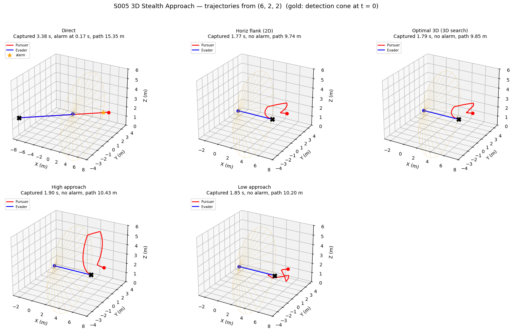
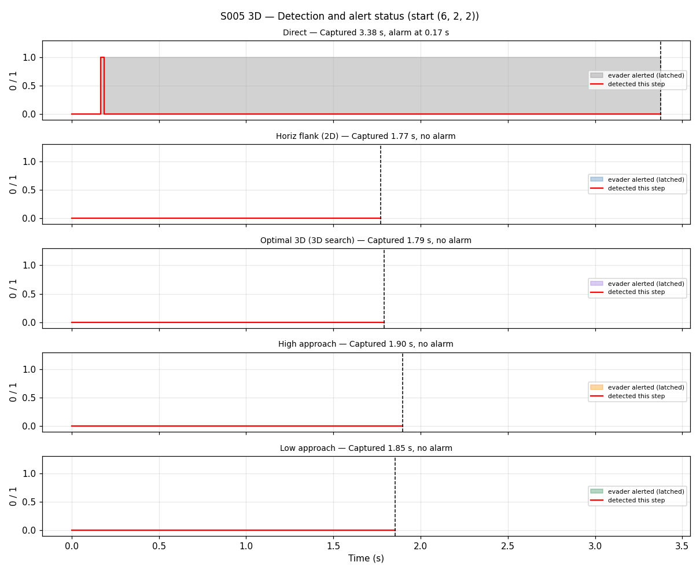
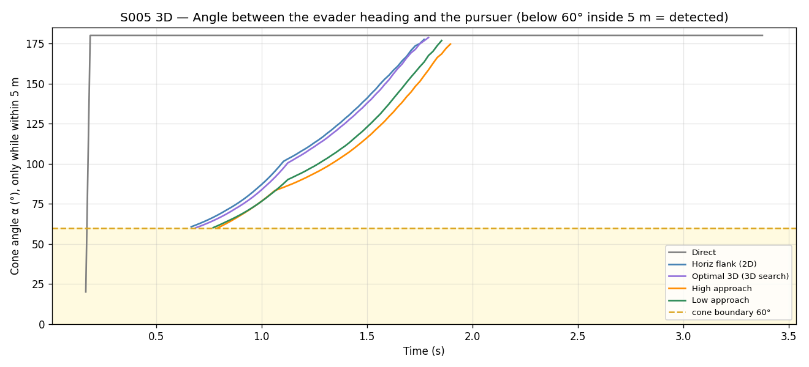
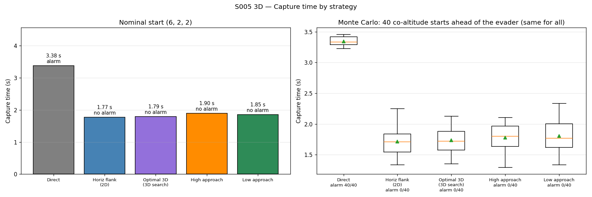
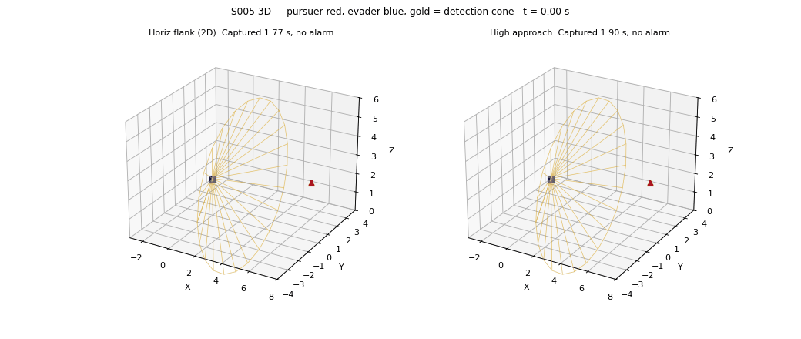

# S005 3D Upgrade — Stealth Approach

**Domain**: Pursuit & Evasion | **Difficulty**: ⭐⭐⭐⭐ | **Status**: ✅ Completed

---

## Problem Definition

**Setup**: the evader patrols along +x and carries a 3D forward detection cone. As in the fixed 2D S005, the pursuer starts **ahead** of the evader at (6, 2, 2) m, outside detection range but close to the cone axis, so a straight approach must cross the cone. The pursuer wants to reach the evader unseen and close in from the rear blind spot.

**Roles**:
- **Evader**: flies +x at 3 m/s. Its cone (half-angle 60°, range 5 m) points along its velocity. The **first** detection alerts it (latched); from then on it flees directly away from the pursuer in 3D at 3 m/s.
- **Pursuer**: five strategies with **the same speed rule**: 5.5 m/s while undetected and the evader is not alerted, 4.5 m/s otherwise.

| Strategy | Logic |
|----------|-------|
| `direct` | Always fly straight at the evader |
| `horiz_flank` (2D baseline) | Aim 2 m behind the evader; each step take the **horizontal** heading closest to that aim whose predicted next position is outside the cone |
| `optimal_3d` | Same aim, but the heading is searched over the **full 3D sphere** of directions |
| `high_approach` | 3D search, aim 2 m behind and 2.5 m above the evader |
| `low_approach` | 3D search, aim 2 m behind and 1.5 m below the evader (z ≥ 0.3 m) |

Every stealth strategy aims at the evader itself once it is within $\|\text{offset}\| + 0.5$ m, and switches to direct pursuit if the evader is ever alerted.

**Objective**: test the card's claim that vertical approaches shorten the approach and give a more reliable rear entry than horizontal flanking.

---

## Mathematical Model

### 3D detection cone

$$\cos\alpha = \frac{(\mathbf{p}_P - \mathbf{p}_E)\cdot\hat{\mathbf{v}}_E}{\|\mathbf{p}_P - \mathbf{p}_E\|}, \qquad \text{detected} \iff \alpha < 60^\circ \;\wedge\; \|\mathbf{p}_P - \mathbf{p}_E\| \le 5 \text{ m}$$

Detection is evaluated only while the evader is still patrolling; the first detection latches the alarm.

### Speed rule (all strategies)

$$v_P = \begin{cases} 5.5 \text{ m/s} & \text{not detected and evader not alerted} \\ 4.5 \text{ m/s} & \text{otherwise} \end{cases}$$

### Stealth heading

With aim point $\mathbf{p}_{aim} = \mathbf{p}_E + \Delta$ ($\Delta = (-2, 0, 0)$, $(-2, 0, 2.5)$ or $(-2, 0, -1.5)$ m) and desired direction $\hat{\mathbf{d}}$ toward it, the command is

$$\hat{\mathbf{u}}^* = \arg\max_{\hat{\mathbf{u}} \in \mathcal{U}} \hat{\mathbf{u}}\cdot\hat{\mathbf{d}} \quad \text{s.t. } \mathbf{p}_P + v_P\hat{\mathbf{u}}\,\Delta t \text{ is undetected by the evader at its next position and } z \in [0.3, 10]$$

$\mathcal{U}$ is 72 horizontal headings (5° steps) for `horiz_flank`, and a 5° azimuth × 5° elevation grid over the sphere (2 522 directions) for the 3D strategies.

### Alerted evader

$$\mathbf{v}_E = 3 \cdot \frac{\mathbf{p}_E - \mathbf{p}_P}{\|\mathbf{p}_E - \mathbf{p}_P\|}, \quad z_E \in [0.3, 10] \text{ (slides along the bound)}$$

---

## Key Parameters

| Parameter | Value |
|-----------|-------|
| Detection cone half-angle / range | 60° / 5.0 m |
| Alarm | first detection, latched |
| Pursuer speed (undetected, not alerted) | 5.5 m/s |
| Pursuer speed (detected / alerted) | 4.5 m/s |
| Evader speed (patrol and alerted) | 3.0 m/s |
| Evader start / heading | (0, 0, 2) m / +x |
| Pursuer start (nominal) | (6, 2, 2) m — 6.32 m from the evader, α = 18.4° |
| Card start (check) | (-4, 2, 2) m |
| Rear offset | 2.0 m |
| Climb / dive offset | +2.5 m / −1.5 m |
| Heading search resolution | 5° |
| Altitude bounds | [0.3, 10] m |
| Capture radius | 0.15 m |
| Control frequency | 48 Hz |
| Max simulation time | 20 s |
| Monte Carlo | 40 co-altitude starts, range $U[5.5, 7]$ m, bearing $U[-45°, 45°]$ from the evader's heading, seed 5, same starts for every strategy |

---

## Implementation

```
src/01_pursuit_evasion/3d/s005_3d_stealth_approach.py    # Main simulation script
```

```bash
conda activate drones
python src/01_pursuit_evasion/3d/s005_3d_stealth_approach.py
```

---

## Results

### Nominal start (6, 2, 2)

| Strategy | Outcome | Alarm | In-cone steps | Pursuer path | Pursuer z range | Min cone angle within 5 m (before alarm) |
|----------|---------|-------|---------------|--------------|-----------------|------------------------------------------|
| Direct | captured 3.38 s | t = 0.17 s, at 4.94 m | 1 | 15.35 m | 2.00 m | 20.1° |
| **Horiz flank (2D)** | **captured 1.77 s** | none | 0 | 9.74 m | 2.00 m | 60.7° |
| Optimal 3D | captured 1.79 s | none | 0 | 9.85 m | 1.95–2.13 m | 60.1° |
| High approach | captured 1.90 s | none | 0 | 10.43 m | 2.00–5.38 m | 60.0° |
| Low approach | captured 1.85 s | none | 0 | 10.20 m | 0.31–2.00 m | 60.2° |

The direct and horizontal-flank numbers equal the fixed 2D S005 (3.38 s and 1.77 s). After the alarm the direct pursuer chases the fleeing evader to (-8.42, -3.27, 2.00); the evader stays at z = 2.00 m because the line of sight is horizontal.

### Card start (-4, 2, 2), already behind the evader

| Strategy | Outcome | Pursuer path |
|----------|---------|--------------|
| Direct | captured 1.67 s, no alarm | 9.17 m |
| Horiz flank | captured 1.77 s, no alarm | 9.74 m |
| Optimal 3D | captured 1.77 s, no alarm | 9.74 m |
| High approach | captured 2.23 s, no alarm | 12.26 m |
| Low approach | captured 1.96 s, no alarm | 10.77 m |

### Monte Carlo (40 co-altitude starts ahead of the evader)

| Strategy | Captured | Alarm | Capture time mean / median / max | Mean pursuer path |
|----------|----------|-------|----------------------------------|-------------------|
| Direct | 40/40 | 40/40 | 3.34 / 3.33 / 3.46 s | 15.21 m |
| **Horiz flank (2D)** | 40/40 | 0/40 | **1.72** / 1.71 / 2.25 s | 9.44 m |
| Optimal 3D | 40/40 | 0/40 | 1.74 / 1.72 / 2.12 s | 9.56 m |
| High approach | 40/40 | 0/40 | 1.78 / 1.80 / 2.10 s | 9.78 m |
| Low approach | 40/40 | 0/40 | 1.80 / 1.77 / 2.33 s | 9.92 m |

Paired against `horiz_flank` on the same start: optimal 3D +0.02 s on average (faster in 1, equal in 8, slower in 31); high approach +0.06 s (faster in 7, equal in 3, slower in 30); low approach +0.09 s (faster in 3, equal in 3, slower in 34).

**Key findings**:
1. **Stealth works, 3D does not add to it.** Every stealth strategy reaches the evader with no alarm in all 40 starts, while direct pursuit triggers the alarm in all 40 and takes about twice as long (mean 3.34 s vs 1.72–1.80 s). The alarm is what costs time: after it, the pursuer drops to 4.5 m/s and must close a ≈5 m gap at only 1.5 m/s.
2. **Vertical approaches are slower, not faster.** The cone is rotationally symmetric about the evader's heading, so going over or under it is no shorter than going around the side. From a co-altitude start with a lateral offset, the sideways route is the shortest; climbing 2.5 m (high) or diving 1.5 m (low) adds path (10.43 and 10.20 m vs 9.74 m nominal) and time (+0.06 and +0.09 s on average). The card's claim that "vertical approaches reduce total approach distance" is not supported.
3. **The full 3D heading search gains nothing here.** It contains every horizontal heading, but the greedy one-step choice sometimes tilts a few degrees out of the plane to skim the cone surface (z 1.95–2.13 m nominal), which costs 0.02 s on average.
4. **From the card's start there is nothing to hide from.** At (-4, 2, 2) the pursuer is already behind the evader; nobody is detected and direct pursuit is fastest (1.67 s), as in the 2D check.

**3D trajectories from (6, 2, 2)** (gold: detection cone at t = 0; star: alarm):



**Detection and alert status** — only the direct pursuer is ever detected (one step at 0.17 s), which latches the alarm:



**Cone angle while within 5 m** — every stealth strategy enters the 5 m range at the 60° boundary and stays outside the cone:



**Capture times** — nominal start (left) and Monte Carlo (right):



**Animation** — horizontal flank vs high approach, the cone moving with the evader:



### Deviations from the scenario card

| Card | This implementation | Reason |
|------|--------------------|--------|
| Pursuer start (-4, 2, 2) m | (6, 2, 2) m; the card start is run as a check | (-4, 2, 2) is already in the rear blind spot, so no strategy is ever detected and the comparison tests only path length (same deviation as 2D S005) |
| Four strategies | Added `direct` as the baseline | Without it there is no measure of what stealth buys |
| "3D optimal approach: solve the shortest 3D path outside the cone" | Greedy per-step heading search over a 5° sphere grid | A one-step search is what all stealth strategies use, so they differ only in the heading set and aim point |
| High approach: climb first to $\mathbf{p}_E + (0, 0, 2.5) - (R/2)\hat{\mathbf{v}}_E$, then descend | Aim at $\mathbf{p}_E - R\hat{\mathbf{v}}_E + (0, 0, 2.5)$ with the cone-avoiding heading search, then at the evader once within 3.7 m | Same aim-point rule for every strategy |
| Alert: evader flees only while the pursuer is in the cone | First detection latches the alert | Same as 2D S005: per-step alerts chatter |
| Stealth pursuer reacts to detection by stepping out of the cone | Predictive heading search avoids detection before it happens | A reactive rule would already have latched the alarm |
| Single run | Plus a 40-start Monte Carlo with common starts | The ranking depends on the start geometry |

---

## Extensions

1. Elevation-dependent cone (card Extension 1): a cone that is wider sideways than vertically would make over/under approaches pay off.
2. Starts above or below the evader's altitude, where the vertical route can be the shortest way around the cone.
3. A true shortest-path planner around the moving cone (card Extension 3) instead of the greedy heading search.
4. Acoustic detection from below (card Extension 2).

---

## Related Scenarios

- Original 2D version: [S005 Stealth Approach](../../../../scenarios/01_pursuit_evasion/S005_stealth_approach.md)
- 3D card: [S005 3D Upgrade — Stealth Approach](../../../../scenarios/01_pursuit_evasion/3d/S005_3d_stealth_approach.md)
- Prerequisites: [S001 Basic Intercept](../../../../scenarios/01_pursuit_evasion/S001_basic_intercept.md), [S002 Evasive Maneuver](../../../../scenarios/01_pursuit_evasion/S002_evasive_maneuver.md)
- Next: [S006 Energy Race](../../../../scenarios/01_pursuit_evasion/S006_energy_race.md)
