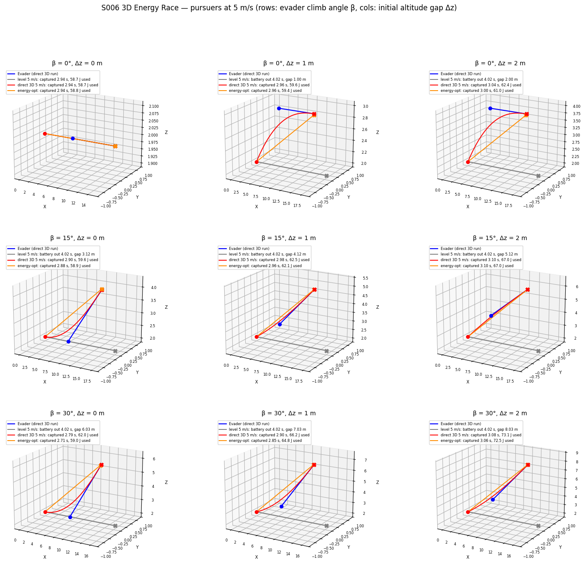
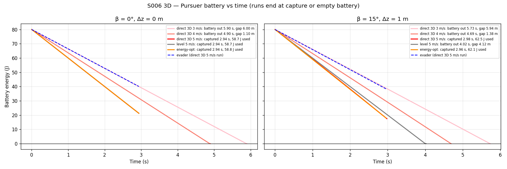
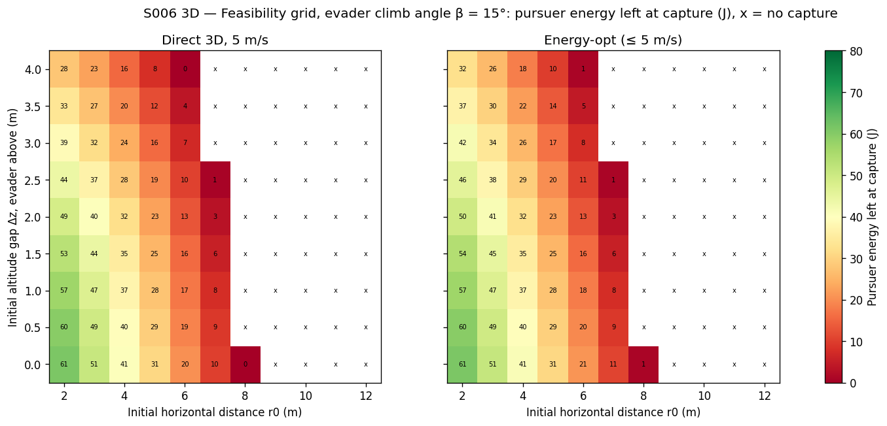
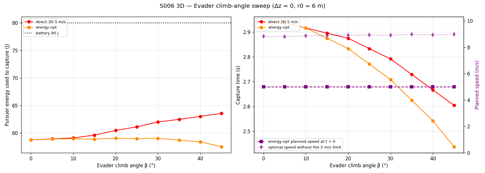
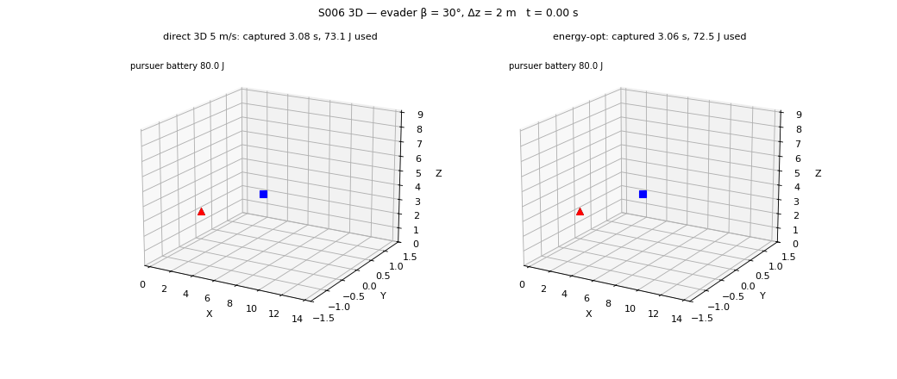

# S006 3D Upgrade — Energy Race

**Domain**: Pursuit & Evasion | **Difficulty**: ⭐⭐⭐ | **Status**: ✅ Completed

---

## Problem Definition

**Setup**: pursuer and evader each carry an 80 J battery. Power depends on the horizontal speed and on the **climb rate only** (descent is free). The evader starts 6 m ahead and Δz = 0, 1 or 2 m higher, and flies straight at 3 m/s with climb angle β = 0°, 15° or 30°. The pursuer must capture it before its own battery runs out.

**Roles**:
- **Evader**: constant velocity $3(\cos\beta, 0, \sin\beta)$ m/s. If its battery empties it stops (holds position).
- **Pursuer**: three strategies.

| Strategy | Logic |
|----------|-------|
| `level` (2D baseline) | Pure pursuit in the horizontal plane, altitude held at 2 m; 3, 4 or 5 m/s |
| `direct_3d` | Pure pursuit in 3D; 3, 4 or 5 m/s |
| `energy_opt` | Re-planned every step: the constant-velocity intercept of the evader's current straight-line motion that minimises the energy $P(\mathbf{v})\,T$, with $\|\mathbf{v}\| \le 5$ m/s |

**Objective**: find out when 3D routing and an energy-aware intercept matter, and whether the evader's "altitude drain" (climbing) helps it.

---

## Mathematical Model

### Power (only the vertical component of the velocity counts as climb)

$$P(\mathbf{v}) = P_{hover} + k_h (v_x^2 + v_y^2) + k_v \max(0, v_z)^2, \qquad E(t) = E_0 - \int_0^t P\,d\tau$$

### Energy-optimal intercept

With relative position $\mathbf{D} = \mathbf{p}_E - \mathbf{p}_P$ and evader velocity $\mathbf{v}_E$, flying at constant velocity $\mathbf{v} = \mathbf{D}/T + \mathbf{v}_E$ meets the evader after $T$. The pursuer picks

$$T^* = \arg\min_{T_{min} \le T \le E_{left}/P_{hover}} \; P\!\left(\frac{\mathbf{D}}{T} + \mathbf{v}_E\right) T, \qquad T_{min}: \left\|\frac{\mathbf{D}}{T_{min}} + \mathbf{v}_E\right\| = v_{max}$$

(400 log-spaced candidates). For a fixed $T$, constant velocity is optimal because $P$ is convex in $\mathbf{v}$. Unconstrained at $\beta = 0$: $E(T) = 13.6\,T + 14.4/T + 14.4$, minimised at $T = 1.03$ s, i.e. $v = 6/1.03 + 3 = 8.8$ m/s. Hover power dominates, so the optimum is to finish fast.

### Battery life at constant speed

$$T_{max}(v) = \frac{E_0}{P_{hover} + k_h v^2}: \quad 5\text{ m/s} \to 80/20 = 4.00 \text{ s}, \quad 4 \to 4.88 \text{ s}, \quad 3 \to 5.88 \text{ s}$$

---

## Key Parameters

| Parameter | Value |
|-----------|-------|
| Hover power $P_{hover}$ | 10 W |
| Horizontal coefficient $k_h$ | 0.4 W·s²/m² |
| Climb coefficient $k_v$ | 1.2 W·s²/m² |
| Battery capacity (both) | 80 J |
| Pursuer speed options (level, direct 3D) | 3.0, 4.0, 5.0 m/s |
| Energy-opt speed limit | 5.0 m/s |
| Evader speed | 3.0 m/s |
| Evader climb angle β | 0°, 15°, 30° (sweep 0–45° in 5° steps) |
| Pursuer start | (0, 0, 2) m |
| Initial horizontal distance | 6 m (feasibility grid 2–12 m) |
| Initial altitude difference Δz (evader above) | 0, 1, 2 m (feasibility grid 0–4 m) |
| Capture radius | 0.15 m |
| Control frequency | 48 Hz |
| Max simulation time | 30 s |

---

## Implementation

```
src/01_pursuit_evasion/3d/s006_3d_energy_race.py    # Main simulation script
```

```bash
conda activate drones
python src/01_pursuit_evasion/3d/s006_3d_energy_race.py
```

---

## Results

Power check printed by the script: level flight at 5 / 4 / 3 m/s draws 20.0 / 16.4 / 13.6 W; the evader draws 13.60 / 14.08 / 15.40 W at β = 0 / 15 / 30°.

### Main grid (r0 = 6 m)

| β | Δz | direct 3D 3 m/s | direct 3D 4 m/s | direct 3D 5 m/s | level 5 m/s | energy-opt |
|---|----|-----------------|-----------------|-----------------|-------------|------------|
| 0° | 0 m | battery out 5.90 s | battery out 4.90 s (gap 1.10 m) | 2.94 s, 58.7 J | 2.94 s, 58.7 J | 2.94 s, 58.8 J |
| 0° | 1 m | battery out 5.88 s | battery out 4.88 s (gap 1.17 m) | 2.96 s, 59.6 J | battery out (gap 1.00 m) | 2.96 s, 59.4 J |
| 0° | 2 m | battery out 5.83 s | battery out 4.81 s (gap 1.37 m) | 3.04 s, 62.4 J | battery out (gap 2.00 m) | **3.00 s, 61.0 J** |
| 15° | 0 m | battery out 5.79 s | battery out 4.75 s (gap 1.16 m) | 2.90 s, 59.6 J | battery out (gap 3.12 m) | 2.88 s, 58.9 J |
| 15° | 1 m | battery out 5.73 s | battery out 4.69 s (gap 1.38 m) | 2.98 s, 62.5 J | battery out (gap 4.12 m) | 2.96 s, 62.1 J |
| 15° | 2 m | battery out 5.67 s | battery out 4.60 s (gap 1.72 m) | 3.10 s, 67.0 J | battery out (gap 5.12 m) | 3.10 s, 67.0 J |
| 30° | 0 m | battery out 5.50 s | battery out 4.42 s (gap 1.24 m) | 2.79 s, 62.0 J | battery out (gap 6.03 m) | **2.71 s, 59.0 J** |
| 30° | 1 m | battery out 5.44 s | battery out 4.35 s (gap 1.56 m) | 2.90 s, 66.2 J | battery out (gap 7.03 m) | 2.85 s, 64.8 J |
| 30° | 2 m | battery out 5.35 s | battery out 4.25 s (gap 2.02 m) | 3.08 s, 73.1 J | battery out (gap 8.03 m) | 3.06 s, 72.5 J |

Level pursuit at 3 and 4 m/s runs out of battery in every case (5.90 s and 4.90 s). Energy-opt plans the full 5.00 m/s in every case; its saving over direct 3D at 5 m/s ranges from 0.00 J (β = 0°, Δz = 0, where both fly the same straight line) to 2.95 J (β = 30°, Δz = 0).

### Feasibility grid (β = 15°, r0 = 2–12 m, Δz = 0–4 m)

Both direct 3D at 5 m/s and energy-opt capture in 52 of 99 cells: up to r0 = 8 m at Δz = 0 and up to 6 m at Δz = 4 m. Energy-opt leaves 0.87 J more on average (0.00 to 4.40 J) and captures no cell that direct 3D misses.

### Climb-angle sweep (Δz = 0, r0 = 6 m)

| β | 0° | 10° | 20° | 30° | 40° | 45° |
|---|----|-----|-----|-----|-----|-----|
| direct 3D 5 m/s: time / energy | 2.94 s / 58.7 J | 2.92 s / 59.1 J | 2.88 s / 60.5 J | 2.79 s / 62.0 J | 2.67 s / 63.0 J | 2.60 s / 63.6 J |
| energy-opt: time / energy | 2.94 s / 58.8 J | 2.92 s / 59.0 J | 2.83 s / 59.1 J | 2.71 s / 59.0 J | 2.54 s / 58.4 J | 2.44 s / 57.5 J |
| energy-opt speed without the 5 m/s limit | 8.81 m/s | 8.85 m/s | 8.91 m/s | 8.91 m/s | 8.93 m/s | 8.97 m/s |

**Key findings**:
1. **The climb cost is now counted correctly, and the energy-optimal pursuer is never worse than direct pursuit.** The old version charged a climb as if the whole 5 m/s were vertical, so at β = 15° it gave up and ran out of battery, while direct 3D captured. Now energy-opt captures in every case where direct 3D at 5 m/s does, at the same time or sooner and with 0.00–2.95 J less.
2. **Speed choice dominates, not routing.** At these parameters the 10 W hover power is half the 20 W drawn at 5 m/s, so the cheapest capture is the fastest one: the unconstrained optimum is about 8.8–9.0 m/s, so energy-opt always sits at the 5 m/s limit. As in 2D, 3 m/s never closes the gap and 4 m/s runs out of battery 1.1–2.0 m short.
3. **The gain from 3D routing is the intercept geometry.** Energy-opt flies a straight lead line to the meeting point, while pure pursuit curves up behind a climbing evader. The gap grows with the climb angle: 2.95 J and 0.08 s at β = 30°, 6.1 J and 0.16 s at β = 45° (63.6 vs 57.5 J). Holding altitude (level) fails whenever the evader is not at 2 m.
4. **The evader's "altitude drain" does not work.** Climbing costs the evader more (15.40 W at β = 30° vs 13.60 W level) and takes speed out of its horizontal escape, so capture comes *sooner* (2.94 s at β = 0 → 2.71 s at β = 30° against energy-opt). It raises the energy a pure-pursuit pursuer spends (58.7 → 62.0 J), but an energy-aware pursuer spends no more (58.8 → 59.0 J). A starting altitude gap hurts the pursuer more: Δz = 2 m adds 3.7–11.1 J for direct 3D.

**3D trajectories** at 5 m/s (rows: β, columns: Δz; level gray, direct 3D red, energy-opt orange, evader blue):



**Pursuer battery vs time** for β = 0°, Δz = 0 and β = 15°, Δz = 1 m:



**Feasibility grid** — energy left at capture, x = no capture:



**Climb-angle sweep** — energy used and capture time; energy-opt's planned speed stays at the 5 m/s limit:



**Animation** — direct 3D vs energy-opt against the evader at β = 30°, Δz = 2 m:



### Deviations from the scenario card

| Card | This implementation | Reason |
|------|--------------------|--------|
| "Energy-optimal pursuit: solve for the speed/altitude profile that minimises energy while guaranteeing capture" | Minimum-energy constant-velocity intercept, re-planned every step, speed ≤ 5 m/s | Constant velocity is optimal for a given intercept time under a convex power model; re-planning handles the evader's battery running out |
| Card's feasibility condition uses $v_P - v_E\cos\theta$ and a separate climb phase | Feasibility found by simulating each grid cell | The closed form ignores the geometry of pure pursuit and the climb-while-closing path |
| Feasibility grid axes "$(r_0, \Delta z_0)$" | Horizontal r0 2–12 m, Δz 0–4 m at β = 15°, for direct 3D and energy-opt | The card gives no ranges |
| Expected output "optimal climb-angle curve: pursuer speed that minimises energy vs evader climb angle" | Climb-angle sweep 0–45° with energy-opt's planned speed and the unconstrained optimum | The answer is that the 5 m/s limit is always active |
| Card does not say what an empty-battery evader does | It stops (holds position) | Same rule as 2D S006 |
| Pursuer start not given | (0, 0, 2) m, evader 6 m ahead, as in 2D S006 | Matches the card's 6 m initial distance |

---

## Extensions

1. Wind layers (card Extension 1): altitude bands with different headwinds make the vertical routing choice matter.
2. Regenerative descent (card Extension 2): an evader that dives would then be cheaper to chase.
3. Lower hover power (e.g. fixed-wing-like $P_{hover}$ = 2 W), where the energy optimum falls below the speed limit and slower, longer chases pay.
4. Relay pursuit with power-aware handoff (S012).

---

## Related Scenarios

- Original 2D version: [S006 Energy Race](../../../../scenarios/01_pursuit_evasion/S006_energy_race.md)
- 3D card: [S006 3D Upgrade — Energy Race](../../../../scenarios/01_pursuit_evasion/3d/S006_3d_energy_race.md)
- Prerequisite: [S005 Stealth Approach](../../../../scenarios/01_pursuit_evasion/S005_stealth_approach.md)
- Follow-up: [S012 Relay Pursuit](../../../../scenarios/01_pursuit_evasion/S012_relay_pursuit.md)
