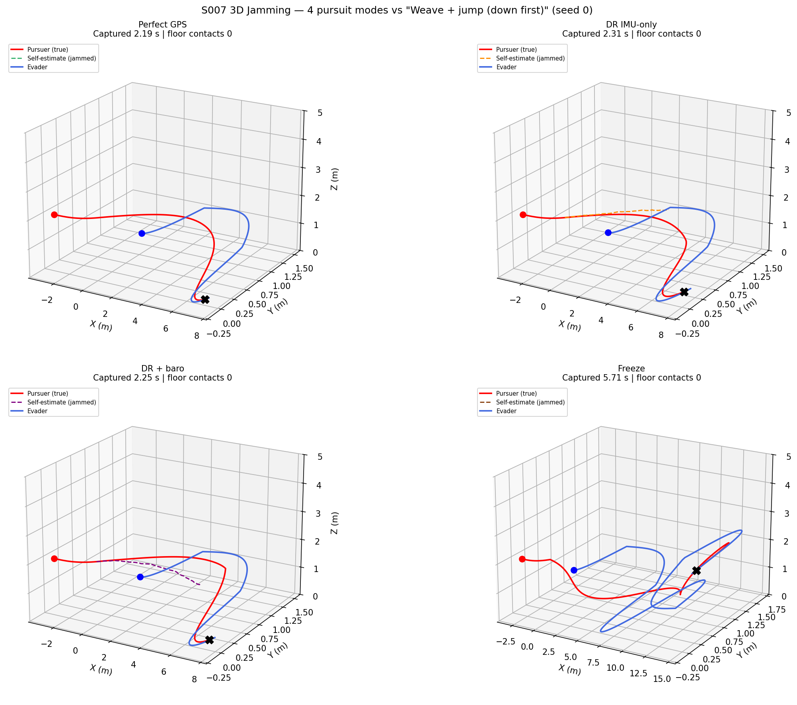
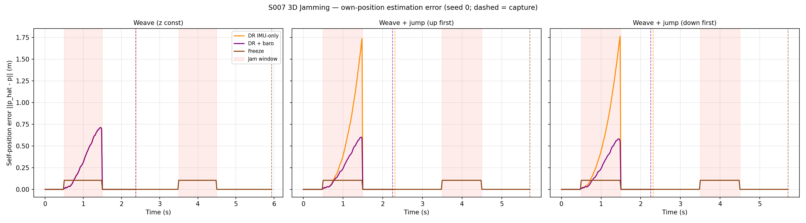
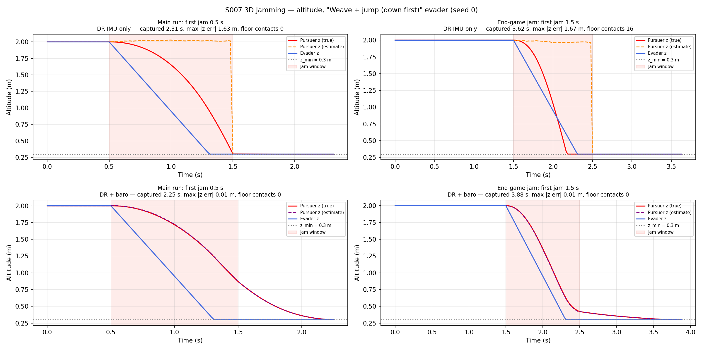
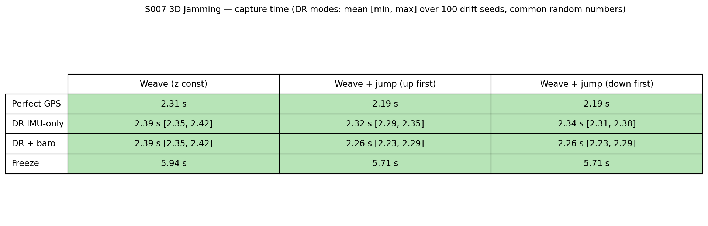
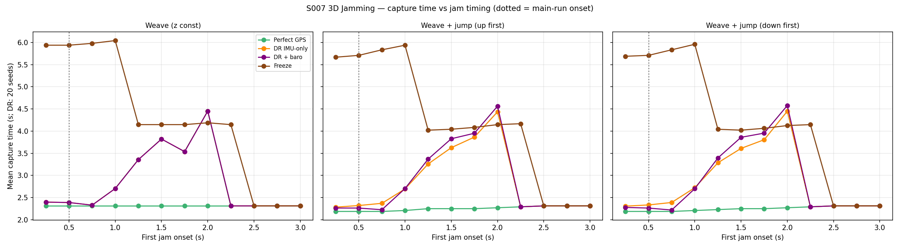
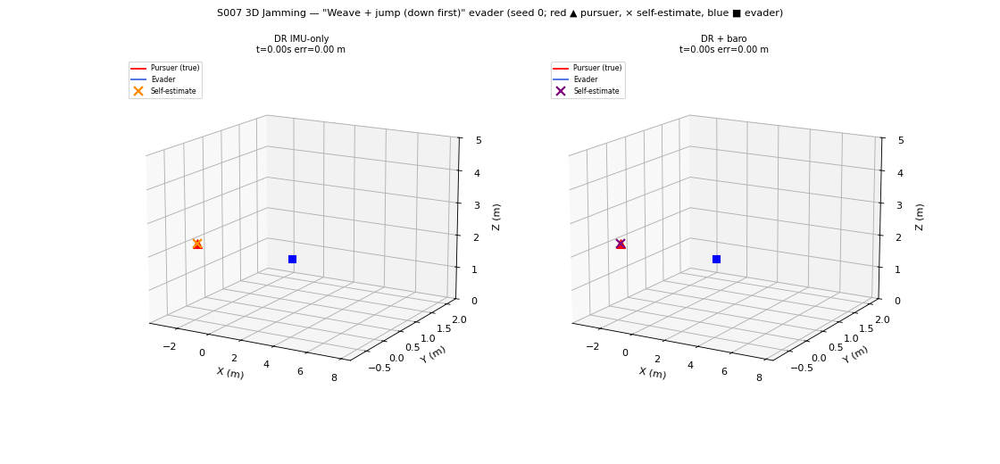

# S007 3D — Jamming & Blind Pursuit

**Domain**: Pursuit & Evasion | **Difficulty**: ⭐⭐⭐⭐ | **Status**: ✅ Completed
**Scenario card**: [S007 3D Upgrade — Jamming & Blind Pursuit](../../../../scenarios/01_pursuit_evasion/3d/S007_3d_jamming_blind_pursuit.md)

---

## Problem Definition

**Setup**: The pursuer's GPS is periodically jammed (1 s jam every 3 s, 33% duty cycle; first jam at t = 0.5 s). During a blackout it must estimate its **own 3D position** without GPS. It always knows the evader's true position (onboard tracker), so the only error source is its self-position estimate. The evader escapes at 3 m/s and **weaves** horizontally (heading = 60°·sin(2πt / 2 s) around +x), as in the fixed 2D S007. With the altitude-jump tactics it also climbs or dives 2 m at the start of every jam window. That forces the pursuer to change its vertical velocity while it is blind.

**Pursuit modes** (same pure-pursuit law, speed and evader; only the jam handling differs):

| Mode | GPS blackout behaviour |
|------|------------------------|
| **Perfect GPS** | No jamming |
| **DR IMU-only** | x, y, z all dead-reckoned with the last GPS velocity; drift σ = (0.05, 0.05, 0.02) m/√s |
| **DR + baro** | x, y dead-reckoned as above; z measured by a barometer whose error is a random walk with σ = 0.005 m/√s |
| **Freeze** | Hover until GPS returns |

**Evader tactics**:

| Tactic | Motion |
|--------|--------|
| **Weave (z const)** | Horizontal weave at z = 2 m |
| **Weave + jump (up first)** | Weave; at each jam onset a new altitude target z ± 2 m (first +2 m, then alternating), flown at 2.1 m/s vertical (70% of its speed) with the rest horizontal |
| **Weave + jump (down first)** | Same, first jump −2 m; clipped at the 0.3 m floor, so the first dive is 1.7 m |

Pursuit law for all modes: $\mathbf{v}_{cmd} = v_P (\mathbf{p}_E - \hat{\mathbf{p}}_P)/\|\mathbf{p}_E - \hat{\mathbf{p}}_P\|$, so the pursuer aims from where it *thinks* it is.

---

## Mathematical Model

### Dead reckoning (jam window starting at $t_j$)

$$\hat{\mathbf{p}}_P(t) = \mathbf{p}_P(t_j) + \mathbf{v}_{last}\,(t - t_j) + \boldsymbol{\varepsilon}(t), \qquad \varepsilon_k(t) \sim \mathcal{N}\!\left(0,\; \sigma_k^2 (t - t_j)\right)$$

Implemented per step as $\hat{\mathbf{p}} \mathrel{+}= \mathbf{v}_{last}\Delta t + \mathcal{N}(0, \sigma_k^2 \Delta t)$ per axis, with $\sigma_{xy} = 0.05$ m/√s and $\sigma_z = 0.02$ m/√s (IMU-only).

### Barometer-aided altitude

$$\hat{z}_P(t) = z_P(t) + b(t), \qquad b(t) \sim \mathcal{N}\!\left(0,\; \sigma_{baro}^2 (t - t_j)\right), \quad \sigma_{baro} = 0.005 \text{ m/√s}$$

x and y are dead-reckoned as above.

### Self-position error

$$e(t) = \|\hat{\mathbf{p}}_P(t) - \mathbf{p}_P(t)\|, \qquad e_z(t) = \hat{z}_P(t) - z_P(t)$$

With IMU-only DR, $e_z$ grows by the pursuer's own unmodelled vertical displacement during the jam, $\int_{t_j}^{t} (v_{cmd,z} - v_{last,z})\,d\tau$, plus drift.

### Altitude safety rule (card)

If $\hat{z}_P < z_{min} = 0.3$ m while jammed, the pursuer climbs vertically at full speed until GPS returns. The true altitude is clipped to $[0.3, 8]$ m. Every step at which the commanded motion would take the pursuer below 0.3 m is logged as a **floor contact** (a crash in reality).

### Jam schedule

Jammed during $[t_0 + nT,\; t_0 + nT + T_{jam})$, $n \ge 0$, with $t_0 = 0.5$ s, $T = 3$ s and $T_{jam} = 1$ s.

---

## Key Parameters

| Parameter | Value |
|-----------|-------|
| Jam period / duration | 3.0 s / 1.0 s (33% duty cycle) |
| First jam onset $t_0$ | 0.5 s (sweep: 0.25–3.00 s in 0.25 s steps) |
| Horizontal IMU drift $\sigma_{xy}$ | 0.05 m/√s |
| Vertical IMU drift $\sigma_z$ (IMU-only) | 0.02 m/√s |
| Barometer altitude error $\sigma_{baro}$ | 0.005 m/√s |
| Pursuer speed | 5 m/s |
| Evader speed | 3 m/s |
| Evader weave | amplitude 60°, period 2 s |
| Evader altitude jump Δz | ±2 m per jam window, vertical rate 2.1 m/s (0.7 × 3 m/s) |
| Initial pursuer / evader position | (−3, 0, 2) m / (3, 0, 2) m |
| Altitude bounds | [0.3, 8] m (both drones) |
| Capture radius | 0.15 m |
| Time step / max time | 1/48 s / 30 s |
| Monte Carlo | 100 drift seeds (0–99) per DR mode and tactic. The per-step noise array of a seed is shared by both DR modes and all tactics (common random numbers). Sweep: 20 seeds per point |
| Plotted run | seed 0 |

---

## Implementation

```
src/base/drone_base.py                                        # point-mass drone
src/01_pursuit_evasion/3d/s007_3d_jamming_blind_pursuit.py    # main simulation
```

```bash
conda activate drones
python src/01_pursuit_evasion/3d/s007_3d_jamming_blind_pursuit.py
```

Runtime ≈ 20 s.

---

## Simulation Results

### Main run (first jam 0.5–1.5 s): capture time, 100 seeds

| Mode | Weave (z const) | Weave + jump (up first) | Weave + jump (down first) |
|------|-----|-----|-----|
| **Perfect GPS** | 2.312 s | 2.188 s | 2.188 s |
| **DR IMU-only** | 2.388 s [2.354, 2.417] | 2.321 s [2.292, 2.354] | 2.337 s [2.312, 2.375] |
| **DR + baro** | 2.388 s [2.354, 2.417] | 2.263 s [2.229, 2.292] | 2.264 s [2.229, 2.292] |
| **Freeze** | 5.938 s | 5.708 s | 5.708 s |

DR cells show the mean over seeds, with [min, max] in brackets. All runs capture.

| Mode | Metric | Weave | Jump up | Jump down |
|------|--------|-----|-----|-----|
| DR IMU-only | max self-position error, mean over seeds | 0.759 m | 1.840 m | 1.805 m |
| DR IMU-only | max \|z error\|, mean over seeds | 0.033 m | 1.657 m | 1.635 m |
| DR IMU-only | runs with floor contact | 0/100 | 0/100 | **73/100** |
| DR + baro | max self-position error, mean over seeds | 0.758 m | 0.675 m | 0.650 m |
| DR + baro | max \|z error\|, mean over seeds | 0.006 m | 0.006 m | 0.006 m |
| DR + baro | runs with floor contact | 0/100 | 0/100 | 0/100 |
| Paired IMU-only − baro (same seed) | capture time | +0.000 s (equal in 100/100) | +0.058 s (IMU slower in 100/100) | +0.073 s (IMU slower in 100/100) |

The safety climb fired in **0** runs of any mode, tactic or sweep point.

### Jam-timing sweep (mean capture time, s; DR modes over 20 seeds)

| First jam onset | Jump up: IMU-only | Jump up: baro | Jump down: IMU-only | Jump down: baro | Weave: IMU-only = baro | Perfect GPS (jump) | Freeze (jump down) |
|---|---|---|---|---|---|---|---|
| 0.25 | 2.284 | 2.265 | 2.306 | 2.278 | 2.398 | 2.188 | 5.688 |
| 0.50 | 2.321 | 2.264 | 2.334 | 2.264 | 2.389 | 2.188 | 5.708 |
| 0.75 | 2.371 | 2.226 | 2.390 | 2.219 | 2.329 | 2.188 | 5.833 |
| 1.00 | 2.696 | 2.703 | 2.723 | 2.700 | 2.705 / 2.704 | 2.208 | 5.958 |
| 1.25 | 3.259 | 3.368 | 3.285 | 3.394 | 3.356 | 2.250 / 2.229 | 4.042 |
| 1.50 | 3.626 | 3.827 | 3.609 | 3.859 | 3.821 | 2.250 | 4.021 |
| 1.75 | 3.865 | 3.951 | 3.805 | 3.954 | 3.538 / 3.536 | 2.250 | 4.062 |
| 2.00 | 4.435 | 4.561 | 4.449 | 4.576 | 4.451 | 2.271 | 4.125 |
| 2.25 | 2.292 | 2.292 | 2.292 | 2.292 | 2.312 | 2.292 | 4.146 |
| 2.50–3.00 | 2.312 | 2.312 | 2.312 | 2.312 | 2.312 | 2.312 | 2.312 |

"a / b" means jump-up / jump-down for the perfect-GPS column and IMU-only / baro for the weave column. All sweep runs capture. Floor contacts in the sweep happen only for IMU-only DR against the down-first jump: 12/20 runs at onset 0.50 and 20/20 runs at every onset from 0.75 to 2.00. With the up-first jump they happen in 0 runs, because the first dive then comes in the second jam, after capture.

**End-game example** (first jam at 1.50 s, jump down, seed 0, printed by the script):

| Mode | Floor contacts | Estimated z at first contact | Range at jam onset → min in jam → when GPS returns (2.500 s) | Max horizontal estimation error | Capture |
|---|---|---|---|---|---|
| DR IMU-only | 16 steps, first at 2.188 s | 1.968 m (true 0.3 m) | 2.007 → 0.910 → 2.869 m | 3.818 m | 3.625 s |
| DR + baro | 0 | — (min estimated z 0.423 m) | 2.007 → 0.912 → 3.744 m | 4.577 m | 3.875 s |

### Key Findings

- **The barometer removes the vertical error, and that is what matters against an altitude jump.** When the evader jumps during the jam, the pursuer has to change its vertical velocity. IMU-only DR keeps propagating the pre-jam vertical velocity (≈ 0), so its z error grows to 1.64–1.66 m on average. That is the pursuer's own 1.7 m dive (2.0 → 0.3 m) or climb in the jam, not drift. The baro keeps |z error| at 0.006 m. Paired over the same 100 seeds, IMU-only is slower than baro in **100/100** runs: by 0.058 s (jump up) and 0.073 s (jump down).
- **Vertical drift alone does not matter here.** Against the constant-altitude weave the two DR modes capture at exactly the same time in all 100 seeds (2.388 s mean). The IMU z drift (σ_z = 0.02 m/√s) gives a mean max |z error| of only 0.033 m. Magnitude check: $0.02\sqrt{0.98} \approx 0.020$ m std after a 0.98 s jam. Horizontal last-velocity error from the weave (0.76 m) dominates, as in 2D.
- **Real 3D danger: IMU-only DR flies into the floor, and the card's safety rule cannot stop it.** Against the down-first jump the pursuer dives after the evader. Its IMU-only estimate stays near 2 m (1.968 m at the first floor contact in the example), so the commanded dive continues until the true altitude hits 0.3 m. That happens in 73/100 main runs and in 20/20 runs at every jam onset from 0.75 to 2.00 s. The card's safety climb checks the *estimated* z, which is exactly the wrong quantity, so it never fires (0 runs). With the baro the estimate is right, the pursuer never goes below the evader, and there are 0 floor contacts.
- **The altitude jump does not help the evader in absolute terms.** Every mode catches the jumping evader sooner than the plain weaver (perfect GPS 2.188 vs 2.312 s; baro 2.263 vs 2.388 s; even IMU-only 2.321–2.337 vs 2.388 s). While it jumps, 70% of its speed goes into the climb, so it runs away horizontally at only 2.1 m/s. The jump only shifts the ranking between the DR modes.
- **When the jam covers the end-game, the horizontal error dominates and the baro does not help.** For first-jam onsets of 1.25–2.00 s both DR modes need 3.26–4.58 s instead of ≈ 2.25 s, as in 2D. Here baro is even 0.09–0.25 s *slower* than IMU-only. The example shows why: both pursuers overshoot the evader while their horizontal estimates keep running at the pre-jam velocity (max errors 3.82 and 4.58 m). The IMU-only pursuer is stopped by the floor, so it overshoots less (range 2.869 vs 3.744 m when GPS returns). Its "advantage" is a crash, not better estimation.
- **Freeze is slowest whenever a jam happens before capture:** 5.708–5.938 s in the main run, about 2.6× the baseline. As in 2D, its estimate lags the truth by one step (5 m/s × 1/48 s = 0.104 m) because the drone flies one more step after the last fix.

### Figures

**3D Trajectories** (seed 0, down-first jump): red = pursuer true path, dashed = its own-position estimate while jammed, blue = evader. The IMU-only estimate (orange) stays at 2 m while the pursuer dives:



**Self-position error vs time** (seed 0; salmon = jam windows, dashed = capture). Against the weave the IMU-only line lies under the baro line:



**Altitude** (seed 0, down-first jump): left = main run, right = end-game jam at 1.5 s. Top = IMU-only, whose z estimate stays near 2 m while the pursuer reaches the 0.3 m floor (16 floor-contact steps on the right). Bottom = baro, whose estimate tracks the true z:



**Capture-time table** (DR modes: mean [min, max] over 100 seeds):



**Capture time vs jam timing** (20 seeds per point):



**Animation** (seed 0, down-first jump, IMU-only left vs baro right; red ▲ = pursuer, × = its self-estimate, blue ■ = evader; every 3rd step, 38 frames):



### Deviations from the scenario card

| Card | This implementation | Reason |
|------|--------------------|--------|
| Evader: "straight horizontal escape (same as S007)" | Horizontal weave, 60°·sin(2πt/2 s) | Same fix as 2D S007. With a straight evader from a collinear start the pursuit direction never changes, so a wrong self-estimate never changes the heading and the modes cannot be told apart |
| Jam schedule from t = 0 | First jam at 0.5 s, then every 3 s; onset sweep 0.25–3.00 s | At t = 0 the drone has not moved, so $\mathbf{v}_{last} = 0$. The old code was jammed from the first step with zero velocity (2D bug) |
| $\hat{\mathbf{p}}_P$ is the pursuer's own position, dead-reckoned from $\mathbf{p}_P(t_j)$ | Implemented as the card says; the evader's true position is always known | The old code dead-reckoned an *evader*-position estimate but started it from the pursuer's own position, so the error jumped to 5–6 m at every jam onset |
| Drift σ in m/s | σ in m/√s; per-step std σ√Δt | The card's model $\varepsilon_k \sim \mathcal{N}(0, \sigma_k^2 (t-t_j))$ is a random walk; that needs σ in m/√s |
| Baro-aided: "z corrected by an independent altimeter" | $\hat{z} = z + b$, with $b$ a random walk of σ = 0.005 m/√s; x, y dead-reckoned | The barometer measures altitude, so z is not propagated with $v_{last}$ |
| Jump: $z_E(t_j^+) = z_E(t_j) + \Delta z$ (instantaneous) | Flown at 2.1 m/s within the 3 m/s speed limit (2 m in 0.95 s); down-first jump clipped at 0.3 m (1.7 m) | An instantaneous 2 m jump would break the evader's speed limit |
| Two tactics: straight, altitude jump (sign unspecified) | Three: weave, jump up first, jump down first | The down-first jump is the one that tests the floor and the safety rule |
| Error on GPS restore ≈ $\sqrt{e_{xy}^2 + \Delta z_{jump}^2}$ | Measured z error ≈ the pursuer's own unmodelled vertical displacement (1.64–1.66 m mean) | The card formula assumes the pursuer loses the evader's altitude. Here it loses its own, and it moves by about as much as the evader does |
| Safety rule: climb if $\hat z < z_{min}$ | Implemented as the card says. It never fires, so floor contacts of the *true* altitude are logged separately; the true z is clipped at 0.3 m and the run continues | Reported as a finding: a rule on the estimate cannot catch an estimate error |
| 4 × 2 capture table from single runs | 4 × 3 table, 100 drift seeds with common random numbers, plus a 12-point onset sweep | The drift is random; the jam timing decides whether estimation matters |
| Trajectory plot "highlights jam windows as shaded bands" | The 3D plot draws the self-estimate dashed while jammed; jam bands are shaded in the time plots | Shaded bands cannot be drawn along a 3D path |
| Not specified | Capture radius 0.15 m, max time 30 s, dt = 1/48 s | Same as 2D S007 |

---

## Extensions

1. Kalman filter with IMU + barometer fusion and commanded-velocity propagation, which removes the last-velocity model error that dominates in the end-game
2. Adversarial jammer: activate only within 1.5 m of capture (the sweep shows the end-game jam is the damaging case)
3. Safety rule on a conservative bound ($\hat z - 3\sigma_z$ minus the worst-case unmodelled descent) instead of the raw estimate
4. 3D terrain below: the floor becomes terrain-following during dead reckoning

---

## Related Scenarios

- Original 2D version: [S007 Jamming & Blind Pursuit](../../../../scenarios/01_pursuit_evasion/S007_jamming_blind_pursuit.md)
- Follow-up: [S008 3D Upgrade — Stochastic Pursuit (Kalman Filter Tracking)](../../../../scenarios/01_pursuit_evasion/3d/S008_3d_stochastic_pursuit.md)
- Altitude floor reference: [S003 Low-Altitude Tracking](../../../../scenarios/01_pursuit_evasion/S003_low_altitude_tracking.md)
