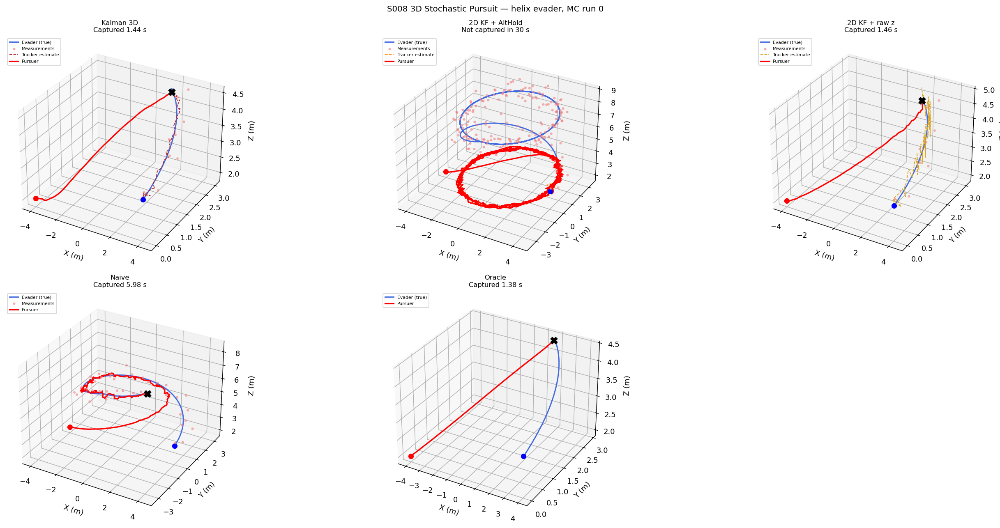
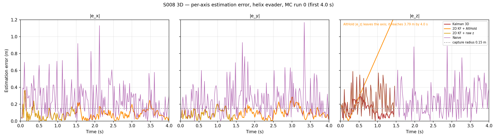
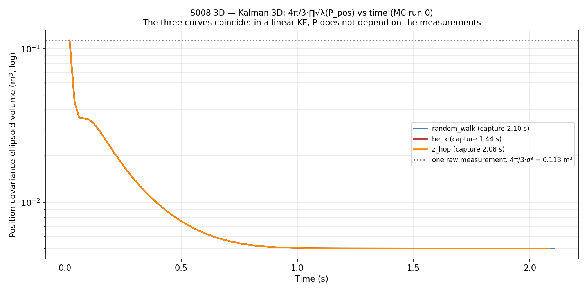
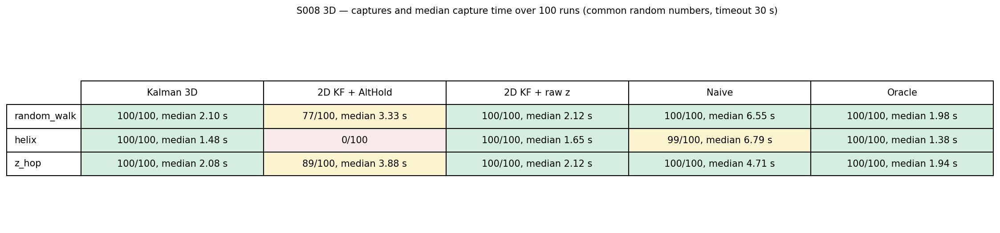
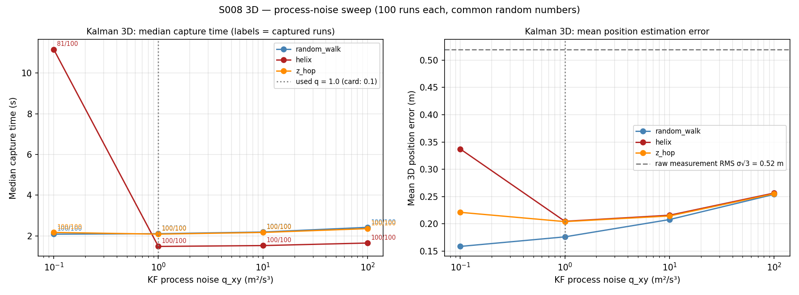
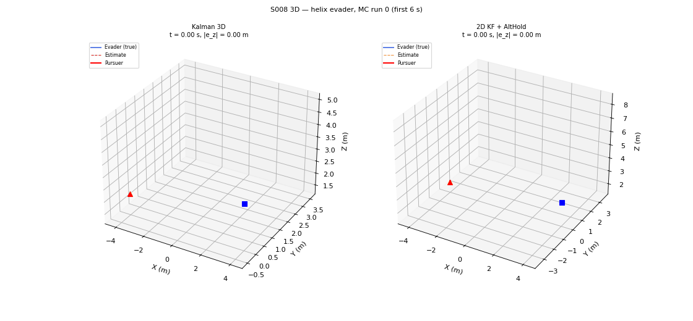

# S008 3D — Stochastic Pursuit (Kalman Filter Tracking)

**Domain**: Pursuit & Evasion | **Difficulty**: ⭐⭐⭐⭐ | **Status**: ✅ Completed
**Scenario card**: [S008 3D Upgrade — Stochastic Pursuit (Kalman Filter Tracking)](../../../../scenarios/01_pursuit_evasion/3d/S008_3d_stochastic_pursuit.md)

---

## Problem Definition

**Setup**: The evader moves in true 3D and starts 8 m from the pursuer, flying across the line of sight (+y). The pursuer (5 m/s) receives noisy 3D position measurements of the evader (σ = 0.3 m per axis) and steers with the card's lead law, using whatever position and velocity estimate its tracker provides.

**Tracker modes** (every mode sees the same evader trajectory **and** the same measurement-noise sequence in each run, i.e. common random numbers):

| Mode | Evader estimate | Guidance |
|------|-----------------|----------|
| **Kalman 3D** | 6-state KF on x, y, z (position and velocity) | Lead |
| **2D KF + AltHold** (card) | 4-state KF on x, y; z **held** at the altitude of the first measurement, $v_z = 0$ | Lead |
| **2D KF + raw z** | 4-state KF on x, y; z = raw measured z every step, $v_z = 0$ | Lead |
| **Naive** | Raw noisy measurement | Pure pursuit |
| **Oracle** | True position and velocity | Lead |

**Evader types**:

| Type | Motion |
|------|--------|
| **random_walk** | Starts at (0, 3, 0) m/s; random acceleration σ_a = 0.5 m/s² on all three axes; speed ≤ 3 m/s, $|v_z| \le 1$ m/s |
| **helix** | Radius 3 m, horizontal speed 2.83 m/s, climb 1.0 m/s (speed 3 m/s; centripetal acceleration $2.83^2/3 = 2.67$ m/s²) |
| **z_hop** | Near-constant horizontal velocity (0, 2.7, 0) m/s with σ_a = 0.5 m/s² noise; an altitude hop of ±0.75 m (1.5 m/s for 0.5 s, random sign) every 1 s from t = 0.5 s |

---

## Mathematical Model

### Process and measurement model

$$\mathbf{x}(k+1) = \mathbf{F}\mathbf{x}(k) + \mathbf{w}_k, \quad \mathbf{F} = \begin{bmatrix}\mathbf{I}_3 & \Delta t\,\mathbf{I}_3 \\ \mathbf{0} & \mathbf{I}_3\end{bmatrix}, \quad \mathbf{z}_k = [\mathbf{I}_3\;\mathbf{0}]\,\mathbf{x}(k) + \mathbf{n}_k,\ \mathbf{n}_k \sim \mathcal{N}(\mathbf{0}, \sigma^2\mathbf{I}_3)$$

Process noise (continuous white-noise acceleration, anisotropic):

$$\mathbf{Q} = q_{xy}\begin{bmatrix}\tfrac{\Delta t^3}{3}\mathbf{D} & \tfrac{\Delta t^2}{2}\mathbf{D} \\ \tfrac{\Delta t^2}{2}\mathbf{D} & \Delta t\,\mathbf{D}\end{bmatrix}, \qquad \mathbf{D} = \mathrm{diag}(1,\,1,\,q_z/q_{xy})$$

### Filter start

The first measurement is used as the position, with zero velocity and $\mathbf{P}_0 = \mathrm{diag}(\sigma^2\mathbf{I}_3,\; 36\,\mathbf{I}_3)$, as in the fixed 2D S008. Predict/update runs from the second measurement. The 2D KF uses the same start on x, y.

### Lead guidance (card)

$$\hat{\mathbf{p}}_{pred} = \hat{\mathbf{p}}_E + \hat{\mathbf{v}}_E T_{int}, \qquad T_{int} = \|\hat{\mathbf{p}}_{pred} - \mathbf{p}_P\| / v_P \quad (\text{two passes})$$

### Covariance ellipsoid volume

$$V_{ell}(t) = \tfrac{4\pi}{3}\prod_{k=1}^{3}\sqrt{\lambda_k(\mathbf{P}_{pos})}$$

---

## Key Parameters

| Parameter | Value |
|-----------|-------|
| KF process noise $q_{xy}$ | **1.0 m²/s³** (card 0.1; sweep 0.1 / 1 / 10 / 100) |
| $q_z / q_{xy}$ | 0.5 |
| Q form | CWNA blocks (Δt³/3, Δt²/2, Δt) ⊗ D |
| Measurement noise σ | 0.3 m per axis |
| KF start | first measurement, zero velocity, $\mathbf{P}_0 = \mathrm{diag}(0.09\,\mathbf{I}, 36\,\mathbf{I})$ |
| Evader acceleration std | 0.5 m/s² per axis (random_walk; x, y for z_hop) |
| Pursuer / evader speed | 5 m/s / 3 m/s |
| Initial pursuer / evader position | (−4, 0, 2) m / (4, 0, 3) m |
| Helix | R = 3 m, climb 1.0 m/s |
| z hops | ±0.75 m (1.5 m/s for 0.5 s) every 1 s from 0.5 s |
| Altitude bounds | [0.3, 8] m |
| Capture radius | 0.15 m |
| Control frequency / timeout | 48 Hz / 30 s |
| Monte Carlo | 100 runs; run i: evader seed 1000 + i, measurement seed i, the same for every mode |
| Plotted run | run 0 |

---

## Implementation

```
src/base/drone_base.py                                  # point-mass drone
src/01_pursuit_evasion/3d/s008_3d_stochastic_pursuit.py # KF, evaders, MC, plots
```

```bash
conda activate drones
python src/01_pursuit_evasion/3d/s008_3d_stochastic_pursuit.py
```

Runtime ≈ 80 s.

---

## Simulation Results

Evader check (run 0): within the first 2.5 s the helix climbs 3.00 → 5.48 m and the z_hop evader spans 3.00–4.50 m, so both change altitude **before** the typical capture time (≈ 2 s). The random walk stays at 3.00–3.04 m.

### Monte Carlo (100 runs, common random numbers)

| Evader | Kalman 3D | 2D KF + AltHold | 2D KF + raw z | Naive | Oracle |
|---|---|---|---|---|---|
| random_walk | 100/100, median **2.104 s** | 77/100, median 3.333 s (max 29.729) | 100/100, median 2.125 s | 100/100, median 6.552 s | 100/100, median 1.979 s |
| helix | 100/100, median **1.479 s** | **0/100** | 100/100, median 1.646 s | 99/100, median 6.792 s | 100/100, median 1.375 s |
| z_hop | 100/100, median **2.083 s** | 89/100, median 3.875 s | 100/100, median 2.125 s | 100/100, median 4.708 s | 100/100, median 1.938 s |

Mean absolute estimation error over each run, averaged over the 100 runs:

| Evader | Mode | mean \|e_z\| | mean horizontal error |
|---|---|---|---|
| random_walk | Kalman 3D / AltHold / raw z / Naive | 0.086 / 0.679 / 0.237 / 0.236 m | 0.141 / 0.130 / 0.140 / 0.373 m |
| helix | Kalman 3D / AltHold / raw z / Naive | 0.092 / 4.539 / 0.237 / 0.237 m | 0.169 / 0.156 / 0.169 / 0.374 m |
| z_hop | Kalman 3D / AltHold / raw z / Naive | 0.126 / 1.071 / 0.237 / 0.236 m | 0.141 / 0.131 / 0.141 / 0.373 m |

Paired over the same runs, Kalman 3D minus 2D KF + raw z:

| Evader | Mean difference | Kalman 3D faster / slower / equal |
|---|---|---|
| random_walk | −0.004 s | 51 / 32 / 17 |
| helix | **−0.256 s** | **85** / 6 / 9 |
| z_hop | −0.018 s | 62 / 29 / 9 |

### Process-noise choice (Kalman 3D, 100 runs each)

| $q_{xy}$ (m²/s³) | random_walk | helix | z_hop |
|---|---|---|---|
| 0.1 (card) | 100/100, median 2.083 s, error 0.159 m | **81/100**, median 11.167 s, error 0.337 m | 100/100, median 2.167 s, error 0.221 m |
| **1.0 (used)** | 100/100, median 2.104 s, error 0.176 m | 100/100, median 1.479 s, error 0.205 m | 100/100, median 2.083 s, error 0.204 m |
| 10 | 100/100, median 2.188 s, error 0.208 m | 100/100, median 1.521 s, error 0.216 m | 100/100, median 2.167 s, error 0.214 m |
| 100 | 100/100, median 2.417 s, error 0.254 m | 100/100, median 1.646 s, error 0.256 m | 100/100, median 2.354 s, error 0.255 m |

"error" = mean 3D position error. Previous version's diagonal per-step Q, $\mathbf{Q} = q\,\mathrm{diag}(1, 1, \tfrac12, 1, 1, \tfrac12)$ with $q = 1$ (same runs): random_walk median 2.438 s, helix 1.521 s (max 6.208 s), z_hop 2.333 s. Its mean horizontal error is 0.345 m in all three cases. The CWNA Q is faster in 93/100, 60/100 and 86/100 paired runs.

Kalman 3D covariance-ellipsoid volume: 0.1131 m³ at the first step (= 4π/3·0.3³, one measurement), 0.0075 m³ at 0.5 s and 0.0050 m³ at 1.0 s, after which it stays flat. It is the same for every evader.

### Key Findings

- **The z filter only pays off when the evader really moves vertically.** Against the helix, Kalman 3D beats 2D KF + raw z in 85/100 paired runs, by 0.256 s on average (median 1.479 vs 1.646 s). Its $v_z$ estimate lets the lead law aim above the climbing evader, and its z error is 0.092 m instead of 0.237 m. For the random walk (z changes by < 0.05 m before capture) the two are practically equal: −0.004 s, faster in 51 and slower in 32 runs. For the z_hop evader the gain is small (−0.018 s, 62 vs 29 runs). Each hop lasts only 0.5 s, so the CV filter's $v_z$ estimate is always catching up.
- **Raw z is already good enough to capture; a held z is not.** 2D KF + raw z captures in 300/300 runs. Its z error is just the measurement noise, mean $\sigma\sqrt{2/\pi} = 0.3 \times 0.798 = 0.239$ m, as measured (0.237 m). The card's 2D KF + AltHold freezes z at the first measured altitude. It never catches the climbing helix (0/100; mean z error 4.539 m). Against the random walk and the z_hop evader it captures only when the evader's altitude happens to pass within 0.15 m of the held value: 77/100 and 89/100, with long tails up to 29.7 s. The previous version wrote the raw measured z into the AltHold estimate every step, so its "AltHold" was really "raw z".
- **The card's q = 0.1 m²/s³ cannot follow the helix.** The helix has a constant 2.67 m/s² centripetal acceleration. With q = 0.1 the constant-velocity filter lags the turn (mean error 0.337 m), and the pursuer misses the 0.15 m capture sphere for a long time: 81/100 captures, median 11.2 s. q = 1 fixes this (100/100, 1.479 s) and costs at most 0.021 s of median capture time on the other evaders (random walk 2.104 vs 2.083 s). Larger q lets more measurement noise through, and capture slows steadily up to q = 100.
- **Diagonal vs off-diagonal Q.** The card writes Q with off-diagonal position–velocity blocks. The previous code used a diagonal per-step Q, which adds 0.1–1 m² of position variance *every step*, more than the measurement variance (0.09 m²). That filter barely smooths: its mean horizontal error is 0.345 m, close to the raw measurement's $\sigma\sqrt{\pi/2} = 0.376$ m. The CWNA form used here keeps the card's block structure, with the standard coefficients Δt³/3, Δt²/2 and Δt.
- **Filtering matters far more than the dimension.** Naive pure pursuit at raw measurements needs a median of 4.7–6.8 s and once times out (helix, 99/100). Its 0.37 m horizontal error is larger than the capture radius, so it zig-zags around the evader. All KF modes with usable z are within 0.19 s of the oracle's median (Kalman 3D within 0.15 s), except 2D + raw z on the helix (+0.271 s).
- **The covariance volume is not a tracking-quality measure here.** In a linear KF, P evolves independently of the measurements, so the three evaders give the same curve. It shrinks from one measurement's 0.113 m³ to a steady 0.0050 m³ within about 1 s and says nothing about manoeuvre lag (e.g. the q = 0.1 helix failure).

### Figures

**3D trajectories** (helix, run 0): Kalman 3D and 2D + raw z capture; AltHold circles below the climbing helix; naive zig-zags:



**Per-axis estimation error** (helix, run 0, first 4 s). The x, y errors are the same for the three KF modes; only z differs. The AltHold z error leaves the axis (3.79 m by 4 s):



**Covariance ellipsoid volume** (run 0; identical for all evaders):



**Capture table** (100 runs; green = all captured, yellow = some missed, red = none):



**Process-noise sweep** (Kalman 3D):



**Animation** (helix, run 0, first 6 s, every 3rd step, 98 frames): Kalman 3D (left) vs 2D KF + AltHold (right):



### Deviations from the scenario card

| Card | This implementation | Reason |
|------|--------------------|--------|
| $q_{xy} = 0.1$ m²/s³ | $q_{xy} = 1.0$; 0.1 shown in the sweep | With 0.1 the filter cannot follow the helix's 2.67 m/s² turn (81/100 captures, median 11.2 s) |
| $\mathbf{Q} = \begin{bmatrix} q\mathbf{D} & \tfrac{\Delta t}{2}q\mathbf{D} \\ \tfrac{\Delta t}{2}q\mathbf{D} & q\mathbf{D}\end{bmatrix}$ | CWNA $q\,[\Delta t^3/3, \Delta t^2/2; \Delta t^2/2, \Delta t] \otimes \mathbf{D}$ | The card's blocks are not a discretisation of anything with q in m²/s³ (position noise q per step). The CWNA form keeps the off-diagonal structure with consistent units. The previous diagonal per-step Q is reported as an ablation |
| Filter start not specified (previous code: the **true** evader position) | First measurement, zero velocity, $\mathbf{P}_0 = \mathrm{diag}(0.09\,\mathbf{I}, 36\,\mathbf{I})$ | Same fix as 2D S008: a tracker does not know the true position |
| 2D KF + AltHold "fixes z at last known altitude" | z held at the first measured altitude for the whole run; the old raw-z behaviour kept as "2D KF + raw z" | The old code overwrote the hold with the raw measurement every step, so no altitude was ever held |
| Helix (unspecified) | Starts at the evader start, crossing the line of sight; climb 1.0 m/s | The old helix started at (3, 0, 3), not at the stated evader start, and climbed only 0.3 m/s |
| z_hop "random z-hops" | ±0.75 m hops every 1 s from 0.5 s | The old first hop was at 3 s, after capture (≈ 2.3 s), and its vertical velocity decayed ×0.8 per step, giving a 0.16 m hop |
| Evader direction (old code: +x, away from the pursuer) | Initial velocity +y (crossing) | On a collinear tail chase lead and pure pursuit coincide (same fix as 2D) |
| Single run, per-mode noise seeds (`7 + index`) | 100 runs, common random numbers | Single-run times varied from 1.38 to 29.15 s (naive, helix) |
| Expected: 4 modes | 5 modes (+ 2D KF + raw z) | Separates "no z filter" from "no z information" |
| "Tracking quality degrades as $V_{ell}$ grows" | $V_{ell}$ shown, but it is data-independent | Linear KF property; manoeuvre lag does not show in P |
| Not specified | Capture radius 0.15 m, timeout 30 s, altitude [0.3, 8] m, evader speed ≤ 3 m/s | — |

---

## Extensions

1. Coordinated-turn (EKF / IMM) model for the helix: removes the lag that forced q = 1
2. Particle filter for multi-modal z uncertainty (e.g. the hop direction)
3. Range-only radar + bearing-only optical fusion: does 3D triangulation converge faster than a single sensor?

---

## Related Scenarios

- Original 2D version: [S008 Stochastic Pursuit — Kalman Filter Tracking](../../../../scenarios/01_pursuit_evasion/S008_stochastic_pursuit.md)
- Previous 3D scenario: [S007 3D Upgrade — Jamming & Blind Pursuit](../../../../scenarios/01_pursuit_evasion/3d/S007_3d_jamming_blind_pursuit.md)
- Next 3D scenario: [S009 3D Upgrade — Differential Game (Lion & Man in 3D)](../../../../scenarios/01_pursuit_evasion/3d/S009_3d_differential_game.md)
