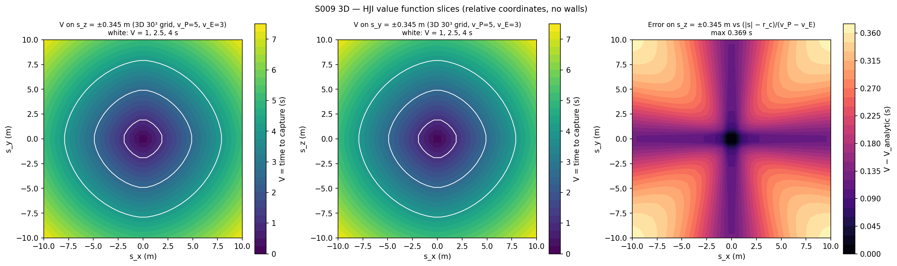
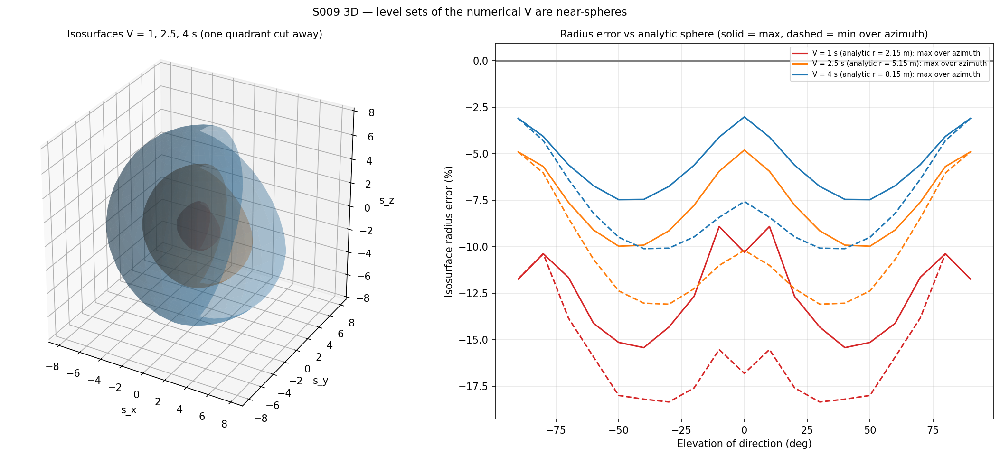
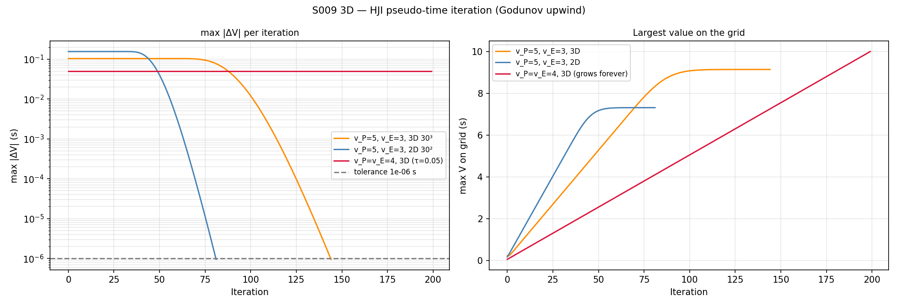
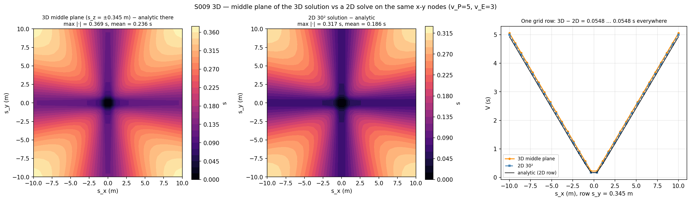
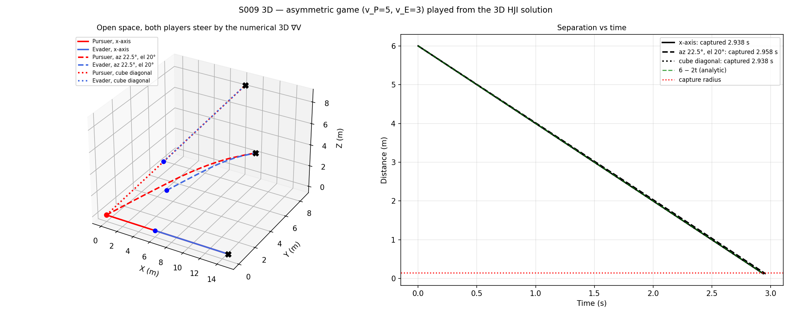
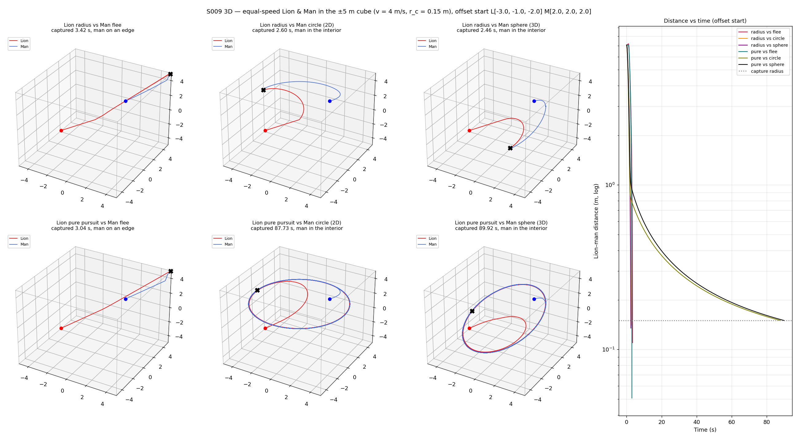
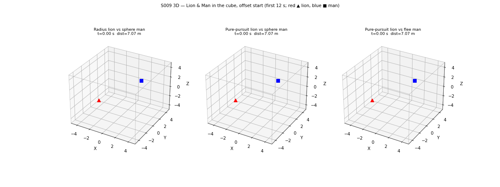

# S009 3D — Differential Game (Lion & Man in 3D)

**Domain**: Pursuit & Evasion | **Difficulty**: ⭐⭐⭐⭐⭐ | **Status**: ✅ Completed
**Scenario card**: [S009 3D Upgrade — Differential Game (Lion & Man in 3D)](../../../../scenarios/01_pursuit_evasion/3d/S009_3d_differential_game.md)

---

## Problem Definition

**Lion & Man in 3D**: the Lion (pursuer) minimises the capture time and the Man (evader) maximises it. There are two parts, as in the fixed 2D S009:

| Part | Setting | Method |
|------|---------|--------|
| **A. 3D HJI value function** | Relative coordinates $\mathbf{s} = \mathbf{p}_E - \mathbf{p}_P \in [-10, 10]^3$, no walls. Asymmetric speeds ($v_P = 5$, $v_E = 3$ m/s) and equal speeds (4 m/s). 30³ grid (card) | Corrected numerical HJI solver; the asymmetric game is then played with **both** players steering by the numerical 3D $\nabla V$ |
| **B. Lion & Man in the cube** | Equal speeds (4 m/s) in $[-5, 5]^3$ m, capture radius 0.15 m, walls enforced | 2 Lion strategies × 3 Man strategies × 2 starts |

---

## Mathematical Model

### HJI equation (minimum-time game)

$$\min_{\hat{u}_P \in \mathbb{S}^2}\max_{\hat{u}_E \in \mathbb{S}^2}\left[\nabla V \cdot (v_E\hat{u}_E - v_P\hat{u}_P)\right] + 1 = 0, \qquad V = 0 \text{ on } \|\mathbf{s}\| \le r_c$$

The saddle point is $\hat{u}_P^* = \hat{u}_E^* = \nabla V/\|\nabla V\|$, which gives

$$(v_P - v_E)\,\|\nabla V\| = 1 \quad\Rightarrow\quad V(\mathbf{s}) = \frac{\|\mathbf{s}\| - r_c}{v_P - v_E} \quad (v_P > v_E)$$

For $v_P = v_E$: $V = \infty$ outside the capture set.

### Numerical scheme (same as the fixed 2D S009)

$$V^{n+1} = V^n + \tau\left(1 - (v_P - v_E)\,\|\nabla V^n\|_{God}\right), \qquad V^0 = 0, \qquad \tau = 0.9\,\frac{\Delta s}{3(v_P - v_E)}$$

$\|\nabla V\|_{God}$ is the Godunov upwind gradient (per axis $\max(D^-V, -D^+V, 0)^2$). Nodes with $\|\mathbf{s}\| < r_c + \Delta s$ are fixed to the exact value (the capture sphere is sub-grid). Converged when $\max|\Delta V| < 10^{-6}$ s.

### Cube strategies (Part B)

| Player | Strategy | Rule |
|--------|----------|------|
| Lion | **Radius** | Move to the point of the segment centre→Man closest to the Man and reachable in $v\Delta t$; if out of reach, move toward the segment |
| Lion | **Pure pursuit** | Straight at the Man (open-space HJI control) |
| Man | **Flee** | Straight away from the Lion (open-space HJI control). At a wall the outward components are removed; if nothing is left, slide sideways ($\hat z \times d$, then $\hat x \times d$, $\hat y \times d$) |
| Man | **Circle (2D)** | Counter-clockwise on a horizontal 4.5 m circle about the vertical centre axis, radial gain 2 m⁻¹, z unchanged (the 2D S009 strategy) |
| Man | **Sphere (3D)** | Tangent to a 4.5 m sphere about the centre, in the tangent direction pointing most directly away from the Lion, radial gain 2 m⁻¹ |

---

## Key Parameters

| Parameter | Value |
|-----------|-------|
| Relative-state grid | 30³ over $[-10, 10]^3$ m, Δs = 0.6897 m (card) |
| 2D comparison grid | 30² on the same x-y nodes |
| Pseudo-time step τ | 0.1034 s (3D), 0.1552 s (2D); 0.05 s for the equal-speed run |
| Max iterations | 500 (card); equal-speed demonstration 200 |
| Convergence tolerance | 10⁻⁶ s |
| Speeds, Part A | $v_P = 5$, $v_E = 3$ m/s; equal case 4 / 4 m/s |
| Speeds, Part B | $v_P = v_E = 4$ m/s |
| Capture radius | 0.15 m |
| Open-space starts | evader 6 m from the pursuer along the x-axis; azimuth 22.5°, elevation 20°; the cube diagonal |
| Cube starts | planar: Lion (−3, 0, 0), Man (3, 0, 0) (= 2D S009); offset: Lion (−3, −1, −2), Man (2, 2, 2) |
| Man circle / sphere radius, gain | 4.5 m, 2 m⁻¹ |
| "Pinned" threshold | Man's actual speed < 1 m/s |
| Simulation step | 1/48 s |
| Max time | 20 s (open space), 150 s (cube) |
| Isosurface levels | V = 1, 2.5, 4 s |
| Animation | first 12 s, every 5th step, 117 frames |

---

## Implementation

```
src/01_pursuit_evasion/3d/s009_3d_differential_game.py   # 3D HJI solver + cube games
```

```bash
conda activate drones
python src/01_pursuit_evasion/3d/s009_3d_differential_game.py
```

Runtime ≈ 30 s. The script has no random elements.

---

## Simulation Results

### Part A — 3D HJI value function

| Case | Converged | Iterations | max \|V − V_analytic\| | mean | max V (analytic at grid corner) |
|------|-----------|------------|------|------|------|
| $v_P = 5$, $v_E = 3$, 3D 30³ | ✅ (final max\|ΔV\| = 9.52e-7 s) | 145 | 0.5561 s | 0.3583 s | 9.141 s (8.585 s) |
| $v_P = 5$, $v_E = 3$, 2D 30² | ✅ (9.49e-7 s) | 82 | 0.3165 s | 0.1863 s | 7.313 s (6.996 s) |
| $v_P = v_E = 4$, 3D 30³ | ❌ diverges by design | 200 shown | — | — | 10.00 s = 200 × τ, growing |

For equal speeds max|ΔV| = 0.0500 s at every one of the 200 iterations (min = max = τ).

**Middle plane vs 2D.** N = 30 is even, so there is no node at $s_z = 0$. The two middle planes $s_z = \pm 0.3448$ m hold identical values (checked: True).

| Comparison | max | mean |
|---|---|---|
| 3D middle plane − analytic at $s_z = 0.3448$ m | 0.3692 s | 0.2362 s |
| 2D 30² − analytic | 0.3165 s | 0.1863 s |
| 3D middle plane − 2D | 0.0548 s | 0.0548 s (constant: min = max) |

The 4 fixed capture-set nodes on the middle plane hold 0.2236 s in 3D vs 0.1688 s in 2D.

**Direction and isosurfaces.** The angle between the numerical 3D $\nabla V$ and $\mathbf{s}/\|\mathbf{s}\|$ ($\|\mathbf{s}\| > 1$ m) is 3.73° on average and 8.90° at most.

| Isosurface | Numerical radius | Analytic radius | Error |
|---|---|---|---|
| V = 1 s | 1.755–1.958 m | 2.150 m | −18.4% to −8.9% |
| V = 2.5 s | 4.476–4.903 m | 5.150 m | −13.1% to −4.8% |
| V = 4 s | 7.326–7.904 m | 8.150 m | −10.1% to −3.0% |

**Asymmetric game from the 3D ∇V** (both players), evader 6 m from the pursuer:

| Evader start | Captured | Evader's largest deviation from its straight escape line | Net heading error |
|---|---|---|---|
| x-axis (6, 0, 0) | **2.938 s** | 0.000 m | 0.00° |
| az 22.5°, el 20° (5.209, 2.158, 2.052) | **2.958 s** | 0.430 m | 0.25° |
| cube diagonal (3.464, 3.464, 3.464) | **2.938 s** | 0.000 m | 0.00° |

Analytic optimum $(6 - 0.15)/2 = 2.925$ s, i.e. 141 steps = 2.9375 s.

### Part B — Equal-speed Lion & Man in the ±5 m cube

| Start | Lion \ Man | Flee | Circle (2D) | Sphere (3D) |
|---|---|---|---|---|
| planar | **Radius** | 2.688 s (on a face) | 2.271 s (interior) | 2.271 s (interior) |
| planar | **Pure pursuit** | 2.542 s (on an edge, (5, 5, 0)) | 88.208 s (interior) | 89.729 s (interior) |
| offset | **Radius** | 3.417 s (on an edge, (4.92, 5, 5)) | 2.604 s (interior) | 2.458 s (interior) |
| offset | **Pure pursuit** | 3.042 s (on an edge, (4.92, 5, 5)) | 87.729 s (interior) | 89.917 s (interior) |

All 12 games end in capture. In **every** game the Man's actual speed over the last 0.5 s before capture is 4.00 m/s, and he is pinned (< 1 m/s) for 0.00 s: no capture happens because the Man is stuck against a wall. Both players stay inside the cube (max |coordinate| ≤ 5.000 m). Man altitude range: flee 2.00–5.00 m (offset); sphere −0.46–2.45 m (radius Lion, offset) and −2.60–2.60 m (pure pursuit, offset); circle constant z. On the planar start every Man stays at z = 0.

### Key Findings

- **The corrected 3D HJI scheme converges on the card's 30³ grid.** It needs 145 of the allowed 500 iterations; the old scheme ($V \leftarrow V - \Delta t\,H$ with $H = -1$) just added Δt every iteration. The front reaches the grid corner after about $8.585/0.1034 \approx 83$ iterations, the knee of the convergence curve. Equal speeds diverge exactly as they should: $V$ grows by τ = 0.05 s per iteration.
- **The 3D grid error is a first-order upwind error and is larger than in 2D.** The isosurfaces are near-spheres but 3–18% too small (V too large). The error is worst along diagonal directions (elevation ≈ ±45°) and for the smallest level, whose radius is only about 3 cells. With Δs = 0.69 m, the 0.15 m capture sphere is far below grid resolution.
- **The middle-plane check is meaningful, and it shows a constant offset.** On the middle planes the upwind z-derivative vanishes by symmetry ($V(+0.345) = V(-0.345)$). Those planes therefore satisfy exactly the 2D scheme, and 3D − 2D is the same 0.0548 s everywhere. The offset comes from the fixed capture-set nodes: in 3D they sit at $\|\mathbf{s}\| = 0.597$ m, giving (0.597 − 0.15)/2 = 0.2236 s, versus 0.488 m and 0.1688 s in 2D. The old README's "z = 0 slice matches 2D" proved nothing, because both arrays were $\|\mathbf{s}\| + 1.5$.
- **The 3D gradient drives a near-optimal game in every direction.** Capture takes 2.938 s along an axis and along the cube diagonal, where symmetry makes $\nabla V$ exact. From the generic start it takes 2.958 s, one step later, with a 0.430 m sideways bow (gradient direction off by up to 8.90°).
- **In the cube the Lion wins every game; the third dimension does not save the Man.** The radius strategy works in any dimension: it captures every Man in 2.271–3.417 s. Against pure pursuit the evasive Men last 87.7–89.9 s, as the circling Man did in 2D (88.208 s). The 3D sphere strategy is only 1.5–2.2 s better than the 2D circle (89.729 vs 88.208 s planar; 89.917 vs 87.729 s offset). Running "tangent, away from the Lion" settles onto a single great circle (z −2.60…2.60 m), i.e. a tilted version of the 2D circle.
- **The planar start reproduces 2D S009 exactly** (2.271, 88.208, 2.688, 2.542 s). This validates the 3D cube code: with z = 0 everywhere, the 3D wall slide and Lion rules reduce to the 2D ones.
- **Flee captures are wall-assisted, but not by a pinned Man.** Running straight away drives the fleeing Man into a wall. He then slides at full speed along it into an edge (the offset runs end at (4.92, 5, 5)) and is caught as he gets there. In the planar case the radius Lion catches him on the y = 5 face (2.688 s), and the pure-pursuit Lion at the (5, 5, 0) edge (2.542 s). In the old code the evader was clipped at the wall and stopped. Here the slide rule keeps him moving, so the wall wins by geometry, not by freezing him. "Corner trapping" (old README) does not occur: no Man is caught in a corner.

### Figures

**Value-function slices** (3D, $v_P = 5$, $v_E = 3$): middle planes $s_z = \pm 0.345$ m and $s_y = \pm 0.345$ m with level lines, and the error against the analytic value:



**Isosurfaces** V = 1, 2.5, 4 s (one quadrant cut away) and their radius error by direction:



**Convergence** — asymmetric 3D and 2D drop below 10⁻⁶ s; equal speeds stay at τ and V grows linearly:



**3D middle plane vs 2D** on the same nodes (right: one grid row, 3D − 2D = 0.0548 s everywhere):



**Asymmetric game from the 3D ∇V** (three starts, separation vs time with the analytic 6 − 2t):



**Lion & Man in the cube** (offset start, six strategy pairs, distance on a log scale):



**Animation** (offset start, first 12 s, every 5th step, 117 frames): radius Lion vs sphere Man, pure-pursuit Lion vs sphere Man, pure-pursuit Lion vs fleeing Man:



### Deviations from the scenario card

| Card (before this fix) | This implementation | Reason |
|------|--------------------|--------|
| $\partial_t V + H = 0$ with $H = (v_E - v_P)\|\nabla V\| - 1$, update $V \leftarrow V - \Delta t\,H$, central differences, start from $\|\mathbf{s}\|$ | Stationary HJI $(v_P - v_E)\|\nabla V\| = 1$, Godunov upwind pseudo-time iteration from $V = 0$ | The card's sign makes $V$ grow without bound for every speed pair. With equal speeds the old code added Δt every iteration and ended at $\|\mathbf{s}\| + 1.5$. **The card has been corrected**, as the 2D card was |
| Main case $v_P = v_E = 4$ in the HJI | HJI solved for $v_P = 5$, $v_E = 3$; equal speeds shown to diverge | Equal speeds have no finite value to plot or steer by |
| 25³ grid, 300 iterations (old code; card 30³, 500) | 30³, max 500 (converges in 145) | Aligned with the card |
| Δt = 0.005 | τ = 0.1034 s (CFL-limited) | With 0.005 the front would need ≈ 1700 iterations to reach the corner value 8.6 s, more than the 500 allowed |
| Grid spacing 0.33 m | 0.69 m | 0.33 m would need a ±5 m grid; relative positions in a ±5 m cube reach ±10 m |
| Isosurfaces at V = 5, 10, 20 s | V = 1, 2.5, 4 s | The finite value (v_P = 5, v_E = 3) reaches only 8.6 s on the grid; card corrected |
| "z = 0 slice should match 2D" | Middle planes $s_z = \pm 0.345$ m compared with a 2D 30² solve; constant 0.0548 s offset explained | N = 30 has no node at $s_z = 0$ |
| Bounded cube game through the gradient policy | Simulated strategy pairs in the cube (relative HJI ignores walls) | The bounded game has a 6-D state; a grid solve is far beyond the runtime budget. The old trajectories applied the open-space gradient and clipped the evader at the wall, where it stopped |
| "Pursuer drives the relative state toward a wall corner" | Not observed: no Man is caught in a corner | Removed from the card |
| — | Man "sphere" strategy and offset 3D start added | Tests whether the third dimension helps the Man |

---

## Extensions

1. Speed ratio close to 1 in the cube: minimum ratio for guaranteed capture against the sphere Man
2. Test the numerical $\nabla V$ against the exact direction with only one player using it (exposes the 8.9° gradient error, which the symmetric game hides)
3. Physics-informed neural network for $V$ to avoid the $O(N^3)$ grid cost and the first-order diagonal error

---

## Related Scenarios

- Original 2D version: [S009 Differential Game 1v1 (Differential Game — Lion & Man)](../../../../scenarios/01_pursuit_evasion/S009_differential_game.md)
- Previous 3D scenario: [S008 3D Upgrade — Stochastic Pursuit (Kalman Filter Tracking)](../../../../scenarios/01_pursuit_evasion/3d/S008_3d_stochastic_pursuit.md)
- Follow-up: [S010 3D Upgrade — Asymmetric Speed Bounded Arena Trapping](../../../../scenarios/01_pursuit_evasion/3d/S010_3d_asymmetric_speed.md)
