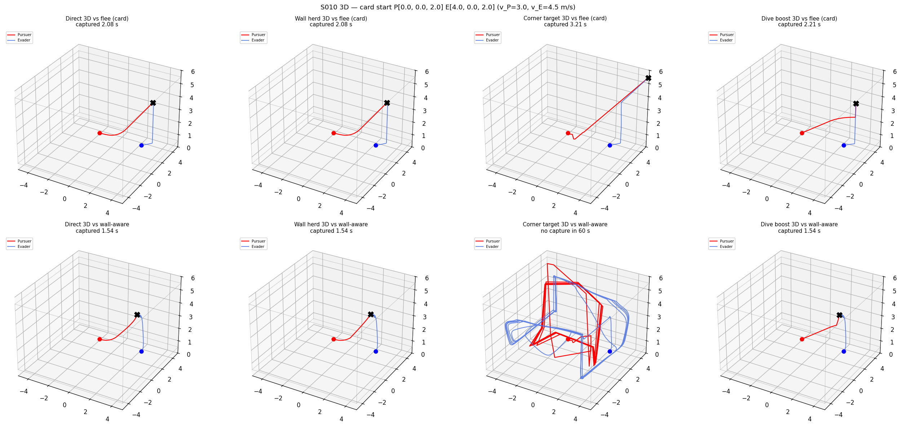
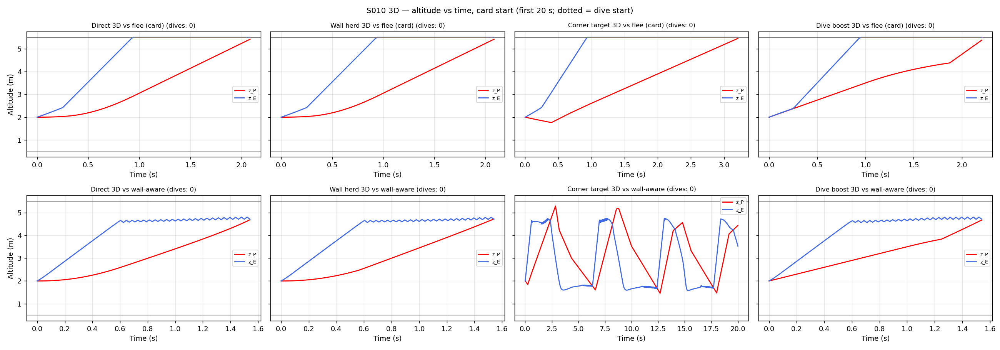
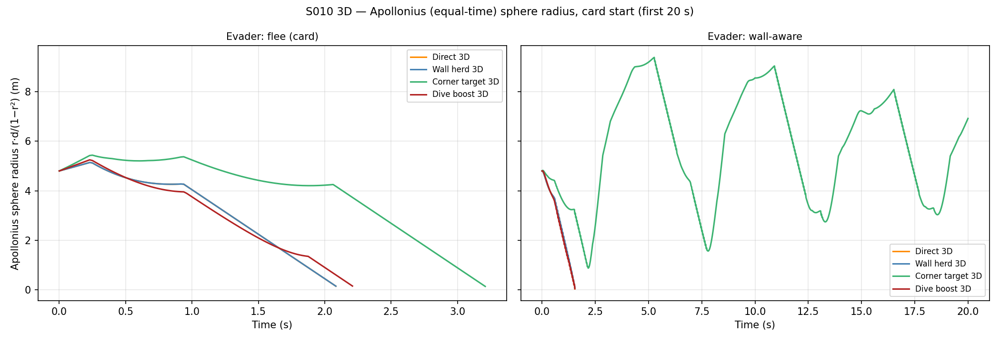
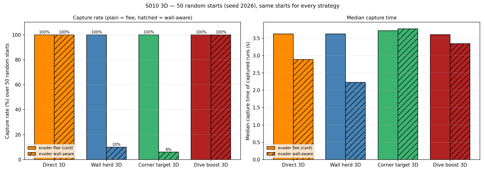
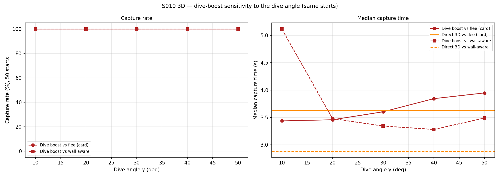
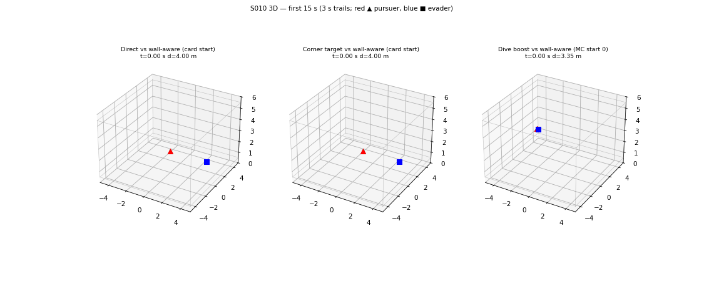

# S010 3D — Asymmetric Speed Bounded Arena Trapping

**Domain**: Pursuit & Evasion | **Difficulty**: ⭐⭐⭐⭐ | **Status**: ✅ Completed
**Scenario card**: [S010 3D Upgrade — Asymmetric Speed Bounded Arena Trapping](../../../../scenarios/01_pursuit_evasion/3d/S010_3d_asymmetric_speed.md)

---

## Problem Definition

**Setup**: The evader (4.5 m/s) is faster than the pursuer (3.0 m/s, speed ratio r = 0.667). The arena is a bounded volume, x, y ∈ [−5, 5] m and z ∈ [0.5, 5.5] m. In open space the pursuer can never catch the evader; the question is which pursuer strategy can use the faces, edges and corners of the box.

**Pursuer strategies**:

| Strategy | Rule |
|----------|------|
| **Direct 3D** | Pure pursuit in 3D |
| **Wall herd 3D** | $\alpha\,\hat{\mathbf{r}}_{PE} + (1-\alpha)\,\hat{\mathbf{r}}_{wall}$, where $\hat{\mathbf{r}}_{wall}$ points at the evader's projection onto its nearest face (on a tie, onto all tied faces); α = 0.5 |
| **Corner target 3D** | Fly at the arena corner nearest to the evader |
| **Dive boost 3D** | Close horizontally while climbing to 5.0 m. When more than 1 m above the evader (and above 2 m), dive at γ = 30° toward it at $\min(\sqrt{v_P^2 + 2g\eta\Delta z},\ 4.2)$ m/s; recover at the evader's altitude or the floor. Direct pursuit within 1 m |

**Evaders**:

| Evader | Rule |
|--------|------|
| **Flee (card)** | Away from the pursuer plus a vertical bias $\beta\,[0, 0, \mathrm{sign}(z_E - z_P)]$, β = 1.5 (+1 when level) |
| **Wall-aware** | Card flee direction plus repulsion $2\,(1.5 - \delta)/1.5$ from every face closer than δ < 1.5 m. If fully blocked, it turns sideways ($\hat z \times d$, then $\hat x \times d$, $\hat y \times d$), as the 2D wall-aware evader |

**Arena rule (every player, as in the fixed 2D S010)**: at a face the velocity component pointing out of the arena is removed and the rest is renormalised to the player's speed, so the player slides along the face. A command pointing straight into a face, edge or corner leaves nothing, and the player stops.

---

## Mathematical Model

### Apollonius (equal-time) sphere

$$R_{apo} = \frac{r\,d}{1 - r^2}, \qquad \mathbf{c}_{apo} = \mathbf{p}_E + \frac{\mathbf{p}_P - \mathbf{p}_E}{d}\cdot\frac{d}{1 - r^2}$$

The sphere contains the pursuer. Every point inside it is reached by the pursuer first; every point outside, by the evader first.

### Wall point (sign corrected)

$$\mathbf{p}_{wall} = \mathbf{p}_E + d_{f^*}\,\hat{\mathbf{n}}_{f^*}, \qquad d_f = \text{distance from the evader to face } f \text{ (real positions } x, y = \pm 5,\ z = 0.5, 5.5)$$

with $\hat{\mathbf{n}}_f$ the outward normal; on ties, $\mathbf{p}_E + \sum_{f \in F^*} d_f\hat{\mathbf{n}}_f$.

### Corners

$$\mathcal{C} = \{-5, 5\} \times \{-5, 5\} \times \{0.5, 5.5\}$$

### Dive boost

$$v_{dive} = \min\left(\sqrt{v_P^2 + 2 g \eta \Delta z},\; 4.2\right), \quad \Delta z = z_P - z_E, \quad \mathbf{v} = v_{dive}\,[\cos\phi\cos\gamma,\ \sin\phi\cos\gamma,\ -\sin\gamma]$$

With η = 0.3 the cap is reached for Δz ≥ 1.5 m. A dive starts only at Δz > 1 m, so the dive speed is 3.86–4.20 m/s, always below the evader's 4.5 m/s.

---

## Key Parameters

| Parameter | Value |
|-----------|-------|
| Arena | x, y ∈ [−5, 5] m, z ∈ [0.5, 5.5] m |
| Pursuer cruise speed / dive cap | 3.0 / 4.2 m/s |
| Evader speed | 4.5 m/s (r = 0.667) |
| Blend factor α | 0.5 |
| Vertical escape weight β | 1.5 |
| Dive angle γ | 30° (sweep 10°–50°) |
| Dive trigger | z_P − z_E > 1.0 m and z_P > 2.0 m |
| Dive-boost cruise altitude, climb gain, climb-rate limit | 5.0 m, 1.0 s⁻¹, 1.5 m/s |
| g, η | 9.81 m/s², 0.3 |
| Wall-aware evader | repulsion range 1.5 m, gain 2 |
| Card start | pursuer (0, 0, 2), evader (4, 0, 2) |
| Monte Carlo | 50 random starts (seed 2026), uniform 0.5 m inside the walls, separation ≥ 3 m; the same starts for every strategy and evader |
| Time step / max time | 1/48 s / 60 s |
| Capture radius | 0.15 m |
| Animation | first 15 s, every 6th step, 3 s trails |

---

## Implementation

```
src/01_pursuit_evasion/3d/s010_3d_asymmetric_speed.py
```

```bash
conda activate drones
python src/01_pursuit_evasion/3d/s010_3d_asymmetric_speed.py
```

Runtime ≈ 60 s. All random starts come from a fixed seed.

---

## Simulation Results

Checks printed by the script:

- Wall point: evader (4, 0, 2) → (5, 0, 2); evader (0, 0, 4.8) → (0, 0, 5.5), the real ceiling; tie at (4, 4, 4.5) → (5, 5, 5.5).
- The Apollonius sphere at t = 0 has centre (−3.2, 0, 2) and R = 4.800 m. On it, $|t_P - t_E| \le 3.3 \times 10^{-16}$ s. It contains the pursuer, not the evader. By hand: $R = 0.667 \times 4 / (1 - 0.444) = 4.8$ m, and the centre is $(4,0,2) + 7.2 \times (-1, 0, 0) = (-3.2, 0, 2)$.

### Card start (pursuer (0, 0, 2), evader (4, 0, 2))

| Strategy | vs Flee (card) | vs Wall-aware |
|---|---|---|
| **Direct 3D** | 2.083 s; evader **stopped** on the (5, 0, 5.5) edge for the last 1.15 s | 1.542 s at (3.50, 0, 4.71); evader chattering (step speed 4.50 m/s, net 0.56 m/s) |
| **Wall herd 3D** | 2.083 s, same edge, stopped 1.15 s | 1.542 s at (3.54, 0, 4.71); net 0.53 m/s |
| **Corner target 3D** | 3.208 s; evader stopped in the (5, 5, 5.5) corner for 1.15 s | ❌ no capture in 60 s (distance 2.74–6.38 m in the last 10 s) |
| **Dive boost 3D** | 2.208 s, same edge, stopped 1.25 s; **0 dives** | 1.542 s at (3.50, 0, 4.70); **0 dives** |

The strategies steer differently, but at this start direct and wall herd reach the same capture time with the same path length (6.25 m). The evader starts in front of the +x face, so the wall point lies almost straight ahead.

### Monte Carlo (50 random starts, same starts for every strategy)

| Strategy | vs Flee: captured, median [max] | vs Wall-aware: captured, median [max] | Runs with a dive (flee / aware) |
|---|---|---|---|
| **Direct 3D** | 50/50, 3.625 s [4.479] | **50/50, 2.885 s [3.771]** | — |
| **Wall herd 3D** | 50/50, 3.625 s [4.500] | 5/50, 2.229 s [2.833] | — |
| **Corner target 3D** | 50/50, 3.719 s [4.854] | 3/50, 3.771 s [9.250] | — |
| **Dive boost 3D** | 50/50, 3.604 s [4.646] | 50/50, 3.344 s [7.292] | 26/50 (54 dives) / 47/50 (101 dives) |

How the captures happen:

- **Flee:** in all 200 captures the evader is in a **corner** and **stopped** (< 1 m/s over the last 0.5 s, net speed 0.00 m/s).
- **Wall-aware:** every capture (50 + 5 + 3 + 50) is in the **interior**, with the evader never stopped. It chatters at full step speed (4.5 m/s) with a median net speed of only 0.70–1.05 m/s.

**Dive-angle sweep** (dive boost, same 50 starts; all 50 captured at every angle):

| γ | 10° | 20° | 30° | 40° | 50° |
|---|---|---|---|---|---|
| Median vs flee | 3.438 s | 3.458 s | 3.604 s | 3.844 s | 3.948 s |
| Median vs wall-aware | 5.115 s | 3.479 s | 3.344 s | 3.281 s | 3.490 s |

Dive example (MC start 0, wall-aware evader): first dive at 1.479 s, one dive lasting 1.54 s at the 4.20 m/s cap, capture at 3.000 s.

### Key Findings

- **The fixes make the strategies distinct.** The old wall point moved *inward* (evader at x = 4 → wall point x = 3). Faces and corners used z = ±5, although z is clipped to [0.5, 5.5]. The corner pursuer therefore parked at (5, −5, 5), 0.5 m from an evader stuck at z = 5.5. With real faces, real corners and the outward projection, the four strategies behave differently. Against the wall-aware evader their capture rates range from 100% (direct, dive) to 10% (wall herd) and 6% (corner).
- **Against the card's fleeing evader all strategies win, and the walls do the work, not the strategy.** The vertical bias β drives the evader to the ceiling, and fleeing then slides it into an edge or corner. There every velocity component points out of the arena, and it stops (1.15 s stopped at the card start; stopped in all 200 MC captures). The pursuer only has to fly there. The medians are 3.604–3.719 s for all four strategies, so against this evader they practically coincide.
- **The wall-aware evader traps itself at a balance point, and direct pursuit exploits it.** Near the ceiling, the β term (pull up and away) and the ceiling repulsion cancel. The evader chatters in place: full step speed but a net speed of 0.5–1 m/s, e.g. at z ≈ 4.7 m at the card start, where z oscillates between 4.6 and 4.8 m in the altitude plot. Direct pursuit flies straight at it and captures 50/50 (median 2.885 s). Wall herd and corner target do not aim at the evader. They approach off-axis, tip the evader out of its balance, and it escapes: 5/50 and 3/50. This is the same mechanism as in 2D S010.
- **The dive now fires, but gives no advantage.** It fires in 26/50 (flee) and 47/50 (wall-aware) random starts, but never at the card start, where the evader climbs away and the pursuer is never above it. Even at the 4.2 m/s cap the dive is slower than the evader (4.5 m/s), so it cannot run it down. Against the wall-aware evader, dive boost captures 50/50 but slower than direct (median 3.344 vs 2.885 s): climbing to 5 m costs time. Against the self-cornering flee evader shallow dives (10°–20°) are slightly faster than direct (3.44–3.46 vs 3.625 s), only because they reach the stopped evader's corner sooner. The card's claim that gravity lets the pursuer "temporarily exceed v_P" holds (4.2 > 3.0 m/s) but does not decide any game.
- **No strategy traps a faster, wall-aware evader by herding.** As in 2D, every capture comes from the evader's own rule stopping it: a corner for the flee evader, a flee/repulsion balance point for the wall-aware one. That is consistent with the Apollonius sphere: it always surrounds the pursuer, so the evader has free space unless walls or its own rule block it.

### Figures

**3D trajectories** (card start; top: flee evader, bottom: wall-aware evader; black = diving segments, none at this start):



**Altitude vs time** (card start, first 20 s): the flee evader reaches the 5.5 m ceiling in < 1 s; the wall-aware evader chatters at ≈ 4.7 m:



**Apollonius sphere radius vs time** (card start):



**Monte Carlo capture rate and median time** (50 starts):



**Dive-angle sweep** (dive boost; orange lines = direct pursuit for reference):



**Animation**: direct vs wall-aware (card start, caught at the balance point), corner target vs wall-aware (card start, 60 s chase), dive boost vs wall-aware (MC start 0, one dive):



### Deviations from the scenario card

| Card | This implementation | Reason |
|------|--------------------|--------|
| $\mathbf{p}_{wall} = \mathbf{p}_E - d\,\hat{\mathbf{n}}\,\mathrm{sign}(\mathbf{p}_E\cdot\hat{\mathbf{n}})$, $d_f = 5 - \lvert\mathbf{p}_E \cdot \hat{\mathbf{n}}_f\rvert$ | $\mathbf{p}_{wall} = \mathbf{p}_E + d_{f^*}\hat{\mathbf{n}}_{f^*}$ with distances to the real faces; tie → all tied faces | The card's sign moved the wall point inward, and its z faces were at ±5 instead of 0.5 / 5.5. **Card corrected** |
| Corners $\{-5, 5\}^3$ | $\{-5, 5\}^2 \times \{0.5, 5.5\}$ | z is clipped to [0.5, 5.5]; the old corner pursuer parked 0.5 m from the evader. **Card corrected** |
| "Centre offset from pursuer = $d/(1-r^2)$" | Centre at distance $d/(1-r^2)$ from the **evader**, beyond the pursuer | Equal-time check (3.3·10⁻¹⁶ s). **Card corrected** |
| Arena clipping only (players stop at walls) | One renormalised wall rule for every player (2D fix) | Players slide along faces; only a command straight into a face, edge or corner stops them |
| Dive: trigger at $z_P > 3$ m with the evader below; no climb phase | Climb to 5 m while closing; dive when 1 m above the evader and above 2 m; dive speed from the card's formula, capped at 4.2 m/s | The pursuer started level with the evader and never got above it, so the dive fired 0 times |
| One evader | Card evader + wall-aware evader | The card evader corners itself, so every strategy wins |
| Single start | Card start + 50 random starts (common random numbers) | Outcomes depend strongly on the start |
| DT = 0.05 s | 1/48 s | Same step as the other scenarios |
| Sensitivity: capture rate vs γ | Capture rate (100% everywhere) and median time vs γ | The rate does not vary, so the time is shown too |
| Unused `rng` in the old code | Removed; random starts use a seeded generator | — |

---

## Extensions

1. Pursuer strategy that exploits the wall-aware evader's balance points on purpose (aim at the predicted balance point)
2. Two-pursuer 3D herding: one herds horizontally, one blocks vertical escape
3. Energy-limited dive schedule: when is climbing for a dive worth the time it costs?

---

## Related Scenarios

- Original 2D version: [S010 Asymmetric Speed — Bounded Arena Trapping](../../../../scenarios/01_pursuit_evasion/S010_asymmetric_speed.md)
- Previous 3D scenario: [S009 3D Upgrade — Differential Game (Lion & Man in 3D)](../../../../scenarios/01_pursuit_evasion/3d/S009_3d_differential_game.md)
- Next 3D scenario: [S011 3D Upgrade — Swarm Encirclement](../../../../scenarios/01_pursuit_evasion/3d/S011_3d_swarm_encirclement.md)
