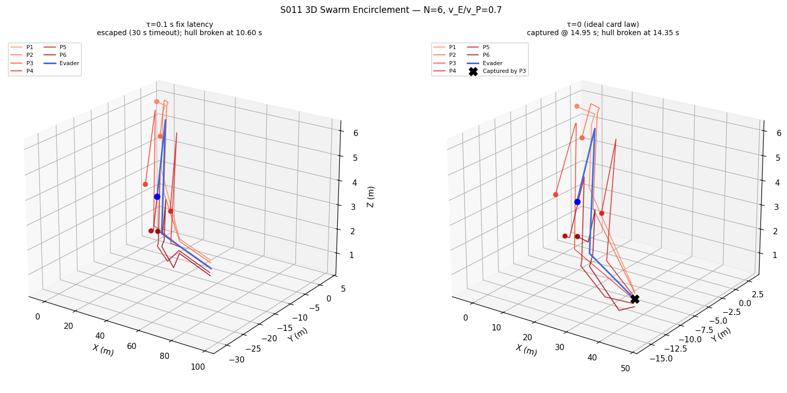
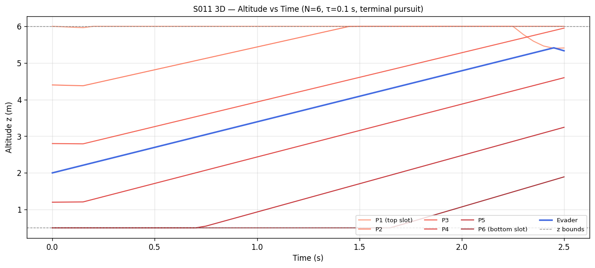
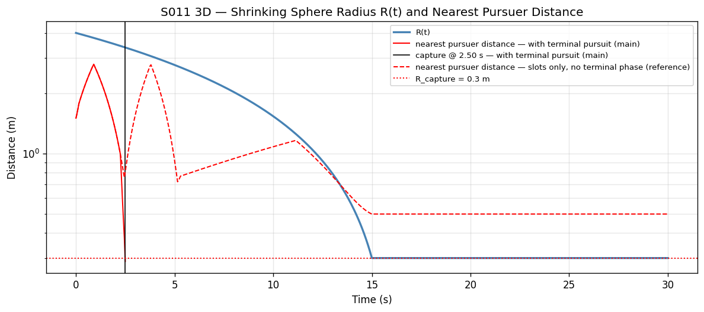
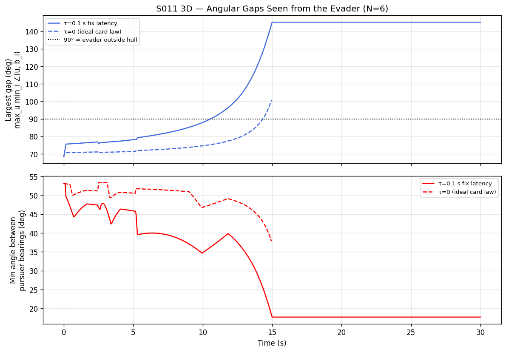
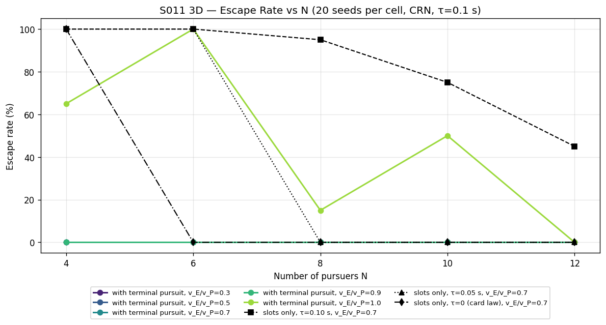
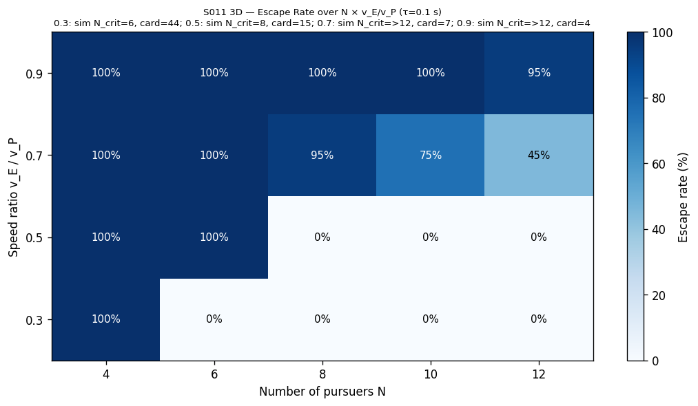
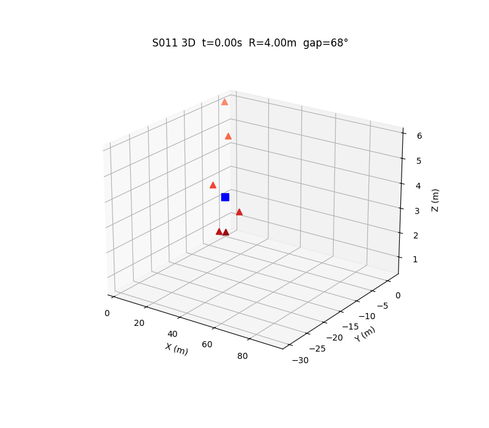

# S011 3D — Swarm Encirclement

**Domain**: Pursuit & Evasion | **Difficulty**: ⭐⭐⭐ | **Status**: ✅ Completed
**Scenario card**: [`scenarios/01_pursuit_evasion/3d/S011_3d_swarm_encirclement.md`](../../../../scenarios/01_pursuit_evasion/3d/S011_3d_swarm_encirclement.md)
**Source**: [`src/01_pursuit_evasion/3d/s011_3d_swarm_encirclement.py`](../../../../src/01_pursuit_evasion/3d/s011_3d_swarm_encirclement.py)

---

## Problem Definition

**Setup**: N pursuers fly to slots on a shrinking sphere around the evader. The slots are the card's Fibonacci-sphere directions, so slot 1 is the top pole and slot N is the bottom pole. The evader looks for the direction with the largest angular gap to the pursuers, commits to it and tries to break out.

**Key question** (card objective): what is the smallest N that prevents a 3D breakout, as a function of the speed ratio v_E/v_P?

**Control law used here**:
- **Sphere centre**: the swarm's shared evader fix, which is τ = 0.1 s old (tracking + communication latency): c(t) = p_E(t − τ).
- **Terminal pursuit**: once the nearest pursuer is within 1 m, it flies straight at the evader instead of to its slot.

**Why terminal pursuit is needed.** The slots-only law ("slots only") is kept as a documented reference, because on its own its outcome is set by the law rather than by the encirclement:
- With the card's every-step re-centring (τ = 0), the sphere moves rigidly with the evader, and capture just follows the shrink schedule.
- With τ > 0, the slots trail a fleeing evader at a fixed lag. The nearest pursuer then sits at a constant 0.498 m forever, so the evader "escapes" even though every pursuer is faster.

---

## Mathematical Model

### Fibonacci Sphere Slots (card)

$$\mathbf{q}_i = \begin{bmatrix}\sqrt{1-y_i^2}\cos\phi_i \\ \sqrt{1-y_i^2}\sin\phi_i \\ y_i\end{bmatrix}, \quad y_i = 1 - \frac{2i}{N-1}, \quad \phi_i = i\cdot\frac{2\pi}{\varphi^2}$$

### Encirclement Law with Terminal Pursuit

$$\mathbf{p}_i^{target}(t) = \begin{cases}\mathbf{p}_E(t) & i = \arg\min_j \|\mathbf{p}_j - \mathbf{p}_E\| \text{ and } \|\mathbf{p}_i - \mathbf{p}_E\| < R_{term}\\[2pt] \mathbf{p}_E(t-\tau) + R(t)\,\mathbf{q}_i & \text{otherwise}\end{cases}$$

$$R(t) = \max\!\left(R_0 - \frac{R_0 - R_{capture}}{T}\,t,\; R_{capture}\right)$$

Targets are clipped to the z band [0.5, 6.0] m. Each pursuer flies straight at its target at up to V_P and stops exactly on it if it can reach it within one step. The slots-only reference drops the first case.

### Evader (committed max-gap breakout)

Each step the evader samples K = 200 random unit directions (card). It drops any direction that points into a floor or ceiling closer than 0.6 m. It scores each direction by its minimum angle to the blocking bearings: every pursuer, plus straight down/up when the floor/ceiling is closer than R(t). It switches only if the best direction beats its current one by more than 20° (2D S011 commitment rule).

The **fixed-heading** control evader instead flies one random horizontal heading for the whole run, with no gap seeking.

### Breakout and Outcome

- **Largest gap**: $g = \max_{\hat u}\min_i \angle(\hat u, \mathbf{b}_i)$, measured over 1000 fixed Fibonacci directions. $g > 90°$ means the evader is outside the convex hull of the pursuers and walls ("hull broken").
- **Capture**: any pursuer closer than R_capture = 0.3 m. **Escape**: no capture within 30 s.

### Card Breakout Formula

$$N_{critical} = \left\lceil \frac{2}{1 - \cos(\arcsin(v_E/v_P))} \right\rceil$$

It is printed next to the simulated N_crit. It *decreases* with v_E/v_P (44 at 0.3, 3 at 1.0), because the card's condition $v_E > v_P\sin\delta_{gap}$ gets easier to meet as the gap δ shrinks. So the formula is inverted.

---

## Key Parameters

| Parameter | Value |
|-----------|-------|
| Number of pursuers N (main run) | 6 |
| Initial sphere radius R₀ | 4.0 m |
| Shrink time T | 15 s |
| Capture radius R_capture (= sphere floor) | 0.3 m |
| Terminal-pursuit range R_term | 1.0 m |
| Pursuer speed V_P | 5.0 m/s |
| Evader speed V_E (main run) | 3.5 m/s (v_E/v_P = 0.7) |
| Evader start | (0, 0, 2) m |
| z range | 0.5 – 6.0 m |
| Breakout candidates K | 200 per step |
| Gap-switch hysteresis | 20° |
| Evader wall margin | 0.6 m |
| Sphere-centre fix age τ | 0.1 s (references: 0.05 s and 0) |
| dt | 0.05 s |
| Max simulation time | 30 s |
| Main sweep | N ∈ {4, 6, 8, 10, 12} × v_E/v_P ∈ {0.3, 0.5, 0.7, 0.9, 1.0}, 20 seeds per cell |
| Random numbers | seed s is used in every cell (common random numbers); main run seed 0 |

---

## Implementation

```bash
conda activate drones
python src/01_pursuit_evasion/3d/s011_3d_swarm_encirclement.py
```

Runtime ≈ 72 s:
- 3 single runs (main, slots-only reference, static evader)
- 500 main-sweep runs
- 480 reference runs (400 slots-only sweep runs, 80 fixed-heading runs)
- a 51-frame GIF

---

## Results

### Main runs (N = 6, v_E/v_P = 0.7, seed 0)

| Law | Outcome | Hull broken (g > 90°) | Max gap | Evader z range | Nearest pursuer at the end |
|-----|---------|-----------------------|---------|----------------|----------------------------|
| **With terminal pursuit** | captured by P1 @ **2.50 s** (terminal phase from 2.30 s) | never | 76.9° | 2.00 – 5.41 m | 0.29 m |
| Slots only (reference) | escaped (102.73 m net displacement) | at 10.60 s | 145.2° | 1.05 – 5.41 m | 0.50 m; for t > 15 s constant at **0.498 m** |

- **Main-run capture**: the evader climbs toward the ceiling, where P1 (the top-slot drone, pinned at z = 6 m) comes within 1 m. P1 then switches to direct pursuit and catches it.
- **Static evader** (terminal pursuit): captured at 12.35 s.
- **Largest gap from the centre of the undisturbed Fibonacci slots**: N=4: 89.6°, N=6: 68.4°, N=8: 58.9°, N=10: 50.4°, N=12: 44.5°.

### Main sweep: escapes with terminal pursuit (τ = 0.1 s, 20 seeds per cell)

| v_E/v_P | N = 4 | N = 6 | N = 8 | N = 10 | N = 12 | Simulated N_crit | Card formula N_crit |
|---------|-------|-------|-------|--------|--------|------------------|---------------------|
| 0.3 | 0/20 | 0/20 | 0/20 | 0/20 | 0/20 | 4 | 44 |
| 0.5 | 0/20 | 0/20 | 0/20 | 0/20 | 0/20 | 4 | 15 |
| 0.7 | 0/20 | 0/20 | 0/20 | 0/20 | 0/20 | 4 | 7 |
| 0.9 | 0/20 | 0/20 | 0/20 | 0/20 | 0/20 | 4 | 4 |
| 1.0 | 13/20 | 20/20 | 3/20 | 10/20 | 0/20 | 12 | 3 |

Simulated N_crit is the smallest swept N with 0 escapes in 20 seeds.

Capture times (mean ± sd over the captured seeds) and hull-broken counts:

| v_E/v_P | N = 4 | N = 6 | N = 8 | N = 10 | N = 12 |
|---------|-------|-------|-------|--------|--------|
| 0.3 | 11.37 ± 2.46 s (20 broken) | 5.52 ± 3.89 s (3) | 2.60 ± 1.61 s (0) | 2.40 ± 1.41 s (0) | 1.32 ± 1.03 s (0) |
| 0.5 | 10.82 ± 3.31 s (20) | 3.97 ± 3.27 s (1) | 1.67 ± 0.97 s (0) | 1.54 ± 0.85 s (0) | 0.89 ± 0.62 s (0) |
| 0.7 | 10.64 ± 3.79 s (20) | 3.28 ± 2.89 s (1) | 1.33 ± 0.68 s (0) | 1.21 ± 0.61 s (0) | 0.72 ± 0.44 s (0) |
| 0.9 | 11.44 ± 4.17 s (20) | 3.55 ± 2.79 s (1) | 1.42 ± 0.57 s (0) | 1.31 ± 0.59 s (0) | 0.86 ± 0.35 s (0) |
| 1.0 | 11.85 ± 1.19 s (20) | – (20) | 3.52 ± 1.52 s (3) | 5.91 ± 4.20 s (12) | 2.44 ± 2.27 s (1) |

At v_E/v_P = 1.0 the escapes end with the nearest pursuer at a median of 0.87 / 0.62 / 0.35 / 0.37 m for N = 4 / 6 / 8 / 10. With equal speeds, the pursuer in terminal pursuit can never close the gap.

### Reference: slots only (no terminal phase), the lag artefact

| Law | v_E/v_P | N = 4 | N = 6 | N = 8 | N = 10 | N = 12 |
|-----|---------|-------|-------|-------|--------|--------|
| Slots only, τ = 0.10 s | 0.7 | 20/20 | 20/20 | 19/20 | 15/20 | 9/20 |
| Slots only, τ = 0.10 s | 0.9 | 20/20 | 20/20 | 20/20 | 20/20 | 19/20 |
| Slots only, τ = 0.05 s | 0.7 | 20/20 | 20/20 | 0/20 | 0/20 | 0/20 |
| Slots only, τ = 0 (card law) | 0.7 | 20/20 | 0/20 (14.93 ± 0.04 s) | 0/20 (14.77 ± 0.04 s) | 0/20 (14.65 ± 0.03 s) | 0/20 (14.60 ± 0.03 s) |

Slots-only escapes at τ = 0.10 s, v_E/v_P = 0.7 end with the nearest pursuer at a median of 0.60 / 0.49 / 0.37 / 0.35 / 0.34 m for N = 4–12.

**Fixed-heading evader** (no gap seeking; v_E/v_P = 0.7, τ = 0.10 s):

| Law | N = 6 | N = 8 |
|-----|-------|-------|
| Slots only | 14/20 escape | 8/20 escape |
| With terminal pursuit | 0/20 | 0/20 |

**Key findings**:
- **The slots-only "breakouts" were an artefact of the control law.** With a delayed centre, the slots trail a fleeing evader by a fixed offset. In the reference run the nearest pursuer sits at a constant 0.498 m for the whole second half, although every pursuer is faster than the evader. A fixed-heading evader that never looks for gaps "escapes" in 14/20 (N=6) and 8/20 (N=8) seeds. The escape counts also flip with the delay: at N = 12, v_E/v_P = 0.7 they are 0/20 at τ = 0.05 s and 9/20 at τ = 0.10 s.
- **With terminal pursuit, no breakout succeeds below speed parity.** At v_E/v_P = 0.3, 0.5, 0.7 and 0.9, every cell is 0/20 escapes, even with N = 4. N = 4 is the degenerate case whose slots leave the hull broken in every seed. So in this model the answer to the card's question is that **any swept N (≥ 4) prevents escape when v_E < v_P**. More pursuers only shorten the capture: at v_E/v_P = 0.7, 10.64 s with N = 4, 3.28 s with N = 6, 0.72 s with N = 12.
- **Escapes only happen at speed parity (v_E/v_P = 1.0)**, and there they do not fall steadily with N: 13, 20, 3, 10 and 0 escapes for N = 4, 6, 8, 10, 12. Only N = 12 holds all 20 seeds. At parity, a single pursuer in direct pursuit cannot close the gap, so capture depends on whether the evader's gap-seeking route runs into another drone.
- **The card's N_crit formula points the wrong way** (44 → 3 as v_E/v_P rises) and matches neither law.
- **Real 3D motion.** In the main run the evader climbs from 2.00 m to 5.41 m before P1, the top-slot drone pinned at the ceiling, catches it. In the slots-only run it climbs to 5.41 m, dives to 1.05 m and then settles on a shallow climb. The floor and ceiling count as blockers in the evader's gap score, so it never drives into a pinned pole drone on its own.

### 3D Trajectories (main law vs slots-only reference)



### Altitude vs Time (main run)



### Shrinking Radius R(t) and Nearest Pursuer Distance (log scale; the slots-only curve shows the constant 0.498 m gap)



### Angular Gaps vs Time

Top: the evader's largest gap, with breakout above 90°. Bottom: the card's minimum angle between pursuer bearings.



### Escape Rate vs N (card output; the main law per speed ratio, plus the slots-only references)



### Escape Rate over N × v_E/v_P (with terminal pursuit)



### Animation (main run, every step, 51 frames)



### Deviations from the scenario card

| Card | This implementation | Reason |
|------|--------------------|--------|
| Sphere centred on $\mathbf{p}_E(t)$ every step, slots only | Centre = $\mathbf{p}_E(t-\tau)$, τ = 0.1 s, plus terminal pursuit within 1 m; the slots-only law at τ = 0.1, 0.05 and 0 s is kept as a reference | With τ = 0 capture follows the shrink schedule. With τ > 0 and slots only, the "escapes" come from the lag (constant 0.498 m gap; a fixed-heading evader also escapes) |
| Evader re-picks the best of K = 200 random directions every step | Same K, plus 20° switching hysteresis, a 0.6 m wall margin, and the floor/ceiling counted as blocking bearings within R(t); a fixed-heading control evader | Without commitment the evader dithers (2D S011 fix). Without wall awareness it climbs into the ceiling-pinned top drone and the capture is a clipping artefact |
| Pursuers move V_P·dt toward the target every step | Saturated go-to (stop on the slot or the evader if reachable within one step) | Avoids chattering around the slot (2D S011 fix) |
| Breakout condition $v_E > v_P\sin\delta_{gap}$, $N_{critical}$ formula | Breakout = largest gap > 90° (hull broken); outcome = capture or escape in 30 s; card formula printed for comparison | The card formula is inverted (N_crit falls as v_E/v_P rises) |
| "Remaining N − 2 drones fill the equatorial band" | Card's Fibonacci formula used as written, with slots spread over all latitudes | The card's own formula does not produce an equatorial band |
| Sweep N = 4…12 at one speed ratio | N = 4…12 × v_E/v_P = 0.3–1.0, 20 seeds per cell (common random numbers) | The card's objective is N_crit *as a function of* v_E/v_P. Ratio 1.0 was added because no escape happens below it |
| Sphere radius 4 m around z = 2 in a 0.5–6 m band | Slot targets clipped to the band (bottom slot starts at 0.5 m) | The sphere does not fit; reported, not hidden |

---

## Extensions

1. Evader faster than the pursuers (v_E/v_P > 1): does a larger N still contain it?
2. Smarter terminal phase: hand the target to the two nearest drones, or predict the evader's position
3. Latency sweep with terminal pursuit: the largest τ at which v_E/v_P = 1.0 is still contained
4. Dynamic Fibonacci rebalancing: re-orient the slot set each step (card extension)
5. Heterogeneous altitude tiers and weighted breakout (card extensions)

---

## Related Scenarios

- Original 2D version: [S011 Swarm Encirclement](../../../../scenarios/01_pursuit_evasion/S011_swarm_encirclement.md)
- Follow-ups: [S012 3D Upgrade — Relay Pursuit](../../../../scenarios/01_pursuit_evasion/3d/S012_3d_relay_pursuit.md), [S013 3D Upgrade — Pincer Movement](../../../../scenarios/01_pursuit_evasion/3d/S013_3d_pincer_movement.md)
- Altitude floor reference: [S003 Low-Altitude Tracking](../../../../scenarios/01_pursuit_evasion/S003_low_altitude_tracking.md)
