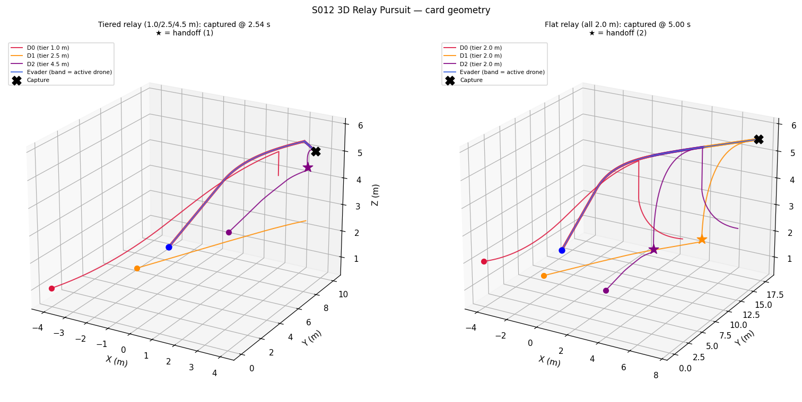
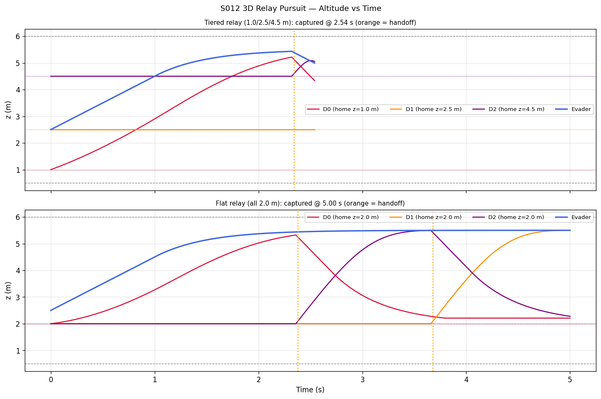
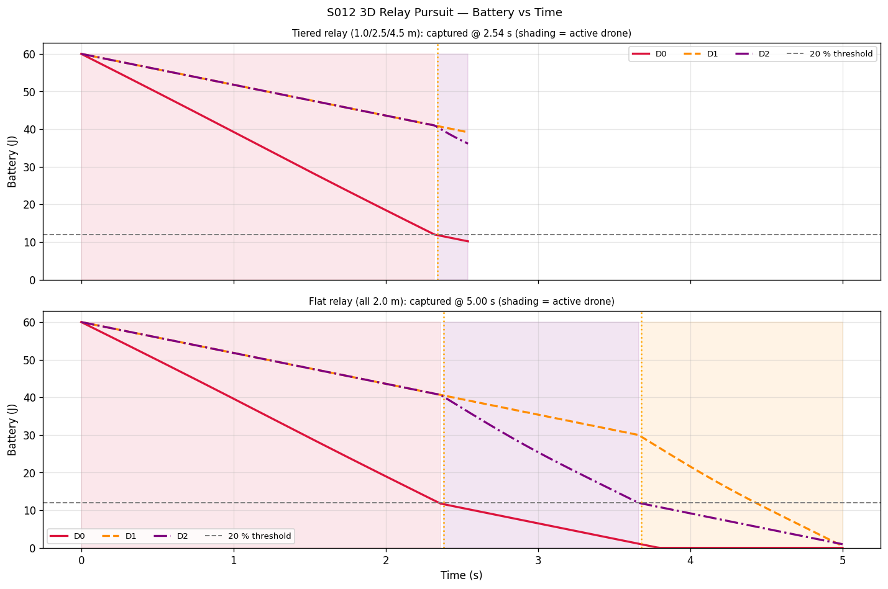
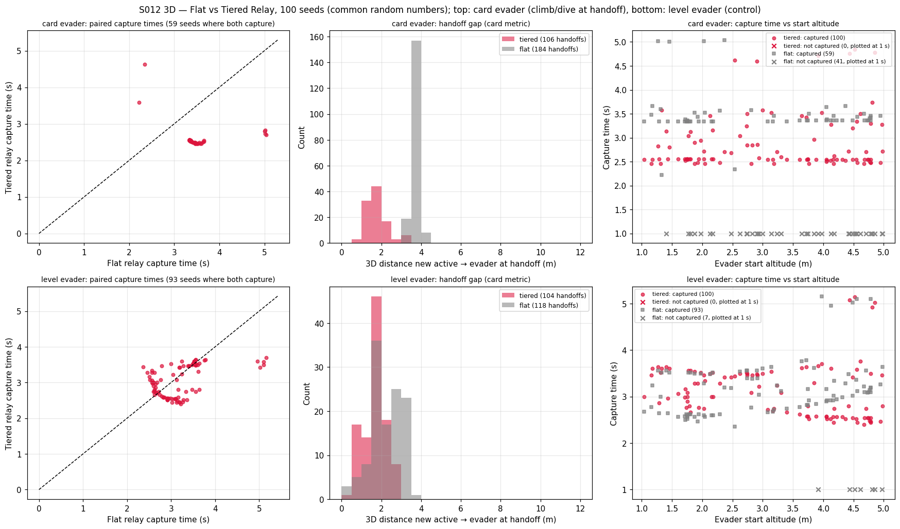
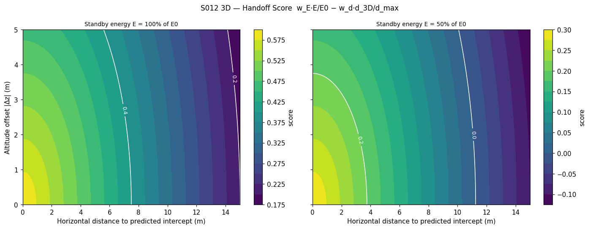
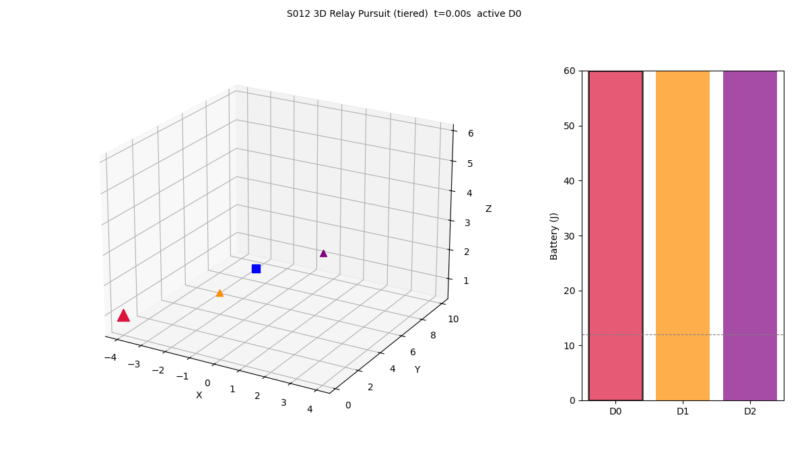

# S012 3D — Relay Pursuit

**Domain**: Pursuit & Evasion | **Difficulty**: ⭐⭐⭐⭐ | **Status**: ✅ Completed
**Scenario card**: [`scenarios/01_pursuit_evasion/3d/S012_3d_relay_pursuit.md`](../../../../scenarios/01_pursuit_evasion/3d/S012_3d_relay_pursuit.md)
**Source**: [`src/01_pursuit_evasion/3d/s012_3d_relay_pursuit.py`](../../../../src/01_pursuit_evasion/3d/s012_3d_relay_pursuit.py)

---

## Problem Definition

**Setup**: Three battery-limited pursuers (D0, D1, D2) relay the chase of one evader.
- **Active drone**: flies 3D pure pursuit at 5 m/s.
- **Standby drones**: fly horizontally toward the evader's predicted position at the estimated handoff time. Meanwhile they hold their home altitude tier with the card's law ż = k_hold·(z_home − z).
- **Handoff**: when the active drone drops below 20 % of E0, the standby with the best score w_E·E/E0 − w_d·d_3D/d_max takes over.

**Evader** (card: "exploit handoff moments by climbing or diving to an altitude tier that is far from the next active pursuer"): flies a fixed horizontal heading. At t = 0 and at every handoff it climbs to z = 5.5 m or dives to z = 1.0 m, whichever is farther from the newly active drone.

**Comparison** (card): altitude-tiered relay (tiers 1.0 / 2.5 / 4.5 m) vs flat relay (all at 2.0 m). Both are run in the card geometry and in a 100-seed Monte Carlo over evader heading and start altitude. A level-flying evader is added as a control.

---

## Mathematical Model

### Power and Battery

$$P(\mathbf{v}) = P_{hover} + k\,\|\mathbf{v}\|^2 + (k_{climb} - k)\max(v_z, 0)^2, \qquad k_{climb} = 1.5\,k$$

$$E_i(t+\Delta t) = E_i(t) - s_i\,P(\mathbf{v}_i)\,\Delta t, \qquad s_i = \begin{cases}1 & \text{active}\\ 0.5 & \text{standby (card)}\end{cases}$$

Level flight at 5 m/s costs P_level = 10 + 0.4·25 = 20 W, so an active drone reaches the 20 % threshold after 48 J / 20 W = 2.40 s. A standby flying at 4 m/s draws 0.5·(10 + 0.4·16) = 8.2 W.

### Handoff Time Estimate and Predicted Intercept

$$T_h = \max\!\left(\frac{E_{active} - 0.2\,E_0}{P_{level}},\ 0.5\text{ s}\right), \qquad \hat{\mathbf{p}}_E(T_h) = \mathbf{p}_E + \mathbf{v}_E\,T_h$$

### Handoff Selection

$$j^* = \arg\max_{k \neq active,\ E_k \ge 0.2E_0}\left[w_E\frac{E_k}{E_0} - w_d\frac{\|\hat{\mathbf{p}}_E(T_h) - \mathbf{p}_k\|}{d_{max}}\right]$$

If no standby is at or above the threshold, the active drone keeps flying until it is empty, and then any drone with energy left takes over. This is the 2D S012 rule against ping-pong handoffs.

### Standby Altitude Hold

$$v_z = \mathrm{clip}\big(k_{hold}(z^{home}_k - z_k),\ \pm v_{standby}\big), \qquad \|\mathbf{v}_{xy}\| = \sqrt{v_{standby}^2 - v_z^2}\ \text{toward } \hat{\mathbf{p}}_E(T_h)$$

### Evader

$$v_{E,z} = \mathrm{clip}\big(2.0\,(z_{goal} - z_E),\ \pm 2\text{ m/s}\big), \qquad \|\mathbf{v}_{E,xy}\| = \sqrt{3.5^2 - v_{E,z}^2}$$

$z_{goal} \in \{1.0, 5.5\}$ m, whichever is farther from the newly active drone's altitude. The level control evader keeps $z_{goal} = z_E(0)$.

---

## Key Parameters

| Parameter | Value |
|-----------|-------|
| Number of pursuers | 3 |
| Tiered home altitudes | 1.0, 2.5, 4.5 m |
| Flat home altitudes | 2.0, 2.0, 2.0 m |
| Battery E0 | 60 J each |
| Hover power P_hover | 10 W |
| Energy coefficient k | 0.4 W·s²/m² |
| Climb coefficient k_climb | 0.6 W·s²/m² (1.5·k) |
| Standby power factor | 0.5 |
| Handoff threshold | 20 % (12 J) |
| T_h floor | 0.5 s |
| Active / standby / evader speed | 5.0 / 4.0 / 3.5 m/s |
| Evader max climb/dive rate, gain | 2.0 m/s, 2.0 s⁻¹ |
| Evader dive / climb altitudes | 1.0 / 5.5 m |
| Altitude-hold gain k_hold | 2.0 s⁻¹ |
| Handoff weights (w_E, w_d), d_max | 0.6, 0.4, 15 m |
| Start positions (card) | D0 (−4, 0), D1 (0, 0), D2 (4, 0) at their tier; evader (0, 3, 2.5) heading (0.5, 1)/‖·‖ |
| Capture radius | 0.15 m |
| z range | 0.5 – 6.0 m |
| dt / max time | 0.02 s / 40 s |
| Monte Carlo | 100 seeds (rng seed 12): heading offset U(−45°, 45°), evader start z U(1, 5) m; the same draws for every relay and evader (common random numbers) |

---

## Implementation

```bash
conda activate drones
python src/01_pursuit_evasion/3d/s012_3d_relay_pursuit.py
```

Runtime ≈ 17 s: 2 main runs, 400 Monte Carlo runs and a 65-frame GIF.

---

## Results

### Card geometry

| Relay | Outcome | Handoffs | Handoff gap: 3D distance (\|Δz\|) from the new active drone to the evader | Final energy D0 / D1 / D2 |
|-------|---------|----------|------------------------------------------------------------------------|----------------------------|
| **Tiered** (1.0/2.5/4.5 m) | captured @ **2.54 s** | 1: D0 → D2 @ 2.34 s | 1.04 m (0.93 m) | 10.2 / 39.2 / 36.1 J |
| **Flat** (all 2.0 m) | captured @ **5.00 s** | 2: D0 → D2 @ 2.38 s, D2 → D1 @ 3.68 s | 3.46 m (3.44 m), 3.50 m (3.50 m) | 0.0 / 0.5 / 1.0 J |

- **Evader altitude**: tiered 2.50–5.43 m, flat 2.50–5.50 m.
- **Tier holding**: standby drones that have not yet been active stay exactly on their tier, with a maximum deviation of 0.000 m in both relays and in all 400 Monte Carlo runs. A drone that has handed off flies back down or up to its tier, as D0 does after 2.34 s.

### Monte Carlo (100 seeds, common random numbers)

| Evader | Relay | Captured | Batteries empty | Capture time (s) | Handoffs / run | Mean handoff gap 3D (\|Δz\|) | Runs with an evader dive ≥ 1 m |
|--------|-------|----------|-----------------|------------------|----------------|------------------------------|--------------------------------|
| Card (climb/dive at handoff) | **Tiered** | **100/100** | 0 | 2.87 ± 0.58 | 1.06 | 1.81 m (1.07 m) | 33 |
| Card (climb/dive at handoff) | Flat | 59/100 | **41** | 3.48 ± 0.47 | 1.84 | 3.70 m (3.41 m) | 0 |
| Level (control) | Tiered | 100/100 | 0 | 3.14 ± 0.57 | 1.04 | 1.68 m (0.75 m) | 0 |
| Level (control) | Flat | 93/100 | 7 | 3.18 ± 0.58 | 1.18 | 2.24 m (1.56 m) | 0 |

Paired comparison with the same seeds:
- **Card evader**: tiered is faster in 98 seeds and flat in 2. Only tiered captures in 41 seeds, and only flat in 0. Where both capture (59 seeds), tiered − flat = −0.89 ± 0.63 s.
- **Level evader**: tiered is faster in 54 seeds, flat in 44, and they tie in 2. Only tiered captures in 7 seeds, and only flat in 0. Where both capture (93 seeds), tiered − flat = −0.14 ± 0.54 s.

**Key findings**:
- **The relay is needed.** With hover power the active drone reaches 20 % after 2.40 s of level flight, while D0 starts 5.2 m from the evader with a 1.5 m/s closing speed. Every tiered run needs at least one handoff (1–2 per run). In 3 of the 200 flat runs, D0 captures alone before reaching the threshold (2.22–2.36 s).
- **Against the card's evader the flat relay often fails.** All flat drones sit at 2.0 m, so the evader always climbs to 5.5 m. Each new active drone then starts about 3.4 m below it (mean |Δz| 3.41 m) and pays the 1.5× climb cost. The flat relay runs out of energy in 41/100 seeds. In the card geometry it captures only at 5.00 s, with 0.5 J left in the capturing drone.
- **The tiered relay captures in 100/100 seeds** because some tier is always within about 1 m of the evader's 1.0 m or 5.5 m refuge. In the card geometry the evader flees D0 (tier 1.0 m) upward, which takes it into D2's 4.5 m tier. D2 takes over 1.04 m away and captures 0.20 s later.
- **The dive does happen, but not in the main run.** After a handoff to the 4.5 m drone the evader is ordered to dive to 1.0 m. In the card geometry capture comes 0.20 s later, so the evader descends only 0.44 m. In the Monte Carlo the evader dives by 1 m or more in 33/100 tiered runs. Against the flat relay it never dives, because every new active drone is at 2.0 m and 5.5 m is always the farther refuge.
- **Most of the tiered advantage comes from the evader's altitude tactic.** Against the level evader the two relays are close: the mean time difference is 0.14 s, tiered is faster in only 54/100 seeds, and flat still fails in 7 seeds. Tiers buy robustness against an evader that uses altitude. They are not a large speed-up in general.
- **Energy check**: a standby at 4 m/s draws 8.2 W, so D1 and D2 have about 60 − 8.2·2.34 ≈ 40.8 J at the first tiered handoff. D1 then spends another 0.20 s × 8.2 W ≈ 1.6 J and ends at 39.2 J, as printed.

### 3D Trajectories (card geometry; the band on the evader path shows the active drone, ★ = handoff)



### Altitude vs Time

The standby drones hold their tiers (dotted). Handoffs are marked in orange.



### Battery vs Time



### Monte Carlo: Flat vs Tiered (top: card evader, bottom: level control evader)



### Handoff Score Surface (card output)



### Animation (tiered relay, card geometry; every 2nd step, 65 frames; larger ▲ and outlined bar = active drone)



### Deviations from the scenario card

| Card | This implementation | Reason |
|------|--------------------|--------|
| Battery model $k\|\mathbf{v}\|^2$ only | Adds hover power 10 W (P_level = 20 W at 5 m/s) | A drone holding a tier must pay to stay in the air; without it the tier-hold costs nothing |
| $k_{climb}$ applied to the whole $\|\mathbf{v}\|^2$ whenever $\dot z > 0$ | 1.5·k applied to the climbing component only | Avoids a jump in power from a tiny climb rate. The card's ×1.5 ratio is kept (the old code used 3×) |
| $T_h = (E - E_{thr})/(k v^2)$ | Uses P_level = P_hover + k·V² = 20 W, with a 0.5 s floor | Consistent with the battery model (the old code used the power at velocity (5,5,5) = 60 W). The floor is the 2D S012 fix |
| Standby flies the 3D intercept and holds its tier only when idle | Horizontal flight toward the intercept while holding the tier | Otherwise the tiers dissolve at once (old code: D2 dropped to 3.98 m) and the flat-vs-tiered comparison is meaningless |
| Evader: straight escape with random vertical wander | Climb/dive at each handoff away from the new active drone, plus a level control evader | The card's own text describes the handoff-exploiting evader. The control shows how much of the result depends on it |
| Next active by score among all standbys | Same score, restricted to standbys ≥ 20 % | 2D S012 anti-ping-pong rule (replaces the old 2 s cooldown) |
| Standby power 0.5× (card pseudocode) | Same (the old code used 0.4×) | Restored to the card |
| Comparison table from single runs | Card geometry plus 100-seed Monte Carlo × 2 evaders, common random numbers | The flat relay's failures depend on geometry; a single run hides them |
| Not specified | Evader refuges 1.0 / 5.5 m (0.5 m inside the z band), max climb rate 2 m/s | The evader levels off before the floor/ceiling instead of being stopped by the clip |

---

## Extensions

1. Optimal tier spacing: grid-search the three tier altitudes against the climb/dive evader (card extension)
2. 4-drone relay with two drones per tier (card extension)
3. Evader that flees the altitude of *all* drones, not just the new active one; with tiers 1.0/2.5/4.5 m no refuge is more than 1 m from a tier
4. Pre-handoff climb: move the best-scoring standby toward the evader's altitude once T_h < 1 s

---

## Related Scenarios

- Original 2D version: [S012 Relay Pursuit](../../../../scenarios/01_pursuit_evasion/S012_relay_pursuit.md)
- Energy model background: [S006 3D Upgrade — Energy Race](../../../../scenarios/01_pursuit_evasion/3d/S006_3d_energy_race.md)
- Neighbours: [S011 3D Upgrade — Swarm Encirclement](../../../../scenarios/01_pursuit_evasion/3d/S011_3d_swarm_encirclement.md), [S013 3D Upgrade — Pincer Movement](../../../../scenarios/01_pursuit_evasion/3d/S013_3d_pincer_movement.md)
