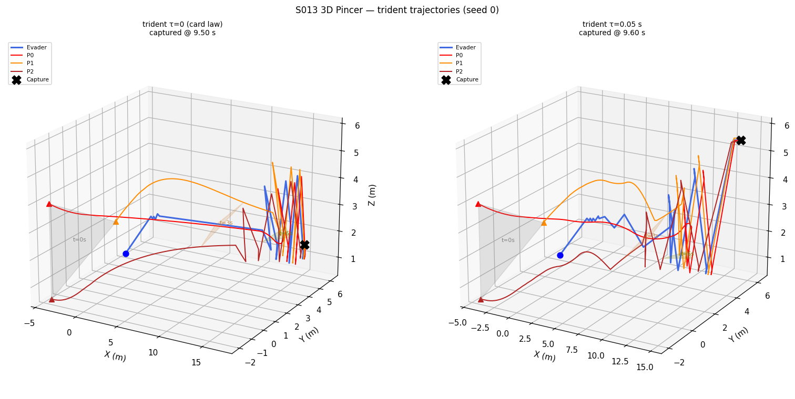
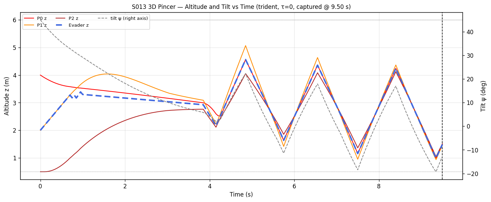
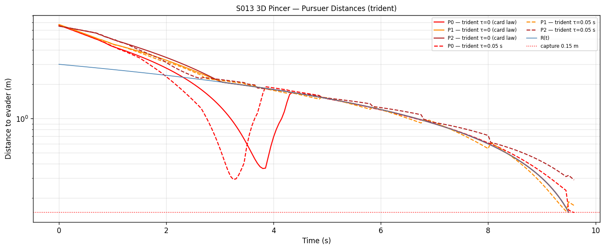
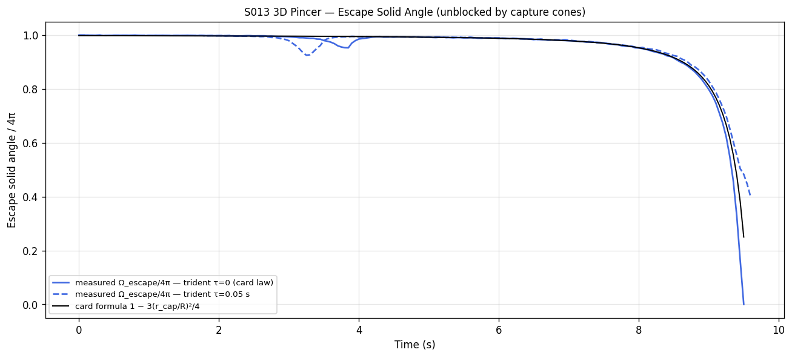
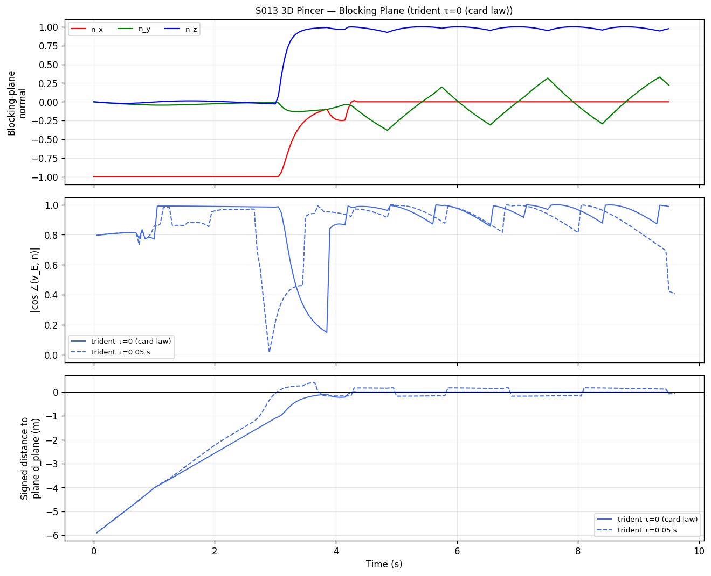
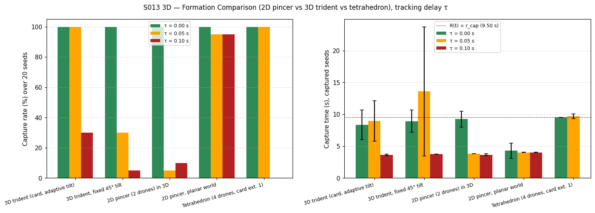
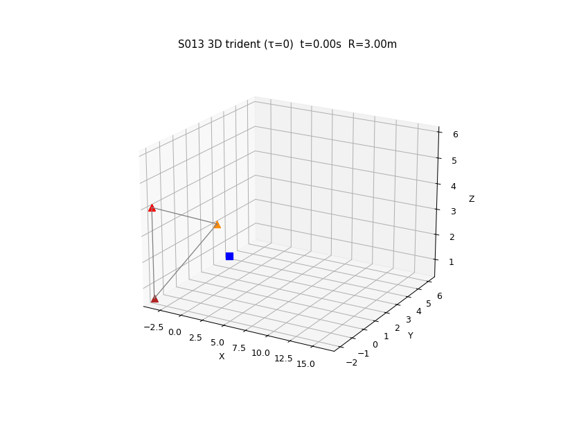

# S013 3D — Pincer Movement (Trident)

**Domain**: Pursuit & Evasion | **Difficulty**: ⭐⭐⭐⭐ | **Status**: ✅ Completed
**Scenario card**: [`scenarios/01_pursuit_evasion/3d/S013_3d_pincer_movement.md`](../../../../scenarios/01_pursuit_evasion/3d/S013_3d_pincer_movement.md)
**Source**: [`src/01_pursuit_evasion/3d/s013_3d_pincer_movement.py`](../../../../src/01_pursuit_evasion/3d/s013_3d_pincer_movement.py)

---

## Problem Definition

**Setup** (card): three pursuers hold the vertices of an equilateral triangle centred on the evader. The triangle sits in a plane tilted by ψ about the x-axis, and its radius R(t) shrinks. The tilt follows the card's law toward the evader's altitude. The evader samples K = 200 directions and flies the one with the largest minimum angle to the pursuers.

**Objective** (card): compare the 3D trident with a 2D two-pursuer pincer, and report the escape solid angle and the blocking-plane normal.

**Comparisons** (20 seeds each, common random numbers):
- 3D trident with the card's adaptive tilt (main)
- 3D trident with a fixed 45° tilt
- 2D two-pursuer pincer (slots ±x, the 2D S013 geometry) flown in 3D
- the same 2D pincer in a planar world (evader confined to z = 2 m)
- tetrahedron with 4 pursuers (card extension 1)

Each formation is run with the card law (τ = 0: slots centred on the evader's current position) and with tracking delays τ = 0.05 s and 0.10 s.

---

## Mathematical Model

### Slot Targets

$$\mathbf{p}_{P_i}^{target} = \mathbf{p}_E(t-\tau) + R(t)\,\mathbf{R}_x(\psi)\begin{bmatrix}\cos(2\pi i/3)\\ \sin(2\pi i/3)\\ 0\end{bmatrix}, \qquad R(t) = \max(R_0 - v_{shrink}\,t,\; R_{min})$$

- **2D pincer**: slots $\pm R(t)\,\hat{\mathbf{x}}$.
- **Tetrahedron**: slots $R(t)\,(\pm1,\pm1,\pm1)/\sqrt3$, using the four vertices of a regular tetrahedron.

Targets are clipped to the 0.5–6 m band. Pursuers fly at V_P toward their slot and stop on it if it is reachable within one step. Each step the evader moves first, and the pursuers then move toward slots around its new position, so τ = 0 means zero-latency tracking.

### Tilt Law (card)

$$\psi^{cmd} = \operatorname{atan2}\!\left(z_E - \bar z_P,\ \|\mathbf{p}_E^{xy} - \bar{\mathbf{p}}_P^{xy}\|\right), \qquad \dot\psi = k_{tilt}(\psi^{cmd} - \psi), \quad |\psi| \le 60°$$

### Evader

The evader scores each sampled direction by its minimum angle to the pursuers and maximises it. As in S011 3D, it keeps its current direction unless another is better by more than 20°. The floor and ceiling count as blocking bearings when they are closer than R(t). Directions into a floor or ceiling closer than 0.6 m are dropped.

### Escape Solid Angle

- **Card formula**: $\Omega_{escape} = 4\pi - \sum_i \pi r_{cap}^2/R^2$.
- **Measured**: 4π times the fraction of 2000 Fibonacci directions that lie outside every pursuer's capture cone, where each cone has half-angle $\arcsin(r_{cap}/d_i)$.

### Blocking Plane

$$\hat{\mathbf{n}} = \frac{(\mathbf{p}_1 - \mathbf{p}_0)\times(\mathbf{p}_2 - \mathbf{p}_0)}{\|\cdot\|}, \qquad d_{plane} = (\mathbf{p}_E - \mathbf{p}_0)\cdot\hat{\mathbf{n}}$$

The script also logs $|\cos\angle(\mathbf{v}_E, \hat{\mathbf{n}})|$. A value of 1 means the evader is flying straight out of the triangle's plane.

---

## Key Parameters

| Parameter | Value |
|-----------|-------|
| Pursuer starts (trident) | (−4, −2, 4), (−4, 3, 2), (−4, −2, 0.5) m |
| Pursuer starts (2D pincer) | (−4, −2, 2), (−4, 2, 2) m |
| Pursuer starts (tetrahedron) | trident starts + (−4, 0, 3) m |
| Evader start | (2, 0, 2) m |
| Pursuer / evader speed | 5.0 / 3.5 m/s |
| Initial radius R₀ | 3.0 m |
| Shrink rate | 0.3 m/s |
| Minimum radius R_min | 0.1 m (≤ capture radius) |
| Capture radius | 0.15 m |
| Initial tilt ψ₀, tilt gain, tilt limit | 45°, 0.5 s⁻¹, ±60° |
| Evader candidates K, switch hysteresis, wall margin | 200, 20°, 0.6 m |
| Tracking delay τ | 0 (card), 0.05, 0.10 s |
| z range | 0.5 – 6.0 m |
| dt / max time | 0.05 s / 30 s |
| Seeds | 20 per cell (seed s in every cell); main runs seed 0 |

---

## Implementation

```bash
conda activate drones
python src/01_pursuit_evasion/3d/s013_3d_pincer_movement.py
```

Runtime ≈ 40 s: 3 main runs, 300 comparison runs and a 96-frame GIF.

---

## Results

### Main runs (trident, seed 0)

| Run | Outcome | Max gap | Evader z range | Mean \|cos(v_E, n)\| | Tilt at end | Ω_escape/4π at end: measured / card formula |
|-----|---------|---------|----------------|----------------------|-------------|----------------------------------------------|
| τ = 0 (card law) | captured @ **9.50 s** | 148.2° | 0.99 – 4.56 m | 0.900 | −12.7° | 0.000 / 0.250 |
| τ = 0.05 s | captured @ **9.60 s** | 148.7° | 1.04 – 5.46 m | 0.858 | 19.2° | 0.397 / 0.000 |

- **Static evader** (trident, τ = 0): captured at 9.50 s, which is when R(t) reaches r_cap.
- **Card's capture-certainty radius**: the card gives r_cap·√(3π) = 0.460 m. Its own Ω formula reaches 0 at R = r_cap·√(3/4) = 0.130 m.

### Formation comparison (20 seeds per cell)

| Formation | τ (s) | Captured | Capture time (s) | Range (s) | Captured before R = r_cap | Median final distance, uncaptured (m) |
|-----------|-------|----------|------------------|-----------|---------------------------|---------------------------------------|
| **3D trident (card, adaptive tilt)** | 0.00 | 20/20 | 8.34 ± 2.33 | 3.55–9.50 | 4 | – |
| | 0.05 | **20/20** | 8.96 ± 3.20 | 3.60–18.05 | 5 | – |
| | 0.10 | 6/20 | 3.62 ± 0.11 | 3.45–3.75 | 6 | 0.306 |
| 3D trident, fixed 45° tilt | 0.00 | 20/20 | 8.92 ± 1.73 | 3.70–9.50 | 2 | – |
| | 0.05 | 6/20 | 13.61 ± 10.14 | 3.70–28.30 | 2 | 0.160 |
| | 0.10 | 1/20 | 3.75 | 3.75 | 1 | 0.320 |
| 2D pincer (2 drones) in 3D | 0.00 | 20/20 | 9.25 ± 1.25 | 3.80–9.55 | 1 | – |
| | 0.05 | 1/20 | 3.80 | 3.80 | 1 | 0.192 |
| | 0.10 | 2/20 | 3.65 ± 0.15 | 3.50–3.80 | 2 | 0.350 |
| 2D pincer, planar world | 0.00 | 20/20 | **4.29 ± 1.20** | 4.00–9.50 | 19 | – |
| | 0.05 | 19/20 | 4.02 ± 0.02 | 4.00–4.05 | 19 | 0.186 |
| | 0.10 | 19/20 | 4.02 ± 0.02 | 4.00–4.05 | 19 | 0.341 |
| Tetrahedron (4 drones) | 0.00 | 20/20 | 9.50 ± 0.00 | 9.50–9.50 | 0 | – |
| | 0.05 | 20/20 | 9.68 ± 0.38 | 9.40–10.70 | 8 | – |
| | 0.10 | 0/20 | – | – | 0 | 0.295 |

No run of any formation touches the floor (0/20 in every cell).

**Key findings**:
- **Capture now works without the clip artefact.** With R_min = 0.1 m below the 0.15 m capture radius, a held formation captures the moment R(t) reaches r_cap at 9.50 s. A static evader is caught at exactly that time, and the evader never touches the floor. In the old version R_min = 0.3 m, a static evader was never caught, and capture only came after the evader was pinned on the floor.
- **Under the card law (τ = 0) capture time is the shrink schedule.** Every formation captures 20/20. Most captures happen at 9.50 s. Earlier captures (from 3.55 s) happen when a pursuer crosses the evader while flying to its slot: 4/20 seeds for the trident, 1/20 for the 2D pincer in 3D, and none for the tetrahedron.
- **The card's 3D-vs-2D question: the 3D trident is not faster.** In a planar world the 2D pincer catches the evader in 4.29 ± 1.20 s. In 19 of 20 seeds the evader cannot dodge the pursuers transiting to their slots. Give the same evader the third dimension and the same pincer needs 9.25 ± 1.25 s. The trident needs 8.34 ± 2.33 s. The extra dimension helps the evader more than the third drone helps the pursuers.
- **The trident is still a planar formation, and the evader escapes along its normal.** In the main run the evader flies almost straight out of the triangle's plane (mean |cos(v_E, n)| = 0.900). It turns back each time the floor or ceiling comes within R, so it bounces between 0.99 m and 4.56 m.
- **Tracking delay separates the formations, and the card's tilt law matters.** With τ = 0.05 s the evader moves 0.175 m per delay, more than r_cap, so a slot pattern that just follows it never closes.
  - The adaptive trident still captures 20/20. The only difference from the fixed-tilt trident is the card's tilt law, which keeps rotating the plane as the evader changes altitude.
  - The fixed-tilt trident captures 6/20, the 2D pincer in 3D 1/20, and the tetrahedron 20/20.
  - At τ = 0.10 s only crossings during assembly remain (all before 3.75 s). Even the tetrahedron fails (0/20, median final distance 0.295 m), because the evader breaks out once R shrinks to the size of its delay offset (see S011 3D).
- **The card's solid-angle formula is not a capture predictor.** It reaches 0 at R = 0.130 m, not at the 0.460 m the card states. In the τ = 0.05 s run it reads 0.000 at the end while the measured unblocked fraction is still 0.397, and the evader is captured only when a pursuer actually comes within 0.15 m.

### 3D Trajectories (seed 0; shaded triangles at t = 0, 3, 6 s)



### Altitude and Tilt vs Time (trident, τ = 0)



### Pursuer Distances (log scale)



### Escape Solid Angle (card output)



### Blocking-Plane Normal (card output)

Top: the normal's components. Middle: alignment of the evader's velocity with the normal. Bottom: the evader's signed distance to the plane.



### Formation Comparison (capture rate and capture time per τ)



### Animation (trident, τ = 0, every 2nd step, 96 frames)



### Deviations from the scenario card

| Card | This implementation | Reason |
|------|--------------------|--------|
| R_min = 0.3 m (pseudocode), capture radius 0.15 m | R_min = 0.1 m | With R_min > r_cap a held formation can never capture (static evader never caught). The card's own reasoning is that capture follows from the formation closing |
| P2 start z: 0.5 m (parameter table), 0.8 m (pseudocode) | 0.5 m | Parameter table value (the old code used 0.8 m) |
| dt 0.05 s, no lead | dt 0.05 s, no lead | Aligned with the card. The old code used dt = 1/48 s and a 0.5 s lead that the card does not have |
| Pursuers move before the evader | Evader moves first; delays τ = 0.05 / 0.10 s run as explicit cases | Moving the pursuers first is a hidden one-step delay (0.175 m > r_cap). It decides the outcome, so it is now a stated parameter |
| Pursuers move V_P·dt toward the slot every step | Saturated go-to (stop on the slot) | Avoids chattering around the slot (2D S013 fix) |
| Evader re-picks the best of K = 200 directions every step | Same K, plus 20° hysteresis and floor/ceiling blockers within R(t) | Without these the evader dithers between the two plane normals and gets pinned on the floor (old capture at 10.15 s was a clipping artefact) |
| Capture certain at R = r_cap·√(3π) | Card formula and measured solid angle both plotted | The card's number (0.460 m) does not follow from its own formula (0.130 m) |
| "Compare 3D trident vs 2D two-pursuer pincer" | 2D pincer both in a planar world and in 3D, plus fixed-tilt trident and tetrahedron (card extension 1) | Separates the effect of the third drone, the tilt law and the third dimension |
| Single run | 20 seeds per cell, common random numbers | The evader's candidate directions are random |
| Max time not fixed (pseudocode 30 s) | 30 s | Pseudocode value |

---

## Extensions

1. Terminal phase: switch to direct pursuit when R reaches R_min, as the 2D S013 fix does, and measure whether that recovers capture under delay
2. Delay compensation: centre the slots on $\mathbf{p}_E(t-\tau) + \tau\,\mathbf{v}_E$ (the delay version of the old lead term)
3. Evader ballistic dive (card extension 2)
4. Dynamic role reassignment of top / lateral / bottom (card extension 3)

---

## Related Scenarios

- Original 2D version: [S013 Pincer Movement](../../../../scenarios/01_pursuit_evasion/S013_pincer_movement.md)
- Breakout under tracking delay: [S011 3D Upgrade — Swarm Encirclement](../../../../scenarios/01_pursuit_evasion/3d/S011_3d_swarm_encirclement.md)
- Follow-up: [S014 3D Upgrade — Decoy & Lure](../../../../scenarios/01_pursuit_evasion/3d/S014_3d_decoy_lure.md)
