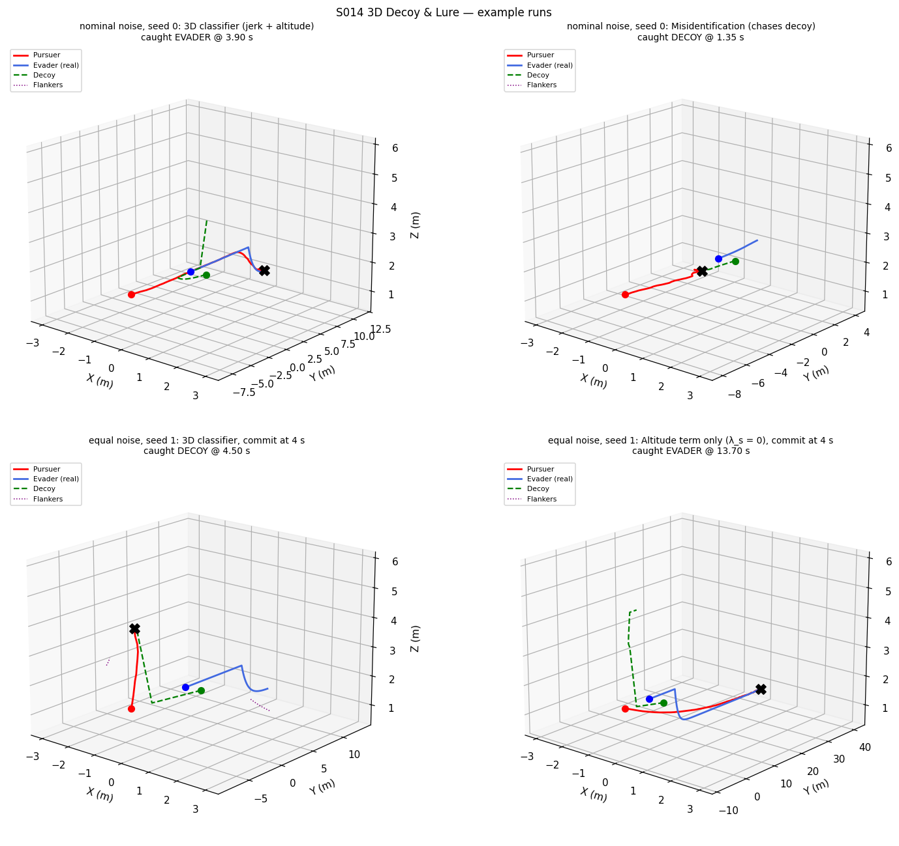
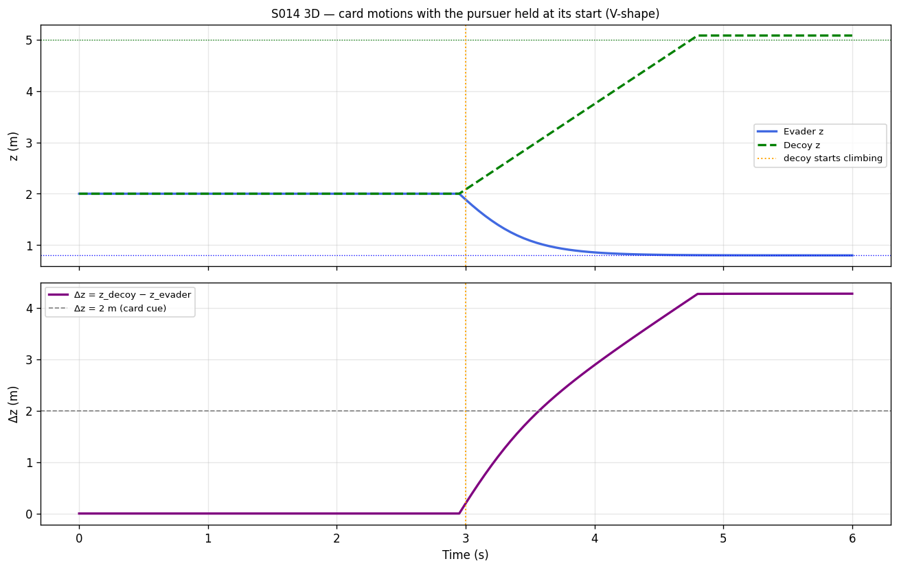
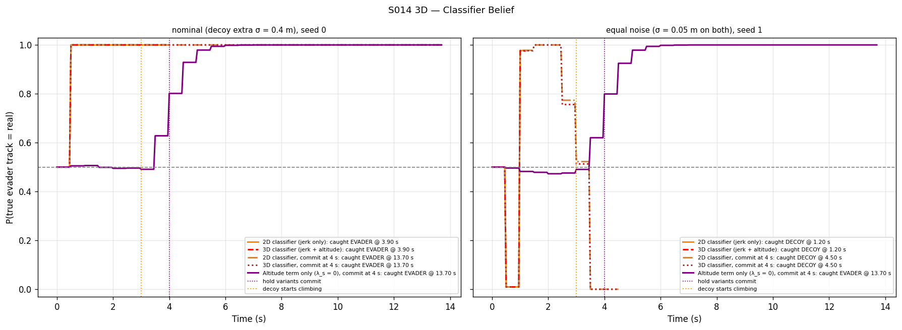
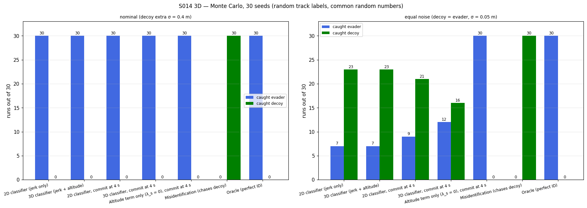
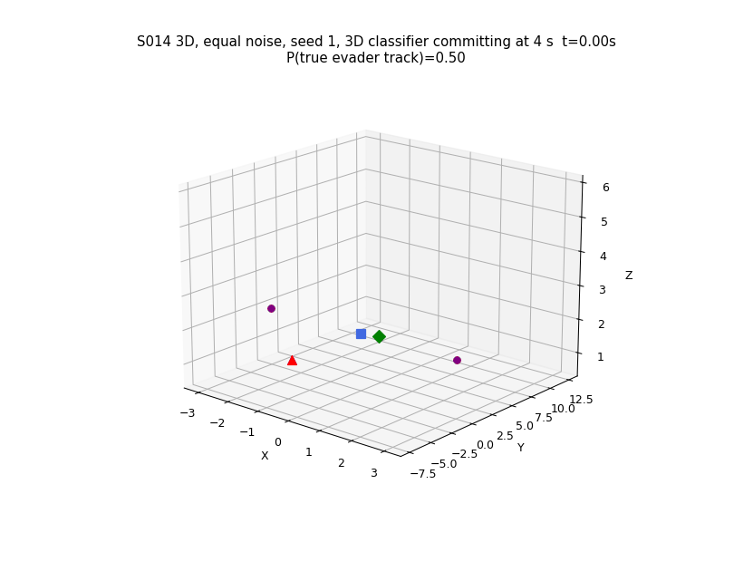

# S014 3D — Decoy & Lure

**Domain**: Pursuit & Evasion | **Difficulty**: ⭐⭐⭐⭐ | **Status**: ✅ Completed
**Scenario card**: [`scenarios/01_pursuit_evasion/3d/S014_3d_decoy_lure.md`](../../../../scenarios/01_pursuit_evasion/3d/S014_3d_decoy_lure.md)
**Source**: [`src/01_pursuit_evasion/3d/s014_3d_decoy_lure.py`](../../../../src/01_pursuit_evasion/3d/s014_3d_decoy_lure.py)

---

## Problem Definition

**Setup** (card): one pursuer sees two tracks and must decide which is the real evader.
- **Evader**: flees horizontally away from the pursuer at 3 m/s. When the decoy starts climbing (t = 3 s) it also dives toward z = 0.8 m.
- **Decoy**: flies toward the pursuer at 2 m/s as bait. From 3 s to 6 s it climbs toward z = 5 m (the "altitude trap"), and after 6 s it stops.
- **Flankers**: two drones allied with the evader. They wait until the pursuer climbs above 3.5 m, then fly to 1.5 m above it and 2 m beside it.

The pursuer runs the card's Bayesian log-ratio classifier on the two observed tracks. In the 2D form it uses jerk only; in the 3D form it uses jerk plus an altitude term.

**Comparison** (card: "2D classifier vs 3D classifier, misidentification rate over 30 random seeds"):
- 2D and 3D classifiers that act on the first update
- the same two classifiers when the pursuer hovers until 4 s before committing (card: "the pursuer must observe [Δz] and update its classifier before committing")
- the altitude term alone
- bounds: always chase the decoy (misidentification) and always chase the evader (oracle)

Each strategy is run at the card's decoy noise and with the decoy as precisely observed as the evader.

As in the fixed 2D S014, the real evader is on track A or B at random per seed. Until the first classifier update the pursuer flies toward the midpoint of the two tracks, so the label order carries no information.

---

## Mathematical Model

### Motions (card)

$$\mathbf{v}_{decoy} = 2\,\frac{[\hat{\mathbf{u}}_{xy},\ c]}{\|[\hat{\mathbf{u}}_{xy},\ c]\|},\quad \hat{\mathbf{u}}_{xy} = \frac{(\mathbf{p}_P - \mathbf{p}_D)_{xy}}{\|\cdot\|},\quad c = \begin{cases}0 & t < 3\text{ s}\\ 1.5 & 3 \le t < 6\text{ s},\ z_D < 5\text{ m}\end{cases},\quad \mathbf{v}_{decoy} = 0 \text{ for } t \ge 6\text{ s}$$

$$\mathbf{v}_E = 3\,\frac{[\hat{\mathbf{a}}_{xy},\ \Delta z]}{\|[\hat{\mathbf{a}}_{xy},\ \Delta z]\|},\quad \hat{\mathbf{a}}_{xy} = \frac{(\mathbf{p}_E - \mathbf{p}_P)_{xy}}{\|\cdot\|},\quad \Delta z = \begin{cases}0 & t < 3\text{ s}\\ 0.8 - z_E & t \ge 3\text{ s}\end{cases}$$

### Observations

- **Evader track**: true position + N(0, 0.05²) on every axis.
- **Decoy track**: the same sensor noise, plus the card's decoy noise ε_xy ~ N(0, 0.4²) in x and y (nominal case), or no extra noise (equal-noise case).

### Classifier (card)

Every 0.5 s, with $s_j$ the mean $\|\mathbf{v}_j(t) - \mathbf{v}_j(t-\Delta t)\|/\Delta t$ over the last 10 steps of track j (velocities from differenced observations):

$$\Lambda \mathrel{+}= \lambda_s\,(s_B - s_A) \;+\; \underbrace{\lambda_z\,(z_B - z_A)}_{\text{3D classifier only}}, \qquad P(\text{A real}) = \tfrac12\big(1 + \tanh(\Lambda/2)\big)$$

The pursuer flies at 5 m/s toward the track with P > 0.5. The "commit at 4 s" variants hover until t = 4 s. Capture of either track within 0.15 m ends the run.

### Flankers (card)

$$\mathbf{p}_{F1}^{target} = \mathbf{p}_P + [0, 0, 1.5]^T, \qquad \mathbf{p}_{F2}^{target} = \mathbf{p}_P + [0, 2, 0]^T, \qquad \text{active once } z_P > 3.5\text{ m}$$

---

## Key Parameters

| Parameter | Value |
|-----------|-------|
| Pursuer / evader / decoy / flanker speed | 5 / 3 / 2 / 4 m/s |
| Pursuer, evader, decoy start | (0, −8, 2), (0, 0, 2), (0.5, 0.3, 2) m |
| Flanker starts | (−3, 0, 2), (3, 0, 2) m |
| Lure / trap phase | 0–3 s / 3–6 s |
| Decoy climb (before renormalisation), trap height | 1.5 m/s, 5.0 m |
| Evader escape altitude | 0.8 m |
| Flanker activation altitude, offsets | 3.5 m; +1.5 m z, +2 m y |
| Sensor noise (both tracks) | 0.05 m, all axes |
| Extra decoy noise ε_xy | 0.4 m (nominal), 0 (equal-noise case) |
| λ_s, λ_z | 0.5, 0.3 |
| Update period, jerk window | 0.5 s, 10 steps |
| Commit time (hold variants) | 4.0 s |
| Capture radius | 0.15 m |
| z range | 0.5 – 6.0 m |
| dt / max time | 0.05 s / 25 s |
| Monte Carlo | 30 seeds; seed s fixes track labels and all noise draws for every strategy (common random numbers) |

---

## Implementation

```bash
conda activate drones
python src/01_pursuit_evasion/3d/s014_3d_decoy_lure.py
```

Runtime ≈ 15 s: 21 example runs, 2 × 210 Monte Carlo runs, a 210-run check without flankers, and a 46-frame GIF.

---

## Results

### Card motions (pursuer held at its start)

- **V-shape**: the decoy peaks at 5.08 m and the evader dives to 0.80 m. At 6 s, Δz = 4.28 m.
- **Timing of the altitude cue**: the card's discriminating cue (Δz > 2 m) first appears at **3.60 s**.

### Jerk proxy: motion vs sensor noise (m/s², pursuer held at its start)

| Track | Phase | 3D: motion only | 3D: noise only | 3D: observed | z-only: motion | z-only: noise |
|-------|-------|----------------:|---------------:|-------------:|---------------:|--------------:|
| Evader | lure 0–3 s | 0.9 | 77.7 | 77.9 | 0.8 | 37.7 |
| Evader | trap 3–6 s | 0.9 | 85.8 | 85.8 | 0.8 | 32.7 |
| Decoy (extra σ 0.4 m) | lure 0–3 s | 0.6 | 420.7 | 420.5 | 0.6 | 47.5 |
| Decoy (extra σ 0.4 m) | trap 3–6 s | 26.6 | 453.5 | 447.3 | 0.6 | 30.4 |
| Decoy (equal noise) | lure 0–3 s | 0.6 | 82.5 | 81.9 | 0.6 | 47.5 |
| Decoy (equal noise) | trap 3–6 s | 26.6 | 64.8 | 65.3 | 0.6 | 30.4 |

### Monte Carlo (30 seeds)

| Strategy | Nominal: evader / decoy captured | Nominal: mean evader-capture time | Equal noise: evader / decoy / timeout | Equal noise: mean evader-capture time | Equal noise: runs with flankers activated |
|----------|------------------|------------------|------------------|------------------|------------------|
| 2D classifier (jerk only) | 30 / 0 | 3.88 s | 7 / 23 / 0 | 3.88 s | 0 |
| 3D classifier (jerk + altitude) | 30 / 0 | 3.88 s | 7 / 23 / 0 | 3.88 s | 0 |
| 2D classifier, commit at 4 s | 30 / 0 | 13.70 s | 9 / 21 / 0 | 13.97 s | 21 |
| 3D classifier, commit at 4 s | 30 / 0 | 13.70 s | **12 / 16 / 2** | 14.18 s | 19 |
| Altitude term only (λ_s = 0), commit at 4 s | 30 / 0 | 13.70 s | **30 / 0 / 0** | 13.70 s | 0 |
| Misidentification (chases decoy) | 0 / 30 | – | 0 / 30 / 0 | – | 0 |
| Oracle | 30 / 0 | 3.85 s | 30 / 0 / 0 | 3.85 s | 0 |

- **Latest decoy capture with equal noise**: 3.90 s for both immediate classifiers, 20.90 s (2D) and 23.90 s (3D) when committing at 4 s, and 1.45 s for misidentification.
- **Flanker check**: with the flankers removed, outcomes and times are identical in all equal-noise runs.

### Example runs

- **Seed 0, nominal noise**: the real evader is on track B. Both classifiers catch the evader at 3.90 s, the oracle at 3.85 s, and misidentification catches the decoy at 1.35 s.
- **Seed 1, equal noise**: this is the first seed where the 3D classifier committing at 4 s fails.
  - Both immediate classifiers catch the decoy at 1.20 s.
  - Both "commit at 4 s" classifiers follow the climbing decoy up to 4.53 m and catch it at 4.50 s. The flankers activate at 4.30 s but are still 7.16 m away at capture.
  - The altitude-only classifier catches the evader at 13.70 s.

**Key findings**:
- **With the card's decoy noise, the cue is the noise.** The decoy's extra 0.4 m noise makes its jerk proxy 5.4× the evader's (420.7 vs 77.7 m/s² in the lure phase). Its motion contributes 0.6 m/s². Every classifier is right 30/30, as in the 2D S014 fix.
- **The 2D and 3D classifiers make identical decisions when they act on the first update.** The altitude term is zero until the decoy starts climbing at 3 s, and the Δz > 2 m cue only exists from 3.60 s. With equal noise, every misidentified run catches the decoy by 3.90 s.
- **With equal noise, acting early is worse than a coin flip (7/30).** The decoy flies *toward* the pursuer, so any wrong or flipped belief ends at the decoy within about a second. Staying on the evader needs the belief to hold for the whole ~3.9 s chase.
- **Waiting for the altitude cue helps only if the classifier listens to it.** Committing at 4 s raises the 3D classifier to 12/30 (vs 9/30 for 2D), but the card's weights drown the cue. λ_z·Δz is about 0.3 × 2 = 0.6 per update. λ_s·(s_B − s_A) is half the difference of two noise-dominated jerk values of 65–86 m/s² each (table above), so a difference of just over 1 m/s² already outweighs the altitude term. With the altitude term alone, the same patient pursuer is right **30/30**.
- **The card's claim that the climb raises the decoy's jerk is not supported.** A constant-rate climb adds 0.6 m/s² of z-jerk, against 30–47 m/s² of differentiated sensor noise. The 26.6 m/s² motion jerk in the trap phase comes from the decoy arriving over the held pursuer late in the window, where its horizontal heading reverses every step.
- **The altitude trap is real, but only after a late wrong commitment.** In seed 1 both "commit at 4 s" classifiers chase the climbing decoy to 4.53 m. Flankers activate in 21 (2D) and 19 (3D) of the 30 equal-noise hold runs.
- **The flankers cannot change any outcome.** The card gives them no capture or blocking role and gives the pursuer no avoidance rule. Removing them leaves every outcome and time unchanged. They are kept as the card describes and reported, not credited.

### 3D Trajectories (top: seed 0 nominal; bottom: seed 1 equal noise)



### Altitude Contrast (card motions with the pursuer held at its start)



### Classifier Belief P(true evader track = real)



### Monte Carlo (30 seeds per strategy and noise case)



### Animation (seed 1, equal noise, 3D classifier committing at 4 s: the pursuer is lured up to the decoy; purple dots = flankers; every 2nd step, 46 frames)



### Deviations from the scenario card

| Card | This implementation | Reason |
|------|--------------------|--------|
| (Old code: a different scenario with no pursuer, classifier or ID comparison) | Card scenario: pursuer, evader, decoy, two flankers, Bayesian classifier | Restores the card |
| Track order fixed (pseudocode: track 1 = evader) | Real evader on track A or B at random per seed; pursuer flies to the midpoint until the first update | 2D S014 fix: otherwise ties resolve toward the real target |
| Decoy noise as position process noise (pseudocode) or $\mathbf{p}_E + \boldsymbol\varepsilon_{xy}$ (text) | Decoy flies its own card trajectory; ε_xy (σ 0.4 m) is added to its *observed* x, y; both tracks also carry 0.05 m sensor noise | A decoy drawn on top of the evader leaves no choice of target. Sensor noise on both tracks is needed for a fair equal-noise test |
| Evader dives from t = 0 (pseudocode) | Dives from t = 3 s | Card text: "dives as soon as the decoy begins its climb" |
| Decoy climbs "to z_trap" | Climb component removed once z ≥ 5 m (peak 5.08 m) | The pseudocode has no stop |
| Two λ_z values (0.3 in the log-ratio, 2.0 in the sigmoid prior) | Log-ratio form with λ_z = 0.3 | The card calls it the "full Bayesian update" |
| 2D vs 3D classifier only | Plus commit-at-4 s variants, altitude-only, misidentification and oracle bounds, and an equal-noise case | Needed to separate the noise cue, the motion cue and the altitude cue |
| Flankers "force the pursuer to choose" | Flankers fly to the card offsets; no avoidance rule; a flanker-free control is run | The card defines no mechanism for them to act, and the control confirms they change nothing |
| Flanker starts and speed, sensor noise not given | (±3, 0, 2) m, 4 m/s; 0.05 m | Chosen values |
| Max time 20 s (pseudocode) | 25 s | The commit-at-4 s pursuer needs about 14 s to run down the fleeing evader |

---

## Extensions

1. Smooth the tracks (e.g. a Kalman filter) before computing jerk, so motion cues are not buried in differentiated noise
2. Learn λ_s and λ_z from data; the run shows the card's weights make the altitude term negligible
3. Adaptive decoy that mirrors the evader's altitude to defeat the altitude term (card extension 1)
4. Give the flankers a role: a pursuer avoidance rule or a blocking volume, then measure their effect against the flanker-free control

---

## Related Scenarios

- Original 2D version: [S014 Decoy & Lure](../../../../scenarios/01_pursuit_evasion/S014_decoy_lure.md)
- Tracking under noise: [S008 3D Upgrade — Stochastic Pursuit (Kalman Filter Tracking)](../../../../scenarios/01_pursuit_evasion/3d/S008_3d_stochastic_pursuit.md)
- Neighbours: [S013 3D Upgrade — Pincer Movement](../../../../scenarios/01_pursuit_evasion/3d/S013_3d_pincer_movement.md), [S015 3D Upgrade — Relay Tracking](../../../../scenarios/01_pursuit_evasion/3d/S015_3d_relay_tracking.md)
