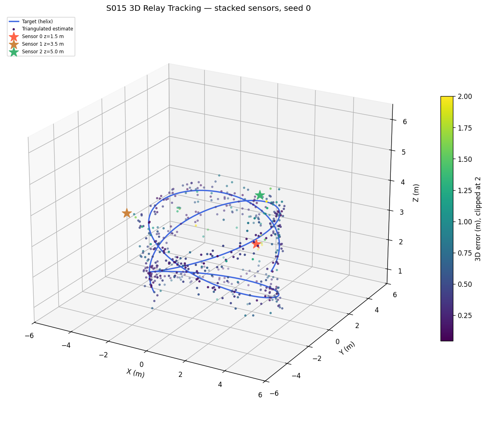
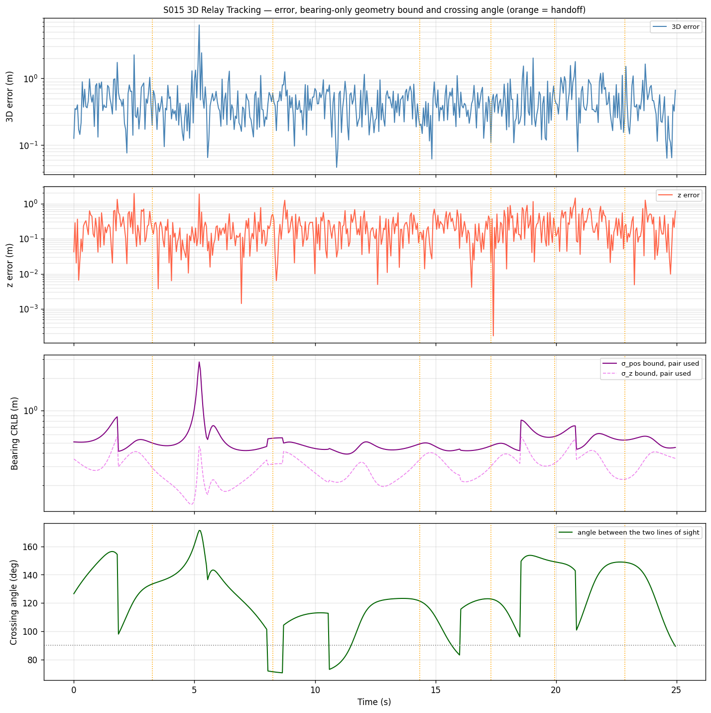
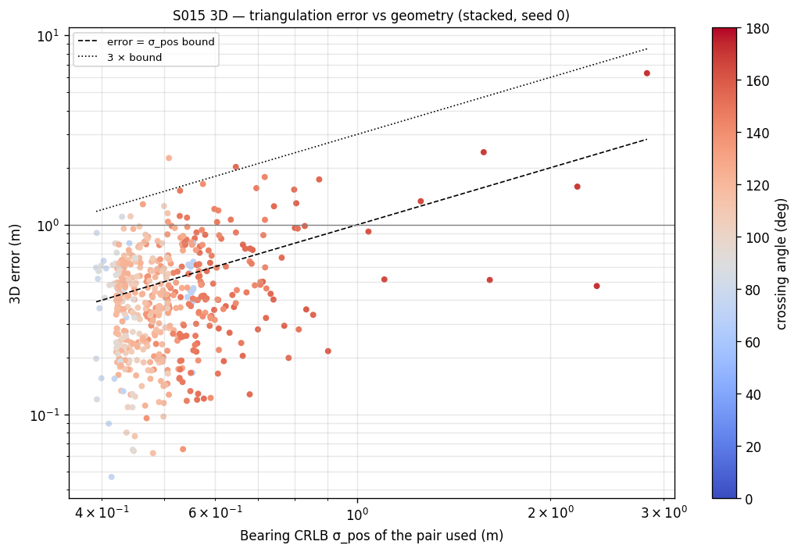
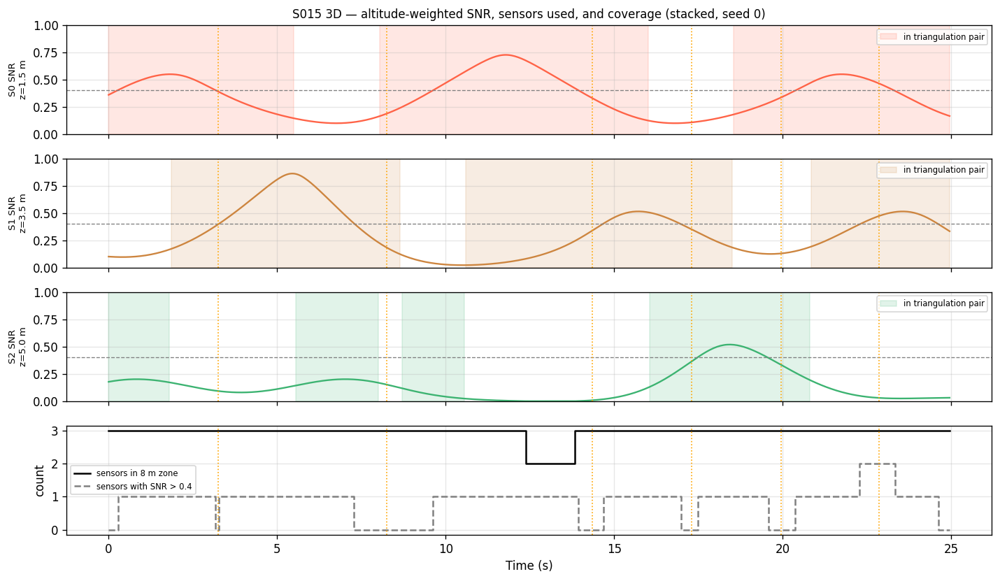
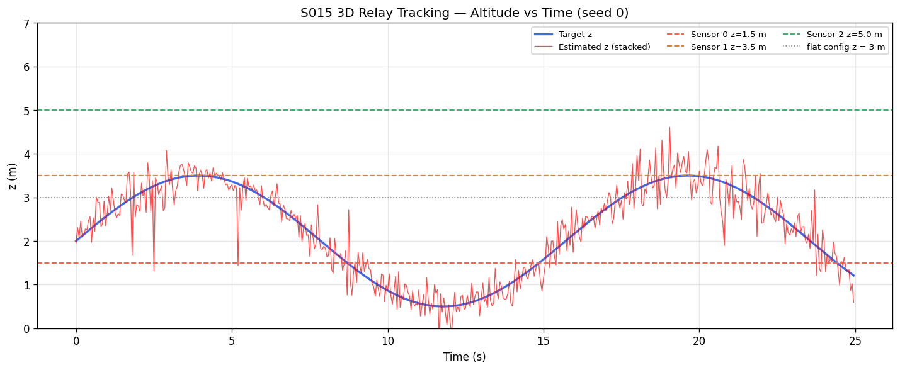
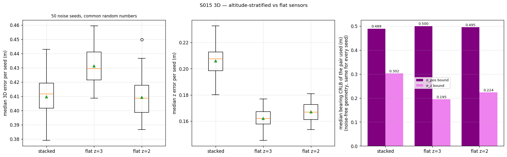
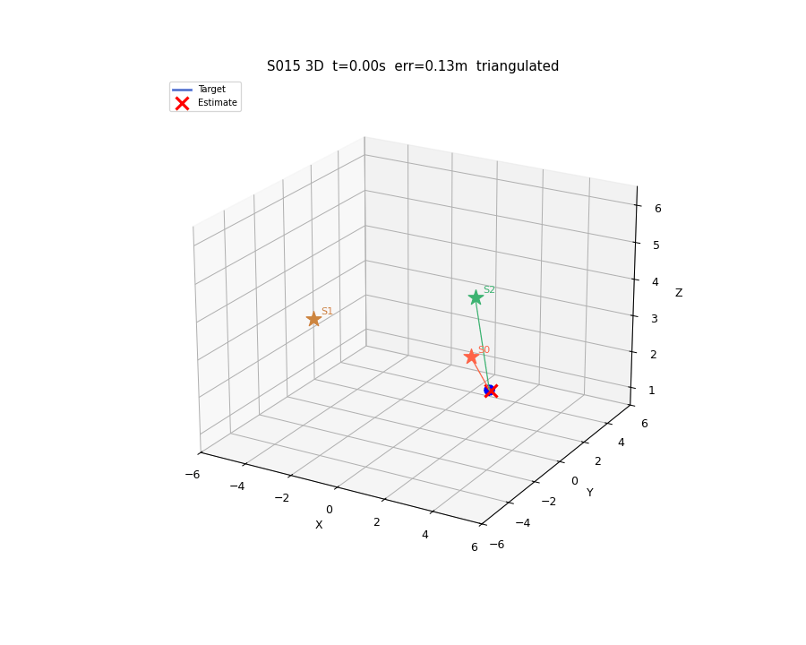

# S015 3D — Relay Tracking

**Domain**: Pursuit & Evasion | **Difficulty**: ⭐⭐⭐⭐ | **Status**: ✅ Completed
**Scenario card**: [`scenarios/01_pursuit_evasion/3d/S015_3d_relay_tracking.md`](../../../../scenarios/01_pursuit_evasion/3d/S015_3d_relay_tracking.md)
**Source**: [`src/01_pursuit_evasion/3d/s015_3d_relay_tracking.py`](../../../../src/01_pursuit_evasion/3d/s015_3d_relay_tracking.py)

---

## Problem Definition

**Setup** (card): a target flies a helix, a 3 m orbit at 2 m/s with z = 2 + 1.5 sin(0.4t). Three bearing-only sensor drones measure azimuth and elevation with Gaussian noise. The sensor with the highest altitude-weighted SNR is the primary sensor, and a change of primary is a handoff. Every step the two highest-SNR sensors inside their 8 m zone are triangulated with the card's closest-approach midpoint. The sensors never measure range.

**Card objectives**:
1. Show whether altitude-stratified sensors (z = 1.5 / 3.5 / 5.0 m) reduce the estimation error compared with flat sensors (card: all at z = 3 m; also run at z = 2 m, the target's mean altitude).
2. Show whether error spikes at handoffs.

---

## Mathematical Model

### Bearings and Rays (card)

$$\alpha_i = \operatorname{atan2}(y_T - y_i, x_T - x_i) + \epsilon_\alpha, \qquad \beta_i = \operatorname{atan2}\!\left(z_T - z_i, \sqrt{(x_T-x_i)^2 + (y_T-y_i)^2}\right) + \epsilon_\beta$$

$$\hat{\mathbf{d}}_i = [\cos\beta_i\cos\alpha_i,\ \cos\beta_i\sin\alpha_i,\ \sin\beta_i]^T$$

### Two-Ray Triangulation (card)

$$s_1^* = \frac{be - d}{1 - b^2},\quad s_2^* = \frac{e - bd}{1 - b^2},\quad \hat{\mathbf{p}}_T = \tfrac12\big[(\mathbf{p}_1 + s_1^*\hat{\mathbf{d}}_1) + (\mathbf{p}_2 + s_2^*\hat{\mathbf{d}}_2)\big]$$

with $b = \hat{\mathbf{d}}_1\cdot\hat{\mathbf{d}}_2$, $d = \hat{\mathbf{d}}_1\cdot\mathbf{w}$, $e = \hat{\mathbf{d}}_2\cdot\mathbf{w}$, $\mathbf{w} = \mathbf{p}_1 - \mathbf{p}_2$. With fewer than two sensors in zone, or with parallel rays, the last estimate is held. No true range is ever used.

### SNR and Handoff (card)

$$\text{SNR}_i^{3D} = \max\!\left(0, 1 - \frac{\|\mathbf{p}_T - \mathbf{p}_i\|}{R_{zone}}\right)\exp\!\left(-\frac{(z_T - z_i)^2}{2\sigma_z^2}\right)$$

The primary sensor is the argmax of SNR (2D S015 rule). The 0.4 threshold only counts covered sensors.

### Geometry Quality: Bearing-Only Cramér–Rao Bound

Each sensor contributes two Jacobian rows, scaled by 1/σ:

$$\frac{\partial\alpha}{\partial\mathbf{p}} = \frac{1}{r_{xy}}[-\sin\alpha,\ \cos\alpha,\ 0], \qquad \frac{\partial\beta}{\partial\mathbf{p}} = \frac{1}{r}[-\sin\beta\cos\alpha,\ -\sin\beta\sin\alpha,\ \cos\beta]$$

$$\sigma_{pos} = \sqrt{\operatorname{tr}\big((\mathbf{H}^T\mathbf{W}\mathbf{H})^{-1}\big)}, \qquad \sigma_z = \sqrt{\big[(\mathbf{H}^T\mathbf{W}\mathbf{H})^{-1}\big]_{zz}}$$

These are computed for the pair actually used, in metres. Two sensors already give a rank-3 matrix, so the bound is finite at every step.

The card's DOP stacks unit *range* vectors. That is range (TOA) geometry, and with the two sensors in use it is rank 2. That is why the old code produced 486/500 infinite DOP values and 6 NaN values.

---

## Key Parameters

| Parameter | Value |
|-----------|-------|
| Sensor x, y | (0, 4), (−3.46, −2), (3.46, −2) m |
| Sensor z: stacked / flat (card) / flat (target mean) | 1.5, 3.5, 5.0 / 3.0 × 3 / 2.0 × 3 m |
| Zone radius | 8 m (spherical) |
| σ_α / σ_β | 0.05 / 0.07 rad |
| Target | helix, r = 3 m, 2 m/s, z = 2 + 1.5 sin(0.4t) |
| SNR threshold (coverage count only) | 0.4 |
| Altitude-weighting bandwidth σ_z | 2.0 m |
| Large-error threshold (attribution) | 1.0 m |
| dt / duration | 0.05 s / 25 s (500 steps) |
| Monte Carlo | 50 noise seeds; every sensor draws its noise every step, so all configurations share the same noise (common random numbers); main run seed 0 |

---

## Implementation

```bash
conda activate drones
python src/01_pursuit_evasion/3d/s015_3d_relay_tracking.py
```

Runtime ≈ 45 s: 1 main run, 150 Monte Carlo runs and a 125-frame GIF.

---

## Results

### Main run (stacked sensors, seed 0)

| Metric | Value |
|--------|-------|
| Handoffs | 6, at t = 3.25, 8.25, 14.35, 17.30, 19.95, 22.85 s |
| Steps triangulated / held | **500 / 0** (the old code triangulated in 21 steps and used the true range in 376) |
| Steps with 0 / 1 / 2+ sensors above SNR 0.4 | 103 / 376 / 21 |
| 3D error: mean / median / p95 | 0.490 / 0.416 / 1.039 m |
| Max 3D error | **6.307 m at t = 5.20 s**: crossing angle 171.3°, σ_pos bound 2.827 m (the largest of the run), 1.95 s after the nearest handoff |
| z error: mean / median | 0.257 / 0.195 m |
| Errors > 1 m | 27 steps, all triangulated. They lie 2.30 s before to 2.05 s after the nearest handoff, and only 4 are within ±0.25 s of one. Their crossing angles are 85.0–171.3°, and their median σ_pos bound is 0.608 m vs 0.489 m over all steps |
| Error / σ_pos bound | median 0.82, p95 1.90, max 4.42 |
| log error vs log bound | correlation 0.30 |
| Error within ±0.5 s of a handoff vs elsewhere | mean 0.464 vs 0.499 m (126 steps near a handoff); median 0.421 vs 0.406 m |

### Flat vs stacked (50 seeds, common random numbers)

| Sensors | Median 3D error (mean over seeds) | Mean 3D error | p95 | Max over seeds | Median z error | Mean z error | σ_pos bound / σ_z bound (median) |
|---------|------|------|------|------|------|------|------|
| **Stacked** 1.5 / 3.5 / 5.0 m | 0.410 m | 0.488 m | 1.045 m | 15.60 m | 0.206 m | 0.257 m | 0.489 / 0.302 m |
| Flat z = 3 m (card) | 0.431 m | 0.627 m | 1.502 m | 439.97 m | **0.162 m** | 0.206 m | 0.500 / 0.195 m |
| Flat z = 2 m | 0.409 m | 0.504 m | 1.114 m | 91.04 m | 0.167 m | 0.208 m | 0.495 / 0.224 m |

Paired differences (flat − stacked, same seeds):

| Comparison | Metric | Flat − stacked | Seeds where stacked is better |
|------------|--------|----------------|-------------------------------|
| Flat z = 3 m vs stacked | median 3D error | +0.022 ± 0.014 m | 48/50 |
| Flat z = 3 m vs stacked | median z error | −0.044 ± 0.010 m | **0/50** |
| Flat z = 2 m vs stacked | median 3D error | −0.000 ± 0.017 m | 25/50 |
| Flat z = 2 m vs stacked | median z error | −0.039 ± 0.011 m | **0/50** |

**Key findings**:
- **Triangulation now runs on every step**, with no true range anywhere. All three sensors are inside their 8 m zone in 471 of 500 steps, and two are in the other 29 (t = 12.40–13.80 s), so a pair is always available. The SNR 0.4 threshold is not a usable gate here: only 21 of 500 steps have two sensors above it.
- **Large errors come from geometry and noise, not from handoffs.** The worst error (6.307 m) occurs at the step with the largest geometry bound (2.827 m). There the two lines of sight cross at 171.3° (nearly collinear), 1.95 s after a handoff. Errors are not higher near handoffs (0.464 m within ±0.5 s vs 0.499 m elsewhere). As in the fixed 2D S015, the card's "error spikes at handoff" does not hold. Errors stay within a few multiples of the bearing-only bound (p95 = 1.90 bounds, max 4.42).
- **Stacked sensors do not improve z accuracy; flat sensors do.** Against the card's flat z = 3 m layout, stacking lowers the median 3D error by 0.022 m (better in 48/50 seeds) but raises the median z error by 0.044 m (worse in all 50 seeds). The noise-free geometry bound shows the same thing (σ_z 0.302 m stacked vs 0.195 m flat).
- **Where the z error comes from.** The noise-free bound shows the z penalty is geometry, not noise. But it is not simply the high 5.0 m sensor (sensor 2). Per pair in the main run:

  | Pair | Steps | Median z error | Median σ_z bound |
  |------|------:|---------------:|-----------------:|
  | (1, 2) | 100 | 0.142 m | 0.240 m |
  | (0, 1) | 279 | 0.198 m | 0.297 m |
  | (0, 2) | 121 | 0.256 m | 0.327 m |

  The pair that contains sensor 2 together with the 3.5 m sensor has the *lowest* z error. The worst pair is the low sensor (1.5 m) with the high one (5.0 m). These per-pair numbers do not isolate a single cause; what the run supports is that the tiered layout as a whole gives a larger σ_z bound than the flat layouts.
- **Against flat sensors at z = 2 m there is no 3D gain at all**: the difference is −0.000 m, with stacked better in 25/50 seeds.
- **Flat layouts have much larger worst cases.** Their mean errors and maxima (439.97 m at z = 3 m) come from near-parallel rays. Medians are the robust comparison.

### 3D Trajectory and Estimates (colour = error)



### Error, Geometry Bound and Crossing Angle vs Time (orange = handoff)



### Error vs Bearing-Only Geometry Bound



### SNR, Sensors Used and Coverage



### Altitude vs Time



### Flat vs Stacked (50 seeds)



### Animation (stacked, seed 0; lines show the two sensors used; every 4th step, 125 frames)



### Deviations from the scenario card

| Card | This implementation | Reason |
|------|--------------------|--------|
| Triangulate with the top-2 SNR sensors (pseudocode, every step) | Same, restricted to sensors inside the 8 m zone; the estimate is held if fewer than 2 | The old code required SNR > 0.4 for both (21/500 steps) and otherwise used one sensor with the **true range** |
| DOP = sqrt(tr((HᵀH)⁻¹)) with unit range vectors | Bearing-only Cramér–Rao bound σ_pos and σ_z for the pair used | The card's H is range geometry and is singular for two sensors (old code: 486 inf + 6 NaN of 500) |
| "Spikes at handoff are worse in 3D" | Errors attributed to crossing angle and geometry bound; error near handoffs measured | The measured result contradicts the card (as in 2D S015) |
| "Altitude-stratified sensors improve z accuracy" | Tested against flat z = 3 m (card) and z = 2 m, 50 seeds, common random numbers | The measured result contradicts the card for this target altitude band |
| Single noise realisation | 50 seeds; medians reported next to means | Means are dominated by rare near-parallel blow-ups |
| Handoff rule: SNR threshold | Primary = argmax SNR; the threshold only counts coverage | 2D S015 rule; with the threshold the target is often covered by no sensor at all (103 steps) |

---

## Extensions

1. Use all in-zone sensors with a least-squares or maximum-likelihood estimator instead of the two-ray midpoint
2. Choose the pair by the geometry bound instead of the altitude-weighted SNR
3. Mobile relay drone that repositions to minimise the bound in real time (card extension 1)
4. Optimise the tier altitudes for the target's actual altitude band (card extension 2)

---

## Related Scenarios

- Original 2D version: [S015 Relay Tracking](../../../../scenarios/01_pursuit_evasion/S015_relay_tracking.md)
- Range-based counterpart: [S046 3D Upgrade — Trilateration with Altitude](../../../../scenarios/03_environmental_sar/3d/S046_3d_trilateration.md)
- Neighbours: [S012 3D Upgrade — Relay Pursuit](../../../../scenarios/01_pursuit_evasion/3d/S012_3d_relay_pursuit.md), [S014 3D Upgrade — Decoy & Lure](../../../../scenarios/01_pursuit_evasion/3d/S014_3d_decoy_lure.md)
