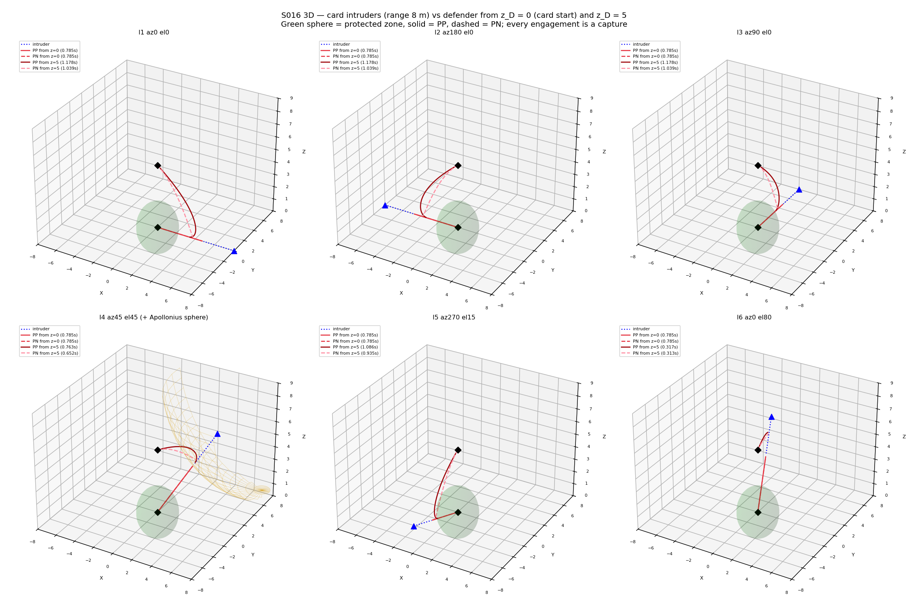
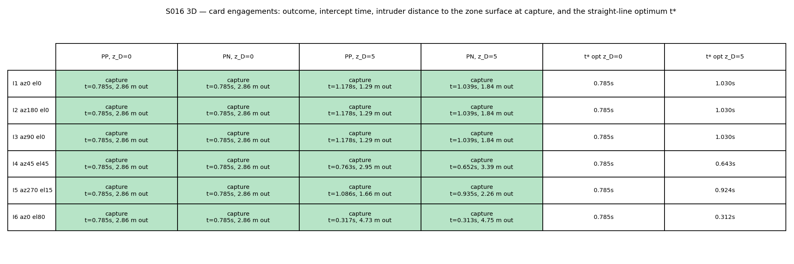
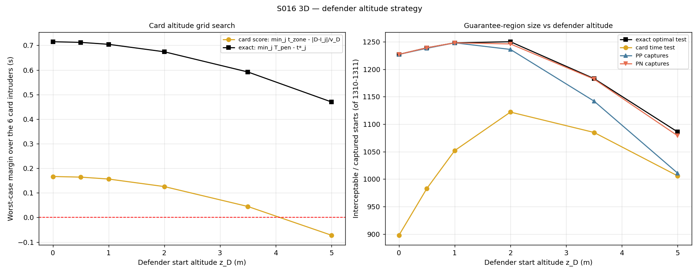
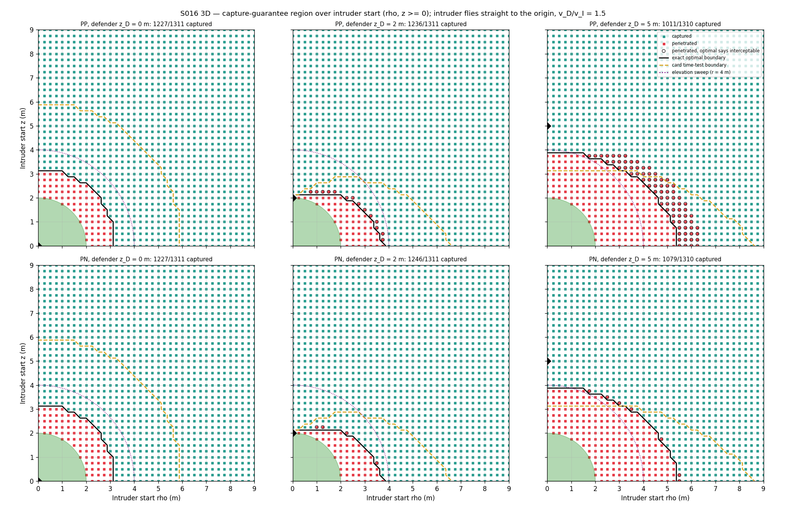
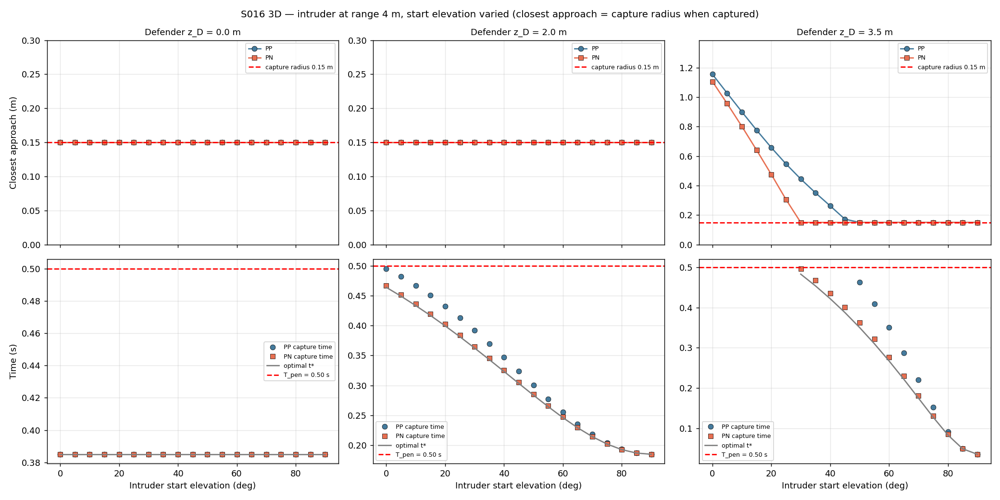
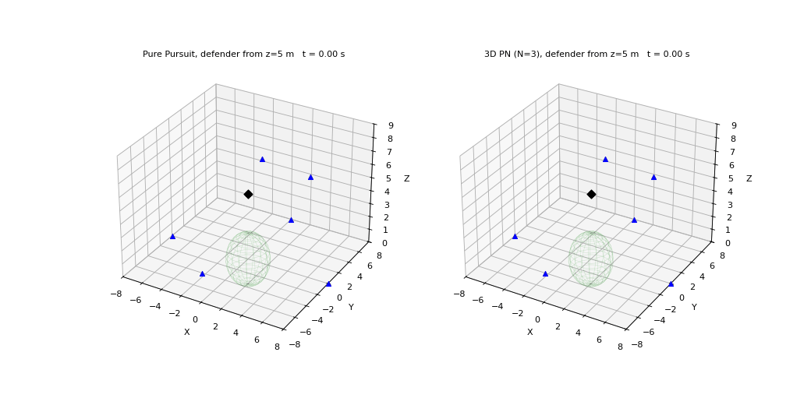

# S016 3D — Airspace Defense

**Domain**: Pursuit & Evasion | **Difficulty**: ⭐⭐⭐⭐ | **Status**: ✅ Completed

---

## Problem Definition

**Setup**: A protected zone (sphere of radius 2 m at the origin; ground is z = 0) is threatened by intruders that fly in a straight line at 4 m/s toward the zone centre from all 3D directions. A single defender (6 m/s) starts on the z-axis at (0, 0, z_D) and must intercept each intruder before it crosses the zone surface. As the card asks, **Pure Pursuit (PP)** is compared with **3D Proportional Navigation (PN, N = 3)**. Both fly at the same constant speed, start with the same heading (along the initial line of sight) and use the same capture test.

**Objectives (from the card)**: compare PP vs 3D PN, map the 3D capture-guarantee region, and analyse how the defender's start altitude affects coverage of diagonal approaches.

The script runs:
1. the card's 6 approach directions at range 8 m, from every candidate defender altitude z_D ∈ {0, 0.5, 1, 2, 3.5, 5} m (z_D = 0 is the card's zone-centre start);
2. the card's altitude grid search (worst-case margin over the 6 card intruders);
3. a capture-guarantee-region sweep over intruder start (ρ, z ≥ 0) for every z_D;
4. an approach-elevation sweep at 4 m range, where interception is marginal.

---

## Mathematical Model

**Protected zone:** $\mathcal{Z} = \{ \mathbf{p} \in \mathbb{R}^3 \mid \|\mathbf{p}\| \leq R_{zone} \}$, penetration time $T_{pen} = (\|\mathbf{p}_I(0)\| - R_{zone})/v_I$.

**Card time test** (the card's "Apollonius intercept condition"): $\|\mathbf{p}_D - \mathbf{p}_I\|/v_D \leq T_{pen}$. The card's altitude grid search maximises the worst-case margin $\min_j \left(T_{pen,j} - \|\mathbf{p}_D(z_D) - \mathbf{p}_{I_j}\|/v_D\right)$.

**Apollonius sphere** ($k = v_D/v_I = 1.5$): $\mathbf{c} = (k^2\mathbf{p}_I - \mathbf{p}_D)/(k^2 - 1)$, $r = k\|\mathbf{p}_I - \mathbf{p}_D\|/(k^2 - 1)$. Inside it the intruder arrives first; the straight intruder path leaves it at the optimal intercept point.

**Exact optimal-intercept test**: interception is possible iff some $t \le T_{pen}$ satisfies $\|\mathbf{p}_I(t) - \mathbf{p}_D(0)\| - r_{capture} \le v_D t$; the earliest such $t$ is $t^*$ (4000-point time grid). The exact worst-case margin is $\min_j (T_{pen,j} - t^*_j)$.

**Pure Pursuit:** $\mathbf{v}_D = v_D (\mathbf{p}_I - \mathbf{p}_D)/\|\mathbf{p}_I - \mathbf{p}_D\|$.

**3D PN** (constant speed, launched at $v_D$ along the initial LOS):

$$\dot{\hat{\boldsymbol{\lambda}}} = \frac{\mathbf{v}_{rel} - (\mathbf{v}_{rel}\cdot\hat{\boldsymbol{\lambda}})\hat{\boldsymbol{\lambda}}}{\|\mathbf{p}_I - \mathbf{p}_D\|}, \quad v_c = -\mathbf{v}_{rel}\cdot\hat{\boldsymbol{\lambda}}, \quad \mathbf{v}_D \leftarrow v_D \frac{\mathbf{v}_D + N v_c \dot{\hat{\boldsymbol{\lambda}}}\,\Delta t}{\|\mathbf{v}_D + N v_c \dot{\hat{\boldsymbol{\lambda}}}\,\Delta t\|}$$

**Capture / penetration**: $\|\mathbf{p}_D - \mathbf{p}_I\| < 0.15$ m / $\|\mathbf{p}_I\| \le R_{zone}$. Within each step both vehicles move at constant velocity; the first crossing of either condition inside the step decides the engagement.

---

## Key Parameters

| Parameter | Value |
|-----------|-------|
| Protected zone radius R_zone | 2 m |
| Defender start | (0, 0, z_D), z_D ∈ {0, 0.5, 1, 2, 3.5, 5} m; card start z_D = 0 |
| Defender speed v_D | 6 m/s |
| Intruder speed v_I | 4 m/s |
| Speed ratio k | 1.5 |
| PN gain N | 3 |
| PN initial velocity | 6 m/s along the initial line of sight |
| Capture radius | 0.15 m |
| dt / T_max | 0.02 s / 10 s |
| Card intruders (az, el of start position) | (0°,0°), (180°,0°), (90°,0°), (45°,45°), (270°,15°), (0°,80°), range 8 m |
| Region sweep | intruder start (ρ, 0, z), ρ = 0–9 m, z = 0–9 m, 0.25 m grid (1310–1311 starts outside the zone) |
| Elevation sweep | range 4 m, elevation 0–90° in 5° steps, z_D ∈ {0, 2, 3.5} m |
| Optimal-intercept time grid | 4000 points on [0, T_pen] |

---

## Implementation

```bash
conda activate drones
python src/01_pursuit_evasion/3d/s016_3d_airspace_defense.py
```

Runtime ≈ 35 s (72 card engagements, 2 × 6 × ~1311 region-sweep engagements, 2 × 3 × 19 elevation engagements, 60-frame GIF).

---

## Results

### Card intruders (range 8 m)

| Defender start | PP captures | PN captures | PP mean / worst time | PN mean / worst time |
|----------------|-------------|-------------|----------------------|----------------------|
| z_D = 0 (card) | 6/6 | 6/6 | 0.785 / 0.785 s | 0.785 / 0.785 s |
| z_D = 0.5 | 6/6 | 6/6 | 0.771 / 0.788 s | 0.771 / 0.788 s |
| z_D = 1 | 6/6 | 6/6 | 0.763 / 0.799 s | 0.761 / 0.796 s |
| z_D = 2 | 6/6 | 6/6 | 0.763 / 0.841 s | 0.753 / 0.827 s |
| z_D = 3.5 | 6/6 | 6/6 | 0.819 / 0.970 s | 0.773 / 0.912 s |
| z_D = 5 | 6/6 | 6/6 | 0.950 / 1.178 s | 0.836 / 1.039 s |

From the card start (0,0,0) all six engagements are the same head-on geometry: every intruder starts 8 m away, T_pen = (8 − 2)/4 = 1.500 s, and both laws capture at (8 − 0.15)/(6 + 4) = 0.785 s with the intruder 2.86 m outside the zone. The card time test passes for all six (‖D − I‖ = 8.000 m vs v_D·T_pen = 9.000 m).

From z_D = 5 the laws separate: on the horizontal intruders PP needs 1.178 s and PN 1.039 s (optimum t* = 1.030 s); on the steep el = 80° intruder they are almost equal (0.317 vs 0.313 s, t* = 0.312 s).

### Altitude grid search

| z_D (m) | Card worst margin (s) | Exact worst margin T_pen − t* (s) | Optimal-test interceptable starts | PP captured | PN captured | PN only |
|---------|----------------------|-------------------------|-----|-----|-----|-----|
| 0 | +0.167 | +0.715 | 1227 / 1311 | 1227 | 1227 | 0 |
| 0.5 | +0.164 | +0.712 | 1239 / 1311 | 1238 | 1239 | 1 |
| 1 | +0.156 | +0.704 | 1248 / 1311 | 1248 | 1248 | 0 |
| 2 | +0.126 | +0.674 | 1250 / 1311 | 1236 | 1246 | 10 |
| 3.5 | +0.045 | +0.592 | 1183 / 1310 | 1142 | 1182 | 40 |
| 5 | −0.072 | +0.470 | 1086 / 1310 | 1011 | 1079 | 68 |

Both the card's score and the exact margin pick z_D* = 0 for the 6 card intruders. No start is captured by PP only, and no simulated capture happens where the optimal test says interception is impossible. The defender never goes below ground (lowest defender z over the whole sweep: 0.000–0.038 m).

### Approach-elevation sweep (range 4 m, T_pen = 0.500 s)

| z_D | Optimal test | PP captures | PN captures | Example |
|-----|--------------|-------------|-------------|---------|
| 0 | 19/19 | 19/19 | 19/19 | every elevation: t = t* = 0.385 s (spherical symmetry) |
| 2 | 19/19 | 19/19 | 19/19 | el 0°: PP 0.495 s, PN 0.466 s, t* 0.464 s |
| 3.5 | 13/19 | 9/19 | 13/19 | el 30–45°: PN captures (0.497–0.401 s), PP penetrated (closest 0.445–0.172 m) |

**Key Findings**:
- **With a proper launch, PN tracks the optimum and PP does not.** PN captures within 0.011 s of t* in every card case (e.g. 1.039 vs 1.030 s from z_D = 5) and captures every start the optimal test allows at z_D = 0, 2 and 3.5 in the elevation sweep. PP chases the intruder's current position, flies a curved path and loses 75 of the 1086 interceptable region starts at z_D = 5 (PN loses 7).
- **The PN advantage is largest for low, horizontal approaches seen from a high defender, not for steep dives.** The card expects PN to help most against steep diagonal attacks. In the data the gap is largest when the intruder crosses the defender's line of sight: from z_D = 5, PP loses 0.139 s to PN on the horizontal intruders but only 0.004 s on the el = 80° dive, which comes almost straight at the defender.
- **From the zone centre the geometry is spherically symmetric.** At z_D = 0 every direction is the same head-on engagement, PP and PN are identical (1227/1227) and the guarantee region is a sphere of radius 3.23 m around the origin: capture at t = (r − 0.15)/10 needs r − 4t > 2, i.e. r > 3.233 m. The 3D direction only matters once the defender is off-centre.
- **Altitude: the card's worst-case criterion and region coverage disagree.** The card's grid search picks z_D* = 0 (worst margin +0.167 s), as the card predicts. Over all above-ground starts the interceptable region is largest at z_D = 1–2 m (1248–1250 vs 1227 at z_D = 0), because a slightly raised defender covers the high approaches better while still covering the horizontal ones. Above 2 m both coverage and the worst-case margin fall.
- **The card time test is conservative from a low defender and unsafe from a high one.** At z_D = 0–2 it never passes for a start that cannot be intercepted but rejects 329 / 256 / 196 / 128 interceptable starts (z_D = 0 / 0.5 / 1 / 2). At z_D = 3.5 and 5 it passes for 7 and 29 starts that **cannot** be intercepted: these intruders start just below the defender and fly away from it toward the zone, so "reach the start point before T_pen" does not mean "catch the intruder".

**3D trajectories — the 6 card intruders vs PP and PN from z_D = 0 (card start) and z_D = 5, Apollonius sphere of I4 (clipped to the box):**



**Outcome table — card engagements from z_D = 0 and z_D = 5, with the optimum t\*:**



**Altitude strategy — card grid search (left) and guarantee-region size vs defender altitude (right):**



**Capture-guarantee region over intruder start (ρ, z) for PP (top) and PN (bottom) at z_D = 0, 2, 5 m, with the exact optimal boundary (black) and the card time-test boundary (gold):**



**Closest approach and capture time vs intruder start elevation (range 4 m) for z_D = 0, 2, 3.5 m:**



**Animation — the 6 card intruders vs the defender from z_D = 5 m; PP left, PN right:**



### Deviations from the scenario card

| Card | Code | Reason |
|------|------|--------|
| Approach (270°, −45°) "oblique low" and (0°, −80°) "near-vertical dive from above" | (270°, +15°) and (0°, +80°) | The card's elevations put these starts 5.66 m and 7.88 m below ground (z = 0). The dive is labelled "from above", so its sign is flipped; the low oblique approach is kept low but above ground |
| PN starts with `v_def = 0` | PN launched at v_D along the initial line of sight | From rest, a head-on LOS has no rotation and the near-zero command was normalised to an arbitrary direction (the 2D bug); PN needs forward speed |
| PN velocity "saturated at v_D" | Rescaled to exactly v_D every step | Constant-speed vehicle at the same speed as PP, so only the guidance law differs |
| Altitude candidates {0.5, 1, 2, 3.5, 5} m; defender z range 0.5–6 m | {0, 0.5, 1, 2, 3.5, 5} m | z_D = 0 is the card's own start position (0, 0, 0); z_D = 6 was not added because coverage already falls from 2 m upward |
| Capture/penetration checked at the end of each step | First crossing inside the step for both events | Closing speed ≈ 10 m/s × 0.02 s = 0.2 m per step, comparable to the 0.15 m capture radius |
| Miss distance vs elevation at the card range | Closest approach vs elevation at 4 m range | At 8 m every start is captured by both laws from every altitude, so the miss distance is just the capture radius |
| Guarantee region "determine" | (ρ, z ≥ 0) sweep per defender altitude | The problem is symmetric about the z-axis for a defender on it, so the half-plane covers every 3D direction |
| Apollonius sphere overlaid on the 3D scene | Drawn for I4 only, clipped to the plot box | Six overlapping 9.6 m spheres hide the trajectories |
| — | The defender may fly through the protected zone | The card puts no constraint on the defender's path |

---

## Extensions

1. Multiple simultaneous intruders from all 6 directions — the defender must prioritise by time-to-zone
2. Intruder executes a last-second altitude jink during final approach to defeat PN
3. Two cooperating defenders at different altitude tiers — analyse the expanded 3D guarantee region

---

## Related Scenarios

- Original 2D version: [S016 Airspace Defense](../../../../scenarios/01_pursuit_evasion/S016_airspace_defense.md)
- 3D card: [S016 3D Upgrade — Airspace Defense](../../../../scenarios/01_pursuit_evasion/3d/S016_3d_airspace_defense.md)
- [S001 Basic Intercept](../../../../scenarios/01_pursuit_evasion/S001_basic_intercept.md), [S003 Low-Altitude Tracking](../../../../scenarios/01_pursuit_evasion/S003_low_altitude_tracking.md)
- Follow-up: [S017 3D Upgrade — Swarm vs Swarm](../../../../scenarios/01_pursuit_evasion/3d/S017_3d_swarm_vs_swarm.md)
