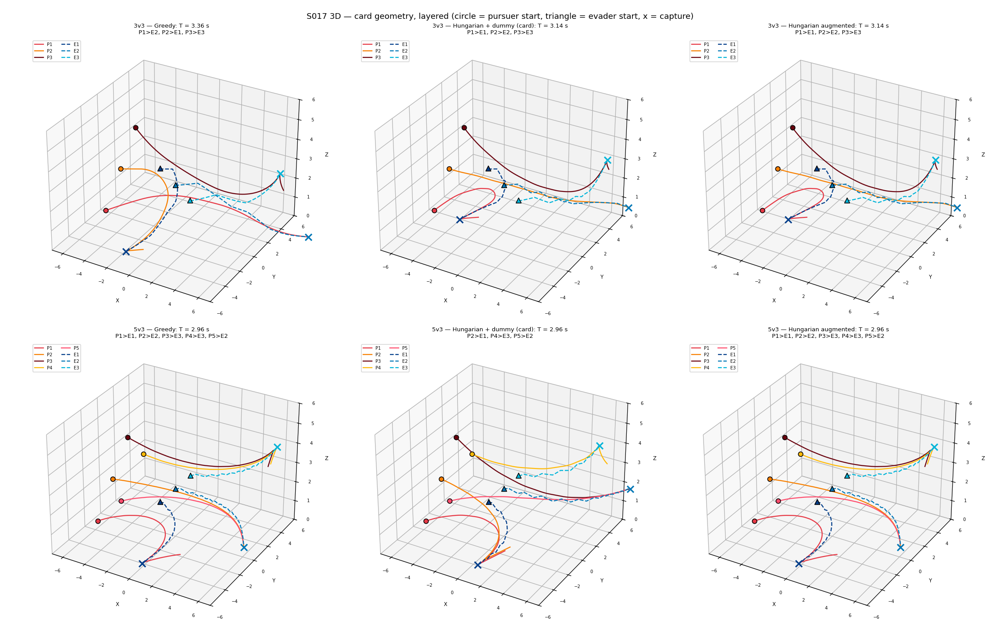
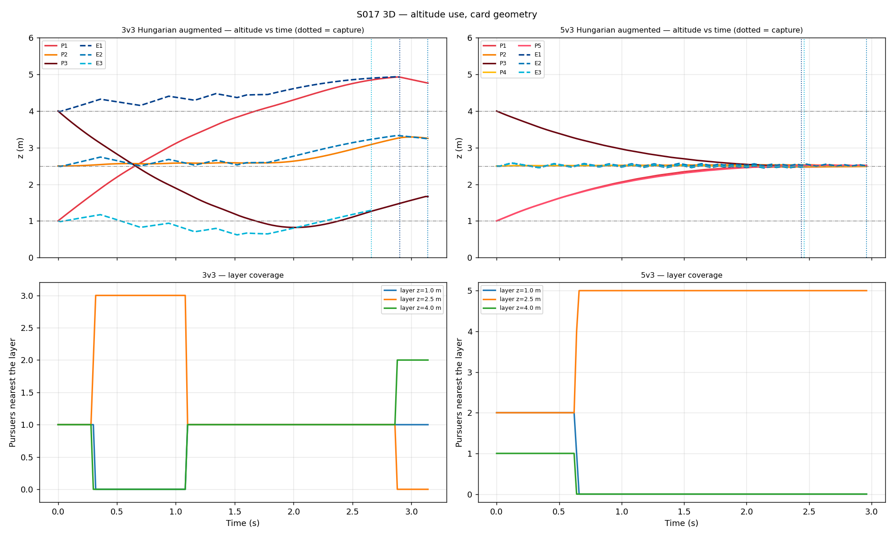
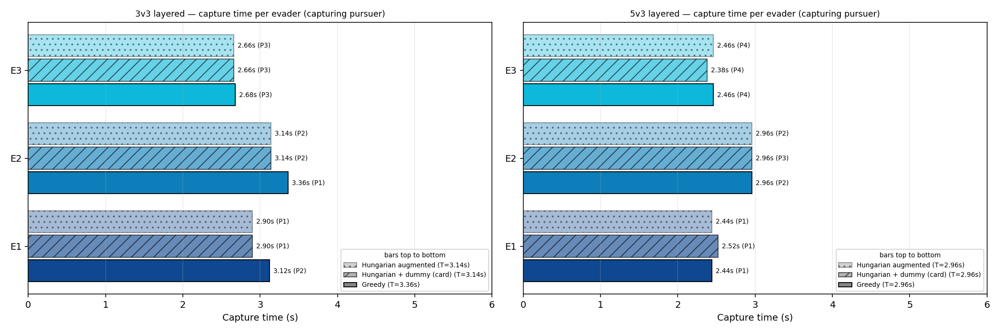
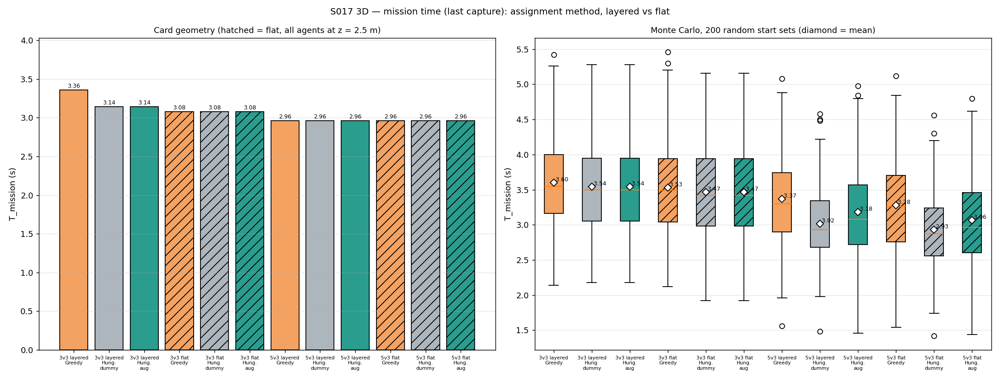
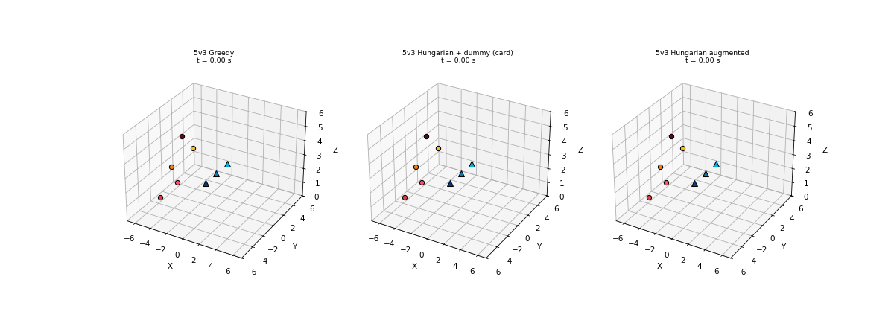

# S017 3D — Swarm vs Swarm

**Domain**: Pursuit & Evasion | **Difficulty**: ⭐⭐⭐⭐ | **Status**: ✅ Completed

---

## Problem Definition

**Setup**: M pursuers vs N = 3 evaders in a 3D volume with three altitude layers (z = 1.0, 2.5, 4.0 m). Pursuers fly 3D pure pursuit toward their assigned evader, with the card's dive boost when diving onto a lower evader. Evaders flee the 3D centroid of all pursuers and bias their altitude toward the layer farthest from every pursuer. When an evader is captured, every pursuer that was chasing it switches to the nearest remaining evader (3D distance).

Two cases from the card:
- **Case A (3v3)**: one pursuer and one evader on each layer; the evader layers are reversed with respect to the pursuers (pursuer at y = −2 is low, evader at y = −2 is high).
- **Case B (5v3)**: five pursuers spanning all layers; three evaders at mid altitude.

Three initial assignment methods on the 3D Euclidean cost matrix (the methods of the S017 2D fix):
- **Greedy**: pursuers in index order each take the nearest unclaimed evader; surplus pursuers take the nearest evader (shared).
- **Hungarian + dummy (card)**: Hungarian algorithm with dummy columns for M > N; pursuers left on a dummy column chase their nearest evader.
- **Hungarian augmented**: every evader column repeated ⌈M/N⌉ times, so the surplus pursuers are placed by the same sum-of-distances objective.

For M = N the two Hungarian variants are identical.

**Key questions (card)**: Hungarian vs greedy in 3D, and how altitude diversity changes total mission time compared with a flat deployment (every agent at z = 2.5 m). The card geometry is nearly symmetric, so the methods are also compared on 200 seeded random start sets with common random numbers (the same starts for every method; flat runs use the same x-y starts).

---

## Mathematical Model

**3D cost matrix**: $C_{ij} = \|\mathbf{p}_{P_i} - \mathbf{p}_{E_j}\|_2$; Hungarian $\sigma^* = \arg\min_\sigma \sum_i C_{i,\sigma(i)}$.
- Dummy padding (card): $[\,C \;|\; \lambda \mathbf{1}_{M\times(M-N)}\,]$ with equal large $\lambda$ — only N pursuers receive an evader.
- Augmented: $[\,C \;|\; C \;|\; \dots\,]$ with $\lceil M/N \rceil$ copies — every pursuer receives an evader, at most 2 per evader in 5v3.

**3D pure pursuit with dive boost**:

$$\mathbf{v}_{P_i} = v \,\frac{\mathbf{p}_{E} - \mathbf{p}_{P_i}}{\|\mathbf{p}_{E} - \mathbf{p}_{P_i}\|}, \qquad v = \begin{cases}\min\!\left(v_P\left(1 + \eta \frac{z_P - z_E}{\|\mathbf{p}_E - \mathbf{p}_P\|}\right),\; 1.3\,v_P\right) & z_P > z_E + 0.5\\ v_P & \text{otherwise}\end{cases}$$

**3D evader scatter**:

$$\mathbf{v}^{base}_{E_j} = v_E \frac{\mathbf{p}_{E_j} - \bar{\mathbf{p}}_P}{\|\mathbf{p}_{E_j} - \bar{\mathbf{p}}_P\|}, \quad z^{esc} = \arg\max_{z \in \{1, 2.5, 4\}} \min_i |z_{P_i} - z|, \quad \mathbf{v}_{E_j} = v_E \frac{\mathbf{v}^{base}_{E_j} + [0, 0, k_z (z^{esc} - z_{E_j})]^T}{\|\cdot\|}$$

Ties in $z^{esc}$ go to the lowest layer. Altitudes are clipped to [0.5, 5.5] m.

**Capture and reassignment**: evader j is captured when its assigned pursuer comes within 0.15 m. Every pursuer whose target is captured (or that has none) switches to the nearest remaining evader. $T_{mission} = \max_j t_{capture,j}$.

---

## Key Parameters

| Parameter | Value |
|-----------|-------|
| Altitude layers | z = 1.0, 2.5, 4.0 m |
| Pursuer speed v_P | 5 m/s |
| Dive boost | η = 0.15, only when z_P > z_E + 0.5 m, capped at 1.3 v_P |
| Evader speed v_E | 3.5 m/s |
| Vertical escape gain k_z | 0.5 |
| z range | 0.5 – 5.5 m |
| Capture radius | 0.15 m |
| dt / T_max | 0.02 s / 30 s |
| 3v3 pursuers | (−5, −2, 1.0), (−5, 0, 2.5), (−5, 2, 4.0) m |
| 3v3 evaders | (0, −2, 4.0), (0, 0, 2.5), (0, 2, 1.0) m |
| 5v3 pursuers | (−5, −3, 1.0), (−5, −1, 2.5), (−5, 1, 4.0), (−5, 3, 2.5), (−5, 0, 1.0) m |
| 5v3 evaders | (0, −2, 2.5), (0, 0, 2.5), (0, 2, 2.5) m |
| Flat variant | same x-y, every agent at z = 2.5 m |
| Monte Carlo trials / seed | 200 / 17 |
| Monte Carlo start boxes | pursuers x ∈ [−7, −3], y ∈ [−4, 4]; evaders x ∈ [−1, 1], y ∈ [−3, 3]; layered z ∈ [1, 4] m (uniform) |

---

## Implementation

```bash
conda activate drones
python src/01_pursuit_evasion/3d/s017_3d_swarm_vs_swarm.py
```

Runtime ≈ 80 s (12 card runs, 200 × 12 Monte Carlo runs, 51-frame GIF).

---

## Results

### Card geometry

| Case | Method | Initial assignment | Sum of assigned 3D distances | Captures (capturing pursuer) | T_mission layered | T_mission flat |
|------|--------|--------------------|------|------------------------------|------|------|
| 3v3 | Greedy | P1→E2, P2→E1, P3→E3 | 17.01 m | E1 3.12 s (P2), E2 3.36 s (P1), E3 2.68 s (P3) | 3.36 s | 3.08 s |
| 3v3 | Hungarian + dummy (card) | P1→E1, P2→E2, P3→E3 | 16.66 m | E1 2.90 s (P1), E2 3.14 s (P2), E3 2.66 s (P3) | **3.14 s** | 3.08 s |
| 3v3 | Hungarian augmented | same as dummy | 16.66 m | same | **3.14 s** | 3.08 s |
| 5v3 | Greedy | P1→E1, P2→E2, P3→E3, P4→E3, P5→E2 | 26.05 m | E1 2.44 s (P1), E2 2.96 s (P2), E3 2.46 s (P4) | 2.96 s | 2.96 s |
| 5v3 | Hungarian + dummy (card) | P2→E1, P4→E3, P5→E2; P1, P3 none | 15.42 m | E1 2.52 s (P1), E2 2.96 s (P3), E3 2.38 s (P4) | 2.96 s | 2.96 s |
| 5v3 | Hungarian augmented | same as greedy | 26.05 m | same as greedy | 2.96 s | 2.96 s |

Evader altitude range: 0.50–4.55 m (3v3 greedy), 0.62–4.94 m (3v3 Hungarian), 2.39–2.59 m (5v3). Dive boost active in 18–19 % of pursuer-steps in 3v3 and 6–7 % in 5v3. In 3v3 greedy one evader sits on the 0.5 m floor for 54 of its steps (1.08 s); no other card run touches the floor or the ceiling.

### Monte Carlo (200 random start sets, same starts for every method)

| Case | Method | Layered mean ± std | Flat mean ± std | Layered faster / slower than flat |
|------|--------|-------------|-------------|------|
| 3v3 | Greedy | 3.600 ± 0.618 s | 3.526 ± 0.646 s | 53 / 129 |
| 3v3 | Hungarian (both variants) | 3.542 ± 0.637 s | 3.467 ± 0.654 s | 55 / 132 |
| 5v3 | Greedy | 3.371 ± 0.651 s | 3.279 ± 0.647 s | 36 / 143 |
| 5v3 | Hungarian + dummy (card) | **3.017 ± 0.509 s** | **2.931 ± 0.511 s** | 42 / 140 |
| 5v3 | Hungarian augmented | 3.182 ± 0.606 s | 3.063 ± 0.592 s | 47 / 135 |

All 2400 runs capture every evader. Head-to-head on the same starts (faster / tie / slower, mean gain):
- 3v3 layered, Hungarian vs greedy: 73 / 73 / 54, +0.059 s (flat: 65 / 89 / 46, +0.059 s).
- 5v3 layered, Hungarian augmented vs greedy: 103 / 31 / 66, +0.190 s (flat: 104 / 35 / 61, +0.216 s).
- 5v3 layered, Hungarian augmented vs Hungarian + dummy: 44 / 49 / 107, −0.165 s (flat: 39 / 62 / 99, −0.132 s) — the card's dummy variant is better on average.

**Key Findings**:
- **In the layered 3v3 card case the 3D cost matrix does separate the methods.** Because the evader layers are reversed, P1 (low, y = −2) is closer to the mid-altitude E2 (5.59 m) than to its straight-across partner E1 (5.83 m). Greedy takes that myopic choice and leaves P2 with E1 (sum 17.01 m); the Hungarian matching is straight across (16.66 m) and finishes 0.22 s earlier (3.14 vs 3.36 s). In the flat version all three methods give the same straight-across matching and the same 3.08 s.
- **In 5v3 all three methods tie at 2.96 s.** The last capture is always E2, the evader at y = 0 that flees almost straight along +x from the pursuer centroid; the extra pursuers only change who catches E1 and E3 and when.
- **Over random starts Hungarian beats greedy on average but not every time.** Mean gain 0.059 s in 3v3 and 0.190 s in 5v3 (layered), yet greedy is faster in 54 (3v3) and 66 (5v3) of 200 trials. The Hungarian objective is the sum of distances, while the mission time is set by the last capture.
- **The previous README's explanation was wrong.** It blamed the 5v3 greedy result on pursuers "contending" for the same evader. The evaders flee the centroid of *all* pursuers, so adding pursuers or changing who chases whom moves the centroid and changes the evaders' paths. That is why method rankings flip from trial to trial. Also, the old 5v3 "Hungarian" mapped the extra pursuers by column index (`c % N`), not by cost.
- **Placing the surplus pursuers by cost is not better than "chase the nearest".** As in 2D, the card's dummy-column variant (3.017 s) beats the augmented variant (3.182 s) in 5v3: faster in 107 trials, slower in 44.
- **Altitude diversity costs time here; it does not help.** Layered starts are slower than flat starts by 0.07–0.12 s on average and in 129–143 of 200 trials per method. The vertical offsets add 3D distance that the pursuers must close. The dive boost only fires in 6–19 % of pursuer-steps and does not make up for it. The evaders' escape-layer bias also flips sign whenever a pursuer crosses their altitude, so they zig-zag in z (the 0.1–0.3 m wiggles in the altitude plot). The vertical velocity they waste slows their horizontal escape: flat 3v3 ends at 3.08 s, below the 3.23 s of a pure tail chase, (5 − 0.15)/(5 − 3.5).

**3D trajectories, card geometry (rows: 3v3, 5v3; columns: method):**



**Altitude vs time and pursuers per layer (Hungarian augmented):**



**Capture time per evader (card geometry, layered):**



**Mission time: card geometry (left) and Monte Carlo (right); hatched = flat:**



**Animation (5v3 layered; greedy, Hungarian + dummy, Hungarian augmented):**



### Deviations from the scenario card

| Card | Code | Reason |
|------|------|--------|
| Card code: extra pursuers in Hungarian take the nearest *unassigned* evader; greedy overflow takes `list(taken)[0]` | Three explicit methods: greedy (overflow → nearest), Hungarian + dummy (unassigned → nearest), Hungarian augmented | Same methods as the S017 2D fix; the card's overflow rules depend on index or set ordering, not cost |
| Layer-balance penalty λ_layer = 2 m in the reassignment cost | Not used | The card's penalty depends only on the pursuer (row), not on the evader. Adding a row constant changes no Hungarian assignment for M ≤ N and no nearest-evader reassignment, so it has no effect on the card's rules |
| Card code: only the capturing pursuer reassigns | Every pursuer whose target is captured switches to the nearest remaining evader | Otherwise the other pursuers on a captured evader keep flying at it |
| Case B evaders not given in the card code | (0, −2, 2.5), (0, 0, 2.5), (0, 2, 2.5) m | The card text puts the 5v3 evaders at mid altitude |
| Escape-layer rule: argmax has ties (all layers covered) | Ties go to the lowest layer | numpy argmax convention; documented because it causes the z chatter |
| Mission time "3D vs 2D versions" | Layered vs flat (all agents at z = 2.5 m), same code | A flat run of the 3D code is the 2D version of the same scenario |
| Card geometry only | Plus 200 seeded random start sets with common random numbers | The card geometry gives ties in 5v3 and cannot show a distribution |
| Pursuer step | Limited to the remaining distance to its target | Avoids overshooting by up to 0.13 m per step at the dive-boosted speed |

---

## Extensions

1. Cooperative altitude stacking: each pursuer is locked to its altitude layer, forcing vertical coordination
2. Heterogeneous altitude speeds: climbing is slower than level flight (different z vs xy max speeds)
3. MARL (MAPPO) end-to-end training for 3D swarm vs swarm — compare to rule-based 3D Hungarian

---

## Related Scenarios

- Original 2D version: [S017 Swarm vs Swarm](../../../../scenarios/01_pursuit_evasion/S017_swarm_vs_swarm.md)
- 3D card: [S017 3D Upgrade — Swarm vs Swarm](../../../../scenarios/01_pursuit_evasion/3d/S017_3d_swarm_vs_swarm.md)
- [S016 3D Upgrade — Airspace Defense](../../../../scenarios/01_pursuit_evasion/3d/S016_3d_airspace_defense.md)
- Follow-up: [S018 3D Upgrade — Multi-Target Intercept](../../../../scenarios/01_pursuit_evasion/3d/S018_3d_multi_target_intercept.md), [S019 3D Upgrade — Dynamic Target Reassignment](../../../../scenarios/01_pursuit_evasion/3d/S019_3d_dynamic_reassignment.md)
