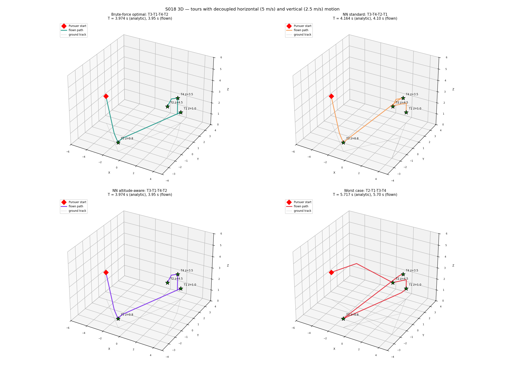
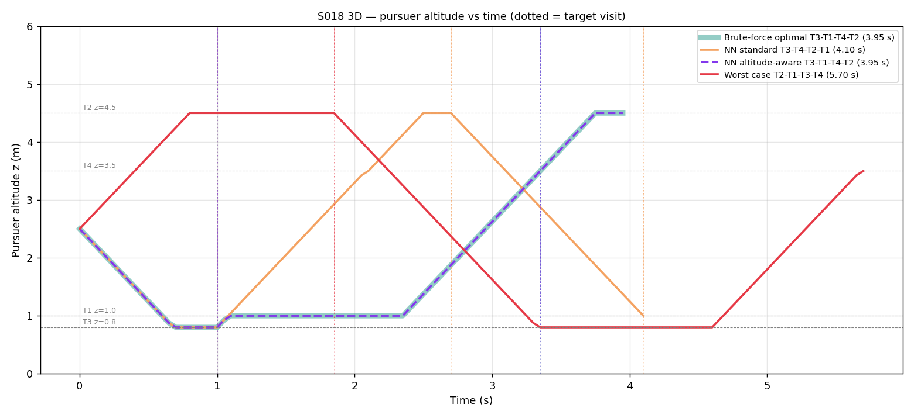
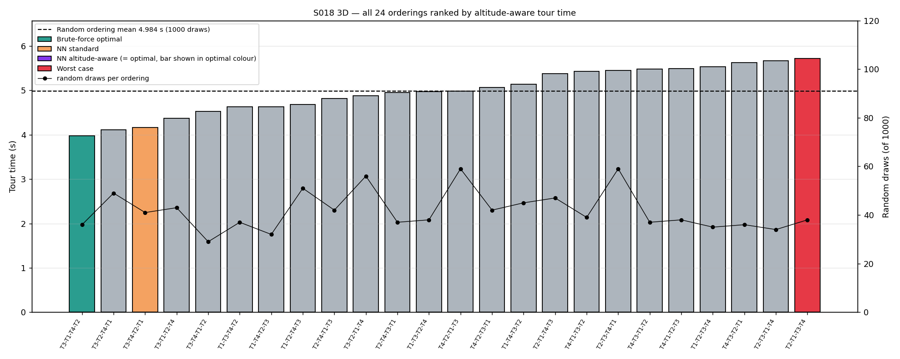
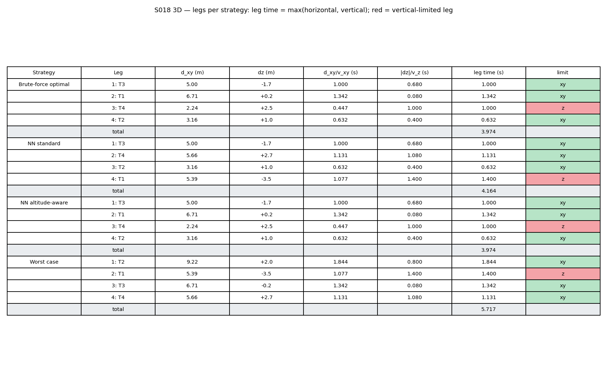
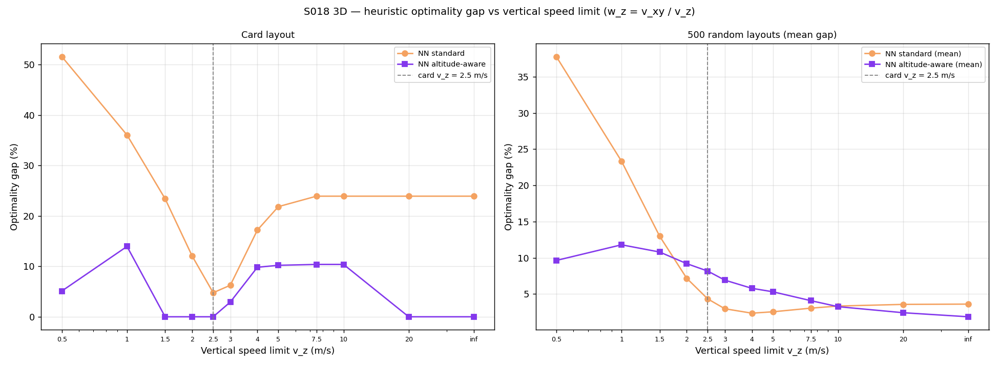
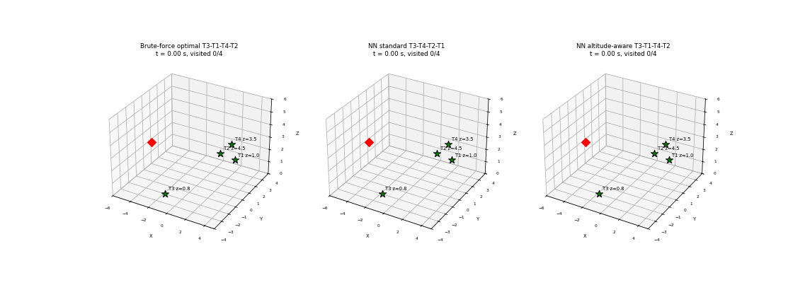

# S018 3D — Multi-Target Intercept

**Domain**: Pursuit & Evasion | **Difficulty**: ⭐⭐⭐⭐ | **Status**: ✅ Completed

---

## Problem Definition

**Setup**: A single pursuer starting at (−5, 0, 2.5) m must visit four stationary targets at different altitudes (z = 0.8–4.5 m). Horizontal and vertical motion use independent speed limits (v_xy = 5 m/s, v_z = 2.5 m/s), so the time of a leg is set by whichever channel is slower, and the best visit order depends on altitude sequencing.

**Compared orderings (card)**: brute-force optimum over all 4! = 24 orderings, standard nearest-neighbour (3D Euclidean distance), and altitude-aware nearest-neighbour. As in the S018 2D fix, a random ordering is reported as a seeded distribution of 1000 draws. Every tour is also flown step by step with the card's decoupled x-y / z motion. The card's v_z sweep is run on the card layout and on 500 seeded random layouts.

---

## Mathematical Model

**Leg time** (decoupled horizontal / vertical channels):

$$t(\mathbf{p}_a, \mathbf{p}_b) = \max\!\left(\frac{\Delta_{xy}}{v_{xy}},\; \frac{|\Delta z|}{v_{z}}\right)$$

**Tour time**: $T(\sigma) = \sum_{k=1}^{4} t(\mathbf{p}_{\sigma_{k-1}}, \mathbf{p}_{\sigma_k})$ with $\mathbf{p}_{\sigma_0}$ = start; optimum $\sigma^* = \arg\min_{\sigma \in S_4} T(\sigma)$.

**Standard NN**: next target $= \arg\min_j \|\mathbf{p}_j - \mathbf{p}_{\sigma_k}\|_2$.

**Altitude-aware NN**: next target $= \arg\min_j \left(\Delta_{xy} + w_z |\Delta z|\right)$, $w_z = v_{xy}/v_z = 2$.

**Flight model** (card): each step the pursuer moves $\min(v_{xy}\Delta t, \Delta_{xy})$ toward the target in x-y and $\mathrm{clip}(\Delta z, \pm v_z \Delta t)$ in z. A target counts as visited when $\Delta_{xy} < 0.2$ m and $|\Delta z| < 0.1$ m.

**Optimality gap**: $(T - T^*)/T^* \times 100\%$.

---

## Key Parameters

| Parameter | Value |
|-----------|-------|
| Pursuer start | (−5, 0, 2.5) m |
| T1 / T2 / T3 / T4 | (2, 3, 1.0) / (4, −2, 4.5) / (−1, −3, 0.8) / (3, 1, 3.5) m |
| Horizontal speed v_xy | 5 m/s |
| Vertical speed v_z | 2.5 m/s |
| Altitude weight w_z | v_xy / v_z = 2.0 |
| Arrival thresholds ε_xy / ε_z | 0.2 m / 0.1 m |
| Flight timestep dt | 0.05 s |
| Random-ordering baseline | 1000 seeded permutations (seed 0) |
| v_z sweep | 0.5, 1, 1.5, 2, 2.5, 3, 4, 5, 7.5, 10, 20 m/s, ∞ (w_z = v_xy / v_z) |
| Random layouts | 500 (seed 18), targets uniform in x ∈ [−2, 5], y ∈ [−4, 4], z ∈ [0.5, 5.5] m |

---

## Implementation

```bash
conda activate drones
python src/01_pursuit_evasion/3d/s018_3d_multi_target_intercept.py
```

Runtime ≈ 16 s (24 orderings, 1000 random draws, 12 × 500 layout brute forces, 42-frame GIF).

---

## Results

### Card layout (v_z = 2.5 m/s)

| Strategy | Visit order | z path (m) | Tour time | Gap | Rank | Flown time |
|----------|-------------|------------|-----------|-----|------|------------|
| Brute-force optimal | T3-T1-T4-T2 | 2.5 → 0.8 → 1.0 → 3.5 → 4.5 | 3.974 s | 0.0 % | 1/24 | 3.95 s |
| NN altitude-aware | T3-T1-T4-T2 | same | 3.974 s | 0.0 % | 1/24 | 3.95 s |
| NN standard | T3-T4-T2-T1 | 2.5 → 0.8 → 3.5 → 4.5 → 1.0 | 4.164 s | 4.8 % | 3/24 | 4.10 s |
| Worst case | T2-T1-T3-T4 | 2.5 → 4.5 → 1.0 → 0.8 → 3.5 | 5.717 s | 43.9 % | 24/24 | 5.70 s |
| Random ordering (1000 draws) | — | — | mean 4.984 s (std 0.499), median 4.987 s, 10–90 % 4.164–5.624 s | 25.4 % (mean) | — | — |

Leg breakdown of the optimum: start→T3 1.000 s (horizontal 5.00 m / 5 m/s), T3→T1 1.342 s (horizontal), T1→T4 1.000 s (vertical: +2.5 m / 2.5 m/s, horizontal only 0.447 s), T4→T2 0.632 s (horizontal); total 3.974 s. The exact mean over all 24 orderings is 4.988 s; 36 of the 1000 random draws hit the optimum (1/24 = 4.2 %), and 682 are more than 20 % slower than it. If altitude is ignored (v_z → ∞) the optimum is T3-T2-T4-T1 at 3.099 s; flown with v_z = 2.5 m/s that order takes 4.112 s, 3.5 % more than the 3D optimum.

The flown times are 0.02–0.06 s shorter than the analytic tour times, because each leg ends when the pursuer is inside the 0.2 m / 0.1 m arrival tolerance, not at the target centre.

### v_z sweep (gap vs vertical speed limit)

| v_z (m/s) | Card optimum | Card: NN std / NN alt gap | 500 layouts: NN std mean gap (optimum found) | NN alt mean gap (optimum found) | Layouts where alt better / std better |
|-----------|-------------|-----------|-----------|-----------|---------|
| 0.5 | 11.742 s | 51.6 % / 5.1 % | 37.77 % (13.8 %) | 9.63 % (37.0 %) | 346 / 78 |
| 1.0 | 6.542 s | 36.1 % / 13.9 % | 23.33 % (16.8 %) | 11.79 % (31.6 %) | 285 / 117 |
| 1.5 | 4.808 s | 23.4 % / 0.0 % | 12.98 % (28.2 %) | 10.79 % (33.4 %) | 200 / 169 |
| 2.0 | 4.224 s | 12.0 % / 0.0 % | 7.17 % (40.2 %) | 9.19 % (33.2 %) | 141 / 187 |
| **2.5 (card)** | 3.974 s | 4.8 % / 0.0 % | 4.33 % (49.8 %) | 8.17 % (34.8 %) | 88 / 210 |
| 3.0 | 3.699 s | 6.3 % / 2.9 % | 2.96 % (56.2 %) | 6.91 % (37.0 %) | 55 / 206 |
| 5.0 | 3.152 s | 21.8 % / 10.2 % | 2.54 % (64.4 %) | 5.31 % (46.0 %) | 19 / 148 |
| 10 | 3.099 s | 23.9 % / 10.4 % | 3.34 % (61.4 %) | 3.25 % (60.2 %) | 34 / 35 |
| ∞ | 3.099 s | 23.9 % / 0.0 % | 3.60 % (60.0 %) | 1.85 % (73.8 %) | 111 / 25 |

(Rows for 4, 7.5 and 20 m/s are in the printed output and the plot.)

**Key Findings**:
- **With the card's parameters the altitude-aware NN finds the optimum, and standard NN does not.** Both start with the nearest target T3 (z = 0.8). Standard NN then picks T4 (6.27 m away in 3D) over T2 (6.30 m) and T1 (6.71 m), climbs to T4 and T2, and must finish with a 3.5 m descent to T1. That last leg is vertical-limited: 1.400 s instead of the 1.077 s its horizontal part needs. This leg, not a horizontal detour, is why NN standard is 0.190 s slower. The altitude-aware metric charges 2 × |Δz| for the climb to T4, so it takes the level hop to T1 first and then climbs monotonically T1 → T4 → T2.
- **The optimal z path is down once, then up.** It is 2.5 → 0.8 → 1.0 → 3.5 → 4.5 m: one descent to the lowest target, then a monotone climb. Only one of its four legs (T1 → T4, +2.5 m in 1.000 s) is limited by v_z.
- **The card layout flatters the altitude-aware NN.** Over 500 random layouts at v_z = 2.5 m/s, standard NN has the lower mean gap (4.33 % vs 8.17 %) and is better in 210 layouts against 88. The altitude-aware metric *adds* horizontal and weighted vertical distance, while the true leg time is their *maximum*. It therefore over-charges legs where both channels move at once. It only wins on average when climbing is very slow (v_z ≤ 1.5 m/s, where vertical time dominates almost every leg) or very fast (v_z ≥ 10 m/s, where w_z → 0 and it becomes a horizontal-only NN; at 10 m/s the margin is only 3.25 % vs 3.34 %).
- **Ordering matters less here than in 2D.** The worst order is 43.9 % slower than the optimum and a random order 25.4 % slower on average (2D: 74.0 % and 39.0 %). Vertical-limited legs put a floor under every leg time regardless of order.
- **Ignoring altitude costs 3.5 % on the card layout.** The 2D-optimal order T3-T2-T4-T1 is the second-best 3D order (4.112 s vs 3.974 s).

**3D tours (optimal, NN standard, NN altitude-aware, worst case) with ground tracks:**



**Pursuer altitude vs time for each tour (optimal and NN altitude-aware overlap):**



**All 24 orderings ranked, with the random-baseline draw counts:**



**Leg table: horizontal vs vertical time per leg (red = vertical-limited):**



**Optimality gap vs vertical speed limit, card layout and 500 random layouts:**



**Animation (optimal, NN standard, NN altitude-aware):**



### Deviations from the scenario card

| Card | Code | Reason |
|------|------|--------|
| No random-ordering baseline in the 3D card | 1000 seeded random permutations, reported as a distribution | Same baseline as the S018 2D fix; shows how much ordering matters on average |
| Flight sim: x-y step of v_xy·dt regardless of remaining distance | Step limited to the remaining horizontal distance | Without the limit the pursuer can overshoot by up to 0.25 m and oscillate around the 0.2 m arrival circle |
| Optimality gap vs v_z for the card layout only | Card layout plus 500 seeded random layouts | One layout cannot show whether a heuristic is generally better; it turns out the card layout is unusually favourable to the altitude-aware NN |
| z range 0.5–5.5 m | Used as the z range of the random layouts; card targets and all flown paths stay inside it | Tours fly straight between targets, so altitude limits are never reached |
| Visit order comparison table | Rendered as an image with horizontal and vertical time per leg | — |

---

## Extensions

1. Moving targets at different altitudes — altitude-aware greedy NN still applicable
2. 2-opt 3D local search: swap two visits and check if altitude-aware tour time improves
3. Heterogeneous vertical speeds: climbing slower than descending (gravity-assisted)

---

## Related Scenarios

- Original 2D version: [S018 Multi-Target Intercept](../../../../scenarios/01_pursuit_evasion/S018_multi_target_intercept.md)
- 3D card: [S018 3D Upgrade — Multi-Target Intercept](../../../../scenarios/01_pursuit_evasion/3d/S018_3d_multi_target_intercept.md)
- [S017 3D Upgrade — Swarm vs Swarm](../../../../scenarios/01_pursuit_evasion/3d/S017_3d_swarm_vs_swarm.md), [S019 3D Upgrade — Dynamic Target Reassignment](../../../../scenarios/01_pursuit_evasion/3d/S019_3d_dynamic_reassignment.md)
