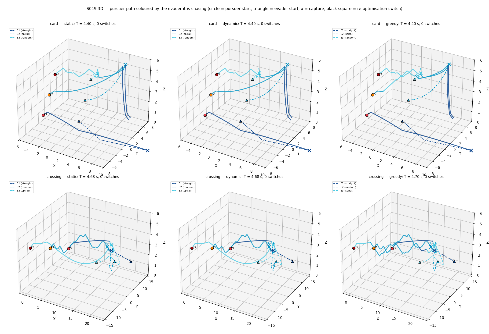
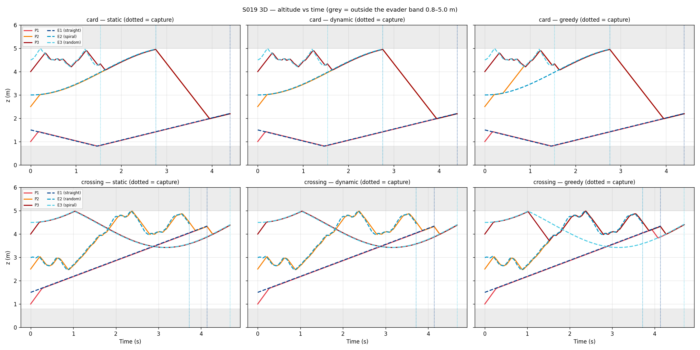
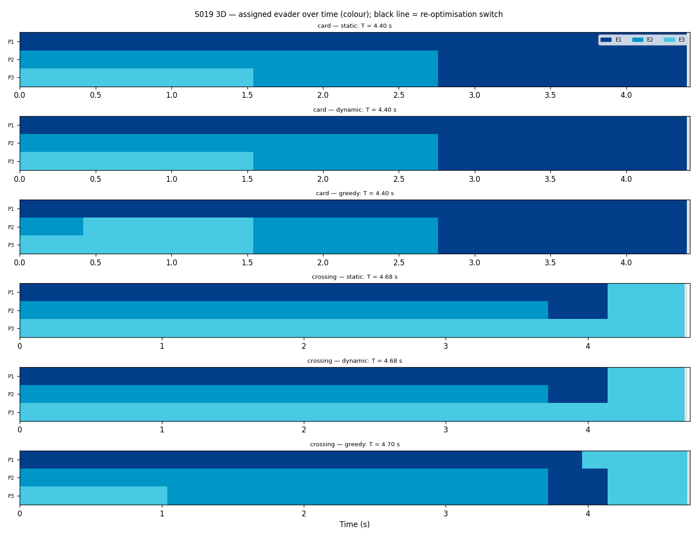
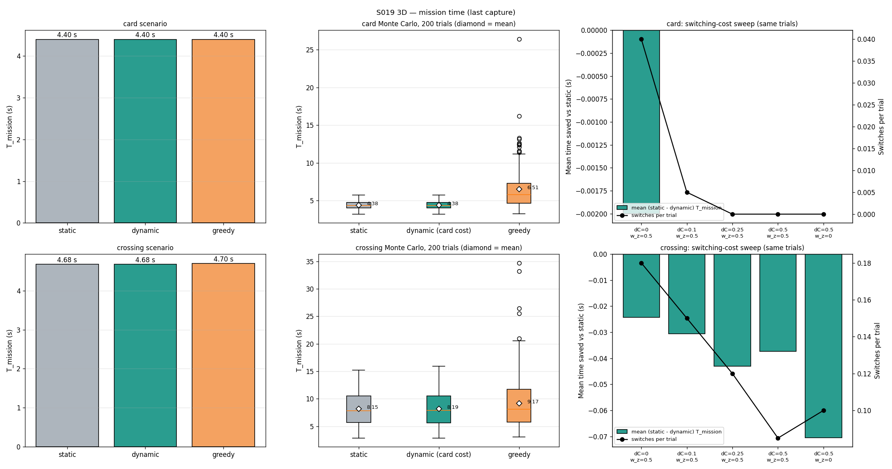
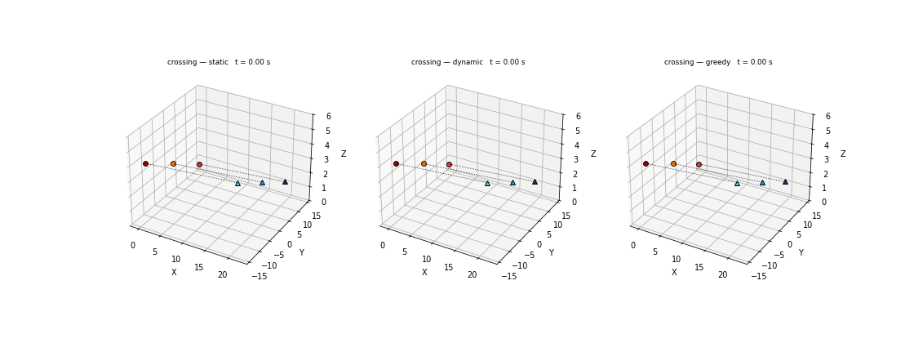

# S019 3D — Dynamic Target Reassignment

**Domain**: Pursuit & Evasion | **Difficulty**: ⭐⭐⭐⭐⭐ | **Status**: ✅ Completed

---

## Problem Definition

**Setup (card)**: 3 pursuers vs 3 evaders in 3D. The evaders use mixed strategies: a straight 3D escape, a helical spiral and a 3D random walk. Pursuers use decoupled guidance: horizontal pure pursuit at 5 m/s plus vertical tracking at up to 2.5 m/s. The assignment is computed with the 3D Hungarian algorithm.

**Three methods (card)**:
1. **Static 3D** — Hungarian at t = 0, never re-optimised.
2. **Dynamic 3D** — every T_check = 1 s, re-optimise with the 3D cost; adopt the new assignment if the improvement in summed time-to-go exceeds the card's altitude-aware switching cost.
3. **Greedy 3D** — every step each pursuer chases its 3D-nearest live evader.

**Fair rules for every method** (as in the S019 2D fix): captured evaders are never assigned. A pursuer whose evader is captured joins the nearest live evader, in static and dynamic alike, so those two differ only by the periodic re-optimisation. Any pursuer that comes within the capture radius captures. The evaders do not react to the pursuers, so all three methods face exactly the same evader paths (common random numbers).

**Scenarios**:
- **card**: the card's start positions.
- **crossing**: the S019 2D fix's wide layout lifted to 3D. The straight evader runs across the other pursuers' lanes while climbing from the low to the high layer, so the initial assignment should go stale.
- **Monte Carlo**: 200 seeded trials per layout (jittered starts, random strategy-to-evader mapping, random-walk seeds and spiral phases; random straight headings on the crossing layout), plus the card's switching-cost sweep.

**Key question**: Does periodic 3D re-optimisation with an altitude-aware switching cost save mission time?

---

## Mathematical Model

**3D cost matrix**: $C[i, j] = \|\mathbf{p}_{P_i} - \mathbf{p}_{E_j}\|_2 / v_P$; Hungarian $\sigma^* = \arg\min_\sigma \sum_i C[i, \sigma(i)]$ over live evaders (each live column repeated $\lceil M / N_{live} \rceil$ times when evaders run short).

**Altitude-aware switching cost** (card) for pursuer $i$ moving to evader $j_{new}$:

$$\Delta C^{3D}_{switch}(i) = \Delta C_{base} + w_z \frac{|z_{E_{j_{new}}} - z_{P_i}|}{v_{z,max}}$$

**Reassignment rule** (card code): with $\mathcal{I}$ the pursuers whose target changes,

$$\sum_i C[i, \sigma_{cur}(i)] - \sum_i C[i, \sigma^*(i)] > \min_{i \in \mathcal{I}} \Delta C^{3D}_{switch}(i)$$

**Pursuer guidance** (card): $\mathbf{v}_{xy} = v_{xy}\,\widehat{(\mathbf{p}_E - \mathbf{p}_P)_{xy}}$, $\;v_z = \mathrm{clip}\left((z_E - z_P)/\Delta t, \pm v_{z,max}\right)$.

**Evaders** (3.5 m/s):
- Straight: fixed 3D heading, away from the pursuers' centroid at t = 0 (card layout) or a given heading (crossing).
- Spiral (card): $\hat{\mathbf{v}} \propto [\cos(\omega t + \phi_0),\, \sin(\omega t + \phi_0),\, \pm A_z \sin 2\omega t]$.
- Random walk (card): $\hat{\boldsymbol{\xi}} \leftarrow \mathrm{normalise}(\hat{\boldsymbol{\xi}} + \mathcal{N}(0, 0.3^2 I))$ every step.

All evaders stay in the card's band z ∈ [0.8, 5.0] m: a step that would leave it has its vertical velocity mirrored, and the evader keeps the mirrored vertical sense (a bounce, not a slide along the limit).

**Capture**: closest approach inside the step $< r_{capture} = 0.15$ m. $T_{mission} = \max_j t_{capture,j}$.

---

## Key Parameters

| Parameter | Value |
|-----------|-------|
| Pursuers (card) | (−5, −2, 1.0), (−5, 0, 2.5), (−5, 2, 4.0) m |
| Evaders (card) | E1 straight (2, −2, 1.5), E2 spiral (2, 0, 3.0), E3 random (2, 2, 4.5) m |
| Pursuers (crossing) | (0, 12, 1.0), (0, 0, 2.5), (0, −12, 4.0) m |
| Evaders (crossing) | E1 straight (20, 12, 1.5), heading (0, −1, 0.2) normalised; E2 random (20, 0, 3.0); E3 spiral (20, −12, 4.5) m |
| Pursuer horizontal / vertical speed | 5 / 2.5 m/s |
| Evader speed | 3.5 m/s |
| Spiral ω / A_z / φ0 | 0.5 rad/s / 0.3 / 0.5 rad |
| Random walk σ / seeds | 0.3 per step / 42–44 (fixed scenarios) |
| Re-check period T_check | 1.0 s (every 50 steps) |
| Base switching cost ΔC_base | 0.5 s |
| Altitude penalty weight w_z | 0.5 |
| Evader z band | 0.8 – 5.0 m |
| Capture radius | 0.15 m |
| dt / T_max | 0.02 s / 40 s |
| Monte Carlo | 200 trials per layout (seeds 19 card, 20 crossing); jitter ±1 m (card) or ±2 m (crossing) in x, y and ±0.5 m in z; crossing straight heading: random azimuth, elevation within ±20° |
| Switching-cost sweep | (ΔC_base, w_z) = (0, 0.5), (0.1, 0.5), (0.25, 0.5), (0.5, 0.5) card, (0.5, 0) |

---

## Implementation

```bash
conda activate drones
python src/01_pursuit_evasion/3d/s019_3d_dynamic_reassignment.py
```

Runtime ≈ 135 s (6 fixed runs, 2 × 200 × 7 Monte Carlo runs, 31-frame GIF).

---

## Results

### Fixed scenarios

| Scenario | Method | T_mission | Captures (capturing pursuer) | Switches | Largest improvement at a check |
|----------|--------|-----------|------------------------------|----------|-----------------|
| card | Static | 4.40 s | E3 1.54 s (P3), E2 2.76 s (P3), E1 4.40 s (P1) | — | — |
| card | Dynamic | 4.40 s | identical to static | 0 | 0.000 s |
| card | Greedy | 4.40 s | identical captures; P2 chases E3 from 0.42 s to 1.54 s | — | — |
| crossing | Static | 4.68 s | E2 3.72 s (P2), E1 4.14 s (P2), E3 4.68 s (P1) | — | — |
| crossing | Dynamic | 4.68 s | identical to static | 0 | 0.385 s |
| crossing | Greedy | 4.70 s | E2 3.72 s (P2), E1 4.14 s (P2), E3 4.70 s (P1) | — | — |

Initial assignment in every case: P1→E1, P2→E2, P3→E3. Evader altitude range: 0.80–4.99 m (card), 1.50–4.99 m (crossing). Bounces at the z band: 1, 0, 2 (card E1–E3) and 0, 1, 1 (crossing).

### Monte Carlo (200 trials per layout, same trials for every method)

| Layout | Method | Mean T_mission | Median | Min / max | vs static: faster / tie / slower | Mean (static − method) |
|--------|--------|------|------|------|------|------|
| card | Static | 4.383 s | 4.360 s | 3.20 / 5.76 s | — | — |
| card | Dynamic (card cost) | 4.383 s | 4.360 s | 3.20 / 5.76 s | 0 / 200 / 0 | 0.000 s |
| card | Greedy | 6.506 s | 5.780 s | 3.24 / 26.44 s | 2 / 23 / 175 | −2.123 s |
| crossing | Static | **8.149 s** | 7.840 s | 2.84 / 15.24 s | — | — |
| crossing | Dynamic (card cost) | 8.186 s | 7.870 s | 2.84 / 15.92 s | 4 / 188 / 8 | −0.037 s |
| crossing | Greedy | 9.169 s | 8.100 s | 3.02 / 34.72 s | 18 / 98 / 84 | −1.020 s |

All 1200 static / dynamic / greedy runs capture every evader. An evader bounces at the z band in 192/200 (card) and 193/200 (crossing) static runs, on average 1.94 and 3.50 times per run.

**Switching-cost sweep (crossing layout; dynamic vs static on the same trials)**:

| ΔC_base | w_z | Mean T_mission | Switches / trial (trials with a switch) | Faster / tie / slower than static | Mean (static − dynamic) |
|---------|-----|------|------|------|------|
| 0 | 0.5 | 8.173 s | 0.18 (32) | 15 / 174 / 11 | −0.024 s |
| 0.1 | 0.5 | 8.180 s | 0.15 (28) | 9 / 178 / 13 | −0.031 s |
| 0.25 | 0.5 | 8.192 s | 0.12 (23) | 6 / 182 / 12 | −0.043 s |
| 0.5 (card) | 0.5 (card) | 8.186 s | 0.09 (17) | 4 / 188 / 8 | −0.037 s |
| 0.5 | 0 | 8.220 s | 0.10 (20) | 4 / 183 / 13 | −0.071 s |

On the card layout re-optimisation almost never fires. With ΔC_base = 0 it switches in 8 of 200 trials and is slower in 3 (mean −0.002 s); with ΔC_base ≥ 0.25 s it never switches.

**Key Findings**:
- **Periodic 3D re-optimisation gives no gain here, at any switching cost.** It never fires in either fixed scenario: the largest improvement seen at a check is 0.385 s in the crossing scenario, below the 0.5 s base cost alone. Across 200 crossing trials it fires in 17–32 trials depending on the cost and is slower than static on average at every setting (−0.024 to −0.071 s). The reason is the same as in 2D. A pure-pursuit pursuer already on an evader stays close behind it, so a different matching rarely lowers the summed time-to-go by much. When a switch does happen, the Hungarian objective (sum of time-to-go) is not the mission time (the last capture), so a "better" matching can finish later.
- **The altitude term makes switching rarer and slightly less harmful, but not useful.** With the card's w_z = 0.5, dynamic switches in 17 trials and loses 0.037 s on average; with w_z = 0 it switches in 20 trials and loses 0.071 s. The difference is a few trials out of 200, so this is a small effect within trial-to-trial noise.
- **Coordination matters more than re-optimisation: greedy is clearly the worst.** On the card layout greedy is slower than static in 175 of 200 trials (mean 6.506 vs 4.383 s, worst 26.44 s): several pursuers end up on the same nearest evader while another flies away. On the crossing layout greedy is slower in 84 trials and faster in 18 (mean −1.020 s).
- **The previous README's conclusions do not hold.** The old script ran a different scenario from the card (evaders disappearing and appearing). Its static baseline kept a pursuer on a vanished target forever and never targeted the new evader, so "static misses" held by construction. Its "altitude-aware is faster" was one 0.05 s step (= dt), and altitude-aware was 0.4 s *slower* on E0.
- **The vertical motion is real, not a clipping artefact.** Pursuers change altitude by up to 3.4 m to follow their evaders (P1 in the crossing scenario climbs from 1.0 to 4.38 m; altitude plot). Evaders bounce at the 0.8 / 5.0 m band only a few times per run. Because the evaders do not react to the pursuers, a bounce never traps an evader against a limit.

**3D trajectories, card (top) and crossing (bottom) scenarios; pursuer path coloured by the evader it is chasing:**



**Altitude vs time for every pursuer and evader:**



**Assignment over time (rows = pursuers, colour = assigned evader):**



**Mission time: fixed scenarios, Monte Carlo distributions and switching-cost sweep for both layouts:**



**Animation (crossing scenario; static, dynamic, greedy; dotted line = current assignment):**



### Deviations from the scenario card

| Card | Code | Reason |
|------|------|--------|
| Problem text: evaders "appear and disappear at random 3D positions" | Not modelled; 3 evaders from start to capture | The card's implementation, comparison and parameters use 3 fixed evaders; the old script's appear/disappear scenario is replaced by the card's scenario |
| Pursuer altitude memory (EMA, α = 0.1) and pre-altitude adjustment (Δz_pre = 1 m) | Not implemented | Pursuer z is commanded straight at the assigned evader at the full 2.5 m/s whenever the gap exceeds 0.05 m, so after a switch the vertical channel already moves as fast as it can. A pre-adjustment toward a remembered altitude cannot be faster, and with no appearing targets there is nothing to pre-adjust for |
| Straight evader flees its *assigned* pursuer | Fixed heading away from the pursuers' centroid at t = 0 (card layout) or a given heading (crossing) | An assignment-dependent evader would give each method different evader paths; with a fixed heading all methods face identical evaders (S019 2D fix) |
| Evader z clipped to [0.8, 5.0] m | Vertical velocity mirrored at the band, mirrored sense kept | Clipping makes evaders slide along the limit; the bounce keeps the z motion genuine |
| Card code: the re-optimisation matrix includes captured evaders | Captured evaders removed; augmented matrix; freed pursuers join the nearest live evader in every method; any pursuer captures | Same fair rules as the S019 2D fix |
| Capture checked at the end of the step | Closest approach inside the step | Closing speed up to ~9 m/s × 0.02 s = 0.18 m per step, more than the 0.15 m capture radius |
| Re-check `t - last_check >= T_check` | Integer step counter (every 50 steps) | Floating-point time comparison can drift by a step |
| Card layout only | Plus the crossing layout and 200-trial Monte Carlo per layout | The card layout never triggers a switch, so it cannot show what re-optimisation does |
| Expected: dynamic beats static | Not met: −0.037 s on average at the card's cost, no setting with a mean gain | Reported as measured |

---

## Extensions

1. Auction algorithm (3D): distributed, scalable alternative to centralised 3D Hungarian
2. Altitude-tiered reassignment: pursuers never cross altitude tiers unless no other option
3. RL policy for 3D reassignment decisions — replace rule-based switching cost with learned value

---

## Related Scenarios

- Original 2D version: [S019 Dynamic Target Reassignment](../../../../scenarios/01_pursuit_evasion/S019_dynamic_reassignment.md)
- 3D card: [S019 3D Upgrade — Dynamic Target Reassignment](../../../../scenarios/01_pursuit_evasion/3d/S019_3d_dynamic_reassignment.md)
- [S017 3D Upgrade — Swarm vs Swarm](../../../../scenarios/01_pursuit_evasion/3d/S017_3d_swarm_vs_swarm.md), [S018 3D Upgrade — Multi-Target Intercept](../../../../scenarios/01_pursuit_evasion/3d/S018_3d_multi_target_intercept.md)
- Follow-up: [S020 3D Upgrade — Pursuit-Evasion Game (RL Capstone)](../../../../scenarios/01_pursuit_evasion/3d/S020_3d_pursuit_evasion_game.md)
