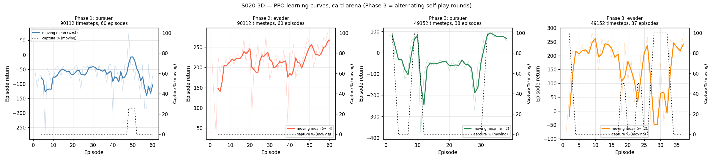
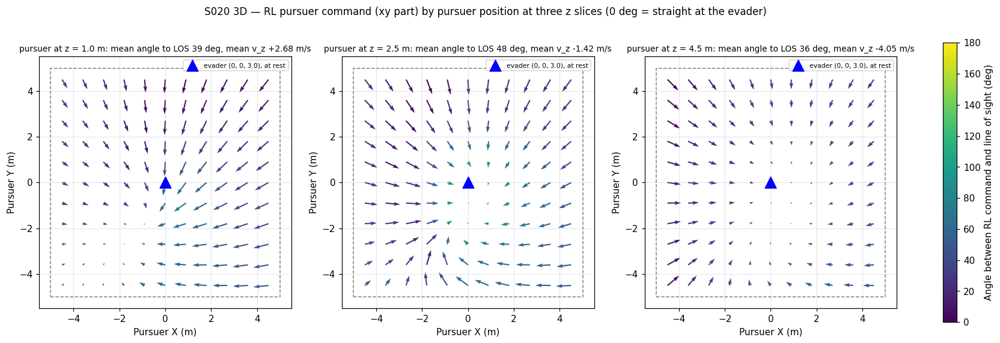
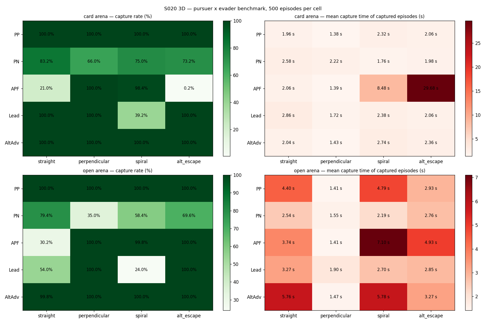
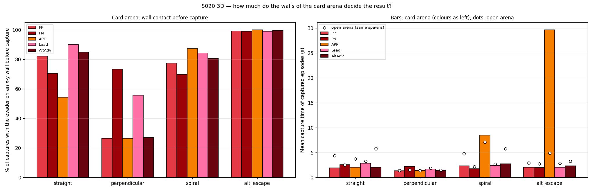
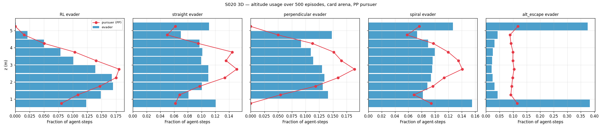
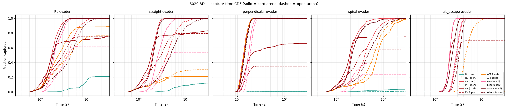
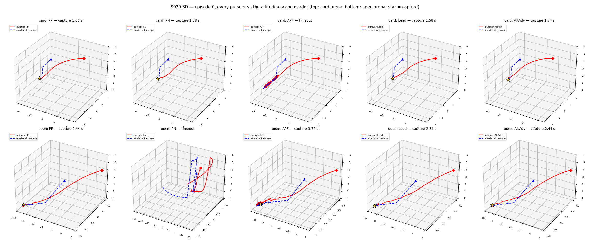
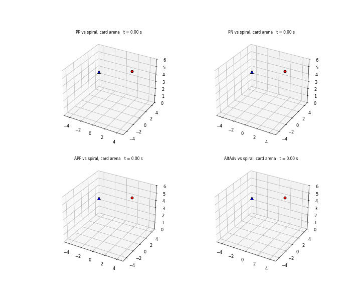

# S020 3D — Pursuit-Evasion Game (RL Capstone)

**Domain**: Pursuit & Evasion | **Difficulty**: ⭐⭐⭐⭐⭐ | **Status**: ✅ Completed

---

## Problem Definition

**Setup**: the card's 3D game, with a 5 m/s pursuer against a 3.5 m/s evader. Both command a 3D unit-sphere velocity direction. Capture radius is 0.15 m, episodes last 30 s, and every observed position and velocity component carries noise σ = 0.1.

**1. PPO training (card)**: the S020 2D stable-baselines3 pipeline, run in the card arena with the card's 3D rewards and its three-phase curriculum at a reduced budget:
- Phase 1: the pursuer trains against a random 3D evader (random spawn altitude).
- Phase 2: the evader trains against the frozen Phase-1 pursuer.
- Phase 3: self-play in four alternating rounds, each agent against a frozen snapshot of the other.

**2. Benchmark grid**: every pursuer against every evader, 500 seeded episodes per cell:

| Pursuer | Rule (always exactly 5 m/s) |
|---------|------|
| RL | trained PPO pursuer, deterministic |
| PP | pure pursuit at the observed evader position |
| PN | 3D proportional navigation, N = 3, constant speed, launched along the initial line of sight (the S016 / S020 2D fix) |
| APF | attraction to the evader + repulsion from every arena face closer than 1 m (a genuine potential field) |
| Lead | pure pursuit at the predicted point e + v_e · 0.3 s |
| AltAdv | pure pursuit with a climb bias until the pursuer is 1 m above the evader |

| Evader | Rule (always exactly 3.5 m/s) |
|---------|------|
| RL | trained PPO evader, deterministic |
| straight | fixed random 3D heading, elevation within ±30° |
| perpendicular | horizontal, perpendicular to the line of sight (random fixed side) |
| spiral | helix: horizontal heading rotating at 0.8 rad/s plus vertical component 0.5 sin(0.8 t + phase) |
| alt_escape | the card's altitude escape: away from the pursuer horizontally while climbing or diving to the altitude limit on the far side of the pursuer |

**Two arenas, with identical spawns, evader parameters and noise (common random numbers)**:
- **card**: x, y ∈ [−5, 5] m, z ∈ [0.5, 5.5] m. The RL agents are trained here.
- **open**: no x-y walls, same z limits. This separates real pursuit from wall cornering.

For each episode the script records whether the evader touched an x-y wall or a z limit before capture.

**3. Policy plots**: RL pursuer quiver plots at the card's z slices (1.0, 2.5, 4.5 m).

**Key questions**: Does PPO learn useful 3D pursuit or evasion within a few minutes of training? Which hand-crafted rules work in 3D? How much of the result in the card's small arena comes from the walls?

---

## Mathematical Model

**Motion**: $\mathbf{p}_{k+1} = \mathrm{clip}_{arena}(\mathbf{p}_k + \mathbf{v}\,\Delta t)$, with $\|\mathbf{v}_P\| = 5$ m/s and $\|\mathbf{v}_E\| = 3.5$ m/s. Agents act on the noisy observation $\tilde{\mathbf{x}} = \mathbf{x} + \mathcal{N}(0, 0.1^2)$ (positions and velocities).

**RL state and action (card)**: $\mathbf{s} = [\tilde{\mathbf{p}}_P, \tilde{\mathbf{v}}_P, \tilde{\mathbf{p}}_E, \tilde{\mathbf{v}}_E, \tilde d] \in \mathbb{R}^{13}$, divided by fixed scales (5 m, 5 m/s, 10 m). Action $\mathbf{a} \in [-1, 1]^3$ gives $\mathbf{v}_{cmd} = v_{max}\,\mathbf{a}/\|\mathbf{a}\|$.

**Pursuer reward (card)**:

$$r_P = 100\cdot\mathbb{1}[\text{capture}] + 0.01\,(d_{prev} - d) + 0.02\,\Delta z_{tac} - 0.1\,\frac{\|\mathbf{a}\|}{v_P} - 1.0\cdot\mathbb{1}[z_P \text{ on a limit}]$$

$$\Delta z_{tac} = \max(0, |z_P - z_E| - 1)\cdot\mathrm{sign}(z_P - z_E)\cdot\mathrm{sign}(v_{z,P})$$

**Evader reward (card)**:

$$r_E = -100\cdot\mathbb{1}[\text{capture}] + 0.1 + 0.01\,(d - d_{prev}) + 0.05\,|z_E - 3.0| - 1.0\cdot\mathbb{1}[z_E \text{ on a limit}]$$

**PN** (constant speed, launched along the initial LOS):

$$\dot{\hat{\boldsymbol\lambda}} = \frac{\mathbf{v}_{rel} - (\mathbf{v}_{rel}\cdot\hat{\boldsymbol\lambda})\hat{\boldsymbol\lambda}}{r}, \quad v_c = -\mathbf{v}_{rel}\cdot\hat{\boldsymbol\lambda}, \quad \mathbf{v}_P \leftarrow v_P\,\frac{\mathbf{v}_P + N v_c \dot{\hat{\boldsymbol\lambda}}\,\Delta t}{\|\cdot\|}$$

**APF**: $\mathbf{v}_P \parallel \widehat{\mathbf{p}_E - \mathbf{p}_P} + \sum_{faces,\, d < d_0} \eta\left(\frac{1}{d} - \frac{1}{d_0}\right)\frac{1}{d^2}\,\hat{\mathbf{n}}$ with $d_0 = 1$ m and $\eta = 1/48$. The repulsion equals the attraction 0.25 m from a face: (1/48)(1/0.25 − 1)/0.25² = 1.

**Lead**: $\mathbf{v}_P \parallel \tilde{\mathbf{p}}_E + 0.3\,\tilde{\mathbf{v}}_E - \tilde{\mathbf{p}}_P$. **AltAdv**: $\mathbf{v}_P \parallel v_P\,\widehat{\mathbf{p}_E - \mathbf{p}_P} + [0, 0, \min(2, 1.5(1 - \Delta z))]$ while $\Delta z = z_P - z_E < 1$ m.

**Capture**: closest approach of the linear relative motion inside a step < 0.15 m, or no capture by 30 s.

---

## Key Parameters

| Parameter | Value |
|-----------|-------|
| Pursuer / evader speed | 5.0 / 3.5 m/s |
| Card arena | x, y ∈ [−5, 5] m, z ∈ [0.5, 5.5] m |
| Open arena | no x-y walls, z ∈ [0.5, 5.5] m |
| Capture radius | 0.15 m |
| dt / episode length | 0.02 s / 30 s (1500 steps) |
| Observation noise σ | 0.1 on every observed position (m) and velocity (m/s) component, all agents, training and benchmark |
| Reward weights | capture ±100; distance 0.01 /m; altitude advantage 0.02; effort 0.1; altitude escape 0.05; survival 0.1 /step; altitude limit −1 /step |
| PPO learning rate / clip range / batch size / n_steps | 3×10⁻⁴ / 0.2 / 256 / 512 |
| Network | [256, 256] MLP |
| Training budget requested | Phase 1 90 000, Phase 2 90 000, Phase 3 4 rounds × 12 000 per agent (timesteps) |
| Training seed | 0 (PPO seeds 1, 2) |
| PN gain N | 3 |
| APF influence distance d₀ / gain η | 1.0 m / 1/48 |
| Lead time | 0.3 s |
| AltAdv target height above the evader | 1.0 m |
| Straight evader elevation range | ±30° |
| Spiral evader ω / vertical amplitude | 0.8 rad/s / 0.5 |
| Spawns | uniform in x, y ∈ [−4.5, 4.5], z ∈ [1, 5] m, separation ≥ 5 m |
| Benchmark episodes per cell / seed | 500 / 2020 |

---

## Implementation

```bash
conda activate drones
python src/01_pursuit_evasion/3d/s020_3d_pursuit_evasion_game.py
```

Runtime ≈ 6.5 min (measured 376–383 s): PPO training on one CPU thread, then 60 benchmark cells × 500 vectorised episodes, a noise-free re-run of the 60 cells, and a 151-frame GIF.

---

## Results

### Training (card arena; real timesteps from `model.num_timesteps`: 139 264 per agent)

| Phase | Timesteps | Episodes | Captured (first 20% → last 20% of episodes) | Mean return (first 20% → last 20%) |
|-------|-----------|----------|------|------|
| 1: pursuer vs random 3D evader | 90 112 | 60 | 0.0% → 0.0% | −89.53 → −88.59 |
| 2: evader vs frozen Phase-1 pursuer | 90 112 | 60 | 0.0% → 0.0% | 189.32 → 248.97 |
| 3: pursuer (self-play rounds) | 49 152 | 38 | 28.6% → 100.0% | −20.35 → 77.82 |
| 3: evader (self-play rounds) | 49 152 | 37 | 28.6% → 28.6% | 147.04 → 169.67 |

### Capture rate / mean capture time of captured episodes (500 episodes per cell; card arena / open arena)

| Pursuer | vs RL | straight | perpendicular | spiral | alt_escape |
|---------|------|----------|------|------|------|
| RL | 20.8% 7.85 s / 0% | 12.0% 8.33 s / 0% | 0.4% 2.48 s / 0.4% 1.55 s | 3.8% 8.42 s / 1.0% 12.92 s | 0% / 0% |
| PP | 100% 1.88 s / 100% 3.93 s | 100% 1.96 s / 100% 4.40 s | 100% 1.38 s / 100% 1.41 s | 100% 2.32 s / 100% 4.79 s | 100% 2.06 s / 100% 2.93 s |
| PN | 75.8% 2.78 s / 75.0% 2.46 s | 83.2% 2.58 s / 79.4% 2.54 s | 66.0% 2.22 s / 35.0% 1.55 s | 75.0% 1.76 s / 58.4% 2.19 s | 73.2% 1.98 s / 69.6% 2.76 s |
| APF | 88.8% 2.65 s / 76.4% 3.70 s | 21.0% 2.06 s / 30.2% 3.74 s | 100% 1.39 s / 100% 1.41 s | 98.4% 8.48 s / 99.8% 7.10 s | 0.2% 29.68 s / 100% 4.93 s |
| Lead | 100% 2.26 s / 62.2% 2.90 s | 100% 2.86 s / 54.0% 3.27 s | 100% 1.72 s / 100% 1.90 s | 39.2% 2.38 s / 24.0% 2.70 s | 100% 2.06 s / 100% 2.85 s |
| AltAdv | 100% 2.05 s / 100% 4.90 s | 100% 2.04 s / 99.8% 5.76 s | 100% 1.43 s / 100% 1.47 s | 100% 2.74 s / 100% 5.78 s | 100% 2.36 s / 100% 3.27 s |

Averaged over the four hand-crafted evaders: card arena PP 100% / 1.93 s, AltAdv 100% / 2.14 s, Lead 84.8% / 2.23 s, PN 74.4% / 2.15 s, APF 54.9% / 4.66 s, RL 4.0% / 8.21 s. Open arena: PP 100% / 3.38 s, AltAdv 100% / 4.07 s, APF 82.5% / 4.41 s, Lead 69.5% / 2.57 s, PN 60.6% / 2.38 s, RL 0.4% / 9.67 s.

### Wall contact in the card arena (share of captures with the evader on an x-y wall before capture)

| Pursuer | vs RL | straight | perpendicular | spiral | alt_escape |
|---------|------|----------|------|------|------|
| RL | 95.2% | 100% | 50.0% | 94.7% | — |
| PP | 67.8% | 82.2% | 26.6% | 77.4% | 99.2% |
| PN | 67.5% | 70.4% | 73.3% | 69.9% | 98.9% |
| APF | 66.2% | 54.3% | 26.6% | 87.2% | 100% |
| Lead | 59.2% | 90.0% | 55.6% | 84.2% | 99.0% |
| AltAdv | 76.2% | 84.8% | 27.0% | 80.6% | 99.6% |

PP captures with no wall or z-limit contact at all: straight 53 of 500 (mean 1.24 s), perpendicular 367 (1.38 s), spiral 55 (1.53 s), alt_escape 0. Share of evader steps in the bottom / top 0.5 m of the z range (card arena, vs PP): alt_escape 38.3% / 37.6% (75.9% together), straight 12.1% / 11.1%, spiral 15.6% / 12.7%, RL 12.3% / 0.1%, perpendicular 0% / 0%.

APF escapes (escaped episodes): card straight 395, all 395 with x-y wall contact (375 also on a z limit), median closest approach 0.26 m; card alt_escape 499, all with x-y wall and z-limit contact, 0.33 m; open straight 349, all 349 on a z limit, 0.26 m.

### Without observation noise (σ = 0, same spawns): capture rate, card / open arena

| Pursuer | vs RL | straight | perpendicular | spiral | alt_escape |
|---------|------|----------|------|------|------|
| RL | 22.0 / 0% | 12.2 / 0.2% | 0.8 / 1.4% | 3.2 / 0.8% | 0 / 0% |
| PP | 100 / 100% | 100 / 100% | 100 / 100% | 100 / 100% | 100 / 100% |
| PN | 97.0 / 98.2% | 100 / 100% | 100 / 100% | 100 / 86.4% | 100 / 100% |
| APF | 74.0 / 83.6% | 29.8 / 60.0% | 100 / 100% | 100 / 100% | 0 / 0% |
| Lead | 100 / 56.8% | 100 / 53.0% | 64.2 / 0% | 34.2 / 21.4% | 100 / 100% |
| AltAdv | 100 / 100% | 100 / 100% | 100 / 100% | 100 / 100% | 100 / 100% |

### RL pursuer policy probe (evader at rest at (0, 0, 3), pursuer at rest on an 11 × 11 grid, no noise)

| Pursuer z | Mean angle between command and LOS | Mean v_z | Mean \|v_z\| / v_P |
|-----------|------|------|------|
| 1.0 m | 38.6° | +2.68 m/s | 0.537 |
| 2.5 m | 48.0° | −1.42 m/s | 0.524 |
| 4.5 m | 36.0° | −4.05 m/s | 0.811 |

**Key Findings**:
- **The RL pursuer learned very little in Phase 1, then learned to catch one specific evader.** In Phase 1 it captured nothing in the first or last 20% of its 60 episodes (the learning curve shows a single capture around episode 49), and its return stayed near −89. In Phase 3 it went from 28.6% to 100% captures against the frozen snapshot of the RL evader. In the benchmark it captures that final RL evader in 20.8% of card-arena episodes, but the hand-crafted evaders only 0–12.0%, and almost nothing in the open arena (0–1.0%). Its captures in the card arena are wall captures: 95–100% of its captures of the RL, straight and spiral evaders happen after the evader has touched an x-y wall. It never learned to pursue away from walls. The probe shows that it does steer toward the evader's altitude (climbs at z = 1 m, dives at z = 4.5 m), but its horizontal command is 36–48° off the line of sight on average.
- **Why: the card's reward gives the pursuer almost no gradient toward the evader.**
  - Effort penalty: up to 0.1·√3/5 = 0.035 per step, i.e. up to 52 over 1500 steps. Because the velocity is normalised, |a| does not change the motion; it is pure penalty.
  - Distance shaping: 0.01 per metre closed, so closing a whole 5–12 m spawn separation earns only 0.05–0.12. At full closing speed that is 0.01 × 5 m/s × 0.02 s = 0.001 per step.
  - Altitude-advantage term: up to 0.02 × (5 − 1) = 0.08 per step (120 per episode). It pays the pursuer for moving vertically *away* from the evader (above and climbing, or below and diving), up to 80 times more per step than closing in pays. The altitude-limit penalty (−1 per step) is larger than everything else and pushes the agent off the floor and ceiling.
  - The +100 capture reward is reached only by chance. That happened once against the random evader, and only regularly in Phase 3 against a predictable deterministic opponent.
  - Training covers 60 + 38 pursuer episodes against the card's 5000 + 10000, about 1/150.
- **The RL evader learned the reward, not the escape.** In Phase 2 nobody caught it, and its return rose from 189 to 249 through the survival bonus (0.1 × 1500 = 150) plus the altitude-escape term (up to 0.05 × 2.5 × 1500 = 187.5), which it raises by staying away from z = 3 m. Against pure pursuit it is caught every time and *faster* than the straight evader (1.88 vs 1.96 s in the card arena, 3.93 vs 4.40 s open). APF captures it far more often than the straight evader (88.8% vs 21.0%). Unlike the straight evader, it seldom sits at a z limit, where APF cannot reach it: 12.4% of its steps are in the bottom or top 0.5 m, against 23.2% for the straight evader.
- **In the card's 10 m arena the walls decide most captures.** Against the straight evader, 82% of PP captures happen after the evader has hit an x-y wall. The same spawns in the open arena take more than twice as long (4.40 vs 1.96 s); the spiral evader behaves the same way (4.79 vs 2.32 s). Only the perpendicular evader, which circles the pursuer instead of running, is caught equally fast in both arenas (1.38 vs 1.41 s).
- **Pure pursuit is the only rule that captures every evader in both arenas.** It needs neither range nor velocity estimates, so the σ = 0.1 noise does not hurt it, and the 1.5 m/s speed advantage always closes the gap. AltAdv also reaches 100% (99.8% against straight in the open arena), but its climb bias makes it slower than PP in the open arena (4.07 vs 3.38 s on average). The old code comment that called the altitude-advantage pursuer "best" was wrong.
- **PN misses because of noise, then flies away.** Its escapes pass a median 0.19–0.26 m from the evader, just outside the 0.15 m capture radius. Without noise it captures 97–100% everywhere except the open-arena spiral (86.4%). After a miss v_c < 0 and PN steers away. In open-arena episode 0 against alt_escape it ends 51.8 m from the origin and 82.6 m from the evader.
- **APF cannot reach an evader in a corner or at a limit.** Its face repulsion balances the attraction 0.25 m from a face, more than the 0.15 m capture radius. It captures the alt_escape evader in 0.2% of card-arena episodes, and every one of its straight-evader escapes ends with the evader on a face. In the open arena with noise it does capture the alt_escape evader (100%), but without noise 0%: the noise jitter is what brings it within 0.15 m.
- **A fixed 0.3 s lead overshoots turning evaders.** Lead aims 1.05 m ahead of the evader, more than the capture radius, so against the spiral it crosses ahead and misses (39.2% card, 24.0% open). Without noise it can lock into a stable miss against the perpendicular evader (64.2% card, 0% open). The previous README's "predictive equals pure pursuit" came from one seed with walls and does not hold.
- **The z motion is real.** The straight and spiral evaders use the whole 0.5–5.5 m band and PP follows them. Only alt_escape concentrates at the limits (75.9% of its steps in the top or bottom 0.5 m), as the card intends.

**PPO learning curves (episode return and moving capture %, per phase):**



**RL pursuer policy at the card's z slices (xy part of the command, colour = angle to the line of sight):**



**Capture rate and mean capture time, card and open arenas:**



**Wall contact before capture (card arena) and capture time card vs open arena:**



**Altitude usage of evader and PP pursuer (card arena, 500 episodes per evader):**



**Capture-time CDF per evader (solid = card arena, dashed = open arena):**



**Episode 0, every pursuer vs the altitude-escape evader (top: card arena, bottom: open arena):**



**Animation (card arena, episode 0: RL vs spiral, PP vs spiral, PN vs RL evader, PP vs RL evader):**



### Deviations from the scenario card

| Card | Code | Reason |
|------|------|--------|
| 5000 / 5000 / 10000 training episodes | 90 112 / 90 112 / 2 × 49 152 timesteps (`model.num_timesteps` 139 264 per agent) = 60 / 60 / 38 + 37 episodes | Runtime limit (whole script < 10 min); about 1/100 of the card's episodes |
| Phase 3: both train simultaneously | Four alternating rounds, each agent against a frozen snapshot of the other | Simplest stable self-play with single-agent PPO (S020 2D pipeline) |
| Altitude bounds as soft constraints; positions clipped to the arena | z hard-clipped to [0.5, 5.5] m; the −1 penalty applies while the agent is on a limit | With a hard clip the agent can never be "outside", so the penalty is applied on the boundary |
| Arena [−5, 5]³ m and z range 0.5–5.5 m (inconsistent) | x, y ∈ [−5, 5] m, z ∈ [0.5, 5.5] m, plus an open arena without x-y walls for the benchmark | The open arena shows what the walls contribute; RL is trained only in the card arena |
| 3D streamline plot of the pursuer policy | Quiver plots at the card's three z slices with the mean v_z per slice | The quivers already show the horizontal command; v_z is reported numerically |
| Benchmark: RL pursuer vs PP, PNG, APF; RL evader vs straight, perpendicular, spiral, altitude-escape | 6 pursuers (RL, PP, PN, APF, Lead, AltAdv) × 5 evaders (RL + the card's four), 500 episodes per cell, both arenas | Full grid with common random numbers; Lead and AltAdv kept from the previous version |
| Observation noise σ = 0.1 m | σ = 0.1 on every observed position and velocity component, for all agents, in training and benchmark; noise-free re-run reported | Same treatment as the S020 2D fix |
| PN, APF, evader behaviours not specified | As defined above | The previous PN started from rest; a renamed pure pursuit is not an APF |
| Altitude histogram over 1000 test episodes | 500 episodes per evader, PP pursuer, card arena | Same per-cell count as the benchmark |
| Capture-time CDF "3D RL vs 2D baselines at z = 2.5 m" | Card arena vs open arena per evader, RL included | The wall effect is the main confound |
| Spawn positions not specified | Uniform in the arena interior, separation ≥ 5 m, the same for every cell and for training resets | — |
| dt not specified | 0.02 s | — |
| Hypotheses: emergent dive-and-intercept / vertical escape | Not met at this budget: the RL pursuer matches altitude but captures mainly against walls; the RL evader optimises the altitude-escape reward and is caught faster than the straight evader | Reported as measured |

---

## Extensions

1. MAPPO for 3v3 swarm — both teams trained end-to-end in 3D with altitude layer coordination
2. Add 3D obstacle field (from S004 3D) to observation and action space
3. Transfer learning from 3D simulation to real hardware: fine-tune with domain randomisation over $v_{z,max}$
4. Curriculum altitude difficulty: start with z-variation σ = 0 (flat), gradually increase to full ±5 m
5. Reward redesign: drop the effort penalty on the normalised action and make the altitude term reward closing vertical distance

---

## Related Scenarios

- Original 2D version: [S020 Pursuit-Evasion Game (RL Capstone)](../../../../scenarios/01_pursuit_evasion/S020_pursuit_evasion_game.md)
- 3D card: [S020 3D Upgrade — Pursuit-Evasion Game (RL Capstone)](../../../../scenarios/01_pursuit_evasion/3d/S020_3d_pursuit_evasion_game.md)
- [S009 3D Upgrade — Differential Game (Lion & Man in 3D)](../../../../scenarios/01_pursuit_evasion/3d/S009_3d_differential_game.md), [S010 3D Upgrade — Asymmetric Speed Bounded Arena Trapping](../../../../scenarios/01_pursuit_evasion/3d/S010_3d_asymmetric_speed.md)
- [S016 3D Upgrade — Airspace Defense](../../../../scenarios/01_pursuit_evasion/3d/S016_3d_airspace_defense.md), [S019 3D Upgrade — Dynamic Target Reassignment](../../../../scenarios/01_pursuit_evasion/3d/S019_3d_dynamic_reassignment.md)
