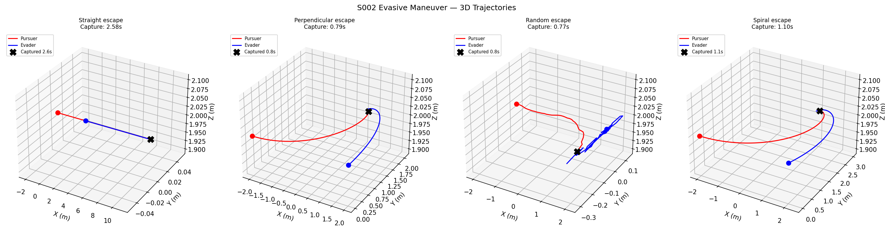
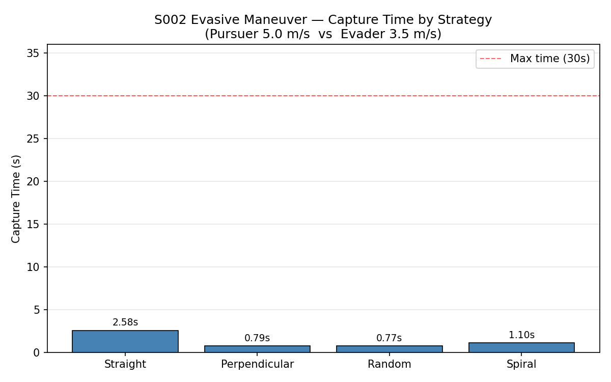
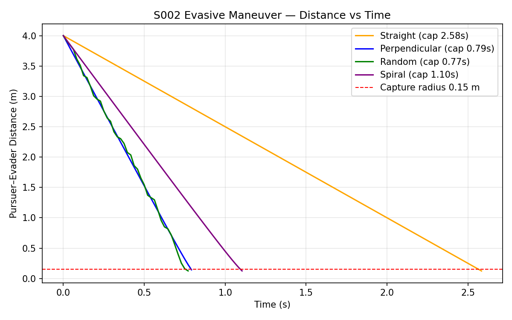
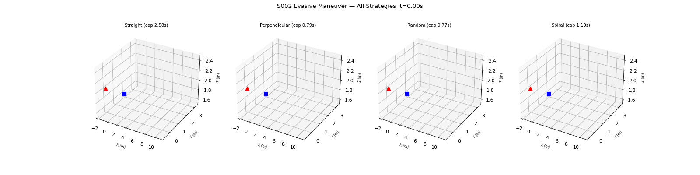

# S002 Evasive Maneuver

**Domain**: Pursuit & Evasion | **Difficulty**: ⭐⭐ | **Status**: ✅ Completed

---

## Problem Definition

**Setup**: Pursuer (Pure Pursuit) vs Evader — 1v1 engagement comparing 4 evasion strategies.

**Roles**:
- **Pursuer**: always aims directly at the evader's current position (Pure Pursuit)
- **Evader**: tests 4 different escape strategies

**Objective**: determine which evasion strategy maximizes survival time against a pure pursuit pursuer.

---

## Mathematical Model

### Pursuer — Pure Pursuit

$$\mathbf{v}_{P} = v_{P,max} \cdot \frac{\mathbf{p}_E - \mathbf{p}_P}{\|\mathbf{p}_E - \mathbf{p}_P\|}$$

### Evader Strategies

**Straight** — fly directly away from pursuer:

$$\mathbf{v}_E = v_{E,max} \cdot \hat{\mathbf{r}}, \quad \hat{\mathbf{r}} = \frac{\mathbf{p}_E - \mathbf{p}_P}{\lVert \mathbf{p}_E - \mathbf{p}_P \rVert}$$

**Perpendicular** — fly perpendicular to line-of-sight in the $xy$ plane:

$$\mathbf{v}_E = v_{E,max} \cdot \mathbf{R}_{90^\circ}\, \hat{\mathbf{r}}_{xy}$$

**Random** — random horizontal direction (seed = 42):

$$\mathbf{v}_E = v_{E,max} \cdot \hat{\mathbf{d}}, \quad \mathbf{d} \sim \mathcal{N}(0, I)$$

**Spiral** — 70% perpendicular + 30% outward:

$$\mathbf{v}_E = v_{E,max} \cdot (0.7\,\hat{\mathbf{r}}_\perp + 0.3\,\hat{\mathbf{r}})$$

### Capture Condition

$$\|\mathbf{p}_P - \mathbf{p}_E\| < r_{capture} = 0.15 \text{ m}$$

---

## Key Parameters

| Parameter | Value |
|-----------|-------|
| Pursuer start | (-2, 0, 2) m |
| Evader start | (2, 0, 2) m |
| Initial distance | 4.0 m |
| Pursuer speed | 5.0 m/s |
| Evader speed | 3.5 m/s |
| Speed ratio $k$ | 1.43 (capture guaranteed) |
| Capture radius | 0.15 m |
| Control frequency | 48 Hz |
| Max simulation time | 30 s |

---

## Implementation

```
src/base/drone_base.py                  # Point-mass drone base class
src/01_pursuit_evasion/s002_evasive_maneuver.py    # Main simulation script
```

```bash
conda activate drones
python src/01_pursuit_evasion/s002_evasive_maneuver.py
```

---

## Results

| Strategy | Capture Time | Mean closing speed | Effectiveness |
|----------|-------------|--------------------|---------------|
| **Straight** | **2.58 s** | 1.50 m/s | Best |
| Spiral | 1.10 s | 3.51 m/s | |
| Perpendicular | 0.79 s | 4.87 m/s | |
| Random | 0.77 s | 5.03 m/s | Worst |

Analytical check (printed by the script, $r_0 = 4$ m, $r_{capture} = 0.15$ m):
- Straight escape: $(r_0 - r_{capture})/(v_P - v_E) = 3.85/1.5 = 2.57$ s; simulated 2.58 s.
- Perpendicular escape: $(r_0 - r_{capture})/v_P = 3.85/5 = 0.77$ s; simulated 0.79 s.

**Key Finding**: Against a pure-pursuit pursuer, **straight escape is best**. Under pure pursuit the range rate is $\dot r = -v_P + v_E\cos\phi$, where $\phi$ is the angle between the evader's velocity and the line of sight. Flying straight away ($\phi = 0$) gives the slowest closing speed, $v_P - v_E = 1.5$ m/s. Flying perpendicular ($\phi = 90^\circ$) contributes nothing to the range, so the pursuer closes at almost its full 5 m/s. Spiral (outward component $0.3/\|(0.7, 0.3)\| = 0.39$ of $v_E$) sits in between. The random strategy re-draws a new direction every step, so on average it makes no progress and is caught as fast as the perpendicular evader. In this draw its mean closing speed (5.03 m/s) is slightly above $v_P$ because more of its steps happened to point toward the pursuer.

> Perpendicular escape only pays off when the evader can exploit the pursuer's turn limits or a lead-angle guidance law (e.g. PNG). This point-mass pursuer has neither, so the perpendicular evader gains nothing here. Testing that would need a different pursuer model (see Extensions).

**3D Trajectories** — pursuer (red) converges on evader (blue) under each strategy:



**Capture Time Comparison**:



**Distance vs Time** — range falls linearly for every strategy, slowest for straight escape:



**Animation** (all 4 strategies side by side in a 1×4 layout — pursuer red, evader blue):



### Deviations from the scenario card

| Card | This implementation | Reason |
|------|--------------------|--------|
| Pursuer uses "PNG or Pure Pursuit" | Pure pursuit only | Keeps the comparison focused on evader strategies; PNG is listed as an extension |
| PyBullet `CtrlAviary` (`Physics.PYB`) two-drone setup | Point-mass `DroneBase` (velocity = clamped command, Euler step at 48 Hz) | The repo does not use PyBullet for 1v1 kinematic studies; the result depends only on speeds and directions |
| Random escape: `pe + randn(3)*0.1` position offset | Random horizontal unit direction at full $v_E$, re-drawn every step, seeded RNG (`seed=42`) | Same speed for every strategy (fair comparison); horizontal plane like the other strategies; reproducible |
| Expected output: "perpendicular escape extends capture time by ~20–50% vs straight escape" | Not reproduced: perpendicular is 3.3× *faster* to capture (0.79 s vs 2.58 s) | The card's expectation does not hold for a pure-pursuit pursuer without turn limits (see Key Finding) |

---

## Extensions

1. Equal-speed case ($v_P = v_E$) — can perpendicular escape prevent capture indefinitely?
2. Train evasion strategy with RL → [S020](../../../scenarios/01_pursuit_evasion/S020_pursuit_evasion_game.md)
3. Replace pure pursuit with PNG and compare optimal evasion strategies
4. 3D evasion — allow z-axis maneuvers

---

## Related Scenarios

- Prerequisites: [S001](../../../scenarios/01_pursuit_evasion/S001_basic_intercept.md)
- Next: [S003](../../../scenarios/01_pursuit_evasion/S003_low_altitude_tracking.md), [S009](../../../scenarios/01_pursuit_evasion/S009_differential_game.md)

## References

- Shneydor, N.A. (1998). *Missile Guidance and Pursuit*. Horwood.
- Isaacs, R. (1965). *Differential Games*. Wiley.
