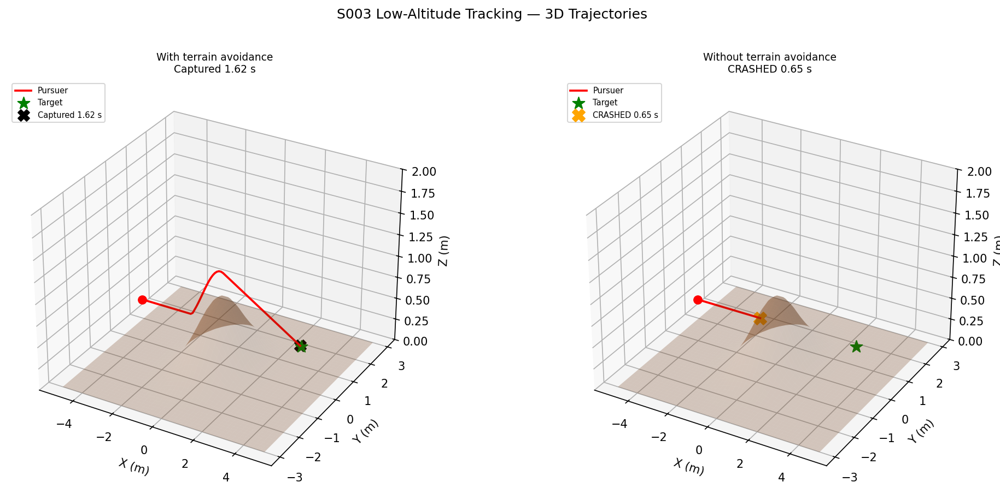
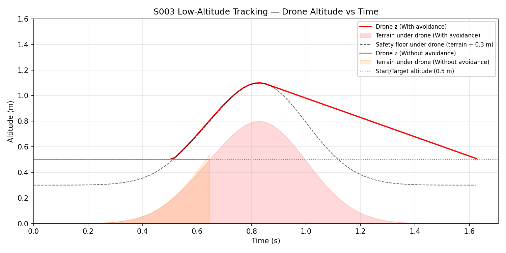
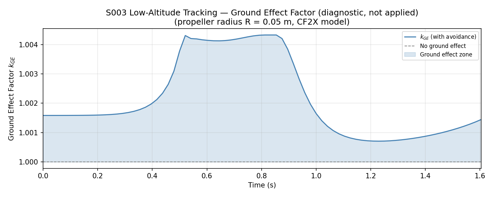
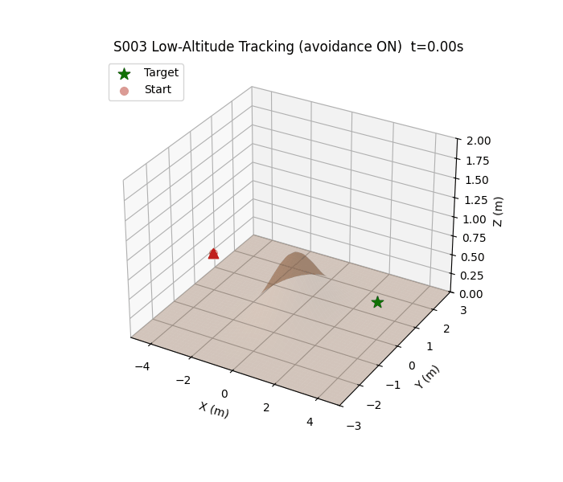

# S003 Low-Altitude Tracking

**Domain**: Pursuit & Evasion | **Difficulty**: ⭐⭐ | **Status**: ✅ Completed

---

## Problem Definition

**Setup**: A pursuer intercepts a stationary target at low altitude (0.5 m). A Gaussian hill with a 0.8 m peak sits directly on the approach path.

**Objective**: Demonstrate terrain-aware altitude control by comparing two cases:
- **With terrain avoidance**: at each step the pursuer lifts its altitude to at least $h_{terrain}(x,y) + h_{safe}$
- **Without terrain avoidance**: pure pursuit only, so the drone crashes into the hill

**Key challenges**:
1. The hill (0.8 m) is taller than the flight altitude (0.5 m), so the drone cannot get past it without actively correcting its altitude
2. An altitude safety margin must be kept for the whole approach
3. Ground effect near the terrain surface. It is evaluated along the path to show its size, but it is **not** fed into the dynamics (see below)

---

## Mathematical Model

### Terrain Model

Gaussian hill centred at the origin:

$$h_{terrain}(x, y) = H \cdot \exp\!\left(-\frac{(x - x_0)^2 + (y - y_0)^2}{\sigma^2}\right)$$

where $(x_0, y_0) = (0, 0)$, $H = 0.8$ m (peak height) and $\sigma^2 = 1.5$ m².

### Altitude Safety Constraint

At every time step the commanded next position satisfies:

$$z_{next} \geq h_{terrain}(x_{next}, y_{next}) + h_{safe}, \quad h_{safe} = 0.3 \text{ m}$$

### Pursuer — Terrain-Aware Pure Pursuit

The pursuer is a velocity-commanded point mass (`DroneBase`). At each step it computes its next candidate position along the pure-pursuit direction, then lifts the $z$ component to the safety floor:

$$\mathbf{p}_{next} = \mathbf{p} + \hat{\mathbf{r}} \cdot v_{max} \cdot \Delta t, \quad z_{next} \leftarrow \max\!\left(z_{next},\ h_{terrain}(x_{next}, y_{next}) + h_{safe}\right)$$

If the lifted step would exceed $v_{max}$, the climb is given priority: $v_z$ is kept and the horizontal speed is reduced to $\sqrt{v_{max}^2 - v_z^2}$. This way the speed limit and the safety floor both hold.

A crash is declared when the drone centre is more than 0.02 m below the terrain surface.

### Ground Effect (diagnostic only)

Thrust correction factor for the CF2X at height $h$ above terrain:

$$k_{GE}(h) = 1 + \frac{0.16 \cdot (R/h)^2}{1 + (R/h)^2}, \quad R = 0.05 \text{ m}$$

The point-mass model is commanded in velocity and has no thrust or mass. So $k_{GE}$ is **only logged** along the flown trajectory to show how large the effect would be. It does not change the motion.

---

## Key Parameters

| Parameter | Value |
|-----------|-------|
| Pursuer start | (-4, 0, 0.5) m |
| Target position | (4, 0, 0.5) m — stationary |
| Hill centre $(x_0, y_0)$ | (0, 0) m |
| Hill peak height $H$ | 0.8 m |
| Hill width $\sigma^2$ | 1.5 m² |
| Pursuer speed $v_{max}$ | 5.0 m/s |
| Safety margin $h_{safe}$ | 0.3 m |
| Required peak altitude | 1.1 m |
| Propeller radius $R$ (ground-effect diagnostic) | 0.05 m |
| Capture radius | 0.15 m |
| Control frequency | 48 Hz |
| Max simulation time | 10 s |

---

## Implementation

```
src/base/drone_base.py                     # Point-mass drone base class
src/01_pursuit_evasion/s003_low_altitude_tracking.py  # Main simulation script
```

```bash
conda activate drones
python src/01_pursuit_evasion/s003_low_altitude_tracking.py
```

---

## Results

| Case | Outcome | Time | Path length | Peak z | Min clearance above terrain |
|------|---------|------|-------------|--------|-----------------------------|
| **With terrain avoidance** | ✅ Captured | **1.62 s** | 8.123 m | 1.099 m | 0.3000 m |
| Without terrain avoidance | 💥 Crashed | 0.65 s | 3.229 m | 0.500 m | -0.0383 m (crash) |

Reference: straight-line path to capture is 7.850 m (1.570 s at 5 m/s).

**Key Findings**:

- Without terrain avoidance the drone crashes into the hill's near slope at $t = 0.65$ s, after 3.229 m of flight ($x \approx -0.77$ m, before the hill centre). Pure pursuit keeps $z$ at 0.5 m because start and target are at the same altitude, while the hill rises to 0.8 m.
- With terrain avoidance the drone climbs from 0.5 m to a peak of 1.099 m over the crest and never comes closer to the terrain than the 0.3 m safety margin (minimum clearance 0.3000 m). The detour adds 8.123 − 7.850 = 0.273 m of path. Capture takes 1.62 s, compared with 1.570 s for the straight line.
- The safety floor rises above the 0.5 m cruise altitude for $|x| < 1.442$ m (where $h_{terrain} + h_{safe} > 0.5$ m). The climb starts there, well before the peak. After the crest, pure pursuit flies a straight descending line to the target and stays above the floor.
- Ground effect along the avoidance path peaks at $k_{GE} = 1.0043$ (+0.43%), at the 0.3 m terrain clearance kept over the hill. This would be negligible at this drone scale, and it is not applied to the dynamics anyway. (The script also prints $k_{GE}$ for the crash case, 1.1383. That value only reflects the drone reaching the terrain surface at the crash step and has no physical meaning.)

**3D Trajectories** — terrain surface (brown), with avoidance (left) vs crash (right):



**Altitude vs Time** — drone altitude, terrain height directly under the drone (shaded) and the safety floor under the avoidance drone (dashed). During the 16-step climb the red curve stays just above the floor: 0.7–7.4 mm above it, except at the crest, where it sits on the floor (gap < 0.5 mm) at t = 0.792, 0.812, 0.833 and 0.854 s. The small gap comes from how the floor is computed. The lift targets the floor at the uncapped next horizontal position. When the 5 m/s cap then shortens the horizontal step, the drone ends up at an $x$ where the floor is slightly lower. At plot scale this gap is invisible:



**Ground Effect Factor** — $k_{GE}$ along the avoidance trajectory (diagnostic, not applied). About 1.0016 at 0.5 m cruise, 1.0043 while holding 0.3 m over the hill, lowest during the descent when clearance is largest:



**Animation** (terrain avoidance ON — pursuer climbs over the hill):



### Deviations from the scenario card

| Card | This implementation | Reason |
|------|--------------------|--------|
| Hill at (1, 0.5), $H = 0.5$ m, $\sigma^2 = 2.0$ m² | Hill at (0, 0), $H = 0.8$ m, $\sigma^2 = 1.5$ m² | With the card's hill and 0.8 m flight altitude, the highest terrain on the $y=0$ path is 0.441 m. The safety floor (0.741 m) then stays below the flight altitude, so avoidance never activates and the two cases would be identical. A taller hill centred on the path makes the comparison meaningful |
| Two drones at $(\pm 3, 0, 0.8)$ m, pursuer tracking a drone | Pursuer at (-4, 0, 0.5) m, **stationary** target at (4, 0, 0.5) m | Isolates terrain following from evasion. A lower altitude puts the hill in the way; a longer baseline leaves room to climb and descend. A moving target is listed as an extension |
| `Physics.PYB_GND` (PyBullet with ground effect) | Kinematic point mass (`DroneBase`); no PyBullet | This repository does not use PyBullet for these scenarios. The point-mass model has no thrust, so ground effect is computed as a diagnostic only |
| Problem item 2: terrain "blocking the line of sight" | No visibility / occlusion model; the hill is only a physical obstacle | The target is stationary and its position is always known, so line of sight never affects the pursuer. Occlusion-dependent tracking (e.g. losing the target behind the hill) is an extension |
| Expected: "altitude fluctuations caused by ground effect" | Not produced | Ground effect is not in the dynamics (see above). Its size here (≤ +0.43%) would be negligible anyway |
| Expected: "pursuit success rate vs terrain complexity" | Not produced; a single hill with ON/OFF comparison | Kept to one deterministic case. A terrain-complexity sweep is an extension |
| Card text: "+10~20% thrust for $h < 0.5$ m" | Formula gives +0.16% at 0.5 m | Arithmetic error in the card, now corrected there |

---

## Extensions

1. Add a moving target that also avoids terrain (full low-altitude chase)
2. Multiple hills → path planning with potential fields; success rate vs terrain complexity
3. Use sensor-noise altitude measurement (ultrasonic altimeter model)
4. Add thrust-level dynamics so ground effect actually perturbs altitude
5. Urban canyon pursuit: narrow corridors instead of open hills → [S004](../../../scenarios/01_pursuit_evasion/S004_obstacle_chase.md)
6. Line-of-sight occlusion: the hill hides a moving target and the pursuer must search or predict

---

## Related Scenarios

- Prerequisites: [S001 Basic Intercept](../../../scenarios/01_pursuit_evasion/S001_basic_intercept.md), [S002 Evasive Maneuver](../../../scenarios/01_pursuit_evasion/S002_evasive_maneuver.md)
- Next: [S004 Obstacle-Course Chase](../../../scenarios/01_pursuit_evasion/S004_obstacle_chase.md)

## References

- Shneydor, N.A. (1998). *Missile Guidance and Pursuit*. Horwood.
- Cheeseman, I.C. & Bennett, W.E. (1955). "The Effect of the Ground on a Helicopter Rotor in Forward Flight." *ARC R&M 3021*.
