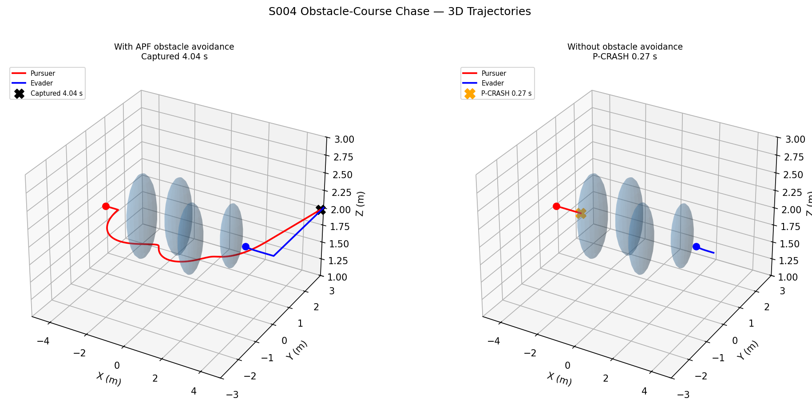
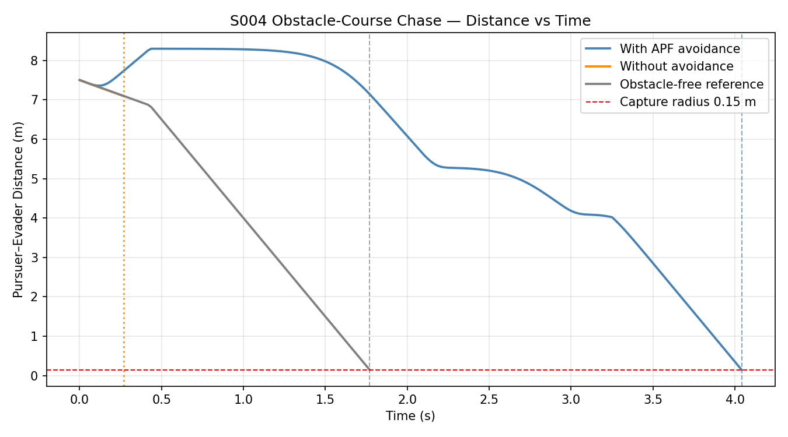
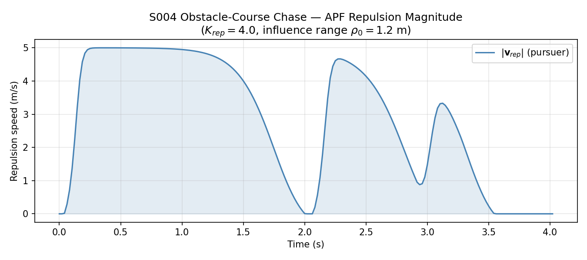
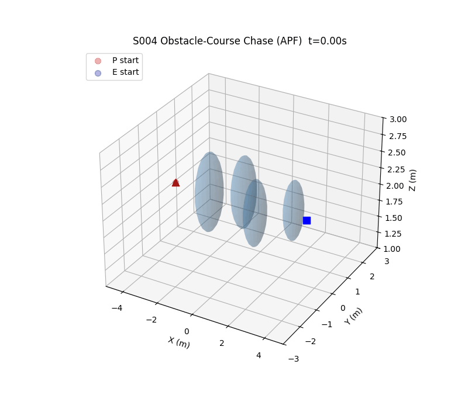

# S004 Obstacle-Course Chase

**Domain**: Pursuit & Evasion | **Difficulty**: ⭐⭐⭐ | **Status**: ✅ Completed

---

## Problem Definition

**Setup**: A pursuer chases an evader through 4 spherical obstacles placed along the approach path. The chase takes place inside a walled arena ($x \in [-5, 5]$, $y \in [-3, 3]$ m), so the evader cannot simply run out of the obstacle course into open space.

**Roles**:
- **Pursuer**: Attractive-Repulsive Potential Field (APF), pulled toward the evader and pushed away from obstacles
- **Evader**: straight escape + APF obstacle repulsion

**Comparison**: pursuer with APF vs. pursuer with pure pursuit only (which crashes into the first obstacle). An obstacle-free run in the same arena gives the reference capture time, so the detour cost can be measured.

---

## Mathematical Model

### Attractive-Repulsive Potential Field (APF)

Total velocity command:

$$\mathbf{v}_{cmd} = \mathbf{v}_{att} + \mathbf{v}_{rep}$$

**Attraction** toward evader:

$$\mathbf{v}_{att} = v_{max} \cdot \frac{\mathbf{p}_E - \mathbf{p}_P}{\|\mathbf{p}_E - \mathbf{p}_P\|}$$

**Repulsion** from obstacles:

$$\mathbf{v}_{rep} = \sum_{i} K_{rep} \left(\frac{1}{\rho_i} - \frac{1}{\rho_0}\right) \frac{1}{\rho_i^2} \, \hat{\mathbf{n}}_i \quad (\rho_i < \rho_0)$$

where $\rho_i = \|\mathbf{p} - \mathbf{c}_i\| - r_i$ is the distance to obstacle surface $i$.

The evader uses the same repulsion term added to its straight-escape velocity $v_{E,max}\,\hat{\mathbf{r}}_{PE}$.

### Speed Limit and Arena Walls (both agents)

The command is clamped to the agent's max speed. The resulting step is then shortened so that the next position stays inside the arena box. The walls are hard constraints: an agent pushed into a wall slides along it.

$$\mathbf{p}_{next} = \text{clip}\big(\mathbf{p} + \text{sat}_{v_{max}}(\mathbf{v}_{cmd})\,\Delta t,\ \mathbf{p}_{lo},\ \mathbf{p}_{hi}\big)$$

### Capture and Collision

$$\|\mathbf{p}_P - \mathbf{p}_E\| < 0.15 \text{ m} \Rightarrow \text{capture}, \qquad \|\mathbf{p} - \mathbf{c}_i\| < r_i + 0.05 \text{ m} \Rightarrow \text{crash}$$

---

## Key Parameters

| Parameter | Value |
|-----------|-------|
| Pursuer start | (-4, 0, 2) m |
| Evader start | (3.5, 0, 2) m |
| Initial distance | 7.5 m |
| Pursuer speed | 5.0 m/s |
| Evader speed | 3.5 m/s |
| $K_{rep}$ | 4.0 |
| Influence range $\rho_0$ | 1.2 m |
| Arena (hard walls) | x ∈ [-5, 5], y ∈ [-3, 3], z ∈ [0, 4] m |
| Capture radius | 0.15 m |
| Collision margin | 0.05 m |
| Control frequency | 48 Hz |
| Max simulation time | 15 s |
| 4 obstacles | radii 0.45–0.60 m |

| Obstacle | Centre (x, y, z) | Radius |
|----------|-----------------|--------|
| 1 | (-2.0, 0.0, 2.0) | 0.60 m |
| 2 | (-0.5, 0.5, 2.0) | 0.55 m |
| 3 | ( 1.0, -0.4, 2.0) | 0.50 m |
| 4 | ( 2.5, 0.3, 2.0) | 0.45 m |

---

## Implementation

```
src/base/drone_base.py               # Point-mass drone base class
src/01_pursuit_evasion/s004_obstacle_chase.py   # Main simulation script
```

```bash
conda activate drones
python src/01_pursuit_evasion/s004_obstacle_chase.py
```

---

## Results

| Case | Outcome | Time |
|------|---------|------|
| **With APF obstacle avoidance** | ✅ Captured | **4.04 s** |
| Without obstacle avoidance | 💥 Pursuer crashed | 0.27 s |
| Obstacle-free reference (same arena) | ✅ Captured | 1.77 s |

APF case diagnostics (printed by the script):

| Obstacle | Closest surface distance — pursuer | Peak repulsion on pursuer | Repulsion active | Closest surface distance — evader |
|----------|-----------------------------------|---------------------------|------------------|-----------------------------------|
| 1 | 0.70 m (inside $\rho_0$) | 5.00 m/s | 1.98 s | 4.90 m |
| 2 | 1.13 m (just inside $\rho_0 = 1.2$ m) | 0.15 m/s | 0.15 s | 3.48 m |
| 3 | 0.71 m (inside $\rho_0$) | 4.67 m/s | 0.98 s | 2.03 m |
| 4 | 0.76 m (inside $\rho_0$) | 3.33 m/s | 0.65 s | 0.59 m |

Dominant obstacle (largest single repulsion term) over time: #1 0.04–2.02 s, #3 2.08–2.98 s, #4 2.98–3.56 s.

- Repulsion on the pursuer is active for 166 of 194 steps (86% of the chase); peak $|\mathbf{v}_{rep}|$ = 5.00 m/s
- Pursuer path length 12.54 m in 4.04 s, a mean speed of 3.10 m/s (vs. 5 m/s max)
- Detour cost vs. the obstacle-free reference: 2.27 s
- Pursuer slower than 0.5 m/s for 0.69 s (local minimum), mean stall position (-3.29, -0.05) m
- Evader reaches the $x = 5$ m wall at $t = 0.44$ s (at $y = -0.07$ m) and ends cornered at (5.00, 3.00, 2.00) m

**Key Findings**:

- Without obstacle avoidance the pursuer flies straight into obstacle 1 and crashes at $t = 0.27$ s. Pure pursuit points directly at the evader regardless of obstacles.
- With APF the pursuer captures the evader at $t = 4.04$ s, 2.27 s later than the obstacle-free reference (1.77 s). Obstacles 1, 3 and 4 shape the path. Obstacle 2 barely matters: the pursuer only grazes the edge of its influence range (1.13 m vs $\rho_0$ = 1.2 m), so it never contributes more than 0.15 m/s of repulsion.
- **Most of the detour cost is an APF local minimum, not the extra path.** Obstacle 1 sits exactly on the line of sight. The pursuer stalls at about (-3.29, -0.05) m, where repulsion (≈5 m/s, the plateau at 0.25–1.2 s in the repulsion plot) cancels the 5 m/s attraction. It nearly stops there: it is slower than 0.5 m/s for 0.69 s in total, and the distance plot is flat at ≈8.3 m. It escapes only because the evader is slightly off-axis ($y = -0.07$ m when it reaches the wall). That tiny asymmetry slowly rotates the line of sight until the pursuer slides around obstacle 1 on the $-y$ side.
- The walls matter. The evader reaches the $x = 5$ m wall at 0.44 s and then slides along it into the (5, 3) corner, where it is captured. Without walls (previous version of this scenario) the evader ran out of the course into open space. The pursuer then saw obstacles only during the first ~2.6 s, and the rest of the chase was an open-field tail chase.
- After escaping the local minimum, the pursuer passes well clear of obstacle 2 and goes around the $-y$ side of obstacle 3, which produces the second repulsion peak (2.08–2.98 s). It then passes obstacle 4, which produces the third peak (2.98–3.56 s). The final ~0.5 s run into the corner is in free space.

**3D Trajectories** — pursuer (red) and evader (blue) through obstacles (blue spheres); axes span the arena in x/y:



**Distance vs Time** — APF case (blue) with the local-minimum plateau; no-avoidance case (thick orange with markers, ending at the crash, orange dotted line), which coincides with the obstacle-free reference (gray dashed) until the crash because both fly the same straight line:



**APF Repulsion Magnitude** — a long saturated plateau at obstacle 1 (local minimum), then the passes around obstacle 3 and obstacle 4:



**Animation** (APF case, 49 frames, every 4th step):



### Deviations from the scenario card

| Card | This implementation | Reason |
|------|--------------------|--------|
| Unbounded space | Walled arena $x \in [-5, 5]$, $y \in [-3, 3]$, $z \in [0, 4]$ m, hard walls for both agents | In open space the straight-escaping evader left the obstacle course after ~2.6 s (it ended at $x \approx 37$ m), so only obstacles 1 and 3 were ever within $\rho_0$ of the pursuer. The arena keeps the whole chase inside the course |
| Comparison: APF vs no avoidance | Same, plus an obstacle-free reference run in the same arena | Lets the detour cost be measured instead of estimated |
| — | All other parameters (speeds, starts, obstacles, $K_{rep}$, $\rho_0$, radii, capture/collision radii, 15 s limit) match the card | |

---

## Extensions

1. Replace spheres with cylinders for urban canyon pursuit
2. Dynamic obstacles (moving) — reactive APF still applies
3. Global path planner (A\* or RRT), or a tangential "vortex" term, to escape the local minimum seen here
4. Smarter evader that uses the obstacles as cover instead of fleeing into a corner
5. Multi-pursuer cooperative APF

---

## Related Scenarios

- Prerequisites: [S001 Basic Intercept](../../../scenarios/01_pursuit_evasion/S001_basic_intercept.md), [S003 Low-Altitude Tracking](../../../scenarios/01_pursuit_evasion/S003_low_altitude_tracking.md)
- Next: [S005 Stealth Approach](../../../scenarios/01_pursuit_evasion/S005_stealth_approach.md)

## References

- Khatib, O. (1986). "Real-Time Obstacle Avoidance for Manipulators and Mobile Robots." *IJRR* 5(1).
- Goodarzi, F.A. et al. (2015). "Geometric Adaptive Tracking Control of a Quadrotor UAV." *JDC*.
