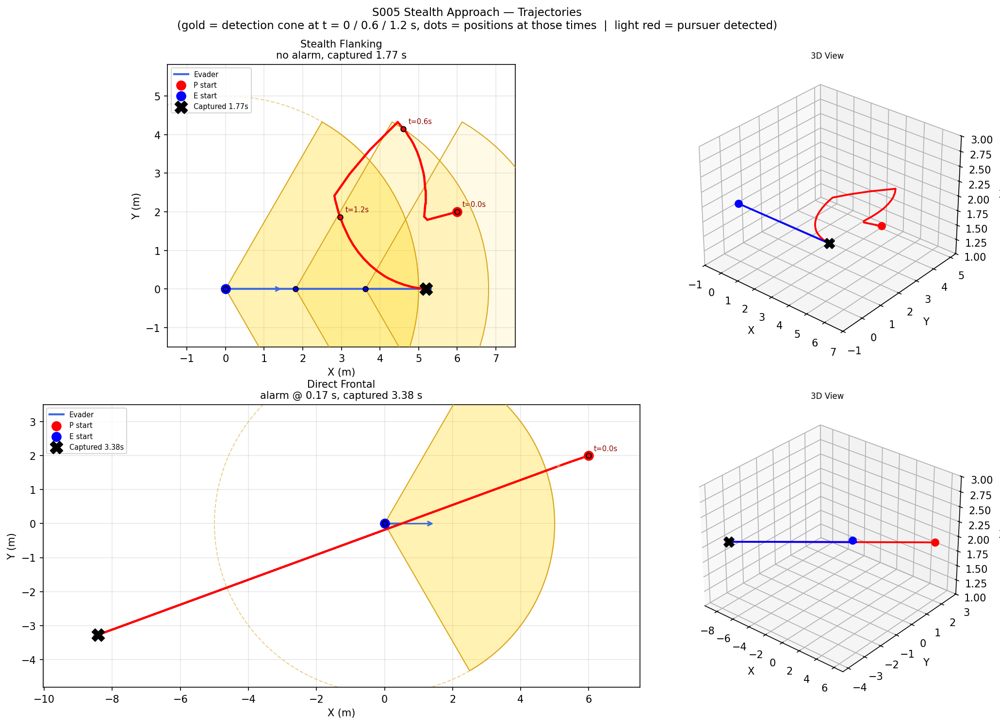
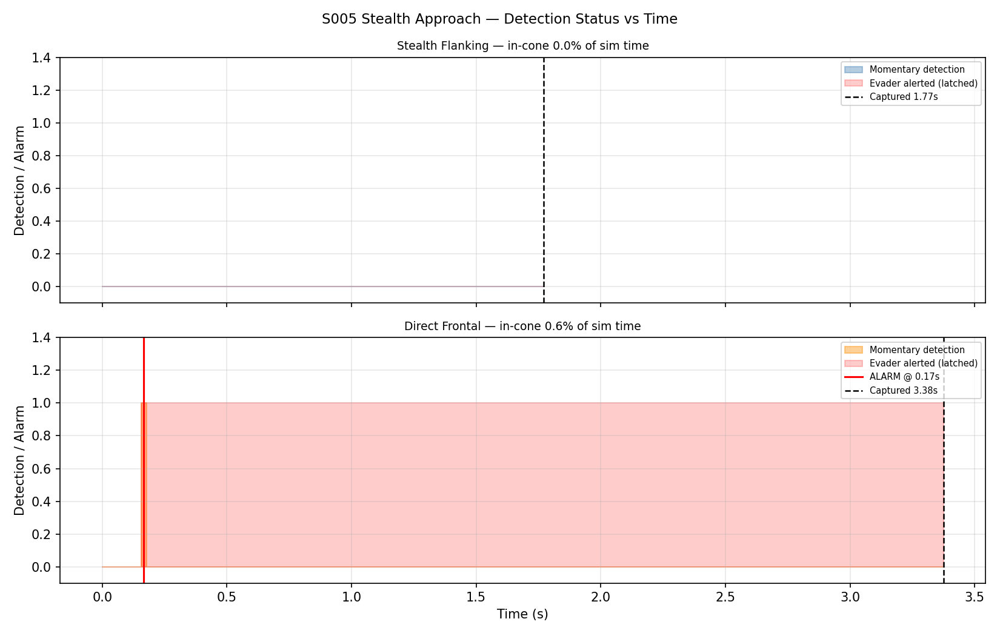
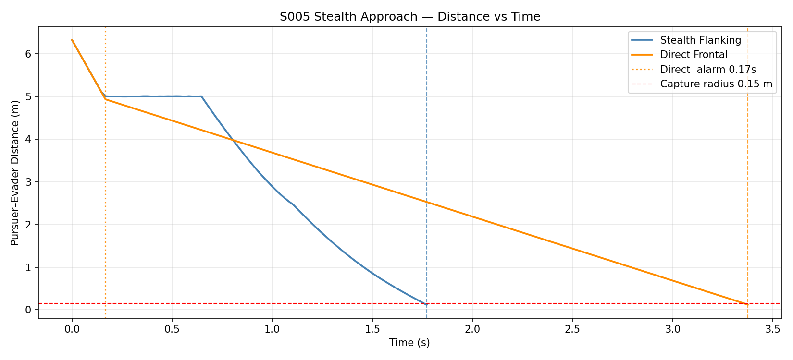
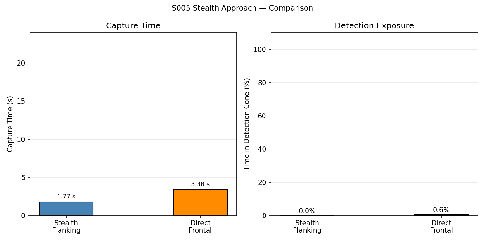
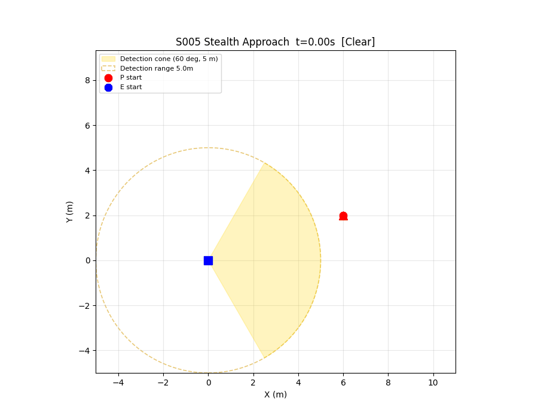

# S005 Stealth Approach

**Domain**: Pursuit & Evasion | **Difficulty**: ⭐⭐⭐ | **Status**: ✅ Completed

---

## Problem Definition

**Setup**: The evader patrols along +x and has a forward detection cone. The pursuer starts **ahead** of the evader, just outside detection range but close to the cone axis, so a straight approach has to cross the cone. The pursuer wants to reach the evader without being seen and close in from the rear blind spot.

**Roles**:
- **Evader**: flies at constant heading (+x) at 3 m/s with a forward detection cone (half-angle 60°, range 5 m) along its velocity. The **first** detection alerts it (latched). From then on it flees directly away from the pursuer at 3 m/s (same speed, new direction).
- **Pursuer**: two strategies compared below. Both obey **the same speed rule**: 5.5 m/s (4.5 + 1.0 bonus) while undetected and the evader is not alerted, otherwise 4.5 m/s.

**Comparison**:

| Strategy | Logic |
|----------|-------|
| **Stealth flanking** | Aim for a waypoint 2 m behind the evader (the evader itself once within 2.5 m). Each step, take the heading closest to that aim whose predicted next position is outside the cone |
| **Direct frontal** | Always fly straight at the evader |

If the stealth pursuer were detected, it would fall back to direct pursuit at 4.5 m/s. In this run that never happens.

---

## Mathematical Model

### Detection Cone Condition

$$\alpha = \arccos\!\left(\frac{(\mathbf{p}_P - \mathbf{p}_E) \cdot \hat{\mathbf{v}}_E}{\|\mathbf{p}_P - \mathbf{p}_E\|}\right)$$

Detected if:  $\alpha < \theta_{cone}$ **AND** $\|\mathbf{p}_P - \mathbf{p}_E\| < R_{detect}$

### Speed Rule (both strategies)

$$v_P = \begin{cases} 5.5 \text{ m/s} & \text{not detected and evader not alerted} \\ 4.5 \text{ m/s} & \text{otherwise} \end{cases}$$

### Stealth Pursuer Control

Desired direction toward the rear waypoint:

$$\hat{\mathbf{d}} = \frac{\mathbf{p}_{target} - \mathbf{p}_P}{\|\mathbf{p}_{target} - \mathbf{p}_P\|}, \quad \mathbf{p}_{target} = \mathbf{p}_E - R_{offset}\,\hat{\mathbf{v}}_E \;\;(\text{or } \mathbf{p}_E \text{ when } \|\mathbf{p}_E - \mathbf{p}_P\| \le R_{offset} + 0.5)$$

Commanded heading = the horizontal unit vector $\hat{\mathbf{u}}$ (searched every 5°) that maximises $\hat{\mathbf{u}} \cdot \hat{\mathbf{d}}$, subject to the predicted next position $\mathbf{p}_P + v_P \hat{\mathbf{u}}\,\Delta t$ being undetected by the evader at its next position. If no heading is safe, $\hat{\mathbf{d}}$ is used.

### Alert Mode (Evader)

On the first detection the alarm latches, and from then on:

$$\mathbf{v}_E = v_{E,alert} \cdot \frac{\mathbf{p}_E - \mathbf{p}_P}{\|\mathbf{p}_E - \mathbf{p}_P\|}$$

Detection is only evaluated while the evader is still patrolling. After the alarm the cone no longer matters.

---

## Key Parameters

| Parameter | Value |
|-----------|-------|
| Detection cone half-angle | 60° |
| Detection range | 5.0 m |
| Alarm | first detection, latched (no debounce) |
| Pursuer speed (undetected, evader not alerted) | 5.5 m/s (4.5 + 1.0 bonus) |
| Pursuer speed (detected / evader alerted) | 4.5 m/s |
| Evader speed (patrol) | 3.0 m/s |
| Evader speed (alerted) | 3.0 m/s (direction changes) |
| Pursuer start | (6, 2, 2) m — 6.32 m from evader, α = 18.4° |
| Evader start | (0, 0, 2) m heading +x |
| Behind-waypoint offset | 2.0 m |
| Stealth heading search resolution | 5° |
| Capture radius | 0.15 m |
| Control frequency | 48 Hz |
| Max simulation time | 20 s |

---

## Implementation

```
src/base/drone_base.py                  # Point-mass drone base class
src/01_pursuit_evasion/s005_stealth_approach.py    # Main simulation script
```

```bash
conda activate drones
python src/01_pursuit_evasion/s005_stealth_approach.py
```

---

## Results

| Strategy | Alarm Triggered | Capture Time | In-Cone steps (%) | Time at 5.5 m/s | Pursuer path | Evader path |
|----------|----------------|--------------|-------------------|-----------------|--------------|-------------|
| **Stealth Flanking** | No | **1.77 s** | 0 (0.0%) | 1.77 s | 9.74 m | 5.31 m |
| Direct Frontal | Yes (t = 0.17 s) | 3.38 s | 1 (0.6%) | 0.17 s | 15.35 m | 10.12 m |

Capture bearing (pursuer relative to the evader's heading at capture): stealth 177°, direct 180°. Both captures happen from directly behind.

**Key Findings**:

- **Stealth is about 1.9× faster (1.77 s vs 3.38 s), and the difference comes from the alarm, not from different speed rules.** Both pursuers fly 5.5 m/s until detected. The direct pursuer is detected at $t = 0.17$ s, when it crosses the 5 m range on the cone axis. The evader turns and flees, and the pursuer drops to 4.5 m/s. That leaves a 4.94 m gap to close at only $4.5 - 3.0 = 1.5$ m/s, which takes ~3.19 s more. $0.17 + 3.19 = 3.36$ s, matching the simulated 3.38 s.
- The stealth pursuer is **never detected** (0 in-cone steps). It first slides along the 5 m range boundary (the distance plot stays flat at ≈5 m from ~0.2 to ~0.65 s). Meanwhile the patrolling evader flies past it, which swings the pursuer out of the 60° cone. The pursuer then dives in behind the evader. The evader keeps patrolling at 3 m/s and never reacts, so the pursuer keeps its 5.5 m/s bonus the whole time. From $t = 1.04$ s it is behind the evader (bearing > 90°). From then until capture its mean closing speed is 3.54 m/s. That is faster than the 5.5 − 3.0 = 2.5 m/s of a pure tail chase, because it arrives from the side-rear, where the evader's velocity is mostly perpendicular to the line of sight. Only in the last 0.125 s, when it is directly astern, does the closing speed drop to 2.55 m/s.
- The in-cone percentage is low for both strategies because detection is only evaluated until the alarm. The direct pursuer needs just **one** detected step to trigger the alarm. The meaningful metric is whether an alarm happens at all, and when.
- **This advantage depends on the geometry.** The script also runs both strategies from the card's start (-4, 2, 2), which is 153.4° from the evader's heading, i.e. already in the blind spot. There, neither pursuer is ever detected (no alarm). **Direct is faster: 1.67 s vs 1.77 s for stealth.** The stealth pursuer detours via the waypoint 2 m behind the evader, while the direct pursuer flies the shorter straight line, and both keep the 5.5 m/s bonus. So stealth only pays off when the straight approach has to cross the cone.

**Trajectories** — top-down XY view with the detection cone drawn at t = 0, 0.6 and 1.2 s (the cone moves with the evader; dots mark both agents at those times). The stealth pursuer (top) stays outside every snapshot cone; the direct pursuer (bottom) enters the cone and triggers the alarm:



**Detection Status vs Time** — stealth: no detection at all; direct: one detected step at 0.17 s latches the alarm:



**Distance vs Time** — stealth holds ≈5 m (range boundary), then closes fast from behind; direct closes at 1.5 m/s after the alarm:



**Capture Time and Detection Exposure**:



**Animation** (stealth case; the cone and range circle move with the evader; every 2nd step, 43 frames):



### Deviations from the scenario card

| Card | This implementation | Reason |
|------|--------------------|--------|
| Pursuer start (-4, 2, 2) m | (6, 2, 2) m | (-4, 2) is behind the evader ($\alpha = 153°$). From there the direct approach is never detected either. This run's check gives direct 1.67 s vs stealth 1.77 s, both with no alarm. The card's expected result reverses, and the comparison would test path length, not stealth. Starting ahead, outside range ($6.32$ m, $\alpha = 18.4°$), forces a straight approach through the cone |
| Evader flees only while the pursuer is in the cone (card pseudocode re-evaluates every step) | First detection latches the alert permanently | With per-step evaluation the fleeing evader's cone turns away from the pursuer, detection drops, the evader resumes patrol and gets re-detected, so it chatters. "Becomes alerted" in the card text is read as a latched state |
| Stealth: go to the behind-waypoint when undetected, straight at the evader when detected | Cone-avoiding heading search toward the waypoint (predictive, 5° steps); falls back to direct pursuit only after an alarm | The card's rule only reacts after detection, which would already trigger the latched alarm |
| — | Speeds 5.5 / 4.5 m/s (pursuer), 3.0 / 3.0 m/s (evader), offset 2 m, max time 20 s, cone 60° / 5 m all match the card | Previous version used 7 / 4 and 2.5 / 6 m/s, offset 3 m, 25 s and a 30-step alarm debounce, with different speed rules for the two strategies. That made the comparison unfair and has been removed |

---

## Extensions

1. Multiple detection cones (front + two lateral at ±90°) — pursuer must find a smaller blind spot
2. Time-varying evader heading (scanning/turning) — pursuer must predict heading to aim behind-waypoint correctly
3. Acoustic noise model: speed above threshold increases detection range proportionally
4. 3D stealth: cone has 3D solid angle, pursuer must also adjust altitude
5. Monte Carlo over pursuer start positions: map where stealth beats direct pursuit and where they coincide

---

## Related Scenarios

- Prerequisites: [S001](../../../scenarios/01_pursuit_evasion/S001_basic_intercept.md), [S002](../../../scenarios/01_pursuit_evasion/S002_evasive_maneuver.md)
- Follow-ups: [S006](../../../scenarios/01_pursuit_evasion/S006_energy_race.md), [S016](../../../scenarios/01_pursuit_evasion/S016_airspace_defense.md)
