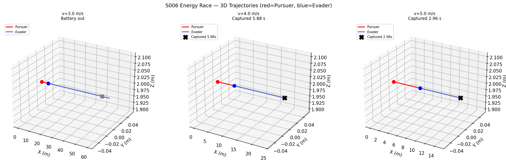
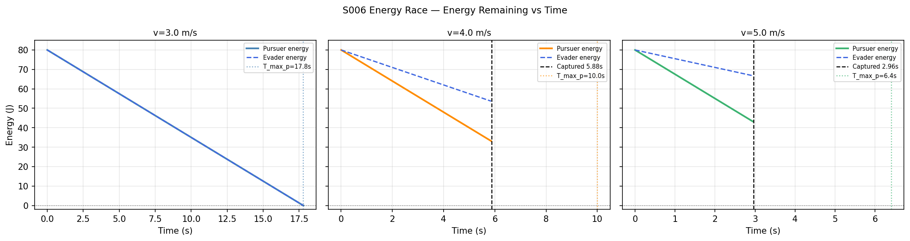
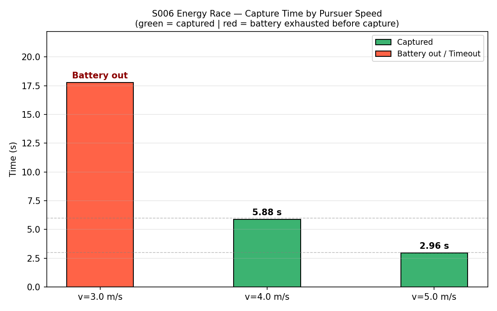
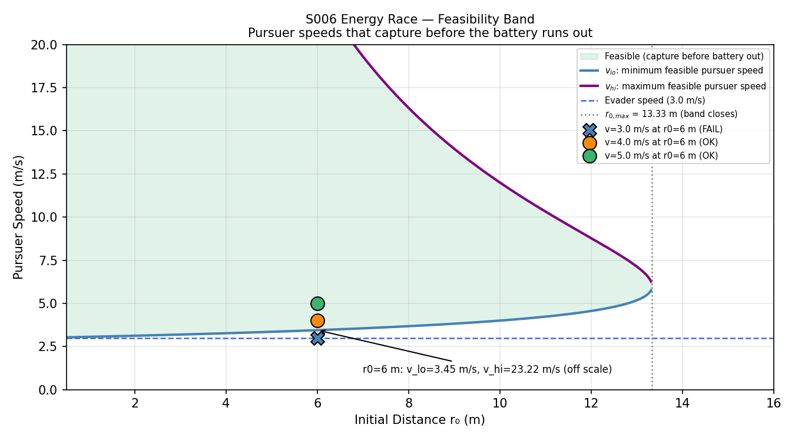
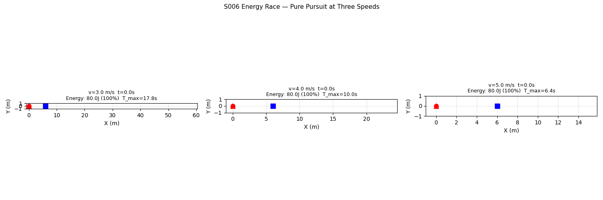

# S006 Energy Race

**Domain**: Pursuit & Evasion | **Difficulty**: ⭐⭐ | **Status**: ✅ Completed

---

## Problem Definition

**Setup**: Pursuer and evader both carry limited batteries (80 J each). Power consumption scales as P = k·v² (k = 0.5 W·s²/m²). The pursuer must capture the evader before its battery runs dry.

**Roles**:
- **Evader**: constant straight flight in +x at 3 m/s; starts 6 m ahead of the pursuer. If its battery empties it stops (holds position); in this run that only happens in the v = 3 m/s case, at the same step as the pursuer's battery empties.
- **Pursuer**: pure pursuit at one of three fixed speeds — 3, 4, or 5 m/s.

**Question**: Which pursuer speed minimises capture time while remaining within the energy budget?

---

## Mathematical Model

### Energy Consumption

$$E(t) = E_0 - \int_0^t k \cdot v^2 \, d\tau = E_0 - k \cdot v^2 \cdot t$$

Maximum flight time at constant speed:

$$T_{max}(v) = \frac{E_0}{k \cdot v^2}$$

### Approximate Capture Time (Pure Pursuit)

$$T_{cap} \approx \frac{r_0}{v_P - v_E}$$

The start is collinear (evader directly ahead, flying straight away), so pure pursuit is a straight tail chase and this formula is exact up to the capture radius and the time step.

### Feasibility Condition

Capture is achievable only if $T_{cap} \leq T_{max}(v_P)$:

$$\frac{r_0}{v_P - v_E} \leq \frac{E_0}{k \cdot v_P^2}
\quad\Longleftrightarrow\quad
k\, r_0\, v_P^2 - E_0\, v_P + E_0\, v_E \le 0$$

### Feasibility Band

The quadratic opens upward, so the condition holds **between** its two roots:

$$v_{lo} = \frac{E_0 - \sqrt{E_0^2 - 4 k r_0 E_0 v_E}}{2 k r_0} \;\le\; v_P \;\le\; v_{hi} = \frac{E_0 + \sqrt{E_0^2 - 4 k r_0 E_0 v_E}}{2 k r_0}$$

- $v_{lo}$ is the **minimum** feasible speed (slower → the gap closes too slowly).
- $v_{hi}$ is the **maximum** feasible speed (faster → the battery drains before the gap is closed).
- The band closes when the discriminant reaches zero: $r_{0,max} = \dfrac{E_0}{4 k v_E}$, at $v_P = 2 v_E$.

For a fixed speed, the largest feasible initial distance is $r_0 \le E_0 (v_P - v_E) / (k v_P^2)$.

---

## Key Parameters

| Parameter | Value |
|-----------|-------|
| Initial distance r₀ | 6 m (pursuer (0, 0, 2), evader (6, 0, 2)) |
| Pursuer speed options | 3.0, 4.0, 5.0 m/s |
| Evader speed | 3.0 m/s, +x |
| Battery capacity (both) | 80 J |
| Energy coefficient k | 0.5 W·s²/m² |
| Capture radius | 0.15 m |
| Control frequency | 48 Hz (dt = 1/48 s) |
| Max simulation time | 30 s |
| Animation | every 6th step, 144 frames |

---

## Implementation

```
src/base/drone_base.py               # Point-mass drone base class
src/01_pursuit_evasion/s006_energy_race.py      # Main simulation script
```

```bash
conda activate drones
python src/01_pursuit_evasion/s006_energy_race.py
```

---

## Results

| Speed | T_cap (analytical) | T_max (battery) | Outcome | Simulated time | Pursuer energy left | Evader energy left |
|-------|-------------------|-----------------|---------|-----------------|-------------|-------------|
| **3 m/s** | ∞ (equal speeds) | 17.78 s | ❌ Battery out | 17.79 s (gap 6.00 m) | 0.00 J | 0.00 J |
| **4 m/s** | 6.00 s | 10.00 s | ✅ Captured | **5.88 s** | 33.17 J | 53.66 J |
| **5 m/s** | 3.00 s | 6.40 s | ✅ Captured | **2.96 s** | 43.28 J | 66.78 J |

Feasibility band printed by the script:

| Quantity | Value |
|----------|-------|
| $v_{lo}$ at r₀ = 6 m (minimum feasible speed) | 3.445 m/s |
| $v_{hi}$ at r₀ = 6 m (maximum feasible speed) | 23.222 m/s |
| $r_{0,max}$ (band closes, at v = 6.0 m/s) | 13.333 m |
| Largest feasible r₀ at v = 4 m/s | 10.00 m |
| Largest feasible r₀ at v = 5 m/s | 12.80 m |
| v = 3 m/s | never feasible ($v_P \le v_E$) |

**Key Findings**:

- **Simulated times match the analytical model.** The simulated captures are slightly *earlier* than $r_0/(v_P - v_E)$ because capture happens at 0.15 m, not 0: $(6 - 0.15)/1 = 5.85$ s and $(6 - 0.15)/2 = 2.925$ s, then rounded up to the next 1/48 s step and detected one step later (5.875 → 5.88 s, 2.958 → 2.96 s).
- **Energy check** ("power × time"): at 4 m/s the pursuer draws $0.5 \times 4^2 = 8$ W for 281 steps $= 5.854$ s → $46.83$ J used, $80 - 46.83 = 33.17$ J left (41%). At 5 m/s it draws $12.5$ W for 141 steps $= 2.9375$ s → $36.72$ J used, $43.28$ J left (54%). The evader draws $4.5$ W in every case.
- At **v = 3 m/s** the pursuer matches the evader's speed, so the 6 m gap never shrinks. Both drones draw 4.5 W and both batteries hit 0 J at the same step (17.79 s; analytically $80 / 4.5 = 17.78$ s, the extra 0.01 s is the 1/48 s step).
- **Faster is not only quicker, it is also cheaper here.** The energy to capture is $E_{cap} = k v_P^2 \, r_0 / (v_P - v_E)$: 48 J at 4 m/s and 37.5 J at 5 m/s (analytical, before the capture-radius saving). It is minimised at $v_P = 2 v_E = 6$ m/s ($0.5 \times 36 \times 6 / 3 = 36$ J). Below that speed, slowing down costs more energy because the chase lasts much longer.
- **Optimal speed**: of the three options, 5 m/s is fastest and within budget. Without the three-option restriction, capture time keeps falling with speed up to $v_{hi} = 23.22$ m/s at r₀ = 6 m. Beyond that speed the battery runs out first.
- **As r₀ grows the band narrows from both sides, and the slower speed drops out first**: 4 m/s stops being feasible beyond r₀ = 10.00 m, 5 m/s beyond 12.80 m. No speed is feasible beyond r₀ = 13.33 m.

**3D Trajectories** — pursuer (red) chases the straight-flying evader (blue) along the x-axis at each speed; X = end point:



**Energy Remaining vs Time** — pursuer energy (solid) and evader energy (dashed); the curves end at capture or battery-out. At 3 m/s the two curves coincide (same speed, same drain):



**Capture Time by Speed** — green = capture time, red = time the battery ran out (no capture); grey dashed lines are the analytical $T_{cap}$ values 6 s and 3 s:



**Feasibility Band** — green region = pursuer speeds that capture before the battery runs out; blue = minimum feasible speed $v_{lo}$, purple = maximum feasible speed $v_{hi}$ (23.22 m/s at r₀ = 6 m is above the plotted range). Our three scenario speeds are marked at r₀ = 6 m:



**Animation** (all three speeds side by side; every 6th step, 144 frames; finished cases freeze on their last frame):



### Deviations from the scenario card

| Card | This implementation | Reason |
|------|--------------------|--------|
| Expected output "Feasibility boundary: minimum energy required vs initial distance" | Feasibility band in speed: $v_{lo}(r_0)$ and $v_{hi}(r_0)$ | The band answers the card's question (which speeds work) directly. The minimum energy is given in the text instead: $E_{min}(r_0) = 4 k v_E r_0 = 6 r_0$ J (at $v_P = 6$ m/s), which reaches 80 J at $r_0 = 13.33$ m, the same point where the band closes |
| Card does not say what an evader with an empty battery does | It stops (holds position, no further drain) | Keeps the evader's battery meaningful. It never matters for capture in this run: the evader only runs dry in the v = 3 m/s case, at the same step as the pursuer |
| — | 48 Hz control and 30 s timeout | Not specified in the card |

---

## Extensions

1. Variable-speed pursuer: adapt speed dynamically based on remaining energy
2. Evader also optimises its energy — slower when far, sprint when close
3. Wind field: directional energy cost (tailwind vs headwind)

---

## Related Scenarios

- Prerequisites: [S001 Basic Intercept](../../../scenarios/01_pursuit_evasion/S001_basic_intercept.md)
- Follow-ups: [S010 Asymmetric Speed — Bounded Arena Trapping](../../../scenarios/01_pursuit_evasion/S010_asymmetric_speed.md), [S012 Relay Pursuit](../../../scenarios/01_pursuit_evasion/S012_relay_pursuit.md)
