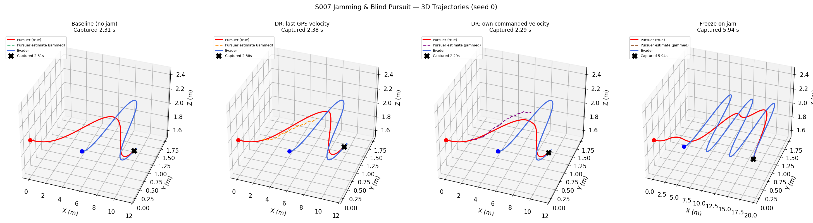
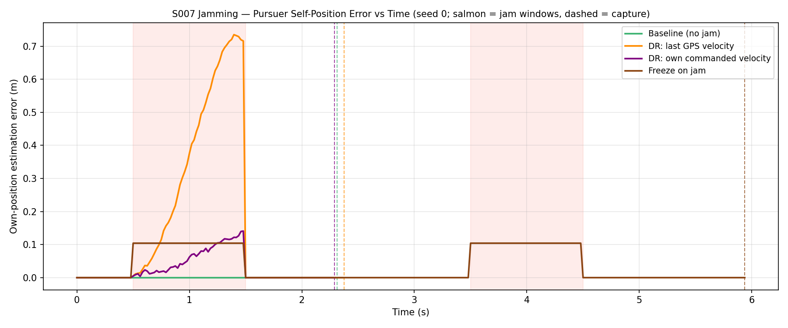
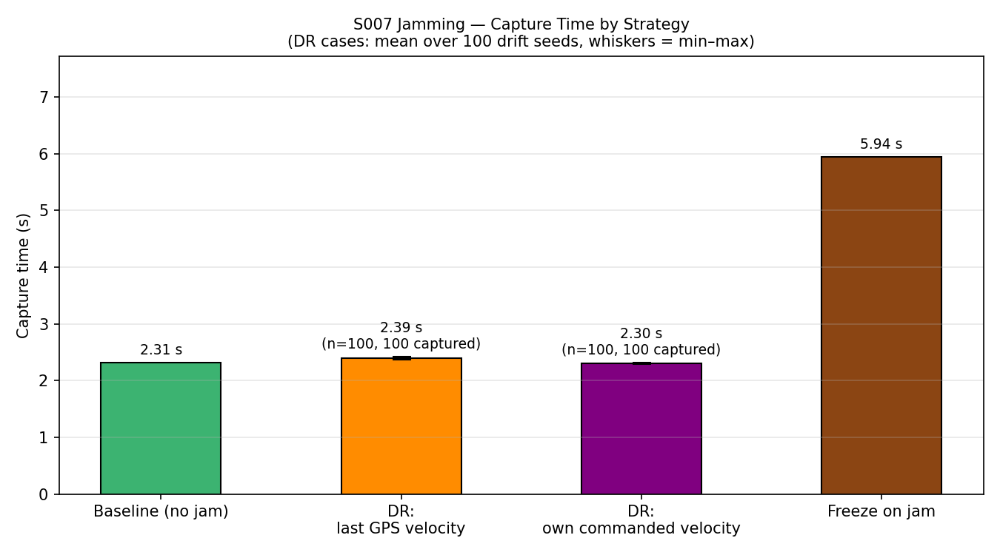
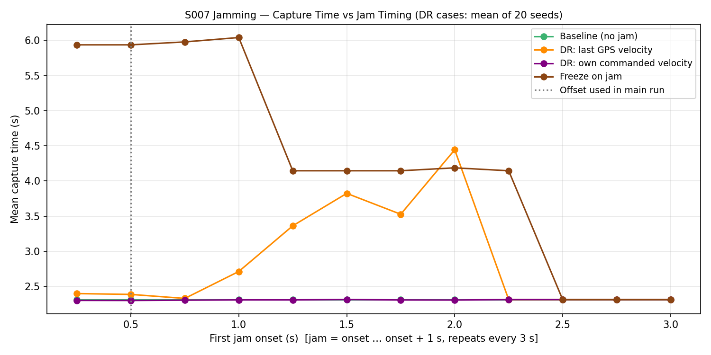
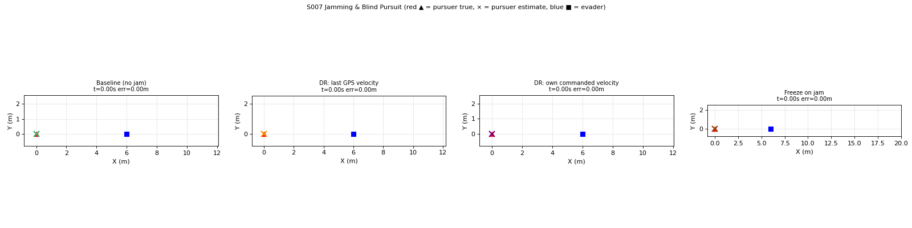

# S007 Jamming & Blind Pursuit

**Domain**: Pursuit & Evasion | **Difficulty**: ⭐⭐⭐ | **Status**: ✅ Completed

---

## Problem Definition

**Setup**: The pursuer's GPS is periodically jammed (1 s jam every 3 s, 33% duty cycle; first jam at t = 0.5 s). During a blackout the pursuer has to estimate its **own** position without GPS. It always knows the evader's true position (e.g. from an onboard tracker), so the only error source is its self-position estimate. The evader escapes at 3 m/s and **weaves** (heading = 60°·sin(2πt / 2 s) around +x), so the pursuer keeps turning. An estimate that assumes the old velocity drifts away from the truth and bends the pursuit direction.

**Strategies compared** (identical pursuit law, speed and evader; only the jam handling differs):

| Strategy | GPS blackout behaviour |
|----------|----------------------|
| **Baseline** | No jamming — perfect GPS always |
| **DR: last GPS velocity** (card model) | Keep pursuing; estimate = last fix + last GPS velocity × elapsed time + IMU drift |
| **DR: own commanded velocity** (IMU-style) | Keep pursuing; estimate integrates the drone's own commanded velocity + IMU drift |
| **Freeze on jam** | Hover until GPS returns |

Pursuit law for all: $\mathbf{v}_{cmd} = v_P \,(\mathbf{p}_E - \hat{\mathbf{p}}_P) / \|\mathbf{p}_E - \hat{\mathbf{p}}_P\|$, i.e. the pursuer aims from where it *thinks* it is.

---

## Mathematical Model

### Pursuit Command

$$\mathbf{v}_{cmd} = v_P \cdot \frac{\mathbf{p}_E - \hat{\mathbf{p}}_P}{\|\mathbf{p}_E - \hat{\mathbf{p}}_P\|}$$

With GPS, $\hat{\mathbf{p}}_P = \mathbf{p}_P$.

### Dead-Reckoning Phase

During a jam window starting at $t_j$:

$$\hat{\mathbf{p}}_P(t) = \mathbf{p}_P(t_j) + \int_{t_j}^{t} \mathbf{v}_{used}\, d\tau + \boldsymbol{\varepsilon}(t), \qquad \boldsymbol{\varepsilon}(t) \sim \mathcal{N}\!\left(\mathbf{0},\; \sigma_{drift}^2 (t-t_j)\, \mathbf{I}\right)$$

- DR last velocity: $\mathbf{v}_{used} = \mathbf{v}_{last}$ (velocity over the last GPS-covered step, constant during the jam)
- DR commanded velocity: $\mathbf{v}_{used} = \mathbf{v}_{cmd}(\tau)$ (what the drone actually flies)

Implemented per step as $\hat{\mathbf{p}} \mathrel{+}= \mathbf{v}_{used}\,\Delta t + \mathcal{N}(\mathbf{0}, \sigma_{drift}^2 \Delta t\, \mathbf{I})$.

### Position Estimation Error

$$e(t) = \|\hat{\mathbf{p}}_P - \mathbf{p}_P\| \approx \underbrace{\Big\|\int_{t_j}^{t} (\mathbf{v}_{used} - \mathbf{v}_{cmd})\, d\tau\Big\|}_{\text{model error (0 for commanded-velocity DR)}} + \mathcal{O}\!\left(\sigma_{drift}\sqrt{t - t_j}\right)$$

### Jam Schedule

Jammed during $[t_0 + n T_{period},\; t_0 + n T_{period} + T_{jam})$ for integer $n \ge 0$, with $t_0 = 0.5$ s.

### Evader

$$\theta_E(t) = A \sin(2\pi t / T_w), \qquad \mathbf{v}_E = v_E\,[\cos\theta_E,\; \sin\theta_E,\; 0]$$

---

## Key Parameters

| Parameter | Value |
|-----------|-------|
| Jam period | 3 s |
| Jam duration | 1 s (33% duty cycle) |
| First jam onset $t_0$ | 0.5 s (sweep: 0.25–3.00 s in 0.25 s steps) |
| IMU drift σ | 0.05 m/√s per axis |
| Pursuer speed | 5 m/s |
| Evader speed | 3 m/s |
| Evader weave | amplitude 60°, period 2 s |
| Initial positions | pursuer (0, 0, 2), evader (6, 0, 2) — 6 m |
| Capture radius | 0.15 m |
| Control frequency | 48 Hz |
| Max simulation time | 25 s |
| Monte Carlo | 100 drift seeds (0–99) per DR strategy; 20 seeds per DR strategy per sweep point; same seed for both DR strategies (common random numbers) |
| Plotted run | seed 0 |
| Animation | every 3rd step, 97 frames |

---

## Implementation

```
src/base/drone_base.py                       # Point-mass drone base
src/01_pursuit_evasion/s007_jamming_blind_pursuit.py    # Main simulation
```

```bash
conda activate drones
python src/01_pursuit_evasion/s007_jamming_blind_pursuit.py
```

Runtime ≈ 30 s.

---

## Results

### Main run (first jam 0.5–1.5 s)

| Strategy | Capture time (seed 0) | Capture time, 100 seeds: mean [min, max] | Self-position error at end of 1st jam (t = 1.479 s, seed 0) | Max error, mean over seeds |
|----------|-----|-----|-----|-----|
| **Baseline** | 2.312 s | 2.312 s (deterministic) | 0.000 m | 0.000 m |
| **DR: last GPS velocity** | 2.375 s | 2.388 s [2.375, 2.417] | 0.716 m | 0.769 m (max 1.003 m) |
| **DR: own commanded velocity** | 2.292 s | 2.303 s [2.292, 2.312] | 0.141 m | 0.092 m (max 0.177 m) |
| **Freeze on jam** | 5.938 s | 5.938 s (deterministic) | 0.104 m | 0.104 m |

All 100 runs of each DR strategy capture. Paired over the same seeds, last-velocity DR is slower than commanded-velocity DR in **100/100** runs, by 0.086 s on average.

### Jam-timing sweep (mean capture time, s; DR strategies over 20 seeds each)

| First jam onset | Baseline | DR: last velocity | DR: commanded velocity | Freeze |
|---|---|---|---|---|
| 0.25 | 2.312 | 2.398 | 2.301 | 5.938 |
| 0.50 | 2.312 | 2.386 | 2.300 | 5.938 |
| 0.75 | 2.312 | 2.329 | 2.304 | 5.979 |
| 1.00 | 2.312 | 2.712 | 2.308 | 6.042 |
| 1.25 | 2.312 | 3.362 | 2.308 | 4.146 |
| 1.50 | 2.312 | 3.824 | 2.314 | 4.146 |
| 1.75 | 2.312 | 3.527 | 2.307 | 4.146 |
| 2.00 | 2.312 | **4.445** | 2.306 | 4.188 |
| 2.25 | 2.312 | 2.312 | 2.312 | 4.146 |
| 2.50–3.00 | 2.312 | 2.312 | 2.312 | 2.312 |

All sweep runs capture.

**Key Findings**:

- **Estimation quality now matters.** With a weaving evader the pursuer turns during the jam, but last-velocity DR keeps propagating the pre-jam velocity. Its self-position error grows to 0.716 m by the end of the first 1 s jam (seed 0), about 5× the commanded-velocity DR error (0.141 m). Magnitude check: 0.716 m in 0.98 s means the true and assumed velocities differ by ~0.73 m/s on average. That is a ~8° average heading difference at 5 m/s ($2 \times 5 \times \sin 4° \approx 0.70$ m/s).
- **Commanded-velocity DR only carries the IMU drift.** Its expected error after τ = 0.98 s is $0.05\sqrt{0.98} \approx 0.049$ m per axis, RMS ≈ $\sqrt{3} \times 0.049 \approx 0.085$ m in 3-D. Seed 0 (0.141 m) is on the high side; the mean over 100 seeds of the *maximum* error is 0.092 m. Its capture time (2.303 s mean) is within one 1/48 s step of the baseline (2.312 s). The small drift-induced path changes sometimes save a step; that is noise, not an advantage.
- **In the main run the cost of the bad estimate is small (+0.086 s), because GPS returns at 1.5 s, before the end-game (capture ≈ 2.3 s).** In seed 0 the range is still 2.23 m when the error peaks (0.716 m at t = 1.479 s), so the aim is bent by at most $\arctan(0.716/2.226) \approx 18°$, and only briefly. That costs little closing speed.
- **The sweep shows when it hurts: if the jam covers the end-game.** With the first jam at 1.25–2.00 s, last-velocity DR needs 3.36–4.45 s instead of 2.31 s. The script prints an example (onset 2.00 s, seed 0): the range is 0.808 m at jam onset and 0.349 m at 2.208 s. The pursuer then passes the evader and turns back, but its estimate keeps moving forward at the pre-jam velocity. The error grows to 6.811 m by 2.979 s, the pursuer aims from the wrong place, and the range opens to 3.288 m before GPS returns at 3.0 s. Capture comes at 4.438 s. Averaged over seeds at this onset, last-velocity DR is even slower than freezing (4.445 vs 4.188 s). Commanded-velocity DR stays within 0.012 s of the baseline at every onset.
- **Freezing is costly whenever a jam happens before capture.** With the first jam at 0.5 s the pursuer hovers for 1 s while the evader moves away, and it hovers again during the second jam (3.5–4.5 s). Capture comes at 5.938 s, 2.6× the baseline. Its estimate is exact while hovering except for one step: the drone flies one more step after the last fix before stopping, so the estimate lags by $5 \times 1/48 = 0.104$ m.
- If the jam starts at 2.50 s or later, every strategy has already captured at 2.312 s, so all coincide.

**3D Trajectories** (seed 0) — red = pursuer true path, dashed = pursuer's own-position estimate while jammed, blue = weaving evader:



**Self-Position Error vs Time** (seed 0) — error grows only inside jam windows (salmon) and resets when GPS returns. Last-velocity DR (orange) grows much faster than commanded-velocity DR (purple). Freeze holds a constant one-step lag (0.104 m):



**Capture Time by Strategy** — DR bars are means over 100 drift seeds, whiskers = min–max:



**Capture Time vs Jam Timing** — the penalty of last-velocity DR peaks when the jam covers the end-game:



**Animation** (seed 0; red ▲ = pursuer true, × = pursuer's own-position estimate, blue ■ = evader; every 3rd step, 97 frames):



### Deviations from the scenario card

| Card | This implementation | Reason |
|------|--------------------|--------|
| Evader: straight escape along +x from a collinear start | Weaving escape, heading 60°·sin(2πt/2 s) | With a straight evader from a collinear start the pursuit direction never changes, so a wrong self-position estimate never changes the heading. The old version's dead-reckoning and baseline trajectories differed by ≤ 0.013 m and the comparison could not discriminate |
| Jam schedule starts at t = 0 ($n T_{period}$) | First jam at $t_0 = 0.5$ s, then every 3 s | At t = 0 the drone has never moved, so $\mathbf{v}_{last} = 0$. The old version's estimate stayed frozen while the drone flew, and the error reached 4.88 m at t ≈ 1 s. The onset sweep (0.25–3.00 s) shows the dependence on jam timing |
| Strategies: dead reckoning, freeze, baseline | Added "DR: own commanded velocity" | Separates the effect of the velocity model from the IMU drift. Card Extension 1 (IMU-aided estimate) in its simplest form |
| — | Pursuer knows the evader's true position | The card only models the pursuer's own GPS loss; the evader is unaffected |
| IMU drift σ = 0.05 **m/s**; pseudocode adds `rng.normal(0, SIGMA_DRIFT * DT, 3)` per step | σ = 0.05 **m/√s**; each step adds $\mathcal{N}(0, \sigma^2 \Delta t)$ per axis, i.e. std $\sigma\sqrt{\Delta t}$ | The card's own math model says $\boldsymbol{\varepsilon}(t) \sim \mathcal{N}(\mathbf{0}, \sigma^2 (t - t_j)\mathbf{I})$, a random walk whose std grows as $\sigma\sqrt{t - t_j}$; that needs σ in m/√s and per-step std $\sigma\sqrt{\Delta t}$. The pseudocode's per-step std $\sigma\Delta t$ would give only $0.05 \times \sqrt{0.98 \times (1/48)} \approx 0.0071$ m after a 0.98 s jam instead of 0.049 m, 7× ($\sqrt{48}$) less than the model |
| Single noisy run | 100 drift seeds per DR strategy, common random numbers; plotted run = seed 0 | The drift is random; one run cannot show whether a difference is systematic |
| Expected "zigzag (dead reckoning)" trajectory | Path bends during jams (visible in the plot), no zigzag | With GPS returning after 1 s the corrections are smooth, not zigzag |

---

## Extensions

1. Kalman filter with IMU: fuse commanded velocity, IMU and intermittent GPS
2. Adversarial jammer: activate only when the pursuer is within 1 m of capture (the sweep shows this is the damaging case for last-velocity DR)
3. Pursuer reduces speed during jam to limit divergence

---

## Related Scenarios

- Prerequisites: [S001 Basic Intercept](../../../scenarios/01_pursuit_evasion/S001_basic_intercept.md), [S002 Evasive Maneuver](../../../scenarios/01_pursuit_evasion/S002_evasive_maneuver.md)
- Follow-up: [S008 Stochastic Pursuit — Kalman Filter Tracking](../../../scenarios/01_pursuit_evasion/S008_stochastic_pursuit.md)
