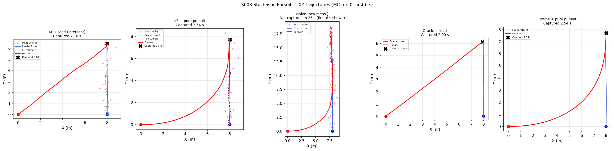
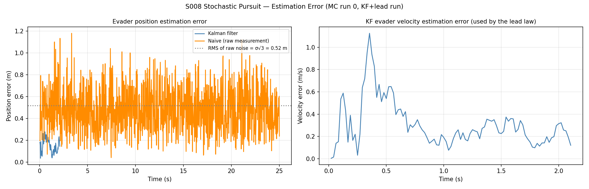
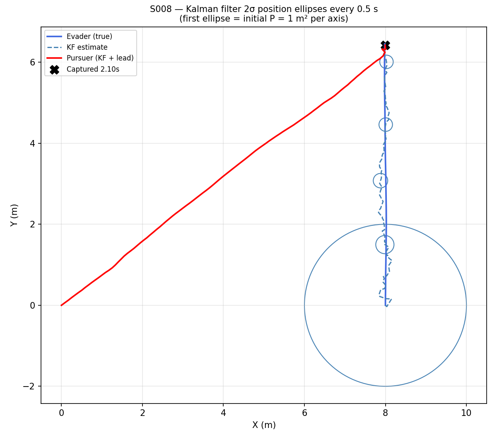
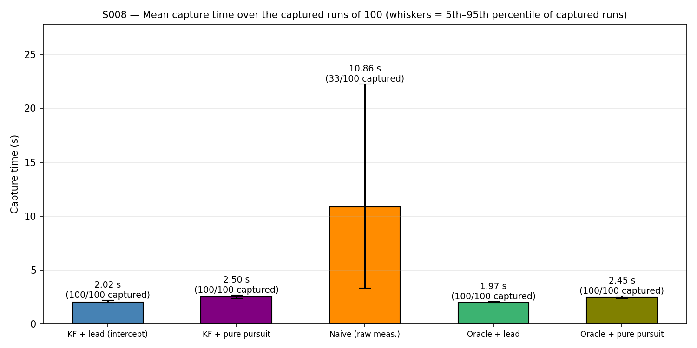
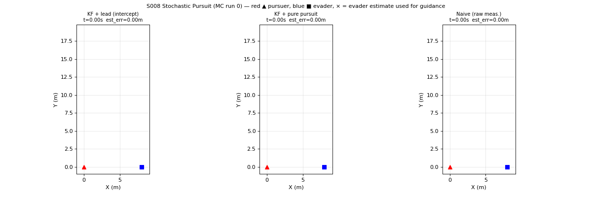

# S008 Stochastic Pursuit — Kalman Filter Tracking

**Domain**: Pursuit & Evasion | **Difficulty**: ⭐⭐⭐ | **Status**: ✅ Completed

---

## Problem Definition

**Setup**: The evader starts 8 m from the pursuer and flies across the line of sight (initial velocity 3 m/s along +y) with random acceleration noise (σ_a = 0.5 m/s² per step in x and y). The pursuer receives noisy 3-D position measurements of the evader (σ = 0.3 m per axis) and flies at 5 m/s.

**Strategies compared** (every strategy sees the same evader trajectory **and** the same measurement-noise sequence in each run — common random numbers):

| Strategy | Evader estimate | Guidance law |
|----------|-----------------|--------------|
| **KF + lead** | Kalman filter position **and velocity** | Aim at the predicted intercept point |
| **KF + pure pursuit** | Kalman filter position | Aim at the estimated position |
| **Naive** | Raw noisy measurement | Aim at the measurement |
| **Oracle + lead** | True position and velocity | Aim at the intercept point (upper bound for KF + lead) |
| **Oracle + pure pursuit** | True position | Aim at the true position (upper bound for KF + pure) |

---

## Mathematical Model

### Evader Process Model (6-D state)

$$\mathbf{x}_E(k+1) = \mathbf{F}\mathbf{x}_E(k) + \mathbf{w}_k, \quad \mathbf{w}_k \sim \mathcal{N}(\mathbf{0}, \mathbf{Q})$$

$$\mathbf{F} = \begin{bmatrix}\mathbf{I} & \Delta t\mathbf{I} \\ \mathbf{0} & \mathbf{I}\end{bmatrix}, \quad \mathbf{Q} = q\begin{bmatrix}\tfrac{\Delta t^3}{3}\mathbf{I} & \tfrac{\Delta t^2}{2}\mathbf{I} \\ \tfrac{\Delta t^2}{2}\mathbf{I} & \Delta t\mathbf{I}\end{bmatrix}$$

### Measurement Model

$$\mathbf{z}_k = \mathbf{H}\mathbf{x}_E(k) + \mathbf{n}_k, \quad \mathbf{n}_k \sim \mathcal{N}(\mathbf{0}, \sigma^2\mathbf{I}_3), \quad \mathbf{H} = [\mathbf{I}\;\mathbf{0}]$$

### Kalman Recursion

**Predict:** $\hat{\mathbf{x}}^- = \mathbf{F}\hat{\mathbf{x}}$, $\mathbf{P}^- = \mathbf{F}\mathbf{P}\mathbf{F}^T + \mathbf{Q}$

**Update:** $\mathbf{K} = \mathbf{P}^-\mathbf{H}^T(\mathbf{H}\mathbf{P}^-\mathbf{H}^T + \mathbf{R})^{-1}$, $\hat{\mathbf{x}} = \hat{\mathbf{x}}^- + \mathbf{K}(\mathbf{z}_k - \mathbf{H}\hat{\mathbf{x}}^-)$

Initial state (what a real tracker knows): the first measurement as position, zero velocity, $\mathbf{P}_0 = \mathrm{diag}(\sigma^2\mathbf{I},\; 36\,\mathbf{I})$. The velocity variance 36 (m/s)² is the square of the evader's 6 m/s speed limit, so any feasible velocity lies within 1σ. The filter starts at the first measurement and runs predict/update from the second.

### Lead (Intercept) Guidance

With the estimated evader position $\hat{\mathbf{p}}_E$ and velocity $\hat{\mathbf{v}}_E$, find the time $t^*$ at which a straight flight at $v_P$ meets an evader moving at constant $\hat{\mathbf{v}}_E$:

$$\|\hat{\mathbf{p}}_E + \hat{\mathbf{v}}_E t^* - \mathbf{p}_P\| = v_P\, t^* \;\Rightarrow\; (\|\hat{\mathbf{v}}_E\|^2 - v_P^2)\,t^{*2} + 2\,(\mathbf{r}\cdot\hat{\mathbf{v}}_E)\,t^* + \|\mathbf{r}\|^2 = 0, \quad \mathbf{r} = \hat{\mathbf{p}}_E - \mathbf{p}_P$$

Take the positive root and command $\mathbf{v}_P = v_P\,\dfrac{\hat{\mathbf{p}}_E + \hat{\mathbf{v}}_E t^* - \mathbf{p}_P}{\|\cdot\|}$. The aim point is recomputed every step. Pure pursuit uses $\hat{\mathbf{p}}_E$ as the aim point.

---

## Key Parameters

| Parameter | Value |
|-----------|-------|
| KF process noise q | 0.1 m²/s³ |
| KF initial state | first measurement, zero velocity; $\mathbf{P}_0 = \mathrm{diag}(0.09\,\mathbf{I}, 36\,\mathbf{I})$ |
| Measurement noise σ | 0.3 m per axis (x, y, z) |
| Evader acceleration std | 0.5 m/s² per step (x, y; altitude fixed) |
| Evader initial velocity | (0, 3, 0) m/s, speed clamped at 6 m/s |
| Pursuer speed | 5 m/s |
| Initial positions | pursuer (0, 0, 2), evader (8, 0, 2) — 8 m |
| Capture radius | 0.15 m |
| Control frequency | 48 Hz |
| Max simulation time | 25 s |
| Monte Carlo | 100 runs; run i: evader seed 1000 + i, measurement seed i |
| Plotted run | run 0 |
| Animation | first 6 s, every 3rd step, 98 frames |

---

## Implementation

```
src/base/drone_base.py                  # Point-mass drone base
src/01_pursuit_evasion/s008_stochastic_pursuit.py  # Main simulation + KF
```

```bash
conda activate drones
python src/01_pursuit_evasion/s008_stochastic_pursuit.py
```

Runtime ≈ 30 s.

---

## Results

### Monte Carlo (100 runs)

| Strategy | Captured | Capture time: mean ± std [min, max] (captured runs) | Mean position error |
|----------|----------|-------------------------------|------------------|
| **Oracle + lead** | 100/100 | **1.972 ± 0.038 s** [1.875, 2.083] | 0.000 m |
| **KF + lead** | 100/100 | **2.102 ± 0.107 s** [1.958, 2.750] | 0.160 m |
| **Oracle + pure pursuit** | 100/100 | 2.446 ± 0.073 s [2.250, 2.625] | 0.000 m |
| **KF + pure pursuit** | 100/100 | 2.504 ± 0.098 s [2.312, 2.792] | 0.153 m |
| **Naive** | **33/100** | 10.864 ± 5.876 s [3.250, 22.958] (33 runs only) | 0.476 m |

Paired comparisons (same evader and noise per run):

| Comparison | First is faster in | Mean difference (runs where both capture) |
|---|---|---|
| KF + lead vs KF + pure | 99/100 | −0.402 s (100 runs) |
| Oracle + lead vs Oracle + pure | 100/100 | −0.474 s (100 runs) |
| KF + lead vs Oracle + lead | 0/100 | +0.130 s (100 runs) |
| KF + lead vs Naive | 100/100 | −8.782 s (33 runs) |
| KF + pure vs Naive | 100/100 | −8.391 s (33 runs) |

### Effect of the filter start (KF + lead, same 100 runs)

| Filter start | Captured | Mean capture time | Max | vs Oracle + lead |
|---|---|---|---|---|
| **First measurement, velocity variance 36 (main)** | 100/100 | 2.102 s | 2.750 s | +0.130 s (6.6%) |
| First measurement, velocity variance 1 (card's $\mathbf{P}_0 = \mathbf{I}$) | 100/100 | 2.096 s | 2.583 s | +0.124 s (6.3%) |
| True position and velocity (warm start, previous version) | 100/100 | 2.025 s | 2.562 s | +0.052 s (2.7%) |

### Plotted run (run 0)

| Strategy | Capture time | Path length | Mean position error |
|---|---|---|---|
| Oracle + lead | 2.000 s | 10.00 m | 0.000 m |
| KF + lead | 2.104 s | 10.52 m | 0.172 m |
| Oracle + pure pursuit | 2.542 s | 12.71 m | 0.000 m |
| KF + pure pursuit | 2.542 s | 12.71 m | 0.162 m |
| Naive | not captured in 25 s | 125.00 m | 0.480 m |

KF mean velocity error in run 0 (KF + lead run): 0.634 m/s.

**Key Findings**:

- **Using the KF velocity to lead the evader is what makes the filter pay off in time.** KF + lead captures in 2.102 s on average, 0.402 s faster than KF + pure pursuit, and wins in 99 of 100 paired runs. The same gain appears with perfect information (oracle lead vs pure: −0.474 s), so it comes from the guidance law. The lead pursuer flies a nearly straight line to the intercept point; pure pursuit curves in behind the crossing evader (run 0 path 10.52 m vs 12.71 m).
- **Sanity check, oracle + lead**: an evader at (8, 0) moving at (0, 3) m/s is met when $\sqrt{64 + 9t^2} = 5t$, i.e. $t = 2.0$ s. The simulated 2.000 s and the 10.00 m path ($5 \times 2.0$) match.
- **Against perfect information the KF costs 0.130 s (6.6%)**: KF + lead 2.102 s vs oracle + lead 1.972 s ($0.130 / 1.972 = 6.6\%$). Most of that is the start-up transient. The filter starts with zero velocity, so its velocity error begins at 3 m/s; in run 0 it overshoots to about 7 m/s within the first 0.15 s and settles below 0.5 m/s after about 0.6 s (right panel of the error plot). Meanwhile the lead pursuer aims at a wrong intercept point; the run-0 path shows a small kink in the first 0.6 s. With a warm start (true initial state) the gap would be only 0.052 s (2.7%), so $(0.130 - 0.052)/0.130 = 60\%$ of the gap comes from not knowing the initial velocity. With the card's $\mathbf{P}_0 = \mathbf{I}$ the result is nearly the same (2.096 s).
- **The KF cuts the position error by 3.0×** compared with raw measurements: 0.160 m vs 0.476 m over 100 runs ($0.476 / 0.160 = 3.0$). The raw error matches the 3-D noise: mean norm of a 3-D Gaussian with σ = 0.3 m is $1.596 \times 0.3 = 0.479$ m.
- **Naive tracking mostly fails to capture (33/100).** The measurement noise (0.3 m per axis, RMS 0.52 m in 3-D) is larger than the 0.15 m capture radius. Close to the evader, the direction to the noisy measurement is almost random, so the pursuer's mean velocity component toward the evader drops. It settles at the range where that component equals the evader's 3 m/s: in run 0 the range stays at a median 0.472 m for t ≥ 3 s (min 0.232 m, 95th percentile 0.614 m) and never reaches 0.15 m. Captures that do happen take 10.864 s on average.
- KF + pure pursuit and oracle + pure pursuit both capture at 2.542 s in run 0. Pure pursuit with a smoothed position estimate behaves almost like pure pursuit with the truth.

**XY Trajectories** (run 0, first 6 s) — red = pursuer, blue = evader, dashed = KF estimate, dots = every 6th noisy measurement. The lead pursuers fly nearly straight to the intercept point; the pure pursuers curve in behind; the naive pursuer trails the evader without closing:



**Estimation Error vs Time** (run 0) — left: evader position error, KF (blue, ends at capture 2.10 s) vs raw measurement (orange, full 25 s); right: KF velocity error used by the lead law:



**KF Uncertainty Ellipses** (2σ, every 0.5 s, KF + lead run) — the first ellipse is the covariance right after initialising from the first measurement (σ² = 0.09 m² per axis); later ellipses are smaller and nearly constant once the filter has converged:



**Capture Time Comparison** — bars = mean over the captured runs, whiskers = 5th–95th percentile; naive captured only 33/100:



**Animation** (run 0, first 6 s; × = the evader estimate used for guidance):



### Deviations from the scenario card

| Card | This implementation | Reason |
|------|--------------------|--------|
| Evader direction not specified (old code: +x, straight away from the pursuer) | Initial velocity +y, crossing the line of sight | On a collinear tail chase the intercept point lies on the line of sight, so lead and pure pursuit are the same law and the card's claim "KF leads the evader" cannot be tested |
| Strategies: Kalman, naive, oracle | Five: KF + lead, KF + pure, naive, oracle + lead, oracle + pure | KF + lead implements the card's "leads the evader". The pure-pursuit and oracle variants separate the effect of the estimator from the effect of the guidance law |
| One random generator shared by all strategies (old code) | Common random numbers: same evader trajectory and same measurement-noise sequence for every strategy in a run | Differences between strategies now come from the method, not from different noise draws |
| Single run | 100 Monte-Carlo runs | Single-run times vary by ±0.1 s |
| KF initial state $\mathbf{x} = \mathbf{0}$, $\mathbf{P} = \mathbf{I}$ | Position = first measurement, velocity = 0 (as in the card), $\mathbf{P}_0 = \mathrm{diag}(0.09\,\mathbf{I}, 36\,\mathbf{I})$ | $\mathbf{x} = \mathbf{0}$ would put the evader estimate at the origin, 2 m below the pursuer and $\sqrt{8^2 + 2^2} = 8.25$ m from the evader. No tracker would start there. The velocity variance covers the evader's full speed range. The card's $\mathbf{P}_0 = \mathbf{I}$ with the same measured start gives 2.096 s vs 2.102 s (table above). The previous version started from the true state, which hid the start-up transient (2.025 s, gap 2.7% instead of 6.6%) |
| Expected output "3D trajectories" | XY trajectories | The evader's altitude is fixed (z acceleration set to 0), so the XY view shows everything |
| KF q = 0.1 m²/s³ (kept) | — | The evader's actual acceleration noise corresponds to $q_{true} = \sigma_a^2 \Delta t = 0.25 / 48 = 0.0052$ m²/s³. The filter is tuned about 19× more conservatively ($0.1 / 0.0052$), so it follows changes quickly but has a noisier velocity estimate |
| — | Evader speed clamp 6 m/s, 25 s timeout | Not in the card; the clamp is never reached in practice (velocity random walk ≈ 0.5·√(t·Δt) ≈ 0.1 m/s after 2 s) |

---

## Extensions

1. Extended Kalman Filter (EKF) for nonlinear evader dynamics
2. Particle filter for non-Gaussian / multi-modal uncertainty
3. IMM filter: multiple models handle evaders that switch strategies mid-flight

---

## Related Scenarios

- Prerequisites: [S001](../../../scenarios/01_pursuit_evasion/S001_basic_intercept.md), [S007](../../../scenarios/01_pursuit_evasion/S007_jamming_blind_pursuit.md)
- Follow-ups: [S009](../../../scenarios/01_pursuit_evasion/S009_differential_game.md), [S019](../../../scenarios/01_pursuit_evasion/S019_dynamic_reassignment.md)
