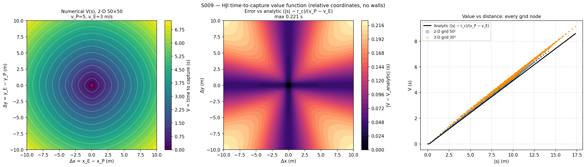
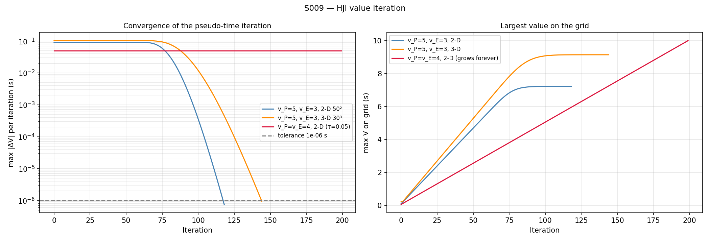
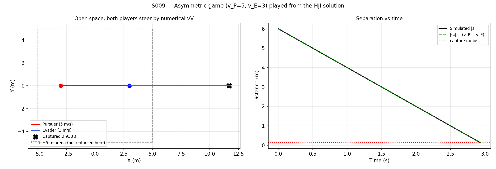
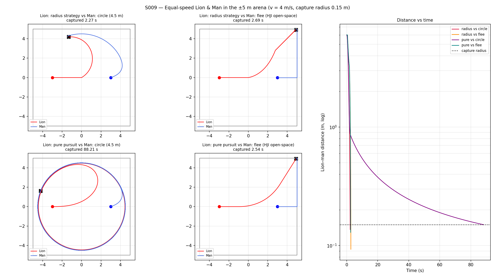
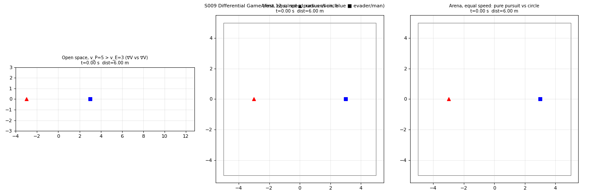

# S009 Differential Game 1v1 — Lion & Man

**Domain**: Pursuit & Evasion | **Difficulty**: ⭐⭐⭐⭐ | **Status**: ✅ Completed

---

## Problem Definition

**Lion & Man Problem**: the Lion (pursuer) minimises the capture time, the Man (evader) maximises it. Can the Lion capture the Man?

This scenario has two parts:

| Part | Setting | Method |
|------|---------|--------|
| **A. HJI value function** | Relative coordinates $\mathbf{s} = \mathbf{p}_E - \mathbf{p}_P$, no walls. Asymmetric speeds ($v_P = 5$, $v_E = 3$ m/s) and equal speeds (4 m/s). 2-D 50×50 grid and 3-D 30³ grid | Numerical HJI solver; the asymmetric game is then played with **both** players steering by the numerical $\nabla V$ |
| **B. Bounded-arena Lion & Man** | Equal speeds (4 m/s) in the $[-5, 5]^2$ m arena, capture radius 0.15 m, walls enforced | Simulation of two Lion strategies × two Man strategies |

Start positions for all games: pursuer/Lion (−3, 0), evader/Man (3, 0) — 6 m apart.

---

## Mathematical Model

### HJI Equation (minimum-time game)

The value $V(\mathbf{s})$ is the capture time under optimal play, so $dV/dt = -1$ along optimal trajectories. It satisfies the stationary HJI equation:

$$\min_{\hat{u}_P}\max_{\hat{u}_E}\left[\nabla V \cdot (v_E\hat{u}_E - v_P\hat{u}_P)\right] + 1 = 0, \qquad V = 0 \text{ on } \|\mathbf{s}\| \le r_c$$

The min-max is attained at $\hat{u}_P^* = \hat{u}_E^* = \nabla V / \|\nabla V\|$ (the pursuer flies toward the evader, the evader straight away), which gives the Eikonal equation

$$(v_P - v_E)\,\|\nabla V\| = 1 \quad\Rightarrow\quad V(\mathbf{s}) = \frac{\|\mathbf{s}\| - r_c}{v_P - v_E} \quad (v_P > v_E)$$

For $v_P = v_E$ there is no finite solution: $V = \infty$ outside the capture set.

### Numerical Scheme

Pseudo-time iteration toward the steady state, starting from $V = 0$:

$$V^{n+1} = V^n + \tau\left(1 - (v_P - v_E)\,\|\nabla V^n\|_{God}\right), \qquad \tau = 0.9\,\frac{\Delta x}{d\,(v_P - v_E)}$$

$\|\nabla V\|_{God}$ is the monotone Godunov upwind gradient: per axis $\max(D^- V,\, -D^+ V,\, 0)^2$, summed and square-rooted. The capture circle (0.15 m) is smaller than a grid cell, so nodes with $\|\mathbf{s}\| < r_c + \Delta x$ are fixed to their exact value. Converged when $\max|\Delta V| < 10^{-6}$ s. For $v_P = v_E$ the update reduces to $V \mathrel{+}= \tau$ everywhere, so $V$ grows without bound.

### Bounded-Arena Strategies (Part B)

| Player | Strategy | Rule |
|--------|----------|------|
| Lion | **Radius strategy** | Move to the point of the segment centre→Man that is closest to the Man and reachable within $v\,\Delta t$; if the segment is out of reach, move toward its nearest point |
| Lion | **Pure pursuit** | Fly straight at the Man (the open-space HJI control) |
| Man | **Circle** | Run counter-clockwise, tangent to a 4.5 m circle about the centre, with radial correction $2\,(4.5 - \rho)$ |
| Man | **Flee** | Run straight away from the Lion (the open-space HJI control). At a wall the outward component is removed; if nothing is left, slide along the wall |

---

## Key Parameters

| Parameter | Value |
|-----------|-------|
| Arena (Part B) | $[-5, 5]^2$ m |
| Relative-state grid | $[-10, 10]^d$ m (relative state spans twice the arena) |
| Grid resolution | 50 × 50 (2-D, Δx = 0.4082 m), 30 × 30 × 30 (3-D, Δx = 0.6897 m) |
| Pseudo-time step τ | $0.9\,\Delta x / (d\,(v_P - v_E))$; 0.05 s for the equal-speed run |
| Max iterations | 2000 (asymmetric), 200 (equal-speed demonstration) |
| Convergence tolerance | $10^{-6}$ s |
| Speeds, Part A | $v_P = 5$, $v_E = 3$ m/s; equal case 4 / 4 m/s |
| Speeds, Part B | $v_P = v_E = 4$ m/s |
| Capture radius | 0.15 m |
| Man circle radius / gain | 4.5 m / 2 m⁻¹ |
| Simulation step | 1/48 s |
| Max time | 20 s (open space), 150 s (arena) |
| Animation | first 12 s, every 5th step, 117 frames |

---

## Implementation

```
src/01_pursuit_evasion/s009_differential_game.py # HJI solver + games
```

```bash
conda activate drones
python src/01_pursuit_evasion/s009_differential_game.py
```

Runtime ≈ 30 s. The script has no random elements.

---

## Results

### Part A — HJI value function (relative coordinates, no walls)

| Case | Converged | Iterations | max \|V − V_analytic\| | mean \|V − V_analytic\| | max V (analytic at grid corner) |
|------|-----------|------------|------|------|------|
| $v_P = 5$, $v_E = 3$, 2-D 50² | ✅ (final max\|ΔV\| = 7.45e-7 s) | 119 | 0.2206 s | 0.1315 s | 7.217 s (6.996 s) |
| $v_P = 5$, $v_E = 3$, 3-D 30³ | ✅ (final max\|ΔV\| = 9.52e-7 s) | 145 | 0.5561 s | 0.3583 s | 9.141 s (8.585 s) |
| $v_P = v_E = 4$, 2-D 50² | ❌ diverges by design | 200 shown | — | — | 10.00 s = 200 × τ, growing |

Angle between the numerical $\nabla V$ and the exact direction $\mathbf{s}/\|\mathbf{s}\|$ (2-D, $\|\mathbf{s}\| > 1$ m): mean 2.57°, max 7.14°.

**Asymmetric game played from the numerical $\nabla V$** (both players): captured at **2.938 s**. Analytic optimum: $(6 - 0.15)/(5 - 3) = 2.925$ s. The simulation needs $\lceil 2.925 \times 48 \rceil = 141$ steps of 1/48 s, i.e. 2.9375 s. The evader ends at x = 11.81 m: this open-space game ignores the arena.

### Part B — Equal-speed Lion & Man in the ±5 m arena

| Lion \ Man | Circle (4.5 m) | Flee (open-space HJI) |
|------------|----------------|------------------------|
| **Radius strategy** | captured **2.271 s** | captured **2.688 s** |
| **Pure pursuit** | captured **88.208 s** | captured **2.542 s** |

Both players stay inside the arena in all four games.

**Key Findings**:

- **The corrected HJI scheme converges to the analytic value.** With the sign fixed, the iteration grows $V$ outward from the capture set and stops changing once $(v_P - v_E)|\nabla V| = 1$ holds everywhere: 119 iterations in 2-D, 145 in 3-D. The front reaches the 2-D corner after about $6.996 / \tau = 6.996 / 0.0918 \approx 76$ iterations ($\tau = 0.9 \times 0.4082 / (2 \times 2) = 0.0918$ s), matching the knee of the convergence curve.
- **The remaining error is the first-order grid error.** It is zero along the grid axes and largest along the diagonals: a 4-neighbour upwind stencil measures diagonal distances as too long. The largest 2-D error is 0.2206 s, which is 3.2% of the 6.996 s corner value. The coarser 3-D grid (Δx = 0.69 m) has a larger error (0.5561 s).
- **Equal speeds in open space: no finite capture time.** For $v_P = v_E$ the $|\nabla V|$ term vanishes, and every iteration adds exactly τ = 0.05 s to $V$ (max|ΔV| = 0.0500 s at every one of 200 iterations). That is the numerical form of $V = \infty$: a Man who runs straight away is never caught.
- **The value function now drives both players.** Steering by the interpolated numerical $\nabla V$ gives a straight-line chase whose separation follows $|s_0| - (v_P - v_E)\,t$ exactly, and capture at 2.938 s (the analytic optimum plus step rounding). The old version's evader was suboptimal (captured at 2.38 s).
- **In the bounded arena with a 0.15 m capture radius, the Lion wins against every Man strategy tried.** This contradicts the card's expectation that the Man can keep his distance indefinitely. That expectation holds in open space (above) or in the continuous game with zero capture radius (Besicovitch's spiral). With walls and a positive capture radius, the Lion can always catch him.
- **The Lion's strategy matters a lot against the circling Man.** The radius strategy (stay between centre and Man) captures him in 2.271 s. Pure pursuit, the open-space HJI control, needs 88.208 s: it falls into the Man's circle behind him, and the gap shrinks only slowly (log-scale distance plot).
- **The Man's open-space HJI control (flee) fails in a box.** Running straight away takes him into the right wall, along it, and into the (5, 5) corner, where he is caught (2.542 s against pure pursuit, 2.688 s against the radius strategy). The radius Lion is 0.15 s slower there because it first moves along the centre→Man segment instead of straight at him.

**Value Function** — left: numerical V(s) for $v_P = 5$, $v_E = 3$ (2-D); centre: error against the analytic value (zero along the axes, largest on the diagonals); right: V against distance for every 2-D and 3-D grid node, with the analytic line:



**Convergence** — left: max|ΔV| per iteration (asymmetric cases drop below 10⁻⁶ s; equal speeds stay at τ = 0.05 s); right: largest V on the grid (asymmetric cases level off; equal speeds grow linearly forever):



**Asymmetric Game from ∇V** (open space) — both players fly straight along ∇V; the separation follows $6 - 2t$ (dashed) to capture:



**Equal-Speed Lion & Man in the Arena** — four strategy pairs and their distance vs time (log scale):



**Animation** (first 12 s; every 5th step, 117 frames): open-space ∇V game, radius Lion vs circling Man, pure-pursuit Lion vs circling Man (still chasing at 12 s; captured at 88.208 s):



### Deviations from the scenario card

| Card | This implementation | Reason |
|------|--------------------|--------|
| HJI written as $\partial_t V + H = 0$ with $H = (v_E - v_P)\|\nabla V\| - 1$ and update $V \leftarrow V - \Delta t\, H$ | Stationary HJI $(v_P - v_E)\|\nabla V\| = 1$, Godunov upwind pseudo-time iteration from $V = 0$ | The card's sign makes $V$ grow without bound for every speed pair. The previous run never converged: the asymmetric case's max\|ΔV\| grew from 0.04 to 16.8, and the equal-speed case started at $R/10^{-6}$ (up to 1.4·10⁷). **The card's equations and pseudocode have been corrected** |
| Equal-speed value function "converges" | Shown to diverge ($V \mathrel{+}= \tau$ per iteration) | $V = \infty$ is the correct answer in open space |
| Card main case: $v_P = v_E = 4$ in the HJI | HJI value function and ∇V game solved for $v_P = 5$, $v_E = 3$ (card Extension 1); equal speeds shown to have $V = \infty$ | Equal speeds have no finite value to plot or steer by |
| Bounded-arena game solved through the HJI value function | Relative-state HJI (walls ignored) + simulated bounded-arena strategies | With walls the state is both positions (4-D in 2-D). A 50⁴ grid has 6.25 million nodes with Δx = 0.20 m, still larger than the 0.15 m capture radius. It would need thousands of iterations, far beyond the runtime budget, and is still too coarse to resolve capture |
| Expected "at equal speeds the Man can maintain distance indefinitely" | Not met in the arena: all four arena games end in capture (2.271–88.208 s); met only in open space ($V = \infty$) | With a positive capture radius in a bounded arena the Lion can always capture; indefinite evasion needs zero capture radius or open space. The card's "Analytical Solution" and "Expected Output" text has been corrected accordingly |
| Arena $[-5, 5]^3$ cube; 3-D extension on 30³ | 3-D relative HJI solved on 30³; arena games are 2-D | The 3-D relative HJI is cheap (27,000 nodes, 145 iterations). A 3-D arena game would need the same strategies with one more coordinate and is left as an extension |
| Card pseudocode grid ±5 m, up to 500 iterations | Relative grid ±10 m, up to 2000 iterations (converges in 119 / 145) | Relative positions in a ±5 m arena reach ±10 m |
| Capture set on the grid | Nodes within $r_c + \Delta x$ fixed to the exact value | The 0.15 m capture circle is smaller than a grid cell |

---

## Extensions

1. Unequal speeds but closer to 1 — study minimum speed ratio for guaranteed capture
2. Circular bounded arena (different Apollonius geometry)
3. Approximate value function with RL (PPO) and compare against numerical solution

---

## Related Scenarios

- Prerequisites: [S002](../../../scenarios/01_pursuit_evasion/S002_evasive_maneuver.md)
- Follow-ups: [S010](../../../scenarios/01_pursuit_evasion/S010_asymmetric_speed.md), [S020](../../../scenarios/01_pursuit_evasion/S020_pursuit_evasion_game.md)
