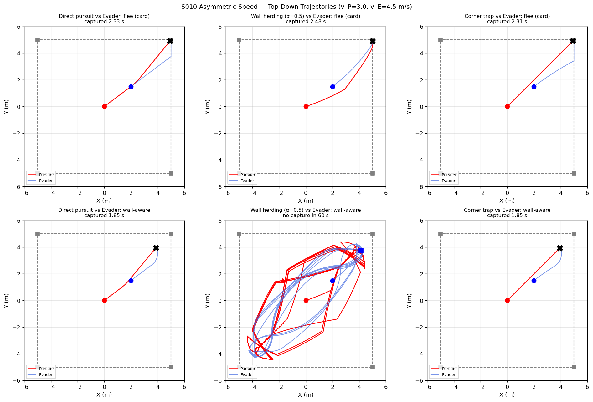
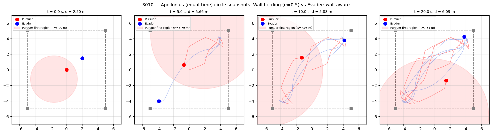
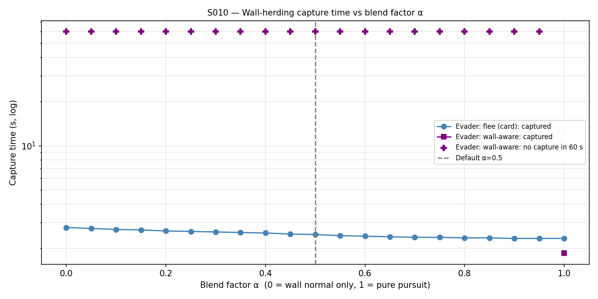
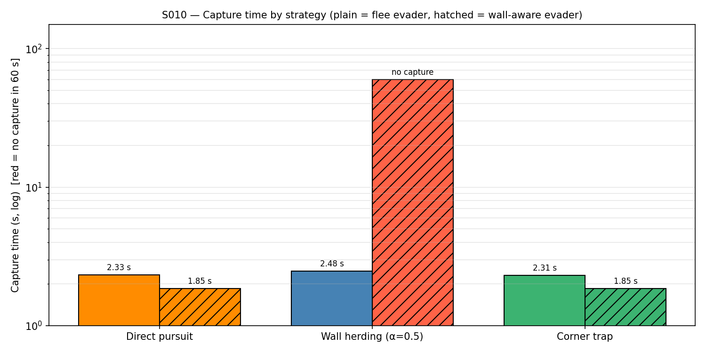
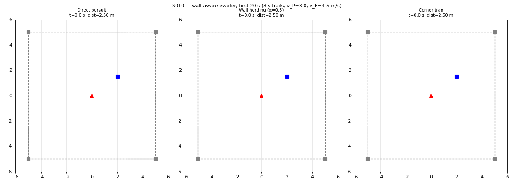

# S010 Asymmetric Speed — Bounded Arena Trapping

**Domain**: Pursuit & Evasion | **Difficulty**: ⭐⭐⭐ | **Status**: ✅ Completed

---

## Problem Definition

**Setup**: The evader is faster than the pursuer (v_E = 4.5 > v_P = 3.0 m/s, ratio r = 0.667). In open space capture is impossible. In a bounded 10×10 m square arena the pursuer can try to use walls and corners to trap the evader. Pursuer starts at (0, 0), evader at (2, 1.5) (2.5 m apart).

**Pursuer strategies**:

| Strategy | Logic |
|----------|-------|
| **Direct Pursuit** | Pure pursuit — head straight at the evader |
| **Wall Herding (α = 0.5)** | Blend: α × (unit vector toward the evader) + (1 − α) × (outward normal of the wall nearest the evader; if two walls are equally near, i.e. the evader is on a corner diagonal, the normalised sum of both normals) |
| **Corner Trap** | Always head for the corner closest to the evader |

**Evader strategies**:

| Evader | Logic |
|--------|-------|
| **Flee (card)** | Run straight away from the pursuer |
| **Wall-aware** (added) | Flee direction plus a repulsion from every wall closer than 1.5 m (weight $(1.5 - \delta)/1.5$, gain 2). If its desired direction is blocked completely (straight into a wall or corner) it turns 90° counter-clockwise and slides along a free wall |

**Arena rule (identical for every player)**: at a wall the velocity component pointing out of the arena is removed and the remainder is renormalised to the player's full speed, so it slides along the wall. A command pointing straight into a wall or corner leaves nothing to slide with, and the player stops. Positions are clipped to ±5 m.

---

## Mathematical Model

### Apollonius (Equal-Time) Circle

The set of points both players reach at the same time, $\|\mathbf{x} - \mathbf{p}_P\|/v_P = \|\mathbf{x} - \mathbf{p}_E\|/v_E$, is a circle with

$$R_{apo} = \frac{r \cdot d}{1 - r^2}, \qquad \text{centre} = \mathbf{p}_E + \frac{d}{1 - r^2}\,\frac{\mathbf{p}_P - \mathbf{p}_E}{d}$$

where $r = v_P/v_E = 0.667$ and $d = \|\mathbf{p}_E - \mathbf{p}_P\|$. The centre lies on the line from the evader through the pursuer, $r^2 d/(1-r^2) = 0.8\,d$ beyond the pursuer. For $r < 1$ the circle **encloses the pursuer**: points inside are reached by the pursuer first, and every point outside by the evader first. In open space the evader can therefore always escape; only walls can take away its escape directions.

### Wall-Herding Velocity

$$\mathbf{v}_{herd} = v_P \cdot \frac{\alpha\,\hat{\mathbf{r}}_{PE} + (1-\alpha)\,\hat{\mathbf{n}}_{wall}}{\|\alpha\,\hat{\mathbf{r}}_{PE} + (1-\alpha)\,\hat{\mathbf{n}}_{wall}\|}$$

$\hat{\mathbf{n}}_{wall}$ is the outward normal of the wall nearest to the evader. The pursuer approaches the evader while pressing toward that wall, cutting off the side that leads back to open space.

### Corner-Targeting

$$\mathbf{p}_{target} = \arg\min_{\mathbf{c}\in\text{corners}}\|\mathbf{c} - \mathbf{p}_E\|, \qquad \mathbf{v}_{cmd} = v_P \frac{\mathbf{p}_{target} - \mathbf{p}_P}{\|\mathbf{p}_{target} - \mathbf{p}_P\|}$$

---

## Key Parameters

| Parameter | Value |
|-----------|-------|
| Arena | 10×10 m square (±5 m), 2-D |
| Pursuer speed | 3.0 m/s |
| Evader speed | 4.5 m/s |
| Speed ratio r | 0.667 |
| Blend factor α | 0.5 (default); sweep 0.00–1.00 in steps of 0.05 |
| Initial positions | pursuer (0, 0), evader (2, 1.5) |
| Wall-aware evader | repulsion range 1.5 m, gain 2.0 |
| Capture radius | 0.15 m |
| Time step | 1/48 s |
| Max simulation time | 60 s |
| Apollonius snapshots | t = 0, 5, 10, 20 s |
| Animation | wall-aware evader, first 20 s, every 7th step, 139 frames |

---

## Implementation

```
src/01_pursuit_evasion/s010_asymmetric_speed.py   # Main simulation
```

```bash
conda activate drones
python src/01_pursuit_evasion/s010_asymmetric_speed.py
```

Runtime ≈ 45 s (previously ~255 s, mostly from a 960-frame GIF). No random elements.

---

## Results

Check printed by the script: the t = 0 Apollonius circle has centre (−1.600, −1.200) and R = 3.000 m. On it, $|t_P - t_E| \le 2.2 \times 10^{-16}$ s, so it really is the equal-time circle. It contains the pursuer and not the evader. By hand: $R = (0.667 \times 2.5)/(1 - 0.444) = 3.0$ m; centre $= (2, 1.5) + 1.8 \times (-2, -1.5) = (-1.6, -1.2)$.

| Strategy | vs Flee evader (card) | vs Wall-aware evader |
|----------|----------------------|----------------------|
| **Direct Pursuit** | captured **2.333 s** at (5.00, 5.00) | captured **1.854 s** at (3.96, 4.05) |
| **Wall Herding (α = 0.5)** | captured **2.479 s** at (5.00, 5.00) | ❌ no capture in 60 s |

Pursuer path length vs the card's evader: direct 7.00 m, wall herding 7.44 m, corner trap 6.94 m. Only the herding pursuer touches a wall (0.167 s).
| **Corner Trap** | captured **2.312 s** at (5.00, 5.00) | captured **1.854 s** at (3.99, 3.99) |

Wall herding vs the wall-aware evader, last 10 s: distance 0.37–6.68 m, path length pursuer 30.0 m and evader 45.0 m. Both fly at full speed the whole time ($3 \times 10$ and $4.5 \times 10$ m); this is a continuing chase, not a deadlock.

**Wall-herding α sweep** (capture time in s; "–" = no capture in 60 s):

| α | 0.00 | 0.05 | 0.10 | 0.20 | 0.30 | 0.40 | 0.50 | 0.60 | 0.70 | 0.80 | 0.90 | 1.00 |
|---|---|---|---|---|---|---|---|---|---|---|---|---|
| Flee evader | 2.77 | 2.73 | 2.69 | 2.62 | 2.58 | 2.54 | 2.48 | 2.42 | 2.38 | 2.35 | 2.33 | 2.33 |
| Wall-aware evader | – | – | – | – | – | – | – | – | – | – | – | 1.85 |

(Selected columns. The script prints all 21 values. Flee evader: captured for all 21 α values. Wall-aware evader: captured only at α = 1.00.)

**Key Findings**:

- **Against the card's fleeing evader every strategy captures, and the walls do the work.** Running straight away from a pursuer that starts below-left of it takes the evader to the +x wall and then into the (5, 5) corner. It slides along the wall at full speed into the corner; there both of its velocity components point out of the arena, nothing is left after the wall rule, and it stops. The pursuer only has to fly there. The pursuer needs about $\|(5, 5)\| / 3 = 7.07/3 = 2.36$ s, consistent with 2.312–2.333 s for direct pursuit and corner trap. Corner trap is 0.021 s faster because it heads for the corner from the start.
- **Wall herding works once its controller bug is fixed.** The old version pointed the wall term at the wall's *midpoint*. With the evader in the (5, 5) corner and the pursuer on the +x wall, that vector was exactly opposite to the pursuit term, so at α = 0.5 the command was zero and the pursuer sat at (5, 1.43) for the rest of the run. With the wall's outward normal the two terms cannot cancel. Herding now captures at 2.479 s, 0.146 s after direct pursuit (2.333 s). The difference is the longer path: the wall term bends the herding pursuer toward the +x wall (7.44 m vs 7.00 m), and $(7.44 - 7.00)/3 = 0.147$ s. An intermediate version (2.896 s) was slower for a different reason. Once the evader sat in the corner, the nearest-wall choice tied and picked the +x wall, and the pursuer rode that wall. The outward part of its command was removed *without* renormalising, so it slid at reduced speed. Renormalising (the same rule as the evader) plus the corner tie-break removed that.
- **α sweep (flee evader): capture for every α, slightly faster as α grows** (2.77 s at α = 0 → 2.33 s at α = 1). Even α = 0 (wall normal only) captures. Once the evader sits in the (5, 5) corner, the tie-break turns the wall term into the corner diagonal. The pursuer then slides along the +x wall into the corner. The previous README's "capture only for α ≈ 0.7–1.0" was wrong; the old sweep already captured for every α ≥ 0.55.
- **A wall-aware evader exposes the difference between the strategies.** It avoids pressing into walls, but its flee and repulsion terms cancel near a corner when the pursuer comes straight from the centre. By hand: flee ≈ (0.707, 0.707), repulsion $2(1.5 - \delta)/1.5$ per axis, equal when $\delta = 1.5(1 - 0.354) = 0.97$ m, i.e. at about (4.03, 4.03). Direct pursuit and corner trap approach along that diagonal and catch it there (1.854 s at (3.96, 4.05) / (3.99, 3.99)). The herding pursuer approaches off the diagonal. That tilts the flee direction, so the evader slides out of the equilibrium and escapes along the arena diagonal for the full 60 s, for every α < 1.
- **So none of these simple strategies traps a faster evader by itself.** Captures happen when the evader's own rule stops it (in a corner, or at a flee/repulsion balance point). This matches the Apollonius picture: with r < 1 the pursuer-first region is a circle around the pursuer, so the evader always has free space unless walls block it.

**Top-Down Trajectories** — top row: card's fleeing evader (all captured at the (5, 5) corner); bottom row: wall-aware evader (direct and corner trap catch it at its ≈(4, 4) balance point; wall herding chases it along the diagonal for 60 s):



**Apollonius Circle Snapshots** (wall herding vs wall-aware evader, t = 0, 5, 10, 20 s) — red disc = pursuer-first region. It always surrounds the pursuer; the evader stays outside it:



**Capture Time vs Blend Factor α** — blue: flee evader (captured for every α); purple: wall-aware evader (captured only at α = 1); markers at 60 s = no capture:



**Capture Time by Strategy** (log scale; plain = flee evader, hatched = wall-aware evader, red = no capture):



**Animation** (wall-aware evader, first 20 s, 3 s trails; every 7th step, 139 frames):



### Deviations from the scenario card

| Card | This implementation | Reason |
|------|--------------------|--------|
| Wall-herding pseudocode: `r_wall = nearest_wall_point - pos_p` (vector to the wall midpoint) | $\hat{\mathbf{n}}_{wall}$ = outward normal of the evader's nearest wall | The point-based version cancels the pursuit term (zero command at α = 0.5 when the pursuer is on the wall below a cornered evader). The previous run deadlocked at (5, 1.43) until the 60 s timeout |
| Apollonius centre "offset $d/(1-r^2)$" (code placed it from the pursuer toward the evader) | Centre at distance $d/(1-r^2)$ from the evader, through and beyond the pursuer | The old circle was not an equal-time circle and contained the evader. **Card text clarified** |
| Roles: one evader (straight escape) | Card evader + an added wall-aware evader | With the card evader every strategy wins because the evader corners itself; the second evader tests whether the strategies trap an evader that avoids walls |
| "Direct pursuit fails when r < 1" | Not met: direct pursuit captures both evaders | It fails in open space, but in the arena the evaders' own rules stop them in or near a corner |
| Expected "herding behaviour driving evader into corners" | Not observed as a herding effect: the flee evader runs into the corner by itself, and the herding pursuer does not drive the wall-aware evader into one | Reported as observed |
| Arena walls not specified | At a wall the outward velocity component is removed and the rest renormalised to full speed (slide); positions clipped | One rule for every player. The intermediate version renormalised only the wall-aware evader, which slowed the herding pursuer on the wall |
| Nearest-wall choice not defined for ties | On a corner diagonal the wall term is the normalised sum of both walls' normals | Avoids an arbitrary pick of one wall when the evader sits in a corner |
| — | 2-D only (card: z = 2 m fixed) | Altitude is constant in the card |

---

## Extensions

1. Grid-search over α to find optimal blend factor for different arena sizes
2. Circular arena — different Apollonius circle geometry
3. Two slower pursuers cooperating to trap a faster evader

---

## Related Scenarios

- Prerequisites: [S002](../../../scenarios/01_pursuit_evasion/S002_evasive_maneuver.md), [S009](../../../scenarios/01_pursuit_evasion/S009_differential_game.md)
- Follow-ups: [S011](../../../scenarios/01_pursuit_evasion/S011_swarm_encirclement.md), [S013](../../../scenarios/01_pursuit_evasion/S013_pincer_movement.md)
