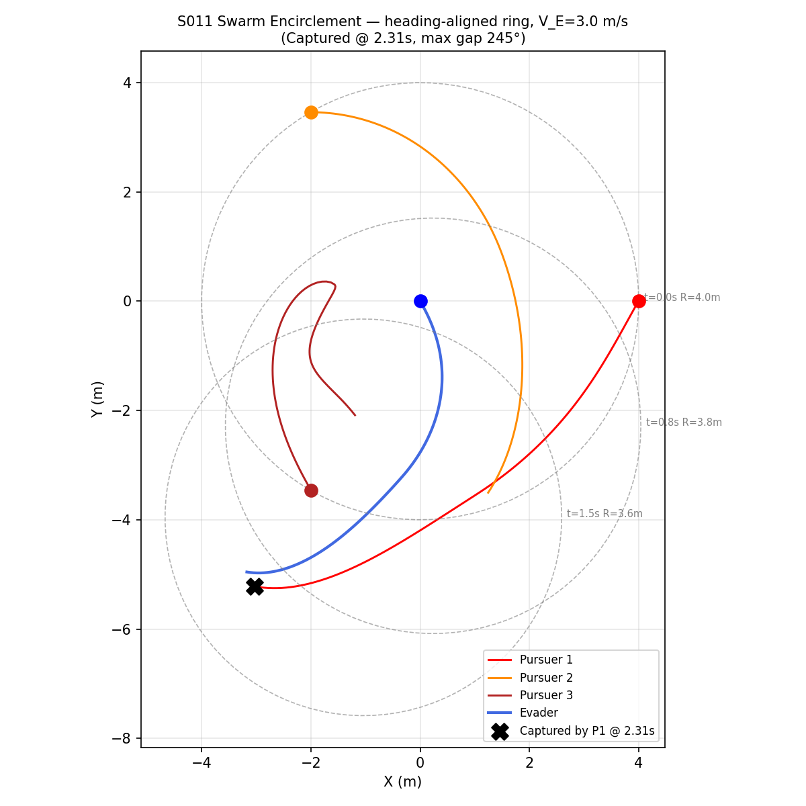
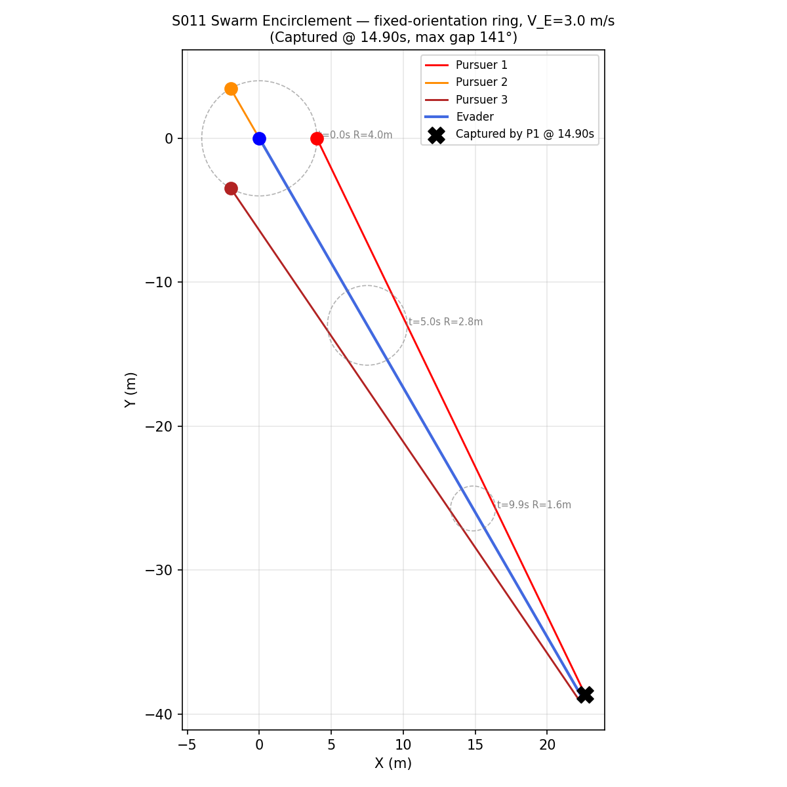
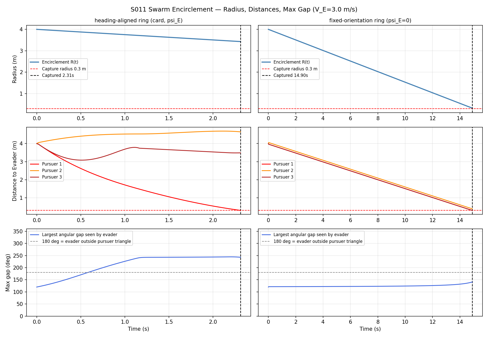
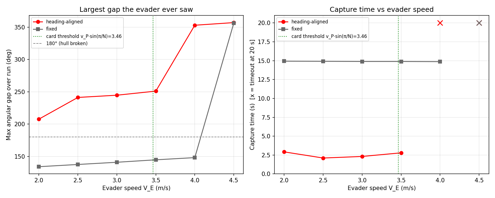
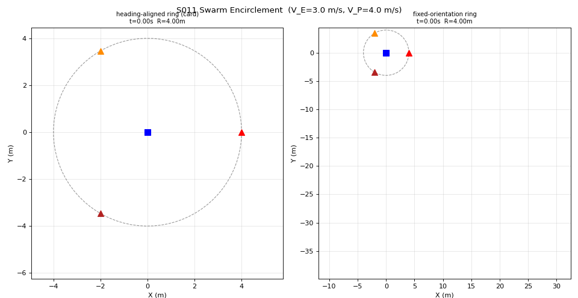

# S011 Swarm Encirclement

**Domain**: Pursuit & Evasion | **Difficulty**: ⭐⭐ | **Status**: ✅ Completed

---

## Problem Definition

**Setup**: 3 pursuer drones simultaneously encircle 1 evader, synchronously shrinking the encirclement radius R(t). The evader picks the widest angular gap between adjacent pursuers, **commits** to it and tries to break out through it.

**Key question**: Does a coordinated shrinking ring hold when the evader commits to a gap, and does the card's heading-aligned ring (one pursuer always placed ahead of the evader) do better or worse than a ring with fixed orientation?

---

## Mathematical Model

### Encirclement Radius

$$R(t) = \max\!\left(R_0 - \frac{R_0 - R_{min}}{T_{conv}} \cdot t,\; R_{min}\right), \qquad R_{min} = r_{capture}$$

where R₀=4 m, R_min=r_capture=0.3 m, T_conv=15 s (shrink rate 0.247 m/s).

### Pursuer Target Positions (card formula)

$$\mathbf{p}_{target,i}(t) = \mathbf{p}_E(t) + R(t)\left[\cos\!\left(\tfrac{2\pi i}{N} + \psi_E\right),\; \sin\!\left(\tfrac{2\pi i}{N} + \psi_E\right),\; 0\right]$$

- **Heading-aligned ring (card)**: ψ_E = direction of the evader's last velocity (ψ_E = 0 at t = 0), so pursuer 1 is always assigned the slot directly ahead of the evader.
- **Fixed-orientation ring (comparison)**: ψ_E ≡ 0.

Each pursuer flies straight at its target at up to V_P, and stops exactly on it if it can reach it within one step (no chattering).

### Evader Breakout Strategy (committed gap)

The evader sorts pursuer bearings, computes the angular gaps between neighbours and flies at V_E toward the mid-angle of its **committed** gap (identified by the pair of pursuers bounding it). It switches to the widest gap only if that gap is wider than the committed one by more than GAP_HYST = 20°.

### Breakout / Capture

- **Hull broken**: largest angular gap seen from the evader > 180° ⇔ evader is outside the pursuers' triangle.
- **Capture**: any pursuer within r_capture = 0.3 m.
- Card's theoretical breakout threshold: $v_E > v_P \sin(\pi/N) = 4\sin 60° = 3.46$ m/s.

---

## Key Parameters

| Parameter | Value |
|-----------|-------|
| N pursuers | 3 |
| Initial radius R₀ | 4.0 m |
| Convergence time T_conv | 15 s |
| Ring floor R_min | 0.3 m |
| Capture radius r_capture | 0.3 m |
| Pursuer speed V_P | 4.0 m/s |
| Evader speed V_E (main runs) | 3.0 m/s |
| Gap-switch hysteresis | 20° |
| Evader start | (0, 0, 2) m |
| Pursuer starts | R₀ at 0°, 120°, 240° around the evader |
| Time step | 1/48 s |
| Max simulation time | 20 s |
| Evader-speed sweep | 2.0, 2.5, 3.0, 3.5, 4.0, 4.5 m/s |

---

## Implementation

```
src/base/drone_base.py                   # Point-mass drone base
src/01_pursuit_evasion/s011_swarm_encirclement.py   # Main simulation
```

```bash
conda activate drones
python src/01_pursuit_evasion/s011_swarm_encirclement.py
```

Runtime ≈ 30 s (2 main runs + 12 sweep runs + 144-frame GIF).

---

## Results

### Main runs (V_E = 3.0 m/s)

| Ring | Outcome | Max gap | Hull broken (gap > 180°) | Gap switches | Evader path / net displacement |
|------|---------|---------|--------------------------|--------------|--------------------------------|
| Heading-aligned (card, ψ_E) | Captured by P1 @ **2.31 s** | 244.6° | at 0.58 s | 0 | 6.94 m / 5.88 m |
| Fixed orientation (ψ_E = 0) | Captured by P1 @ **14.90 s** | 140.8° | never | 0 | 44.69 m / 44.69 m |

Max gap over time, fixed ring: 120.0° (t=0) → 121.7° (1 s) → 122.3° (5 s) → 124.1° (10 s) → 132.0° (14 s) → 140.8° at capture.
Heading-aligned ring: 120.0° (t=0) → 226.2° (1 s) → 243.9° (2 s) → 242.9° at capture.

### Evader-speed sweep

| V_E (m/s) | Heading-aligned: outcome | max gap | hull broken | Fixed: outcome | max gap | hull broken |
|-----------|-------------------------|---------|-------------|----------------|---------|-------------|
| 2.0 | capture 2.92 s | 207.6° | 0.88 s | capture 14.94 s | 134.0° | never |
| 2.5 | capture 2.10 s | 241.2° | 0.71 s | capture 14.92 s | 137.4° | never |
| 3.0 | capture 2.31 s | 244.6° | 0.58 s | capture 14.90 s | 140.8° | never |
| 3.5 | capture 2.79 s | 251.0° | 0.52 s | capture 14.90 s | 144.6° | never |
| 4.0 | **timeout** (net disp 78.79 m) | 352.9° | 0.46 s | capture 14.88 s | 148.0° | never |
| 4.5 | **timeout** (net disp 89.30 m) | 357.0° | 0.42 s | **timeout** (net disp 90.00 m) | 356.1° | 3.81 s |

**Key Findings**:
- **The evader now really commits.** With the 20° hysteresis it never switches gap at V_E = 3 m/s and flies a straight 44.69 m line (path length = net displacement) through the gap between P3 and P1. (The previous version flipped between near-equal gaps every step and never got more than 0.23 m from its start.)
- **Fixed ring: the encirclement holds, and capture time is set by the shrink schedule.** Because the ring is centred on the evader, it translates with it; with V_P > V_E the pursuers keep formation and the largest gap only grows from 120° to 140.8°. Capture happens at 14.90 s, when R(t) = 0.33 m: the two pursuers flanking the evader's heading sit ≈ V_E·Δt·cos 60° ≈ 0.03 m inside the nominal ring because their target is computed before the evader's step, so P1 crosses 0.3 m slightly before R reaches R_min. The fixed ring held up to V_E = 4.0 m/s = V_P and broke only at 4.5 m/s, when the evader is faster than every pursuer.
- **Heading-aligned ring (card's ψ_E term): the formation breaks almost at once, but capture still comes early for V_E ≤ 3.5 m/s.** Every heading change rotates the whole target ring, so the pursuers have to swing across it; the evader is outside the pursuers' triangle after 0.42–0.88 s at every speed tested. Capture then happens at 2.1–2.9 s, well before the shrink schedule would allow, because P1 — assigned the slot ahead of the evader — flies across the evader's path on its way there (at V_E = 3 m/s P1 makes the capture from a bearing of 126° relative to the evader's heading, i.e. from behind-side). This is a tail chase by one faster drone, not an encirclement; once V_E ≥ V_P (4.0 m/s) the evader escapes.
- **The card's threshold v_P·sin(π/N) = 3.46 m/s does not predict these outcomes.** It assumes a stationary ring; here the ring moves with the evader. The fixed ring is broken only when V_E > V_P; the heading-aligned ring is broken at every speed, and capture fails between 3.5 and 4.0 m/s.

**Top-Down Trajectories — heading-aligned ring (card)**:



**Top-Down Trajectories — fixed-orientation ring**:



**Encirclement Radius, Distances and Max Gap vs Time (both rings)**:



**Evader-speed sweep**:



**Animation** (both rings side by side, every 5th step, 144 frames):



### Deviations from the scenario card

| Card | Code | Reason |
|------|------|--------|
| Target formula has ψ_E, card pseudocode omits it | Both implemented: heading-aligned (card formula) and fixed (card pseudocode) | The card is internally inconsistent; comparing the two is the most informative use of both |
| Evader "attempts to break through" (no strategy given) | Widest gap with 20° hysteresis (commit to a gap) | Without commitment the evader oscillated between equal gaps and never actually tested the ring |
| Speeds not specified | V_P = 4 m/s, V_E = 3 m/s, plus V_E sweep 2.0–4.5 m/s | Test the card's breakout threshold 3.46 m/s |
| R_min = r_capture = 0.3 m | Same (previous code used 0.15 m) | Restored to card value |
| Pursuer control not specified | Saturated go-to-target (stop on target if reachable in one step) | Avoids chattering around the target at 4 m/s × 1/48 s = 0.083 m steps |
| Breakout criterion not specified | Largest angular gap > 180° (evader outside pursuer triangle) | Geometric, controller-independent definition |

---

## Extensions

1. 4 or 5 pursuers — does capture time scale with N?
2. Allow evader to predict ring shrinkage and pre-position for gap exploitation
3. Non-uniform ring: assign pursuer roles (leader vs follower)

---

## Related Scenarios

- Prerequisites: [S010](../../../scenarios/01_pursuit_evasion/S010_asymmetric_speed.md)
- Follow-ups: [S012](../../../scenarios/01_pursuit_evasion/S012_relay_pursuit.md), [S013](../../../scenarios/01_pursuit_evasion/S013_pincer_movement.md)
