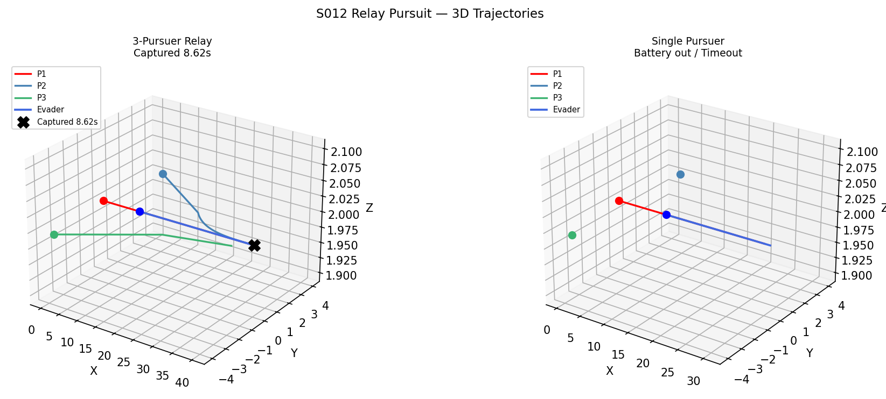
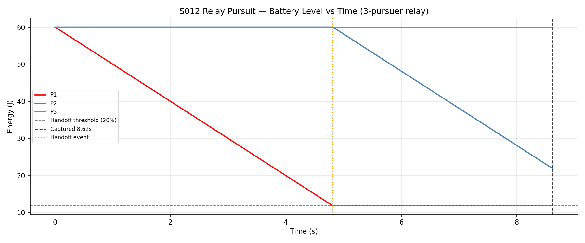
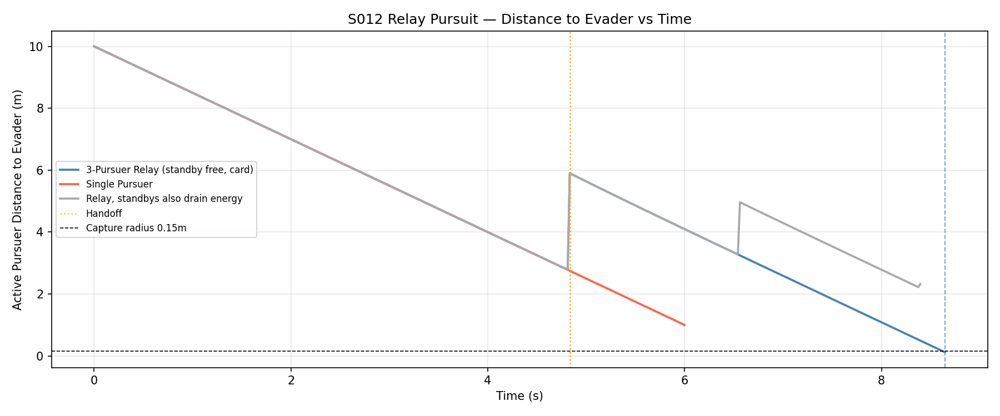
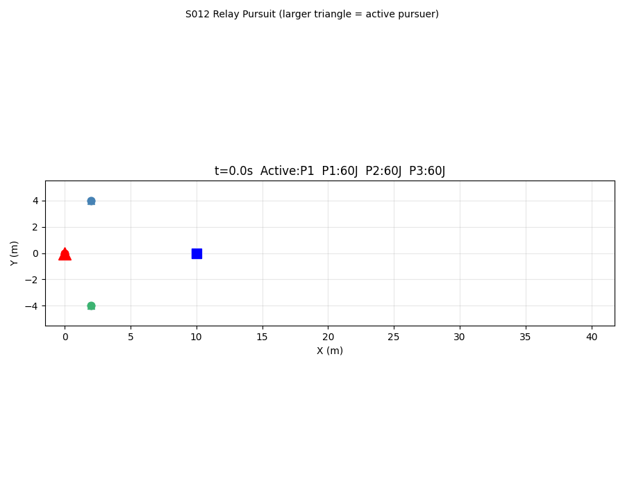

# S012 Relay Pursuit

**Domain**: Pursuit & Evasion | **Difficulty**: ⭐⭐⭐ | **Status**: ✅ Completed

---

## Problem Definition

**Setup**: 3 pursuers take turns chasing an evader; each has limited battery. When the active pursuer's battery drops below a handoff threshold (20%), the standby with the highest remaining energy takes over. Standby drones fly toward the predicted intercept position to be ready.

**Comparison**: 3-pursuer relay vs single pursuer (battery dies before capture), plus a sensitivity run in which standby drones also pay for their flight.

Pursuers are labelled **P1, P2, P3** in the console output, plots and this README; P1 starts as the active pursuer.

---

## Mathematical Model

### Energy Model

$$E(t) = E_0 - k \cdot v^2 \cdot t, \quad P = k v^2$$

where k=0.4 W·s²/m², E₀=60 J, v=5 m/s → P = 10 W, T_max = 60/(0.4×25) = 6 s. The 20% threshold (12 J) is reached at t = 48/10 = 4.8 s.

**Only the active pursuer drains energy** (as in the card's pseudocode). Standby drones fly at 4 m/s for free.

### Handoff Condition

$$\frac{E_{active}}{E_0} < \tau_{handoff} = 0.20$$

The new active pursuer is the standby with the highest remaining energy among those **at or above the threshold**; ties are broken toward the lowest label. If no standby is above the threshold, the active drone keeps flying until it is empty and then any drone with energy left takes over (this prevents every-step ping-pong handoffs between two depleted drones).

### Intercept Prediction (Standby Drones)

$$\mathbf{p}_{intercept} = \mathbf{p}_E + \hat{\mathbf{v}}_E \cdot V_E \cdot t_{handoff}$$

where $t_{handoff} = \max(E_{active} / (k V_P^2),\ 0.5\text{ s})$.

---

## Key Parameters

| Parameter | Value |
|-----------|-------|
| N pursuers | 3 |
| Initial energy E₀ | 60 J each |
| Energy constant k | 0.4 W·s²/m² |
| Handoff threshold | 20% (12 J) |
| Active speed | 5.0 m/s |
| Standby speed | 4.0 m/s (no energy cost) |
| Evader speed | 3.5 m/s, straight +x |
| Capture radius | 0.15 m |
| Initial distance P1 → evader | 10 m (card: 5 m — see deviations) |
| Evader start | (10, 0, 2) m |
| P1 / P2 / P3 start | (0, 0, 2) / (2, 4, 2) / (2, −4, 2) m |
| Time step | 1/48 s |
| Max simulation time | 35 s |

---

## Implementation

```
src/base/drone_base.py                 # Point-mass drone base
src/01_pursuit_evasion/s012_relay_pursuit.py      # Main simulation
```

```bash
conda activate drones
python src/01_pursuit_evasion/s012_relay_pursuit.py
```

Runtime ≈ 20 s (GIF: every 3rd step, 138 frames).

---

## Results

| Strategy | Outcome | Handoffs | Final energies |
|----------|---------|----------|----------------|
| **3-Pursuer Relay** (card energy model) | ✅ Captured @ **8.62 s** | 1: P1 → P2 @ 4.81 s | P1 11.9 J, P2 21.9 J, P3 60.0 J |
| **Single Pursuer** | ❌ Battery out @ 6.00 s, 1.10 m short | — | P1 0.0 J |
| Relay, standbys also drain k·v² (sensitivity) | ❌ All batteries empty @ 8.42 s, 2.38 m short | P1 → P2 @ 4.81 s, P2 → P3 @ 6.56 s, P3 → P2 @ 8.40 s | all 0.0 J |
| Single pursuer, card gap 5 m (check) | ✅ Captured @ 3.25 s | — | P1 27.5 J |

**Key Findings**:
- **Single pursuer**: closing speed 5 − 3.5 = 1.5 m/s, so capture needs (10 − 0.15)/1.5 = 6.57 s but the battery lasts 6.00 s. P1 dies 1.10 m short after the evader has travelled 21.00 m.
- **Relay**: P1 hands off at 4.81 s (first step below 12 J). P2 and P3 both still have 60.0 J, so the tie goes to the lower label, P2. P2 is 5.95 m from the evader at that moment — farther than P1 was (2.81 m) — so the handoff is a step back in distance, but P2 brings a full 6 s battery and captures at 8.62 s with 21.9 J left.
- **Why the relay works**: per the card, standby drones reposition at 4 m/s at no energy cost, so P2 arrives with a full battery. When standbys are charged k·v² = 6.4 W while repositioning, each has only 29.3 J at the first handoff; the chain P1 → P2 → P3 → P2 runs out of energy at 8.42 s, 2.38 m short. Under that more realistic accounting the relay does **not** capture in this geometry.
- With the card's 5 m starting gap a single pursuer already captures at 3.25 s with 27.5 J left (never reaching the 20% threshold), so the relay would never be triggered; that is why the gap was increased to 10 m.

**3D Trajectories**:



**Battery Level vs Time (relay)**:



**Distance to Evader Comparison** (active pursuer; includes the standby-drain sensitivity run):



**Animation** (larger triangle = active pursuer):



### Deviations from the scenario card

| Card | Code | Reason |
|------|------|--------|
| P1 starts 5 m from the evader | 10 m | With 5 m a single pursuer captures in 3.25 s (checked in the script), so no handoff ever happens and the comparison is empty |
| Standby start positions not given | P2/P3 flank at (2, ±4, 2) m | Plausible standby posts beside the chase line |
| Next active = highest energy | Same, restricted to standbys ≥ 20%, tie → lowest label | Card rule leaves ties (P2 = P3 = 60 J) and ping-pong between depleted drones undefined |
| Standby flight has no energy cost (card pseudocode) | Kept for the main run; extra sensitivity run with standby drain | The free standby flight is the reason the relay succeeds; the sensitivity run shows it |

---

## Extensions

1. Optimize standby drone starting positions to minimize handoff latency
2. Variable pursuit speed — trade battery life for pursuit aggressiveness
3. Evader aware of handoff timing — exploit brief transition window

---

## Related Scenarios

- Prerequisites: [S006](../../../scenarios/01_pursuit_evasion/S006_energy_race.md), [S011](../../../scenarios/01_pursuit_evasion/S011_swarm_encirclement.md)
- Follow-ups: [S013](../../../scenarios/01_pursuit_evasion/S013_pincer_movement.md), [S017](../../../scenarios/01_pursuit_evasion/S017_swarm_vs_swarm.md)
