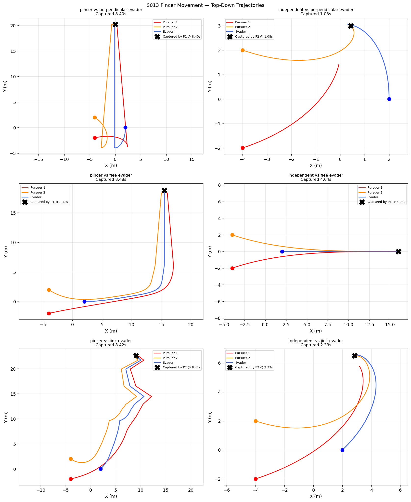
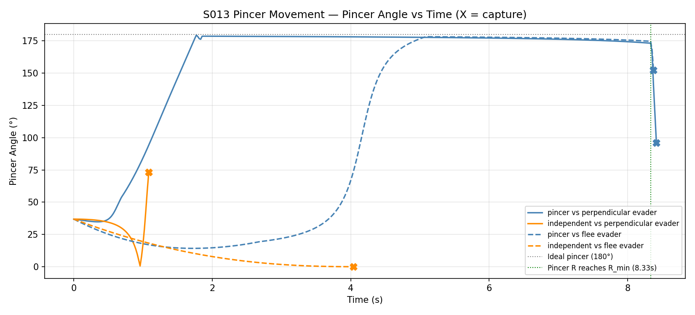
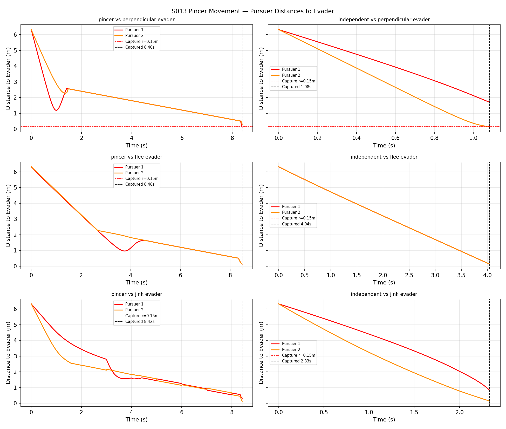
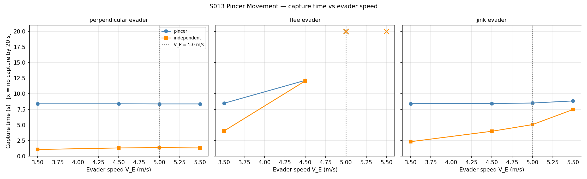
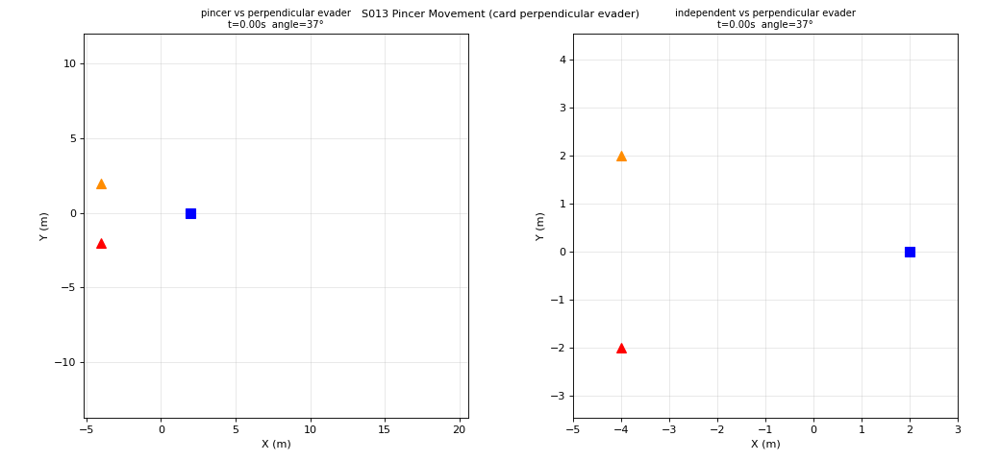

# S013 Pincer Movement

**Domain**: Pursuit & Evasion | **Difficulty**: ⭐⭐⭐ | **Status**: ✅ Completed

---

## Problem Definition

**Setup**: Two pursuers start behind the evader and try to take positions on opposite sides of it (pincer slots at φ = 0° and 180°, i.e. ahead of and behind the evader along the world x-axis) with a shrinking offset R(t). The evader re-plans from the pursuers' current positions every step.

**Comparison**: coordinated pincer vs two independent pure-pursuit drones — same start positions, same speeds, same controller — against three evaders:
- **perpendicular** (card): flies at 90° to the direction from the pursuers' centroid to itself;
- **flee**: flies away from both pursuers (inverse-distance-squared repulsion);
- **jink**: the flee heading plus a random ±60° offset redrawn every 1 s (seeded, same sequence for both strategies).

Each evader is run at the card's V_E = 3.5 m/s and in a speed sweep up to V_E = 5.5 m/s > V_P = 5 m/s.

---

## Mathematical Model

### Coordinated Pincer Targets (card)

$$\mathbf{p}_{tgt,i}(t) = \mathbf{p}_E + R(t)\,[\cos\phi_i,\ \sin\phi_i,\ 0], \qquad \phi_1 = 0°,\ \phi_2 = 180°$$

$$R(t) = \max(R_0 - V_{shrink} \cdot t,\; R_{min})$$

Once R reaches R_min (t = (3.0 − 0.5)/0.3 = 8.33 s) the pincer **closes**: both pursuers fly straight at the evader (terminal phase). Without this phase the pursuers would park 0.5 m from the evader and never reach the 0.15 m capture radius.

### Independent Pure Pursuit

Both pursuers target $\mathbf{p}_E$ directly.

Both strategies use the same saturated go-to-target command: fly at V_P toward the target, or stop exactly on it if it is reachable within one step.

### Evaders

- **Perpendicular (card)**: $\mathbf{v}_E = V_E\,\mathbf{R}_{\pm 90°}\,\dfrac{\mathbf{p}_E - \bar{\mathbf{p}}_P}{\|\mathbf{p}_E - \bar{\mathbf{p}}_P\|}$, $\bar{\mathbf{p}}_P = \tfrac12(\mathbf{p}_{P_1} + \mathbf{p}_{P_2})$, taking the ±90° side the previous heading clearly prefers (|cos| > 0.2), otherwise the side used last time.
- **Flee**: $\mathbf{v}_E \parallel \sum_i \dfrac{\mathbf{p}_E - \mathbf{p}_{P_i}}{\|\mathbf{p}_E - \mathbf{p}_{P_i}\|^2}$.
- **Jink**: flee heading rotated by an offset drawn uniformly from [−60°, +60°] every 1 s. The offset is applied only to the flee heading, never on top of the inside-pincer rule below.
- **Inside-pincer rule** (all evaders): the formulas above are undefined when the evader sits between the pursuers. The rule is used only when two conditions both hold:
  1. The evader's projection onto the segment P1–P2 lies strictly between the pursuers.
  2. Either the centroid is closer than 0.1 × half the pursuer spacing (perpendicular evader), or the two repulsion terms cancel to below 0.1 × the larger one (flee/jink).

  The evader then escapes perpendicular to the pursuer axis — the open side of the pincer. The side is chosen deterministically:
  - the side of the axis it is already on, which increases its distance to both pursuers;
  - if it lies on the axis (offset ≤ 10⁻⁶ m), the side its previous heading clearly prefers (|cos| > 0.2);
  - otherwise the side it used last time.

  The direction is computed from the pursuers' current positions. The script prints how many steps use this rule ("fallback").

### Pincer Angle

$$\theta = \arccos\!\left(\frac{(\mathbf{p}_1 - \mathbf{p}_E)\cdot(\mathbf{p}_2 - \mathbf{p}_E)}{\|\mathbf{p}_1-\mathbf{p}_E\|\|\mathbf{p}_2-\mathbf{p}_E\|}\right)$$

Ideal pincer: θ = 180°.

---

## Key Parameters

| Parameter | Value |
|-----------|-------|
| Pursuer speed V_P | 5.0 m/s |
| Evader speed V_E (main runs) | 3.5 m/s |
| Initial offset R₀ | 3.0 m |
| Min offset R_min | 0.5 m (then terminal direct closing) |
| Shrink rate V_shrink | 0.3 m/s |
| Pincer slot angles φ₁, φ₂ | 0°, 180° |
| Capture radius | 0.15 m |
| Inside-pincer threshold | 0.1 |
| Side tie-break tolerance (\|cos\|) | 0.2 |
| On-axis offset tolerance | 10⁻⁶ m |
| Jink period / max offset / seed | 1.0 s / ±60° / 13 |
| Time step | 1/48 s |
| Max time | 20 s |
| P1 start | (−4, −2, 2) m |
| P2 start | (−4, +2, 2) m |
| Evader start | (2, 0, 2) m |
| Shrink-rate sensitivity sweep | 0.3, 0.6, 1.0, 2.0 m/s |
| Evader-speed sweep | 3.5, 4.5, 5.0, 5.5 m/s |

---

## Implementation

```
src/base/drone_base.py                  # Point-mass drone base
src/01_pursuit_evasion/s013_pincer_movement.py     # Main simulation
```

```bash
conda activate drones
python src/01_pursuit_evasion/s013_pincer_movement.py
```

Runtime ≈ 26 s (6 main runs + 12 shrink-sweep runs + 24 speed-sweep runs + 135-frame GIF, every 3rd step).

---

## Results

### Main runs (V_E = 3.5 m/s)

| Strategy vs evader | Capture | Max pincer angle (first ≥ 170°) | Evader path / net | Inside-pincer steps |
|--------------------|---------|---------------------------------|-------------------|---------------------|
| **Pincer** vs perpendicular (card) | P2 @ **8.40 s** | 176.5° (1.71 s) | 29.39 m / 27.08 m | 318 / 403 |
| **Independent** vs perpendicular (card) | P2 @ **1.08 s** | 73.2° (never) | 3.79 m / 3.51 m | 0 / 52 |
| **Pincer** vs flee | P1 @ **8.48 s** | 174.5° (4.90 s) | 29.68 m / 23.25 m | 167 / 407 |
| **Independent** vs flee | P1 @ **4.04 s** | 36.9° (never) | 14.15 m / 14.15 m | 0 / 194 |
| **Pincer** vs jink | P2 @ **8.42 s** | 175.0° (4.33 s) | 29.46 m / 28.07 m | 194 / 404 |
| **Independent** vs jink | P2 @ **2.33 s** | 75.6° (never) | 8.17 m / 6.49 m | 0 / 112 |

All runs start at a pincer angle of 36.9°. Between first reaching 170° and the terminal phase, the pincer angle stays at 163.4–176.5° (perpendicular), 163.4–174.5° (flee) and 163.4–175.0° (jink).

### Pincer shrink-rate sensitivity (V_E = 3.5 m/s)

| v_shrink (m/s) | Terminal phase at | perpendicular | flee | jink |
|----------------|-------------------|---------------|------|------|
| 0.3 (card) | 8.33 s | 8.40 s | 8.48 s | 8.42 s |
| 0.6 | 4.17 s | 4.23 s | 4.35 s | 4.25 s |
| 1.0 | 2.50 s | 2.54 s | 4.06 s | 2.69 s |
| 2.0 | 1.25 s | 1.27 s | 4.06 s | 2.29 s |

### Evader-speed sweep (V_P = 5.0 m/s, card shrink rate)

| Evader | V_E (m/s) | Pincer | Independent |
|--------|-----------|--------|-------------|
| perpendicular | 3.5 | 8.40 s (net 27.1 m) | 1.08 s (net 3.5 m) |
| perpendicular | 4.5 | 8.40 s (net 33.7 m) | 1.33 s (net 4.5 m) |
| perpendicular | 5.0 | 8.44 s (net 29.4 m) | 1.38 s (net 4.4 m) |
| perpendicular | 5.5 | 8.38 s (net 28.7 m) | 1.33 s (net 4.6 m) |
| flee | 3.5 | 8.48 s | 4.04 s |
| flee | 4.5 | 12.15 s | 12.06 s |
| flee | 5.0 | none (closest 6.20 m) | none (closest 6.16 m) |
| flee | 5.5 | none (closest 6.32 m) | none (closest 6.32 m) |
| jink | 3.5 | 8.42 s | 2.33 s |
| jink | 4.5 | 8.44 s | 4.00 s |
| jink | 5.0 | 8.52 s | 5.06 s |
| jink | 5.5 | 8.85 s | 7.48 s |

**Key Findings**:
- **No tested case where the pincer wins.** Independent pursuit is faster, or both fail, in all 12 sweep cases (which include the 3 main runs). The closest result is the flee evader at 4.5 m/s: 12.15 s vs 12.06 s, where both reduce to the same tail chase (no inside-pincer steps). Against an evader at least as fast as the pursuers that simply flees (5.0 and 5.5 m/s), **neither** strategy captures.
- **Why the pincer can't win here.** The card's slots are fixed on the world x-axis, and the pincer cannot capture before its terminal phase at (R₀ − R_min)/v_shrink. Once the evader is between the pursuers, the open side of the pincer is ±y. Every evader then takes that exit: 318 of 403 steps for the perpendicular evader, 194 of 404 for jink, 167 of 407 for flee. The pincer only escorts the evader along y until the terminal phase starts. The sweep confirms capture time tracks the shrink schedule (8.40 → 4.23 → 2.54 → 1.27 s for the perpendicular evader).
- **The card's perpendicular evader is weak at every speed.** It reacts every step, but "90° to the centroid direction" makes it curve around the pursuers rather than away from them. Independent pursuers catch it within 1.08–1.38 s even at V_E = 5.5 m/s > V_P, after it has moved only 3.5–4.6 m net. At 5.5 m/s against the pincer it gets 28.7 m away along −y, but whenever it is outside the pincer its 90° rule steers it across the pursuers rather than away. It is back between them on 279 of 402 steps and is caught 0.04 s after the terminal phase starts (8.375 s − 8.333 s; printed as 8.38 s).
- **Jinking does not help the evader here.** At V_E = 5.5 m/s > V_P, the ±60° jinks waste forward progress and the evader is still caught by both: independent at 7.48 s, pincer at 8.85 s.
- The README claim that the pincer pays off against an evader that changes direction is **not supported** by any case tested. A pincer whose slots follow the evader's heading, or that blocks the open side, is listed under Extensions.

**Top-Down Trajectories** (3 × 2: evader × strategy, V_E = 3.5 m/s):



**Pincer Angle vs Time** (pincer runs reach ≥ 170° at 1.71 / 4.33 / 4.90 s, then drift down until the terminal phase):



**Pursuer Distances to Evader**:



**Capture time vs evader speed** (x = no capture by 20 s):



**Animation** (card perpendicular evader; pincer left, independent right):



### Deviations from the scenario card

| Card | Code | Reason |
|------|------|--------|
| R_min = 0.5 m with capture radius 0.15 m | Same, plus a terminal phase (pursuers fly at the evader once R = R_min) | Without it the pincer could never capture |
| Pursuer command `V·d/‖d‖` | Saturated: stop on the target if reachable in one step (both strategies) | With the un-saturated law each step is V_P·Δt = 0.104 m, so pursuers overshot and chattered around their slots, which made the centroid-based evader jitter |
| Evader rotates by +90° | ±90°, the side the previous heading clearly prefers (\|cos\| > 0.2), else the last side | With a fixed +90° the evader flip-flopped whenever the centroid moved across it; a plain sign test flipped on rounding noise when the heading was perpendicular to both options |
| Centroid direction undefined inside the pincer (not covered) | Only when truly between the pursuers: escape perpendicular to the pursuer axis (open side), on the side of the axis the evader is on | Previously the evader just kept its last heading there, i.e. it ignored the pursuers on most steps once the pincer had formed |
| Evader: perpendicular escape only | Perpendicular (card) + flee (repulsion) + jink (random ±60° heading changes) | Test the card's idea against an evader that genuinely flees and one that changes direction |
| V_E = 3.5 m/s only | Plus speed sweep 4.5–5.5 m/s | Check whether the pincer helps when a lone pursuer can't out-run the evader |
| Single shrink rate | Card rate 0.3 m/s plus sensitivity sweep 0.6–2.0 m/s | Shows the capture time is set by the shrink schedule |

---

## Extensions

1. 3-pursuer pincer (triangle formation) for 2D escape
2. Pincer slots aligned with the evader's heading (block the open side instead of front/back)
3. Pincer with asymmetric speeds (one fast blocker, one slow flanker)

---

## Related Scenarios

- Prerequisites: [S011](../../../scenarios/01_pursuit_evasion/S011_swarm_encirclement.md), [S012](../../../scenarios/01_pursuit_evasion/S012_relay_pursuit.md)
- Follow-ups: [S014](../../../scenarios/01_pursuit_evasion/S014_decoy_lure.md), [S017](../../../scenarios/01_pursuit_evasion/S017_swarm_vs_swarm.md)
