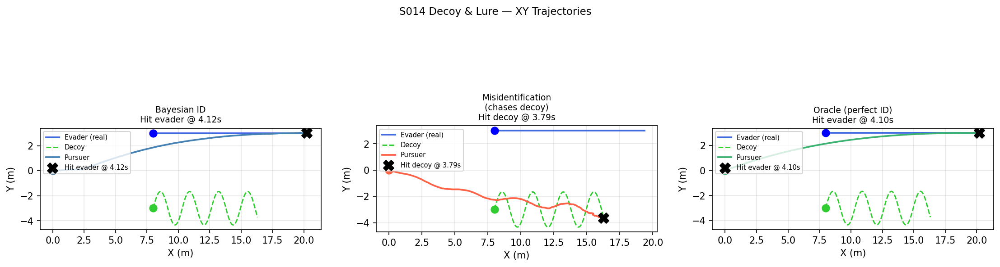
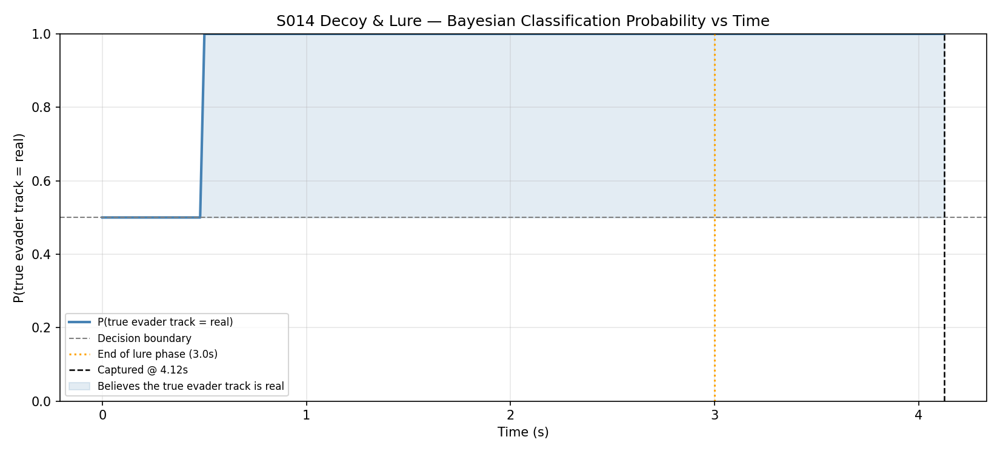
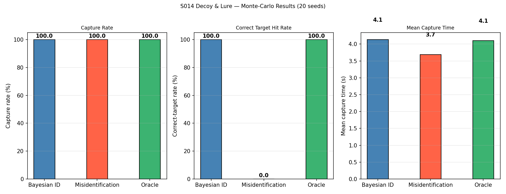
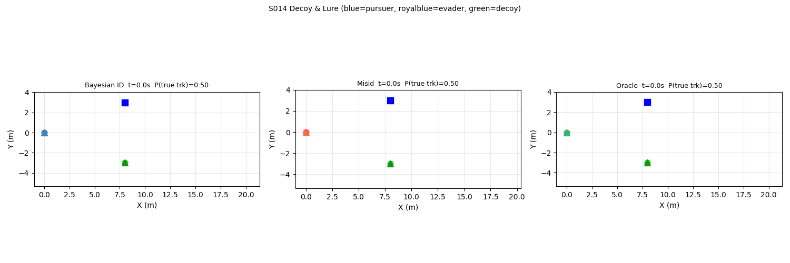

# S014 Decoy & Lure

**Domain**: Pursuit & Evasion | **Difficulty**: ⭐⭐⭐ | **Status**: ✅ Completed

---

## Problem Definition

**Setup**: Evader deploys a decoy drone that starts at a separate position and mimics forward escape motion, but adds sinusoidal lateral oscillation (high jerk) to confuse the pursuer. The real evader flies a smooth constant-velocity +x escape (low jerk). The pursuer uses Bayesian trajectory-smoothness classification (jerk-based log-odds update) to identify which track is the real evader.

**Three strategies compared**:

| Strategy | Logic | Expected Outcome |
|----------|-------|-----------------|
| **bayes_id** | Bayesian jerk classifier → chase the track it believes is real; head between the two tracks until the first update (t = 0.5 s) | Capture real evader |
| **misid** | Always chase the decoy (forced wrong) | Capture decoy |
| **perfect_id** | Oracle — always knows real target | Fastest evader capture |

Which of the two tracks (track 0 / track 1) is the real evader is drawn at random for every seed, so the classifier cannot be right just because of label order.

---

## Mathematical Model

### Jerk-Based Likelihood

Track smoothness (mean acceleration magnitude as jerk proxy):

$$\bar{j}_k = \frac{1}{W}\sum_{i=1}^{W} \|\dot{\mathbf{v}}_k[i]\| = \frac{1}{W}\sum_{i=1}^{W} \frac{\|\mathbf{v}_k[i] - \mathbf{v}_k[i-1]\|}{dt}$$

### Bayesian Log-Odds Update

$$L_{t+1} = L_t + \lambda(\bar{j}_1 - \bar{j}_0)$$

where L = log P(track0=real) / P(track1=real), λ=0.5 update gain.

$$P(\text{track0 = real}) = \sigma(L) = \frac{1}{1+e^{-L}}$$

### Decoy Oscillation

$$y_{decoy}(t) = y_0 + A \sin(2\pi f_{osc} \cdot t), \quad A=1.5\text{ m},\; f_{osc}=1.2\text{ Hz}$$

The lateral acceleration peaks at $A(2\pi f)^2 \approx 85$ m/s². The decoy speed is clamped to 9 m/s, so over the lure phase the decoy's noise-free jerk proxy is 43.5 m/s², against 0 for the evader.

**Sensor noise dominates the proxy.** The proxy differentiates noisy positions twice, so position noise σ contributes about $1.6\,\sigma\sqrt{6}/dt^2$, i.e. 450 m/s² for the evader (σ = 0.05 m) and 3600 m/s² for the decoy (σ = 0.40 m); the measured noise-only values are 439 and 3650 m/s². The classifier therefore mainly separates the *noisier* track, not the oscillating one. The equal-noise Monte-Carlo below measures what the oscillation alone achieves.

---

## Key Parameters

| Parameter | Value |
|-----------|-------|
| Pursuer speed | 5.0 m/s |
| Evader speed | 3.0 m/s |
| Decoy amplitude | 1.5 m |
| Decoy frequency | 1.2 Hz |
| Lure phase duration | 3.0 s |
| Bayesian update interval | 0.5 s |
| Update gain λ | 0.5 |
| Jerk window | 20 steps |
| Sensor noise (evader) | σ=0.05 m |
| Sensor noise (decoy) | σ=0.40 m |
| Pursuer start | (0, 0, 2) |
| Evader start | (8, +3, 2) — smooth +x escape |
| Decoy start | (8, −3, 2) — oscillating lure |

---

## Implementation

```
src/base/drone_base.py               # Point-mass drone base
src/01_pursuit_evasion/s014_decoy_lure.py       # Main simulation
```

```bash
conda activate drones
python src/01_pursuit_evasion/s014_decoy_lure.py
```

---

## Results

### Single-Run (seed=42)

| Strategy | Outcome | Time |
|----------|---------|------|
| **bayes_id** | ✅ Hit **evader** | **4.12 s** |
| **misid** | ❌ Hit **decoy** | 3.79 s |
| **perfect_id** | ✅ Hit **evader** | **4.10 s** |

In this run the real evader is on track 1. The first classifier update at t = 0.5 s already gives P(true evader track = real) ≈ 1.0, and it never drops after that.

### Jerk proxy over the lure phase (m/s²)

| Track | Motion only | Noise only | Observed |
|-------|------------:|-----------:|---------:|
| Evader (σ = 0.05 m) | 0.0 | 438.6 | 438.6 |
| Decoy (σ = 0.40 m) | 43.5 | 3649.7 | 3649.7 |
| Decoy at evader noise (σ = 0.05 m) | 43.5 | 456.2 | 458.6 |

### Monte-Carlo (20 seeds)

| Decoy noise | Strategy | Evader captured | Decoy captured | Mean evader-capture time |
|-------------|----------|----------------:|---------------:|-------------------------:|
| σ = 0.40 m (nominal) | bayes_id | 20/20 | 0/20 | 4.13 s |
| | misid | 0/20 | 20/20 | — |
| | perfect_id | 20/20 | 0/20 | 4.10 s |
| σ = 0.05 m (equal noise) | bayes_id | 12/20 | 8/20 | 4.53 s |
| | misid | 0/20 | 20/20 | — |
| | perfect_id | 20/20 | 0/20 | 4.10 s |

**Key Findings**:
- With the nominal noise, the Bayesian pursuer catches the real evader in 20/20 seeds, only 0.03 s slower than the oracle on average.
- This success comes mainly from the decoy's 8× larger sensor noise. Its noise-only jerk (3650 m/s²) is about 84× its oscillation jerk (43.5 m/s²). The card describes the decoy as the noisy track, so noise is the intended cue, but the oscillation adds almost nothing to it.
- When the decoy is observed as precisely as the evader, the oscillation alone is a weak cue. The observed proxies differ by 20 m/s² (438.6 vs 458.6), but almost all of that is sampling noise: the noise-only parts alone are 438.6 and 456.2 m/s² at the same σ, so the oscillation adds only about 2.4 m/s² on a noise floor of about 440 m/s². The Bayesian pursuer then picks the evader in only 12/20 seeds (8 decoy captures), barely better than a coin flip.
- Misid always captures the decoy, and the real evader escapes.

### Deviations from the scenario card

| Card | Implementation | Reason |
|------|----------------|--------|
| Track assignment not specified; ties (P = 0.5) go to track 2 | Track assignment random per seed; pursuer heads between the tracks until the first update | The earlier code always put the evader on track 0 and resolved P = 0.5 toward it, so the "Bayesian" pursuer chased the real target before seeing any data. |
| Decoy flies at 2 m/s toward the pursuer as bait | Decoy flies +x at 3 m/s with a lateral sine (A = 1.5 m, f = 1.2 Hz), then hovers | Kept from the earlier implementation: an oscillating decoy that flees alongside the evader gives the classifier a motion cue to test (the equal-noise run shows it is weak). |
| Initial pursuer–evader distance 8 m | Evader at (8, 3) → 8.54 m; decoy at (8, −3) | The two tracks start apart so the pursuer has to choose. |
| Jerk proxy described as measuring the oscillation | Proxy reported with its motion and noise parts; equal-noise Monte-Carlo added | The proxy is dominated by differentiated sensor noise (see table above). |
| Decoy model $\mathbf{p}_{decoy} = \mathbf{p}_E + \boldsymbol{\varepsilon}$ (shadows the evader) | Decoy starts 6 m away at (8, −3) and has its own motion; only its noise is drawn from $\mathcal{N}(0, \sigma_{decoy}^2 I)$ | A decoy sitting on top of the evader leaves the pursuer no choice of target; the separate start makes misidentification visible. |
| 3D trajectories; pursuer red | XY plots, pursuer coloured per strategy (steel blue / tomato / green) | All motion is planar at z = 2 m, so a top view loses nothing; the per-strategy colours keep the three panels apart. A true-3D version is in `outputs/01_pursuit_evasion/3d/`. |
| Confusion matrix over 20 seeds | Evader/decoy capture counts per strategy (tables above and `monte_carlo.png`) | Each run ends with exactly one capture, so the counts are the confusion matrix (real vs decoy chased). |
| Logistic $1/(1+e^{-L})$ | $\tfrac12(1+\tanh(L/2))$ | Same function, but it doesn't overflow when $L$ grows large. |

**XY Trajectories**:



**Bayesian Classification Probability (bayes_id, belief on the true evader track)**:



**Monte-Carlo Results**:



**Animation**:



---

## Extensions

1. Increase decoy noise σ to reduce classification signal — find the confusion boundary
2. Multiple decoys with correlated motion to fool the classifier
3. Adversarial decoy that learns to mimic evader's jerk signature

---

## Related Scenarios

- Prerequisites: [S008](../../../scenarios/01_pursuit_evasion/S008_stochastic_pursuit.md), [S013](../../../scenarios/01_pursuit_evasion/S013_pincer_movement.md)
- Follow-ups: [S015](../../../scenarios/01_pursuit_evasion/S015_relay_tracking.md), [S017](../../../scenarios/01_pursuit_evasion/S017_swarm_vs_swarm.md)
