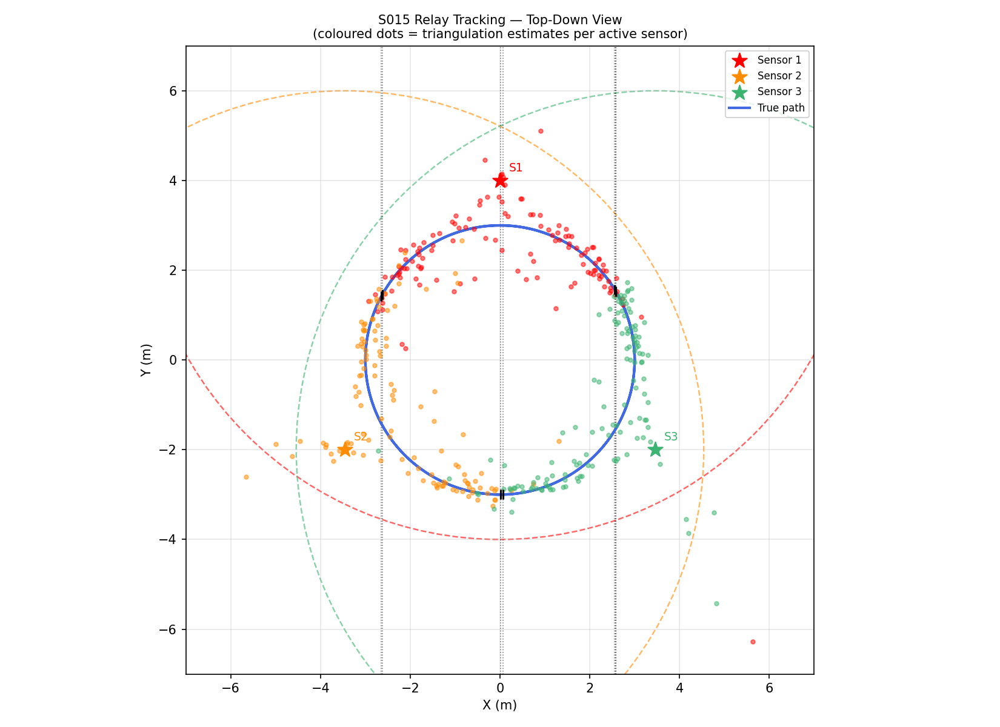
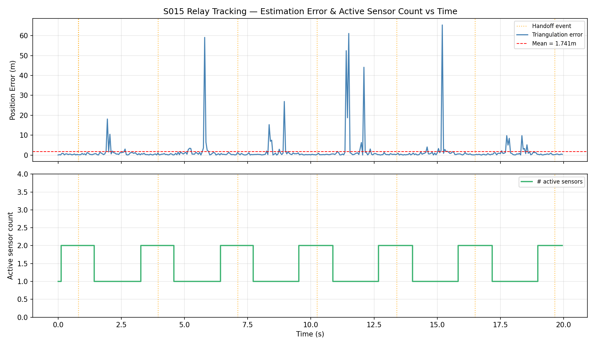
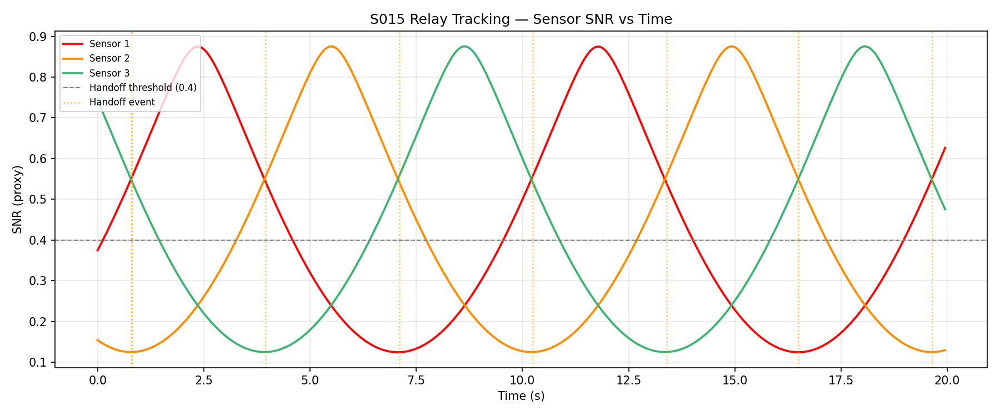
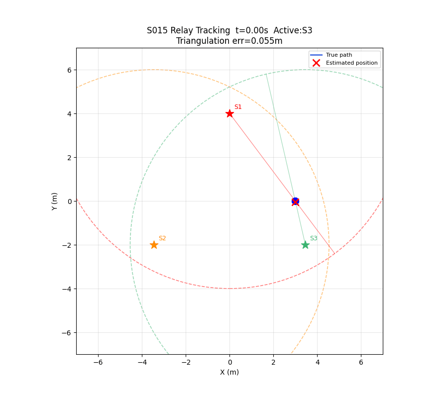

# S015 Relay Tracking

**Domain**: Pursuit & Evasion | **Difficulty**: ⭐⭐⭐ | **Status**: ✅ Completed

---

## Problem Definition

**Setup**: Three stationary sensor drones arranged in an equilateral triangle measure bearing-only (angle) observations of a moving target that orbits through the sensor zone. A zone-based handoff selects the two highest-SNR sensors; two-line triangulation estimates the target position. Estimation error spikes when the target crosses the baseline between the two sensors in use, where their bearing lines become nearly collinear (this happens between handoffs, not at them).

**Key question**: How does relay tracking manage continuous coverage across sensor zones, and where does accuracy degrade?

---

## Mathematical Model

### SNR Model (Inverse Distance)

$$SNR_i = \max\!\left(0,\; 1 - \frac{\|\mathbf{p}_T - \mathbf{s}_i\|}{R_{zone}}\right)$$

### Noisy Bearing Measurement

$$\theta_i = \text{atan2}(y_T - s_{iy},\; x_T - s_{ix}) + \mathcal{N}(0, \sigma_\theta)$$

### Two-Line Triangulation

Intersect bearing rays from sensors i and j:

$$\begin{bmatrix} \tan\theta_i & -1 \\ \tan\theta_j & -1 \end{bmatrix} \begin{bmatrix} x \\ y \end{bmatrix} = \begin{bmatrix} \tan\theta_i \cdot s_{ix} - s_{iy} \\ \tan\theta_j \cdot s_{jx} - s_{jy} \end{bmatrix}$$

System is near-singular (det ≈ 0) when bearing lines are nearly parallel → error spikes.

### Target Path

Circular orbit of radius 3 m centred at origin:

$$x(t) = r\cos(\omega t),\quad y(t) = r\sin(\omega t),\quad \omega = V_T / r \approx 0.667\;\text{rad/s}$$

---

## Key Parameters

| Parameter | Value |
|-----------|-------|
| Sensor positions | (0,4,3), (−3.46,−2,3), (3.46,−2,3) m — equilateral triangle |
| Coverage radius R_zone | 8.0 m |
| Bearing noise σ_θ | 0.05 rad (~3°) |
| Target speed | 2.0 m/s |
| Orbit radius | 3.0 m |
| Orbit period | ≈ 9.4 s |
| Active-sensor SNR threshold (only counts sensors; handoff uses the highest SNR) | 0.4 |
| Simulation time | 20 s |
| dt | 0.05 s |

---

## Implementation

```
src/01_pursuit_evasion/s015_relay_tracking.py     # Main simulation (no DroneBase needed)
```

```bash
conda activate drones
python src/01_pursuit_evasion/s015_relay_tracking.py
```

---

## Results

| Metric | Value |
|--------|-------|
| Handoff events | **7** (at t = 0.80, 3.95, 7.10, 10.25, 13.40, 16.50, 19.65 s) |
| Mean triangulation error | **1.74 m** |
| Median triangulation error | **0.48 m** |
| Steps with error < 0.5 m | **51.2 %** |
| Steps with error > 2 m | **9.5 %** (38 steps) |
| Max triangulation error | **65.38 m** |
| Lowest best-sensor SNR on the orbit | **0.5497** |

**Key Findings**:
- The target completes ~2.1 circular orbits. A handoff happens every ~3.15 s as it passes between adjacent sensor zones, which matches the 120° spacing of the equilateral sensor triangle.
- Error is below 0.5 m for only about half of the run (51.2 % of steps, median 0.48 m). Error depends on how well the two bearings cross, not on whether the target is between handoffs.
- The large errors (> 2 m, up to 65 m) do **not** happen at the handoffs. All 38 such steps are 1.05–1.5 s away from the nearest handoff (19 before, 19 after; offsets −1.50 to +1.35 s), when the target crosses the straight line (baseline) between the two sensors in use. There the two bearing lines point in nearly opposite directions (crossing angle 159.5–179.8°), so they are nearly collinear and the 2×2 triangulation system is close to singular. The orbit (r = 3 m) crosses each side of the sensor triangle (2 m from the centre) twice per lap, which produces these spikes.
- The best sensor's SNR never drops below 0.5497 on the orbit, so there are no blind spots. The second sensor, however, is often weaker: only 179 of 400 steps have two sensors above the 0.4 SNR threshold.

### Deviations from the scenario card

| Card | Implementation | Reason |
|------|----------------|--------|
| Target on a sinusoidal trajectory across the arena | Circular orbit, r = 3 m, through the sensor triangle | Keeps the target inside all three zones, so handoffs repeat every ~3.15 s. |
| Handoff when SNR_i < τ and SNR_j > τ | Primary sensor = highest SNR (argmax); τ = 0.4 is only used to count active sensors | The argmax rule always has a primary sensor; with the threshold rule the target is often covered by just one sensor above τ (221 of 400 steps). |
| Singular-system guard: det < 1e-6 | det < 1e-4 | Rejects slightly more near-parallel bearing pairs; it never triggers in this run (no step returned no estimate). |
| Objective / expected output: error spikes at handoff moments | Spikes occur at baseline crossings, 1.05–1.5 s from handoffs | Measured result (see Key Findings); the card's expectation does not hold for this geometry. |

**Top-Down Tracking Overview** (dots = triangulation estimates, coloured by active sensor):



**Estimation Error & Active Sensor Count vs Time**:



**Sensor SNR vs Time** (handoff events marked):



**Animation**:



---

## Extensions

1. Add a Kalman filter, or pick the sensor pair with the best crossing angle, to suppress the baseline-crossing spikes
2. Optimise sensor placement for minimum peak error across the target path
3. Three-sensor triangulation with least-squares to eliminate singularities

---

## Related Scenarios

- Prerequisites: [S008](../../../scenarios/01_pursuit_evasion/S008_stochastic_pursuit.md), [S012](../../../scenarios/01_pursuit_evasion/S012_relay_pursuit.md)
- Follow-ups: [S016](../../../scenarios/01_pursuit_evasion/S016_airspace_defense.md)
