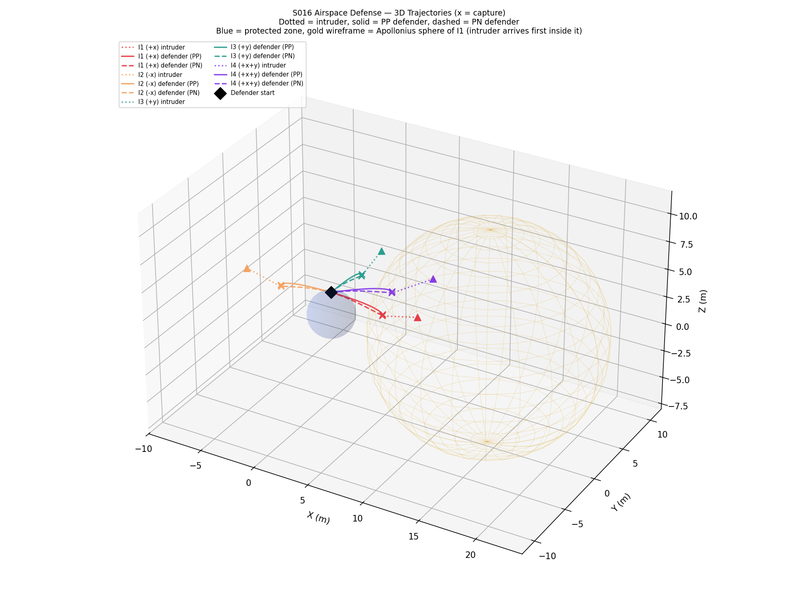
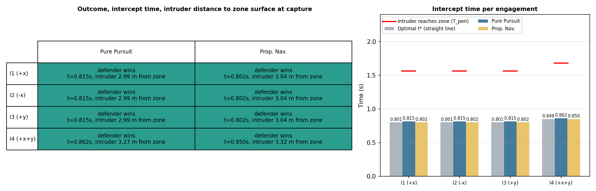
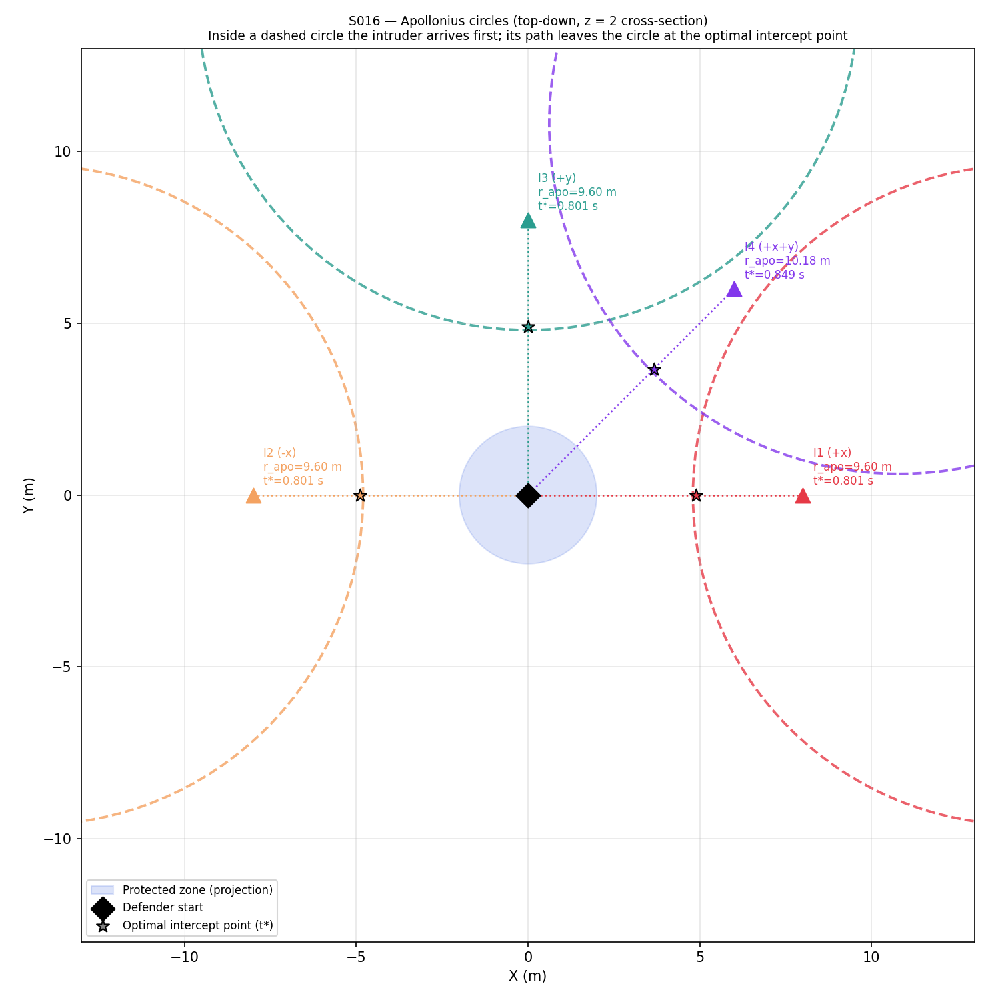
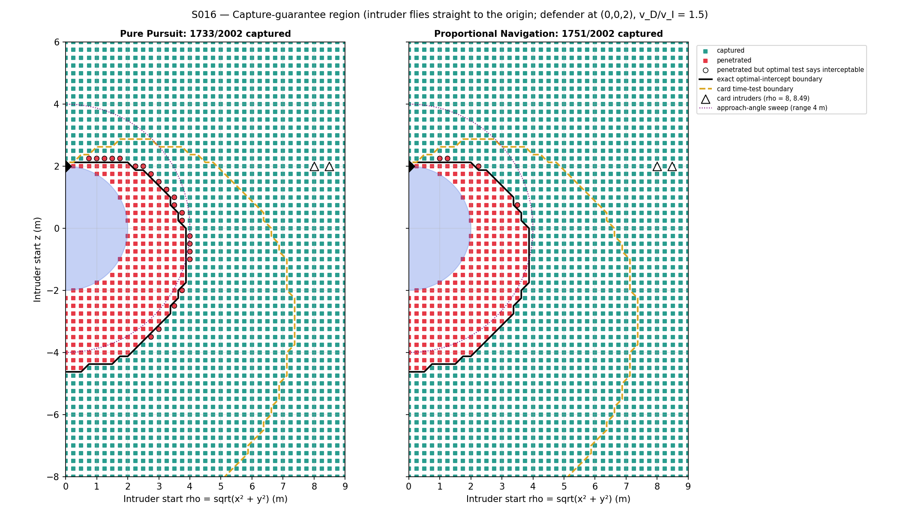
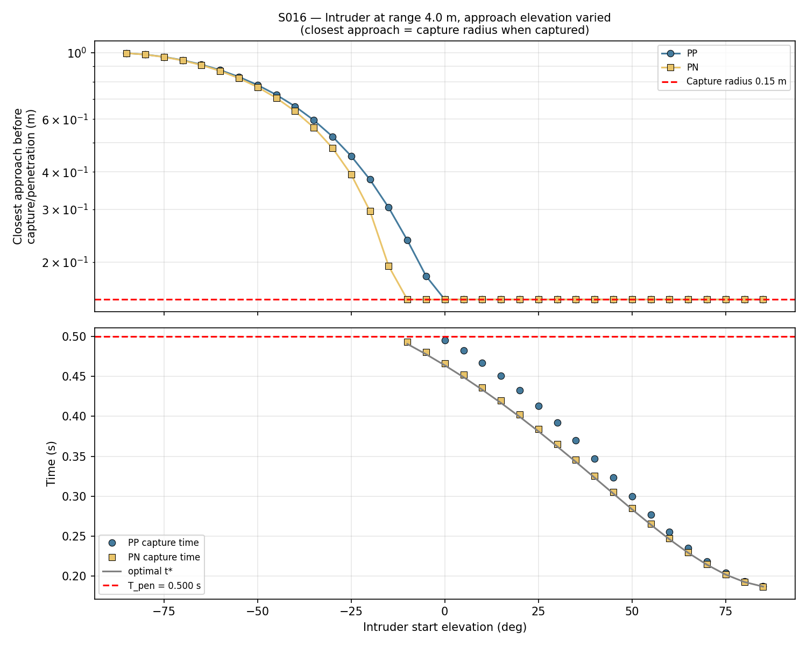
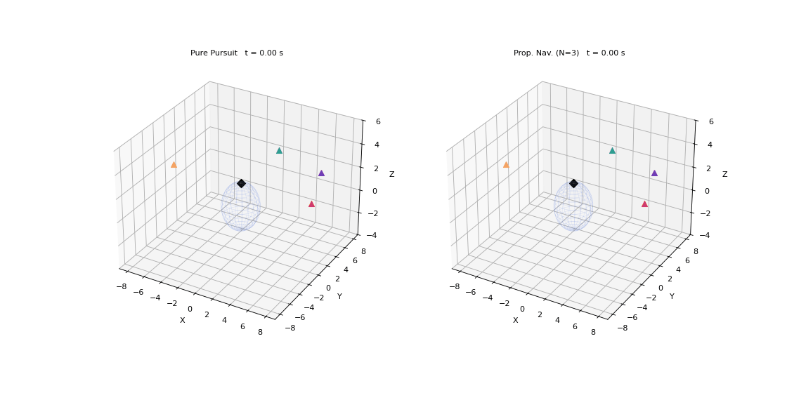

# S016 Airspace Defense

**Domain**: Pursuit & Evasion | **Difficulty**: ⭐⭐⭐ | **Status**: ✅ Completed

---

## Problem Definition

**Setup**: A protected zone (sphere of radius 2 m centered at the origin) must be defended against intruders. Each intruder starts outside the zone and flies in a straight line directly toward the zone center at constant speed. A single defender starts at (0, 0, 2) m — on the top of the zone surface — and must intercept each intruder before it crosses the zone surface. Two guidance laws are compared: Pure Pursuit (PP) and Proportional Navigation (PN, N = 3). Both fly at the same speed, start with the same heading (along the initial line of sight) and use the same capture test.

**Key question**: Under what conditions can the defender guarantee interception before zone penetration? How well does the card's time test, and the exact Apollonius construction, predict the guarantee region, and which guidance law gets closer to it?

The card's four intruder starts are all captured by both laws with a large margin, so the script also sweeps the intruder start over 2002 positions (guarantee-region map) and over 35 approach elevations at 4 m range, where interception is marginal.

---

## Mathematical Model

**Protected zone:**

$$\mathcal{Z} = \{ \mathbf{p} \in \mathbb{R}^3 \mid \|\mathbf{p}\| \leq R_{zone} \}$$

**Card time test** (the card's "Apollonius intercept condition" — the defender could reach the intruder's *current* position before the intruder reaches the zone):

$$\frac{\|\mathbf{p}_D - \mathbf{p}_I\|}{v_D} \leq \frac{\|\mathbf{p}_I\| - R_{zone}}{v_I} = T_{pen}$$

**Apollonius sphere** (points both vehicles reach at the same time, $k = v_D/v_I = 1.5$):

$$\|\mathbf{X} - \mathbf{p}_D\| = k\,\|\mathbf{X} - \mathbf{p}_I\| \;\Rightarrow\; \mathbf{c} = \frac{k^2\mathbf{p}_I - \mathbf{p}_D}{k^2 - 1},\quad r = \frac{k\,\|\mathbf{p}_I - \mathbf{p}_D\|}{k^2 - 1}$$

Inside the sphere the intruder arrives first. The straight intruder path leaves the sphere at the **optimal intercept point**. The exact optimal-intercept test asks whether there is a time $t \le T_{pen}$ with $\|\mathbf{p}_I(t) - \mathbf{p}_D(0)\| - r_{capture} \le v_D\,t$; the earliest such $t$ is $t^*$ (evaluated on a 4000-point time grid).

**Pure Pursuit:**

$$\mathbf{v}_D = v_D \cdot \frac{\mathbf{p}_I - \mathbf{p}_D}{\|\mathbf{p}_I - \mathbf{p}_D\|}$$

**Proportional Navigation** (constant-speed vehicle, launched at $v_D$ along the initial line of sight):

$$\hat{\boldsymbol{\lambda}} = \frac{\mathbf{p}_I - \mathbf{p}_D}{\|\mathbf{p}_I - \mathbf{p}_D\|}, \quad \dot{\hat{\boldsymbol{\lambda}}} = \frac{\mathbf{v}_{rel} - (\mathbf{v}_{rel}\cdot\hat{\boldsymbol{\lambda}})\hat{\boldsymbol{\lambda}}}{\|\mathbf{p}_I - \mathbf{p}_D\|}, \quad \mathbf{v}_{rel} = \mathbf{v}_I - \mathbf{v}_D$$

$$v_c = -\mathbf{v}_{rel}\cdot\hat{\boldsymbol{\lambda}}, \quad \mathbf{a}_{cmd} = N \cdot v_c \cdot \dot{\hat{\boldsymbol{\lambda}}}, \quad \mathbf{v}_D \leftarrow v_D \frac{\mathbf{v}_D + \mathbf{a}_{cmd}\Delta t}{\|\mathbf{v}_D + \mathbf{a}_{cmd}\Delta t\|}$$

**Capture condition (defender wins):** $\|\mathbf{p}_D - \mathbf{p}_I\| < r_{capture} = 0.15$ m

**Penetration condition (intruder wins):** $\|\mathbf{p}_I\| \leq R_{zone}$

Within each step both vehicles move at constant velocity; the script solves for the first time inside the step at which either condition is met, and the earlier event decides the engagement.

---

## Key Parameters

| Parameter | Value |
|-----------|-------|
| Protected zone radius R_zone | 2 m |
| Defender start position | (0, 0, 2) m |
| Defender speed v_D | 6 m/s |
| Intruder speed v_I | 4 m/s |
| Speed ratio k | 1.5 |
| Intruder start positions (card) | (8,0,2), (−8,0,2), (0,8,2), (6,6,2) m |
| Proportional nav gain N | 3 |
| PN initial velocity | 6 m/s along the initial line of sight |
| Capture radius | 0.15 m |
| Simulation timestep | 0.02 s |
| Max simulation time | 10 s |
| Region sweep: intruder start (ρ, 0, z) | ρ = 0–9 m, z = −8–6 m, 0.25 m grid (2002 starts outside the zone) |
| Approach-angle sweep | range 4.0 m, elevation −85° to +85° in 5° steps (35 starts) |
| Optimal-intercept time grid | 4000 points on [0, T_pen] |

---

## Implementation

```
src/01_pursuit_evasion/s016_airspace_defense.py
```

```bash
conda activate drones
python src/01_pursuit_evasion/s016_airspace_defense.py
```

Runtime ≈ 20 s (8 card engagements, 2 × 2002 sweep engagements, 2 × 35 angle-sweep engagements, 45-frame GIF).

---

## Results

### Card intruders

| Intruder | T_pen | Optimal t* | PP capture | PN capture | Intruder distance to zone at capture (PP / PN) |
|----------|-------|------------|------------|------------|-------------------------------|
| I1 (+x) | 1.562 s | 0.801 s | 0.815 s | 0.802 s | 2.985 m / 3.038 m |
| I2 (−x) | 1.562 s | 0.801 s | 0.815 s | 0.802 s | 2.985 m / 3.038 m |
| I3 (+y) | 1.562 s | 0.801 s | 0.815 s | 0.802 s | 2.985 m / 3.038 m |
| I4 (+x+y) | 1.679 s | 0.849 s | 0.862 s | 0.850 s | 3.268 m / 3.319 m |

Both laws win 4/4. Mean intercept time PP 0.827 s, PN 0.814 s. T_pen check for I1: (‖(8,0,2)‖ − 2)/4 = (8.246 − 2)/4 = 1.562 s. Card time test: all four pass (‖D − I‖ = 8.000 m vs threshold 1.5 × 6.246 = 9.369 m for I1–I3; 8.485 m vs 10.077 m for I4). Apollonius sphere of I1: centre (14.40, 0, 2), r = 1.5 × 8 / 1.25 = 9.60 m.

### Guarantee-region sweep (2002 intruder starts)

| Test / law | Interceptable / captured |
|------------|--------------------------|
| Exact optimal-intercept test | 1755 / 2002 |
| Card time test passes | 979 / 2002 |
| Pure Pursuit captures | 1733 / 2002 (all inside the 1755) |
| Proportional Navigation captures | 1751 / 2002 (all inside the 1755) |
| Captured by PN only / PP only | 18 / 0 |
| Card test passes but optimal fails / optimal ok but card test fails | 0 / 776 |

### Approach-angle sweep (range 4.0 m, T_pen = (4 − 2)/4 = 0.500 s)

| Elevation | Optimal t* | PP | PN |
|-----------|-----------|----|----|
| −15° | none | penetrates (closest 0.304 m) | penetrates (closest 0.194 m) |
| −10° | 0.491 s | penetrates (closest 0.237 m) | capture 0.493 s |
| −5° | 0.478 s | penetrates (closest 0.180 m) | capture 0.480 s |
| 0° | 0.464 s | capture 0.495 s | capture 0.466 s |
| 30° | 0.362 s | capture 0.392 s | capture 0.365 s |
| 60° | 0.246 s | capture 0.255 s | capture 0.247 s |

Over all 35 elevations: optimal test 20/35 interceptable (−10° to +85°), PN captures 20/35, PP captures 18/35 (0° to +85°).

**Key Findings**:
- **With a proper launch, PN is the better law, not the worse one.** Launched along the initial line of sight at full speed, PN turns onto a collision course and captures within 0.001 s of the straight-line optimum t* in the card cases (0.802 vs 0.801 s; 0.850 vs 0.849 s) and within 0.003 s on the 4 m ring (e.g. 0.466 vs 0.464 s at 0°). Pure Pursuit always aims at where the intruder *is*, so it flies a curved path and is 0.012–0.013 s slower than PN in the card cases (0.815 vs 0.802 s; 0.862 vs 0.850 s) and up to 0.034 s slower than t* on the 4 m ring (0.467 vs 0.433 s at +10°).
- **The difference only matters near the edge of the guarantee region.** Against the card's intruders both laws capture with the intruder still about 3 m from the zone. In the region sweep PN captures 1751 of the 1755 interceptable starts, PP 1733; the 18 starts only PN saves lie in a thin band just inside the optimal boundary (circles in the PP panel). On the 4 m ring PP's slower curve lets the intruder through at −5° and −10° even though it passes within 0.180 m and 0.237 m of it.
- **Neither law beats the exact Apollonius bound** — no simulated capture happens where the optimal test says interception is impossible, which is a consistency check of the simulation.
- **The card's time test is conservative here.** It never passes for a start that cannot be intercepted, but it fails for 776 of the 1755 interceptable starts: it requires the defender to reach the intruder's *start* position, whereas the intruder is flying toward the defender's side of the zone, so the actual meeting point is much closer.
- The previous README's "PN 0/4, the defender barely moved toward the intruder" was a bug: PN started from zero velocity, the head-on line of sight has almost no rotation, the near-zero command was normalised to full speed and the defender flew off in −z. It was not a property of PN.

**3D Trajectory Plot — card engagements, protected zone and the Apollonius sphere of I1:**



**Outcome table and intercept times vs optimal t\* and T_pen:**



**Apollonius circles (top-down) with optimal intercept points for the card intruders:**



**Capture-guarantee region over intruder start position (ρ, z), PP vs PN, with the exact optimal boundary (black) and card time-test boundary (gold):**



**Closest approach and capture time vs approach elevation (4 m range):**



**Animation (card intruders; Pure Pursuit left, PN right):**



### Deviations from the scenario card

| Card | Code | Reason |
|------|------|--------|
| PN starts with `v_def = 0` | PN launched at v_D along the initial line of sight (the heading PP takes on its first step) | From rest the head-on LOS rate is ≈ 0, the near-zero command was normalised to full speed in an arbitrary direction and the defender flew away; standard PN assumes a moving vehicle with forward speed |
| PN velocity "clipped to v_D" | Rescaled to exactly v_D every step | Constant-speed vehicle, same speed as PP, so only the guidance law differs |
| Capture/penetration checked at the end of each step, intruder first | First crossing inside the step for both events; the earlier one wins | Closing speed ≈ 10 m/s × 0.02 s = 0.2 m per step, comparable to the 0.15 m capture radius; avoids missed captures and order bias |
| "Apollonius intercept condition" = card time test | Card time test kept, plus the true Apollonius sphere and the exact optimal-intercept test | The card's test is not the Apollonius construction; comparing both shows the card test is conservative (fails for 776 interceptable starts) |
| Four intruder starts only | Plus a 2002-start region sweep and a 35-start elevation sweep at 4 m | The problem is symmetric about the z-axis, so I1–I3 are the same engagement and I4 almost the same; all are easy captures and cannot separate PP from PN |
| Miss distance vs approach angle for the card starts | Closest approach vs elevation at 4 m range | At the card range every start is captured by both laws, so the miss distance is just the capture radius |
| Apollonius sphere overlaid on the 3D scene | Drawn for I1 only (I2–I4 shown as circles in the top-down plot) | Four overlapping 10 m spheres hide the trajectories |
| — | The defender may fly through the protected zone | The card puts no constraint on the defender's path |

---

## Extensions

1. Multiple simultaneous intruders (salvo attack) — defender must prioritize targets
2. Intruder executes an evasive maneuver during the final approach phase
3. Two cooperating defenders — analyze how cooperation expands the guarantee region

---

## Related Scenarios

- Prerequisites: [S001 Basic Intercept](../../../scenarios/01_pursuit_evasion/S001_basic_intercept.md), [S002 Evasive Maneuver](../../../scenarios/01_pursuit_evasion/S002_evasive_maneuver.md), [S005 Stealth Approach](../../../scenarios/01_pursuit_evasion/S005_stealth_approach.md)
- Follow-ups: [S017 Swarm vs Swarm](../../../scenarios/01_pursuit_evasion/S017_swarm_vs_swarm.md), [S018 Multi-Target Intercept](../../../scenarios/01_pursuit_evasion/S018_multi_target_intercept.md)
