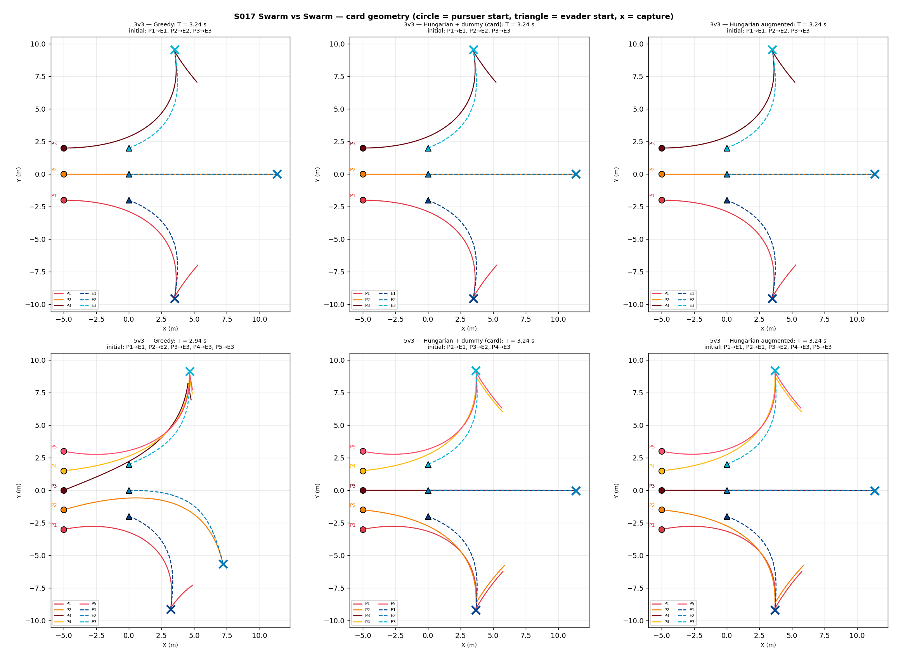
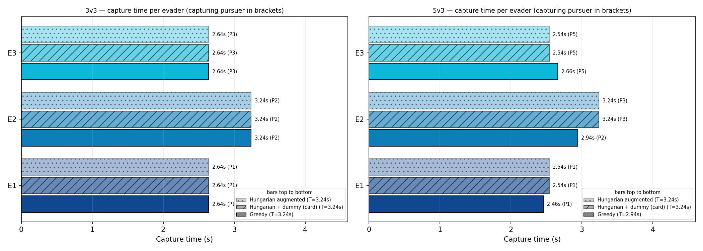
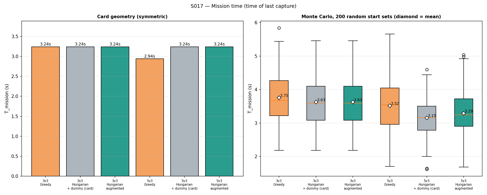
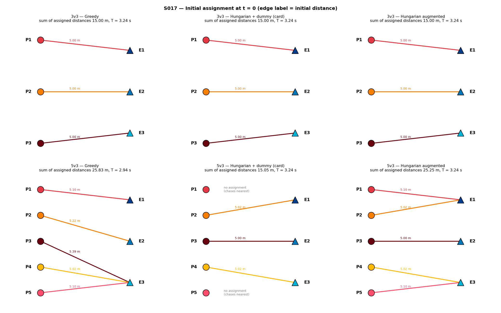
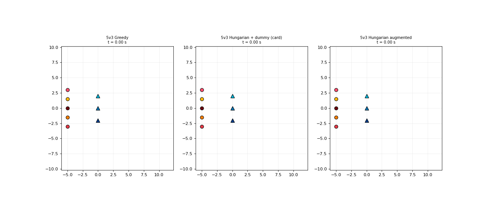

# S017 Swarm vs Swarm

**Domain**: Pursuit & Evasion | **Difficulty**: ⭐⭐⭐⭐ | **Status**: ✅ Completed

---

## Problem Definition

**Setup**: M pursuers compete against N = 3 evaders in an open 2D arena. Two cases are studied: 3v3 (symmetric) and 5v3 (pursuer advantage). Pursuers fly pure pursuit toward their assigned evader; evaders scatter away from the centroid of all pursuers. When an evader is captured, every pursuer that was chasing it switches to the nearest remaining evader.

Three initial assignment methods are compared:
- **Greedy**: pursuers in index order each take the nearest unclaimed evader; once all evaders are claimed, the surplus pursuers take the nearest evader (shared).
- **Hungarian + dummy (card)**: Hungarian algorithm on the distance matrix padded with zero-cost dummy columns, as the card specifies. For M > N, the pursuers left on a dummy column have no assignment and chase the nearest evader.
- **Hungarian augmented**: every evader column is repeated ⌈M/N⌉ times, so all pursuers, including the surplus ones, are placed by the same sum-of-distances optimisation.

For M = N the two Hungarian variants are identical.

**Key question**: How much do the assignment method and the pursuer count affect total mission time? The card geometry is symmetric, so the methods are also compared on 200 seeded random start sets.

---

## Mathematical Model

### Assignment Problem (Hungarian Algorithm)

$$C_{ij} = \|\mathbf{p}_{P_i} - \mathbf{p}_{E_j}\|, \qquad \sigma^* = \arg\min_{\sigma} \sum_{i} C_{i,\sigma(i)}$$

- **Dummy padding (card)**: $[\,C \;|\; \mathbf{0}_{M\times(M-N)}\,]$ — only N pursuers receive an evader.
- **Augmented**: $[\,C \;|\; C \;|\; \dots\,]$ with $\lceil M/N \rceil$ copies — each pursuer receives an evader, at most $\lceil M/N \rceil$ per evader (5v3: 2).

### Pursuer Strategy (Pure Pursuit)

$$\mathbf{v}_{P_i} = v_P \cdot \frac{\mathbf{p}_{E_{\sigma(i)}} - \mathbf{p}_{P_i}}{\|\mathbf{p}_{E_{\sigma(i)}} - \mathbf{p}_{P_i}\|}$$

### Evader Scatter Strategy

$$\bar{\mathbf{p}}_P = \frac{1}{M} \sum_{i=1}^{M} \mathbf{p}_{P_i}, \qquad \mathbf{v}_{E_j} = v_E \cdot \frac{\mathbf{p}_{E_j} - \bar{\mathbf{p}}_P}{\|\mathbf{p}_{E_j} - \bar{\mathbf{p}}_P\|}$$

### Capture and Reassignment

Evader j is captured when $\|\mathbf{p}_{P_i} - \mathbf{p}_{E_j}\| < r_{capture}$ for its assigned pursuer i. Every pursuer whose target has been captured (or that has no target) switches to

$$j^* = \arg\min_{j \in \mathcal{E}_{remaining}} \|\mathbf{p}_{P_i} - \mathbf{p}_{E_j}\|$$

### Total Mission Time

$$T_{mission} = \max_{j} t_{capture,j}$$

---

## Key Parameters

| Parameter | Value |
|-----------|-------|
| Case A | 3 pursuers vs 3 evaders |
| Case B | 5 pursuers vs 3 evaders |
| Pursuer speed | 5 m/s |
| Evader speed | 3.5 m/s |
| 3v3 pursuer starts | (−5, −2), (−5, 0), (−5, 2) m |
| 5v3 pursuer starts | (−5, −3), (−5, −1.5), (−5, 0), (−5, 1.5), (−5, 3) m |
| Evader starts | (0, −2), (0, 0), (0, 2) m |
| Capture radius | 0.15 m |
| Simulation timestep | 0.02 s |
| Max simulation time | 30.0 s |
| Monte Carlo trials / seed | 200 / 17 |
| Monte Carlo pursuer start box | x ∈ [−7, −3], y ∈ [−4, 4] m (uniform) |
| Monte Carlo evader start box | x ∈ [−1, 1], y ∈ [−3, 3] m (uniform) |

---

## Implementation

```
src/01_pursuit_evasion/s017_swarm_vs_swarm.py
```

```bash
conda activate drones
python src/01_pursuit_evasion/s017_swarm_vs_swarm.py
```

Runtime ≈ 30 s (6 card runs, 200 × 6 Monte Carlo runs, 82-frame GIF).

---

## Results

### Card geometry

| Case | Method | Initial assignment | Sum of assigned distances | Captures (capturing pursuer) | T_mission |
|------|--------|--------------------|---------------------------|------------------------------|-----------|
| 3v3 | Greedy | P1→E1, P2→E2, P3→E3 | 15.00 m | E1 2.64 s (P1), E2 3.24 s (P2), E3 2.64 s (P3) | 3.24 s |
| 3v3 | Hungarian + dummy (card) | same | 15.00 m | same | 3.24 s |
| 3v3 | Hungarian augmented | same | 15.00 m | same | 3.24 s |
| 5v3 | Greedy | P1→E1, P2→E2, P3→E3, P4→E3, P5→E3 | 25.83 m | E1 2.46 s (P1), E2 2.94 s (P2), E3 2.66 s (P5) | **2.94 s** |
| 5v3 | Hungarian + dummy (card) | P2→E1, P3→E2, P4→E3; P1, P5 none | 15.05 m | E1 2.54 s (P1), E2 3.24 s (P3), E3 2.54 s (P5) | 3.24 s |
| 5v3 | Hungarian augmented | P1→E1, P2→E1, P3→E2, P4→E3, P5→E3 | 25.25 m | E1 2.54 s (P1), E2 3.24 s (P3), E3 2.54 s (P5) | 3.24 s |

### Monte Carlo (200 random start sets, same starts for every method)

| Case | Method | All captured | Mean T_mission | Median | Min / max |
|------|--------|--------------|----------------|--------|-----------|
| 3v3 | Greedy | 200/200 | 3.752 s | 3.670 s | 2.18 / 5.84 s |
| 3v3 | Hungarian (both variants) | 200/200 | 3.625 s | 3.590 s | 2.18 / 5.46 s |
| 5v3 | Greedy | 200/200 | 3.516 s | 3.540 s | 1.70 / 5.66 s |
| 5v3 | Hungarian + dummy (card) | 200/200 | **3.150 s** | 3.160 s | 1.62 / 4.60 s |
| 5v3 | Hungarian augmented | 200/200 | 3.288 s | 3.240 s | 1.68 / 5.04 s |

Head-to-head on the same starts:
- 3v3 Hungarian vs greedy: Hungarian faster in 88, tie in 65, slower in 47 trials; mean gain +0.127 s.
- 5v3 Hungarian augmented vs greedy: faster in 120, tie in 26, slower in 54; mean gain +0.228 s.
- 5v3 Hungarian augmented vs Hungarian + dummy: faster in 44, tie in 53, slower in 103; mean difference −0.137 s, i.e. the card's dummy variant is better on average.

**Key Findings**:
- **The card geometry cannot separate the methods in 3v3.** All three give the same one-to-one matching (every distance 5.00 m), so T_mission = 3.24 s in each case. The bottleneck is the middle evader E2: the pursuer swarm is symmetric about y = 0, so E2 flees straight along +x and is caught in a pure tail chase after (5 − 0.15)/(5 − 3.5) = 3.23 s, i.e. on the step ending at 3.24 s.
- **Why greedy wins the card 5v3 case (2.94 vs 3.24 s).** Greedy sends P3, P4 and P5 all after E3, so the pursuer centroid moves toward +y. E2 flees away from that centroid, curves toward −y and runs into P2's path, and P2 catches it at 2.94 s. With either Hungarian variant the swarm stays symmetric, E2 again flees straight along +x and the tail chase takes 3.24 s. The gain comes from exploiting the evaders' centroid rule, not from a better assignment objective. Both Hungarian variants end up with the same chasers here: in the card variant the unassigned P1 and P5 take the nearest evaders (E1 and E3), which is exactly where the augmented matrix puts them.
- **Over random starts, Hungarian beats greedy on average but not every time.** Its mean mission time is 0.127 s lower in 3v3 and 0.228 s lower in 5v3, but greedy is still faster in 47 (3v3) and 54 (5v3) of the 200 trials. The Hungarian algorithm minimises the sum of distances, while the mission time is set by the last capture.
- **Placing the surplus pursuers by sum-of-distances is not better than "nearest evader".** In 5v3 the card's dummy-column variant (surplus pursuers chase their nearest evader) averages 3.150 s and the augmented variant 3.288 s; the dummy-column variant is faster in 103 trials and the augmented variant in 44 (53 ties). Having two extra pursuers helps either way: Hungarian mean 3.625 s in 3v3 vs 3.288 s (augmented) or 3.150 s (dummy) in 5v3.
- The previous README attributed the 5v3 gap to "sum of distances vs makespan". In that version, as in the card variant here, only 3 pursuers were assigned by the Hungarian algorithm and the other 2 used nearest-evader. The card geometry shows that the gap actually comes from the asymmetric pursuer centroid under greedy.

**Top-down trajectories, card geometry (rows: 3v3, 5v3; columns: method)**:



**Capture time per evader (card geometry)**:



**Mission time: card geometry (left) and Monte Carlo distribution (right)**:



**Initial assignment at t = 0 for every case and method**:



**Animation (5v3; greedy, Hungarian + dummy, Hungarian augmented)**:



### Deviations from the scenario card

| Card | Code | Reason |
|------|------|--------|
| Dummy-column padding; what the unassigned pursuers do is not specified | Kept as "Hungarian + dummy (card)": they chase their nearest evader. Added "Hungarian augmented" (repeated evader columns) | Lets the surplus pursuers be placed by the Hungarian algorithm too, and shows what the card's padding actually does |
| Card code: greedy overflow pursuers go to an arbitrary claimed evader (`list(taken)[0]`) | Overflow pursuers go to their nearest evader | Greedy should mean "nearest"; the card code's choice depends on set ordering |
| Card code: only the capturing pursuer reassigns | Every pursuer whose target is captured switches to the nearest remaining evader | Otherwise the other pursuers on a captured evader would keep flying at it |
| 3D positions at z = 2 m; 5v3 starts y = −3, −1, 1, 3, 0 | 2D (all at the same height); 5v3 starts y = −3, −1.5, 0, 1.5, 3 | All agents fly at the same altitude, so the third axis carries no information; evenly spaced line kept from the original implementation |
| Card geometry only | Plus 200 seeded random start sets | The symmetric card geometry gives identical 3v3 results for every method |
| Evader exactly at the pursuer centroid: not covered | Flees along +x | Removes the only random draw in the old code (never triggered in these runs) |

---

## Extensions

1. Cooperative pursuit — 2 pursuers per evader using flanking maneuvers
2. Evaders also use APF to avoid each other while scattering
3. Heterogeneous speeds — some evaders are faster than the pursuers

---

## Related Scenarios

- Prerequisites: [S011 Swarm Encirclement](../../../scenarios/01_pursuit_evasion/S011_swarm_encirclement.md), [S013 Pincer Movement](../../../scenarios/01_pursuit_evasion/S013_pincer_movement.md)
- Follow-ups: [S018 Multi-Target Intercept](../../../scenarios/01_pursuit_evasion/S018_multi_target_intercept.md), [S019 Dynamic Target Reassignment](../../../scenarios/01_pursuit_evasion/S019_dynamic_reassignment.md)
