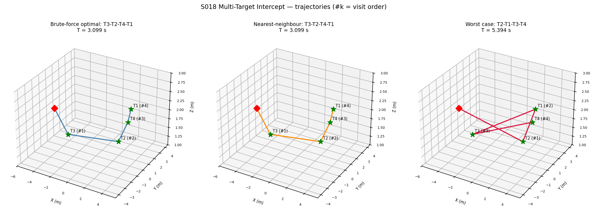
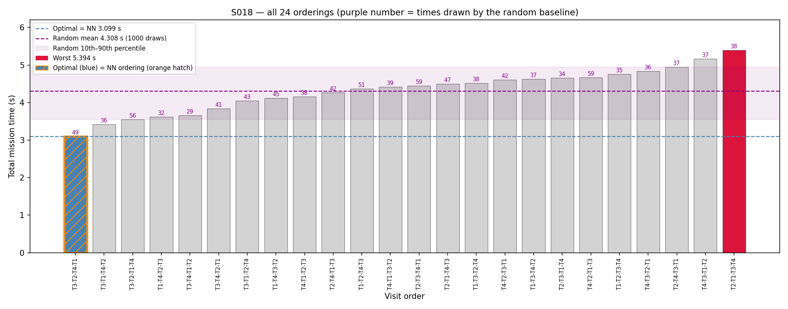
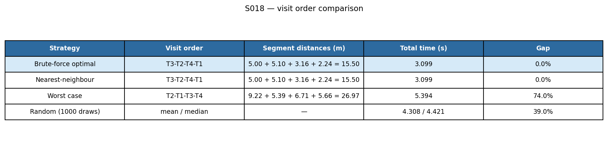
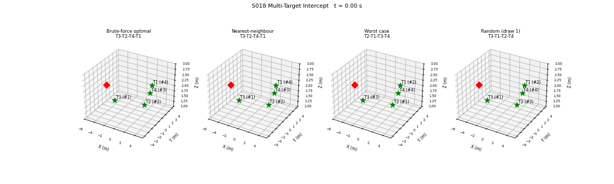

# S018 Multi-Target Intercept

**Domain**: Pursuit & Evasion | **Difficulty**: ⭐⭐⭐ | **Status**: ✅ Completed

---

## Problem Definition

**Setup**: A single pursuer starting at (-5, 0, 2) m must intercept four stationary targets T1–T4 (numbered as on the scenario card) at fixed 3D positions. All motion occurs at constant altitude z = 2 m. The pursuer flies at a constant speed of 5 m/s and must visit every target within a capture radius of 0.15 m.

**Key question**: What is the visit ordering that minimises total flight time, and how well does the greedy nearest-neighbour heuristic approximate the brute-force optimum across all 4! = 24 possible orderings, and how much worse is a random ordering?

---

## Mathematical Model

### Total Mission Time

For visit ordering $\sigma = (\sigma_1, \sigma_2, \sigma_3, \sigma_4)$:

$$T_{\text{total}}(\sigma) = \sum_{k=1}^{N} \frac{\|\mathbf{p}_{\sigma_k} - \mathbf{p}_{\sigma_{k-1}}\|}{v_P}$$

where $\mathbf{p}_{\sigma_0} = \mathbf{p}_P(0)$ is the pursuer start position.

### Optimal Ordering (Brute Force)

$$\sigma^* = \arg\min_{\sigma \in S_N} T_{\text{total}}(\sigma)$$

### Nearest-Neighbour Heuristic

$$\sigma_{k+1} = \arg\min_{j \notin \{\sigma_1,\ldots,\sigma_k\}} \|\mathbf{p}_j - \mathbf{p}_{\sigma_k}\|$$

### Optimality Gap

$$\text{gap} = \frac{T_{NN} - T^*}{T^*} \times 100\%$$

---

## Key Parameters

| Parameter | Value |
|-----------|-------|
| Pursuer start | (-5, 0, 2) m |
| Target T1 | (2, 3, 2) m |
| Target T2 | (4, -2, 2) m |
| Target T3 | (-1, -3, 2) m |
| Target T4 | (3, 1, 2) m |
| Pursuer speed | 5 m/s |
| Capture radius | 0.15 m per target |
| Trajectory / animation sampling step DT | 0.05 s |
| Orderings evaluated | 24 (4!) |
| Random baseline | 1000 seeded permutations (seed 0) |

---

## Implementation

```
src/01_pursuit_evasion/s018_multi_target_intercept.py
```

```bash
conda activate drones
python src/01_pursuit_evasion/s018_multi_target_intercept.py
```

Runtime ≈ 40 s (measured 36–39 s; almost all of it rendering the 110-frame, four-panel 3D GIF).

---

## Results

| Strategy | Visit order | Segment distances | Mission time | Gap |
|----------|-------------|-------------------|--------------|-----|
| Brute-force optimal | T3-T2-T4-T1 | 5.000 + 5.099 + 3.162 + 2.236 = 15.497 m | 3.099 s | 0.0% |
| Nearest-neighbour | T3-T2-T4-T1 | same | 3.099 s | 0.0% |
| Worst case | T2-T1-T3-T4 | 9.220 + 5.385 + 6.708 + 5.657 = 26.970 m | 5.394 s | 74.0% |
| Random, mean of 1000 draws | — | — | 4.308 s (std 0.550 s) | 39.0% |
| Random, median | — | — | 4.421 s | — |
| Random, 10th–90th percentile | — | — | 3.544–4.949 s | 14.3–59.7% |

Mission time = distance / 5 m/s, e.g. 15.497 / 5 = 3.099 s. Gap = (T − T*) / T*, e.g. (4.308 − 3.099) / 3.099 = 39.0%.

The exact expectation of a uniformly random ordering is the mean over all 24 orderings, 4.320 s (gap 39.4%). The 1000 seeded draws give 4.308 s, which matches it to within sampling error. 49 of the 1000 draws hit the optimal ordering (4.9%, vs 1/24 = 4.2% expected), and 798 of 1000 are more than 20% slower than optimal. The first draw, T3-T1-T2-T4 at 4.051 s (30.7% gap), is the single ordering the previous README reported as "the random baseline".

**Key Findings**:
- **Nearest-neighbour finds the optimum here (rank 1 of 24, gap 0.0%).** Each greedy step happens to be the right one: T3 is the closest target to the start (5.00 m), T2 is the closest to T3 (5.10 m), T4 the closest to T2 (3.16 m), and T1 comes last. This is a property of this layout, not a guarantee; NN has no optimality bound in general.
- **The ordering matters a lot.** The worst ordering is 74.0% slower than optimal (5.394 vs 3.099 s), because it crosses the target cluster several times. A random ordering is 39.0% slower on average, and 80% of random draws (798/1000) are more than 20% slower. Only about 1 in 20 random draws finds the optimum.
- With N = 4, enumerating all 24 orderings is trivial. The N! growth makes brute force impractical at around N ≈ 12 (12! ≈ 4.8 × 10⁸), which is where heuristics such as NN or 2-opt are needed.
- **Mission times are measured centre to centre**, as in the card. With the 0.15 m capture radius, each target is actually intercepted 0.15 / 5 = 0.03 s before the pursuer reaches its centre; for the optimal path the four interceptions happen at 0.970, 1.990, 2.622 and 3.069 s. This shifts every ordering by the same 0.03 s at the end and does not change the ranking.

**3D trajectory comparison (optimal, nearest-neighbour, worst case)**:



**All 24 orderings ranked by mission time, with how often the random baseline drew each one**:



**Visit order summary table with segment distances**:



**Animation (optimal, NN, worst case, first random draw)**:



### Deviations from the scenario card

| Card | Code | Reason |
|------|------|--------|
| Random ordering baseline (one ordering) | 1000 seeded random permutations, reported as a distribution | A single draw cannot say how much the ordering matters "on average" |
| Expected output: 3D trajectories for optimal, NN, worst case | Same, plus the first random draw in the animation | — |
| Times computed centre to centre; capture radius listed | Same; capture times printed separately for the optimal path | Keeps the card's T_total formula; the capture radius shifts every ordering by the same 0.03 s at the end |

---

## Extensions

1. Moving targets — greedy NN still applicable; optimal becomes intractable as target positions shift each decision step
2. N = 10 targets: compare NN vs 2-opt local search vs optimal timing; brute-force requires 10! = 3.6 M evaluations
3. Return-to-base variant: pursuer must end at start position (classical TSP with depot), adding a fifth edge to every tour

---

## Related Scenarios

- Prerequisites: [S001 Basic Intercept](../../../scenarios/01_pursuit_evasion/S001_basic_intercept.md), [S011 Swarm Encirclement](../../../scenarios/01_pursuit_evasion/S011_swarm_encirclement.md)
- Follow-ups: [S019 Dynamic Target Reassignment](../../../scenarios/01_pursuit_evasion/S019_dynamic_reassignment.md)
