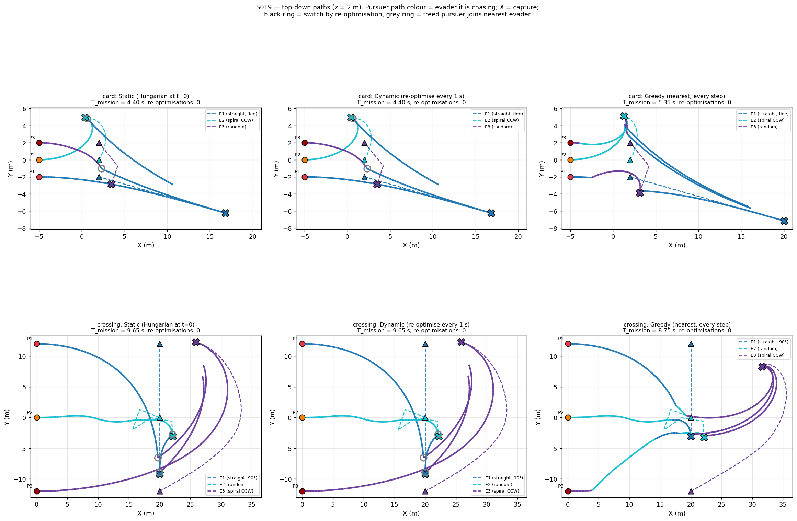
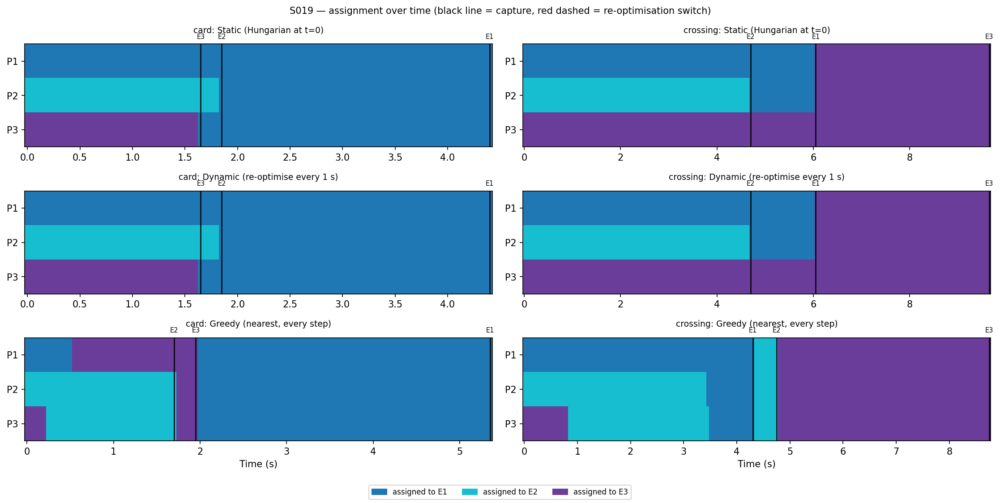
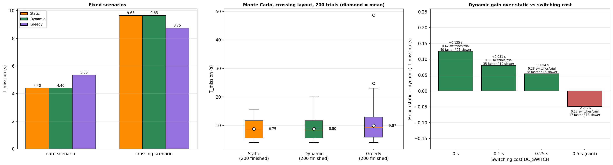
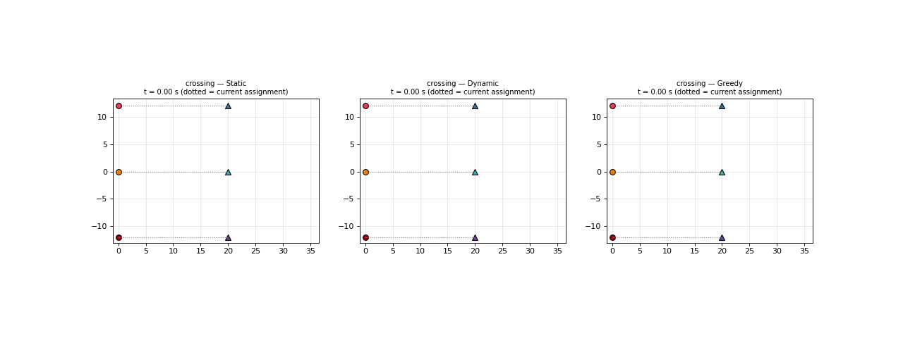

# S019 Dynamic Target Reassignment

**Domain**: Pursuit & Evasion | **Difficulty**: ⭐⭐⭐⭐ | **Status**: ✅ Completed

---

## Problem Definition

**Setup**: 3 pursuers (P1–P3) vs 3 evaders (E1–E3) with mixed evasion strategies, all at z = 2 m (simulated in the horizontal plane). An initial optimal assignment is computed with the Hungarian algorithm. In the dynamic strategy the assignment is re-evaluated every T_CHECK = 1 s and replaced if it lowers the summed time-to-go by more than DC_SWITCH = 0.5 s.

**Evader strategies** (all at 3.5 m/s):
- **Straight**: fixed heading — away from the pursuers' centroid at t = 0 (card scenario), or a given heading (crossing scenario, Monte Carlo).
- **Spiral**: heading 60° to one side of the current flee direction (away from the pursuers' centroid). The evader circles round the pursuers while slowly opening the range (logarithmic spiral). CCW or CW.
- **Random**: uniformly random heading, redrawn every 1 s from a seeded generator.

**Three strategies compared**:
1. **Static** — Hungarian assignment at t = 0, never re-optimised.
2. **Dynamic** — re-optimise every T_CHECK; switch only if the improvement exceeds DC_SWITCH.
3. **Greedy** — every step each pursuer chases its nearest uncaptured evader (no coordination).

In static and dynamic, a pursuer whose evader has been captured joins the nearest remaining evader. Captured evaders are never assigned. Any pursuer within the capture radius captures an evader.

**Scenarios**:
- **card**: the card's start positions.
- **crossing**: a wide layout in which the straight evader runs straight across the other lanes and the spiral evader circles up through them, i.e. the situation where the initial assignment should go stale.
- **Monte Carlo**: 200 trials on the crossing layout with jittered starts, a random strategy-to-evader mapping, random straight headings, random spiral direction and a random-evader seed per trial. Includes a switching-cost sweep.

**Key question**: Does periodic global re-optimisation save mission time against evaders that move unpredictably?

---

## Mathematical Model

**Cost matrix** (time-to-go estimate for pursuer $i$ vs evader $j$):

$$C[i,j] = \frac{\|\mathbf{p}_{P_i} - \mathbf{p}_{E_j}\|}{v_P}$$

**Hungarian algorithm** (over uncaptured evaders only; when fewer evaders than pursuers remain, each evader column is repeated $\lceil M / N_{live} \rceil$ times so every pursuer has a live target):

$$\sigma^* = \arg\min_{\sigma} \sum_i C[i, \sigma(i)]$$

**Reassignment condition** (dynamic only, every T_CHECK):

$$\text{improvement} = \sum_i C[i, \sigma_{\text{current}}(i)] - \sum_i C[i, \sigma^*_{\text{new}}(i)] > \Delta C_{\text{switch}}$$

**Spiral evader heading**: $\hat{\mathbf{v}}_E = R(\pm 60°)\,\dfrac{\mathbf{p}_E - \bar{\mathbf{p}}_P}{\|\mathbf{p}_E - \bar{\mathbf{p}}_P\|}$

---

## Key Parameters

| Parameter | Value |
|-----------|-------|
| Pursuers (M) / evaders (N) | 3 / 3 |
| Pursuer speed | 5.0 m/s |
| Evader speed | 3.5 m/s |
| Capture radius | 0.30 m |
| Timestep DT | 0.05 s |
| Reassignment check period T_CHECK | 1.0 s |
| Switching cost DC_SWITCH | 0.5 s (sweep 0, 0.1, 0.25, 0.5 s) |
| Max simulation time | 120.0 s |
| Spiral offset angle | 60° |
| Random evader heading hold time / seed | 1.0 s / 42 (fixed scenarios) |
| Card scenario starts | P1–P3 (−5, −2), (−5, 0), (−5, 2) m; E1–E3 (2, −2), (2, 0), (2, 2) m |
| Card scenario evaders | E1 straight (flee), E2 spiral CCW, E3 random |
| Crossing scenario starts | P1–P3 (0, 12), (0, 0), (0, −12) m; E1–E3 (20, 12), (20, 0), (20, −12) m |
| Crossing scenario evaders | E1 straight −90° (down across the lanes), E2 random, E3 spiral CCW |
| Monte Carlo | 200 trials, seed 7, start jitter ±2.0 m on the crossing layout |

---

## Implementation

```
src/01_pursuit_evasion/s019_dynamic_reassignment.py
```

```bash
conda activate drones
python src/01_pursuit_evasion/s019_dynamic_reassignment.py
```

Runtime ≈ 45 s (6 fixed runs, 200 × (3 + 4) Monte Carlo runs, 98-frame GIF).

---

## Results

### Fixed scenarios

| Scenario | Strategy | T_mission | Captures (capturing pursuer) | Re-optimisations |
|----------|----------|-----------|------------------------------|------------------|
| card | Static | 4.40 s | E3 1.65 s (P1), E2 1.85 s (P2), E1 4.40 s (P1) | — |
| card | Dynamic | 4.40 s | identical to static | 0 |
| card | Greedy | 5.35 s | E2 1.70 s (P3), E3 1.95 s (P1), E1 5.35 s (P1) | — |
| crossing | Static | 9.65 s | E2 4.70 s (P2), E1 6.05 s (P2), E3 9.65 s (P3) | — |
| crossing | Dynamic | 9.65 s | identical to static | 0 |
| crossing | Greedy | **8.75 s** | E1 4.30 s (P2), E2 4.75 s (P2), E3 8.75 s (P1) | — |

Assignment changes actually made (static and dynamic are identical in both scenarios):
- **card**: initial P1→E1, P2→E2, P3→E3. At 1.65 s E3, a random evader, flies into P1 and is caught; freed P3 joins E1. At 1.85 s P2 catches E2; freed P2 joins E1. All three then chase E1, which P1 catches at 4.40 s.
- **crossing**: initial P1→E1, P2→E2, P3→E3. At 4.70 s P2 catches E2 and joins E1. At 6.05 s P2 catches E1, and both P1 and P2 join E3. P3 catches E3 at 9.65 s.

### Monte Carlo (crossing layout, 200 trials)

| Strategy | All captured | Mean T_mission | Median | Min / max |
|----------|--------------|----------------|--------|-----------|
| Static | 200/200 | 8.751 s | 8.600 s | 4.00 / 15.70 s |
| Dynamic (DC_SWITCH = 0.5 s) | 200/200 | 8.800 s | 8.450 s | 4.00 / 20.05 s |
| Greedy | 200/200 | 9.869 s | 9.225 s | 4.00 / 48.65 s |

- Dynamic vs static: faster in 17 trials, tie in 170, slower in 13; mean difference −0.049 s (dynamic slightly slower).
- Dynamic re-optimises in only 34 of 200 trials (0.17 switches per trial). Of those 34 trials, dynamic is faster in 17 and slower in 13, mean (static − dynamic) −0.287 s.
- Dynamic vs greedy: faster in 100, tie in 67, slower in 33; mean gain +1.070 s.

**Switching-cost sweep** (dynamic vs static on the same 200 trials):

| DC_SWITCH | Mean T_mission | Switches / trial | Faster / slower than static | Mean (static − dynamic) |
|-----------|----------------|------------------|-----------------------------|-------------------------|
| 0 s | 8.626 s | 0.42 | 40 / 21 | +0.125 s |
| 0.1 s | 8.670 s | 0.35 | 35 / 19 | +0.081 s |
| 0.25 s | 8.697 s | 0.28 | 28 / 16 | +0.054 s |
| 0.5 s (card) | 8.800 s | 0.17 | 17 / 13 | −0.049 s |

**Key Findings**:
- **With the card's switching cost, re-optimisation almost never fires and gives no net gain.** It never fires in either fixed scenario, fires in 34 of 200 Monte Carlo trials, and on average makes the mission 0.049 s slower. With pure pursuit, the pursuer already chasing an evader stays close behind it, even when the evader crosses into another lane. A better matching rarely saves more than 0.5 s of summed time-to-go. The largest improvement seen at any check is 0.035 s in the crossing scenario (t = 4.00 s) and 0.000 s in the card scenario, against the 0.5 s threshold.
- **A lower switching cost helps a little.** With DC_SWITCH = 0 the dynamic strategy switches 0.42 times per trial and is 0.125 s faster on average (40 trials faster, 21 slower). The gain shrinks as the switching cost rises and turns negative at the card's 0.5 s. Even at zero cost, re-optimisation loses in 21 trials: the Hungarian objective is the *sum* of time-to-go, while mission time is set by the *last* capture.
- **Greedy is the worst on average but not always.** Without coordination several pursuers can end up on the same evader while another runs away. Greedy's worst Monte Carlo trial takes 48.65 s, against 15.70 s for static. In the crossing scenario, though, greedy finishes first (8.75 vs 9.65 s): P2 and P3 switch to whichever evader is closest as E1 runs down through the lanes. In the card scenario it is slowest (5.35 vs 4.40 s).
- **The previous README's 22.7% dynamic advantage was an artifact.** Captured evaders kept a cost of 10⁶ in the 3 × 3 matrix. The only "reassignment" (at 4.05 s) therefore sent a pursuer to an already-captured evader, where it sat idle. The static baseline also left its freed pursuer idle for the rest of the run. Both are fixed: captured evaders are removed from the matrix and freed pursuers join the nearest remaining evader. Static and dynamic now differ only by the periodic re-optimisation.

**Top-down paths for both fixed scenarios (pursuer path coloured by the evader it is chasing)**:



**Assignment over time (rows = pursuers, colour = assigned evader)**:



**Mission time: fixed scenarios, Monte Carlo distribution and switching-cost sweep**:



**Animation (crossing scenario; static, dynamic, greedy; dotted line = current assignment)**:



### Deviations from the scenario card

| Card | Code | Reason |
|------|------|--------|
| Evader behaviours "straight, spiral, random" not defined | Straight = fixed heading (flee at t = 0, or given); spiral = 60° off the flee direction; random = new heading every 1 s, seeded | Needed a concrete, reproducible model |
| Captured evaders: not covered; card code assigns over all evaders | Captured evaders are removed; augmented matrix when fewer evaders than pursuers remain; freed pursuers join the nearest remaining evader (static and dynamic) | Otherwise pursuers were sent to captured evaders and freed pursuers sat idle |
| Capture radius not given | 0.30 m, any pursuer can capture | Kept from the original implementation; the same rule for all strategies |
| 3D trajectories | Top-down 2D plots | All agents fly at z = 2 m |
| Card positions only | Card scenario + crossing scenario + 200-trial Monte Carlo + switching-cost sweep | The card layout never triggers re-optimisation, so it cannot show what re-optimisation does |
| Expected: dynamic beats static | Not met: no gain at the card's DC_SWITCH = 0.5 s (−0.049 s on average); +0.125 s at DC_SWITCH = 0 | Reported as measured |
| Check `step·DT % T_CHECK < DT` | Integer step counter (every 20 steps) | The floating-point modulo can skip a check |

---

## Extensions

1. Auction algorithm — decentralised, scalable alternative to Hungarian
2. Market-based assignment: pursuers bid for evaders based on expected capture value
3. RL policy for reassignment decisions (replace rule-based switching cost)

---

## Related Scenarios

- Prerequisites: [S011](../../../scenarios/01_pursuit_evasion/S011_swarm_encirclement.md), [S017](../../../scenarios/01_pursuit_evasion/S017_swarm_vs_swarm.md)
- Follow-ups: [S020](../../../scenarios/01_pursuit_evasion/S020_pursuit_evasion_game.md)
