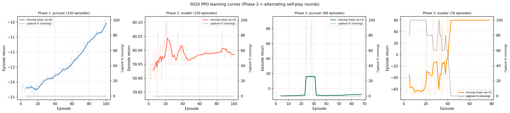
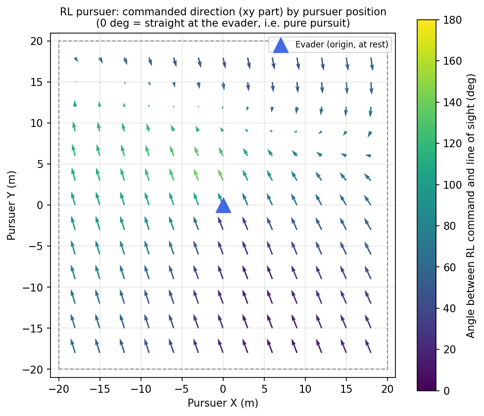
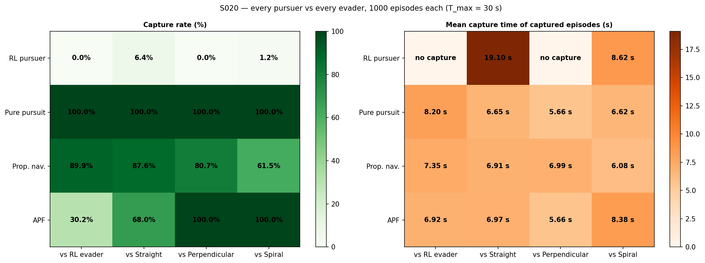
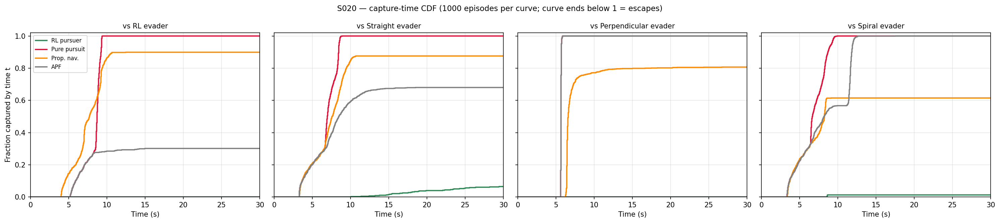
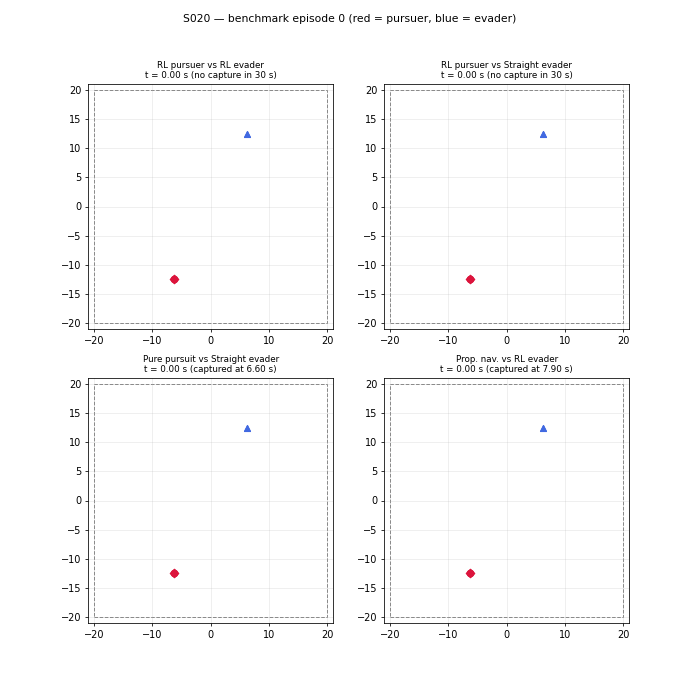

# S020 Pursuit-Evasion Game (RL Capstone)

**Domain**: Pursuit & Evasion | **Difficulty**: ⭐⭐⭐⭐⭐ | **Status**: ✅ Completed

---

## Problem Definition

**Setup**: A pursuer (5 m/s) and an evader (3.5 m/s) operate in a 3D arena, the cube [−20, 20]³ m. Each episode starts with them on opposite sides of a 14 m circle in the z = 0 plane, 28 m apart. Both are trained with Proximal Policy Optimisation (PPO) in a three-phase curriculum:
1. The pursuer trains against a random evader.
2. The evader trains against the frozen Phase-1 pursuer.
3. Self-play: pursuer and evader train in four alternating rounds, each against a frozen snapshot of the other's latest policy.

The trained policies are then benchmarked in a full grid: every pursuer (RL, pure pursuit, proportional navigation, artificial potential field) against every evader (RL, straight, perpendicular, spiral), 1000 seeded episodes per matchup, with the same spawn positions for every matchup.

**Key question**: Within a training budget that fits in a few minutes, does PPO produce pursuer or evader policies that compete with the classical strategies?

---

## Mathematical Model

### PPO Objective

$$L^{CLIP}(\theta) = \hat{\mathbb{E}}_t\!\left[\min\!\left(r_t(\theta)\hat{A}_t,\;\text{clip}(r_t(\theta),1-\varepsilon,1+\varepsilon)\hat{A}_t\right)\right], \quad r_t(\theta) = \frac{\pi_\theta(a_t|s_t)}{\pi_{\theta_{old}}(a_t|s_t)}$$

### Observation and Action

$$\mathbf{s} = [\mathbf{p}_P,\ \mathbf{v}_P,\ \mathbf{p}_E,\ \mathbf{v}_E,\ t_{remaining}] + \boldsymbol{\nu},\quad \boldsymbol{\nu} \sim \mathcal{N}(0, 0.1^2 I_{13})$$

Before entering the network, the observation is divided by fixed scales (positions by 20 m, velocities by 5 m/s, time by 30 s).

$$\mathbf{a} \in [-1, 1]^3, \quad \mathbf{v}_{cmd} = v_{max}\,\frac{\mathbf{a}}{\|\mathbf{a}\|}$$

### Reward (as on the card)

$$r_P = 0.01\,(d_{prev} - d) - 0.1\,\frac{\|\mathbf{a}\|}{v_{P}} + 100\cdot\mathbb{1}[\text{capture}]$$

$$r_E = 0.1 + 0.01\,(d - d_{prev}) - 100\cdot\mathbb{1}[\text{capture}]$$

There is no terminal reward when the evader survives to T_max.

### Hand-crafted strategies

- **Pure pursuit (PP)**: $\mathbf{v}_P = v_P\,\widehat{\mathbf{p}_E - \mathbf{p}_P}$.
- **Proportional navigation (PN)**: a constant-speed vehicle launched along the initial line of sight (LOS). Each step it applies $\mathbf{a} = N v_c \dot{\hat{\boldsymbol\lambda}}$, with $\dot{\hat{\boldsymbol\lambda}} = (\mathbf{v}_{rel} - (\mathbf{v}_{rel}\cdot\hat{\boldsymbol\lambda})\hat{\boldsymbol\lambda})/r$ and $v_c = -\mathbf{v}_{rel}\cdot\hat{\boldsymbol\lambda}$, then rescales the velocity to $v_P$; N = 3.
- **APF**: $\mathbf{v}_P \parallel \widehat{\mathbf{p}_E - \mathbf{p}_P} + \sum_{walls} \eta\left(\frac{1}{d} - \frac{1}{d_0}\right)\frac{1}{d^2}\,\hat{\mathbf{n}}$ for walls closer than $d_0$ = 2 m. η = 1/6, so the repulsion equals the attraction at 0.5 m from a wall: (1/6)(1/0.5 − 1/2)/0.5² = 1.
- **Straight evader**: fixed random horizontal heading. **Perpendicular evader**: perpendicular to the LOS in the horizontal plane. **Spiral evader**: heading rotating at 0.3 rad/s, independent of the pursuer.

All agents (RL and hand-crafted) act on the same noisy observation. Both move simultaneously; positions are clipped to the arena. Capture is detected when the closest approach within a step is below the capture radius.

---

## Key Parameters

| Parameter | Value |
|-----------|-------|
| Pursuer / evader speed | 5.0 / 3.5 m/s |
| Arena | [−20, 20]³ m |
| Spawn | opposite points of a 14 m circle (28 m apart), z = 0 |
| Capture radius | 0.3 m |
| Timestep / episode length | 0.05 s / 30 s (600 steps) |
| Observation noise σ | 0.1 on every observation component (training and benchmark, all agents) |
| PN gain N | 3 |
| APF wall influence d₀ / gain η | 2.0 m / 1/6 |
| Spiral evader heading rate | 0.3 rad/s |
| PPO learning rate / clip range / batch size | 3×10⁻⁴ / 0.2 / 256 |
| PPO rollout length (n_steps) | 512 |
| Network architecture | [256, 256] MLP |
| Phase 1 / Phase 2 timesteps | 60 416 / 60 416 (60 000 requested; SB3 rounds up to whole 512-step rollouts: 118 × 512) |
| Phase 3 | 4 rounds × 10 240 timesteps per agent (10 000 requested, rounded up to 20 × 512) = 40 960 per agent, 81 920 total |
| Training seed / benchmark seed | 0 (PPO seeds 1, 2) / 2024 |
| Benchmark episodes per matchup | 1000 |

---

## Implementation

```
src/01_pursuit_evasion/s020_pursuit_evasion_game.py
```

```bash
conda activate drones
python src/01_pursuit_evasion/s020_pursuit_evasion_game.py
```

Runtime ≈ 4 min (about 2.5 min of PPO training on one CPU thread, then 16 × 1000 vectorised benchmark episodes, a noise-free re-run of the 9 hand-crafted matchups, and a 122-frame GIF).

---

## Results

### Training

| Phase | Timesteps | Episodes | Captured (first 20% → last 20% of episodes) | Mean return (first 20% → last 20%) |
|-------|-----------|----------|---------------------------------------------|------------------------------------|
| 1: pursuer vs random evader | 60 416 | 100 | 0.0% → 0.0% | −14.39 → −10.60 |
| 2: evader vs Phase-1 pursuer | 60 416 | 100 | 0.0% → 0.0% | 59.96 → 59.99 |
| 3: pursuer (self-play rounds) | 40 960 | 68 | 0.0% → 0.0% | −9.70 → −7.90 |
| 3: evader (self-play rounds) | 40 960 | 78 | 93.3% → 0.0% | −54.08 → 60.13 |

### Benchmark (1000 episodes per matchup, σ = 0.1)

| Pursuer | Evader | Capture rate | Mean capture time (captured episodes) | Median |
|---------|--------|--------------|---------------------------------------|--------|
| RL | RL | 0.0% | no capture | > 30 s |
| RL | Straight | 6.4% | 19.10 s | > 30 s |
| RL | Perpendicular | 0.0% | no capture | > 30 s |
| RL | Spiral | 1.2% | 8.62 s | > 30 s |
| Pure pursuit | RL | 100.0% | 8.20 s | 8.70 s |
| Pure pursuit | Straight | 100.0% | 6.65 s | 6.95 s |
| Pure pursuit | Perpendicular | 100.0% | 5.66 s | 5.65 s |
| Pure pursuit | Spiral | 100.0% | 6.62 s | 6.65 s |
| Prop. nav. | RL | 89.9% | 7.35 s | 7.70 s |
| Prop. nav. | Straight | 87.6% | 6.91 s | 7.58 s |
| Prop. nav. | Perpendicular | 80.7% | 6.99 s | 6.60 s |
| Prop. nav. | Spiral | 61.5% | 6.08 s | 8.25 s |
| APF | RL | 30.2% | 6.92 s | > 30 s |
| APF | Straight | 68.0% | 6.97 s | 8.45 s |
| APF | Perpendicular | 100.0% | 5.66 s | 5.65 s |
| APF | Spiral | 100.0% | 8.38 s | 8.20 s |

Mean angle between the pursuer's command and the LOS: RL 93.0–99.0°, PP 1.8–2.5° (noise only), PN 45.5–75.4°, APF 1.8–52.7°.

**Escapes against the hand-crafted pursuers** (medians over the escaped episodes):

| Pursuer | Evader | Escapes | Closest approach | Final distance | Evader on a wall at the end |
|---------|--------|---------|------------------|----------------|-----------------------------|
| Prop. nav. | RL | 101 | 0.35 m | 43.11 m | 100% |
| Prop. nav. | Straight | 124 | 0.37 m | 41.47 m | 100% |
| Prop. nav. | Perpendicular | 193 | 0.38 m | 26.96 m | 58% |
| Prop. nav. | Spiral | 385 | 0.58 m | 30.86 m | 0% |
| APF | RL | 698 | 0.47 m | 0.85 m | 100% |
| APF | Straight | 320 | 0.47 m | 0.83 m | 100% |

**Wall contact before capture** (PP vs APF): perpendicular evader 0.0% / 0.0% of episodes. Spiral evader 59.1% / 59.4%, with mean capture time 5.02 / 5.00 s without wall contact and 7.74 / 10.68 s with it.

**Without observation noise** (same 1000 spawns): PP 100% / 100% / 100%, PN 100.0% / 91.6% / 81.3%, APF 34.8% / 100% / 100% (against straight / perpendicular / spiral).

**Key Findings**:
- **At this budget the RL pursuer did not learn to pursue.** It never captured anything in training: 0 of 100 Phase-1 episodes and 0 of 68 Phase-3 episodes. In the benchmark it captures 0–6.4% and steers 93–99° away from the LOS on average, essentially at random. The probe in the quiver plot (evader at rest at the origin) shows a mean angle of 66.7° to the LOS, with 0.523 of the speed on average in the vertical direction, which the evader never uses.
- **Why not: the card's reward gives almost no gradient before the first capture.** The effort penalty is up to 0.1·√3/5 = 0.035 per step, i.e. up to 20.8 over 600 steps. Because the velocity is normalised, |a| does not change the motion. The shaping term pays only 0.01 per metre closed, so closing the full 28 m earns 0.28. The Phase-1 return rose from −14.39 to −10.60, consistent with the policy shrinking |a| to cut the penalty rather than learning to close in. The +100 capture reward was never reached by exploration. Training is 100 + 68 pursuer episodes against the card's 5000 + 10000, about 1/90.
- **The RL evader learned something only in Phase 3.** In Phase 2 the frozen pursuer never caught it, so its return stayed at ≈ 0.1 × 600 = 60 with no signal (59.96 → 59.99). In Phase 3 the deterministic snapshot of the pursuer caught it in 93.3% of the first 20% of episodes and 0% of the last 20%: it learned to escape that pursuer. Against pure pursuit it is still caught every time, but takes the longest of the four evaders: 8.20 s mean, vs 6.65 s (straight), 5.66 s (perpendicular), 6.62 s (spiral). Against APF it survives in 69.8% of episodes, by ending on an arena wall (all 698 APF escapes).
- **Pure pursuit is the strongest pursuer here**: 100% capture against every evader, with or without noise. The evaders are 1.5 m/s slower and the arena is bounded, so none of them can outrun a direct chase.
- **PN misses, then flies away.** In its escapes it passes within a median 0.35–0.58 m of the evader, just outside the 0.3 m capture radius, and ends 27–43 m away. After a miss the closing speed v_c turns negative, so the PN command a = N v_c λ̇ steers away from the evader; plain PN has no re-engagement logic. Observation noise causes most of the misses against the straight evader (87.6% → 100% without noise). Against the perpendicular and spiral evaders PN misses even without noise (91.6%, 81.3%).
- **APF cannot reach an evader on a wall.** Its wall repulsion balances the attraction 0.5 m from the wall. Every APF escape ends with the evader on a wall and the pursuer a median 0.83–0.85 m away, so the closest approach of 0.47 m never gets below the 0.3 m capture radius. Against the perpendicular evader, which never touches a wall (0.0% of episodes), it behaves exactly like pure pursuit (identical 5.66 s). The spiral evader's 11.7 m circle reaches a wall before capture in 59.4% of APF episodes (59.1% for PP). Without wall contact APF matches PP (5.00 vs 5.02 s), but with wall contact it is much slower (10.68 vs 7.74 s): the wall repulsion holds it back while the evader slides along the wall. That is why its overall spiral mean is 8.38 s vs 6.62 s for PP, with a mean angle to the LOS of 14.3° vs 2.4°. It still captures every spiral evader, because the circle carries the evader off the wall again. Noise actually helps it against the straight evader: 68.0% with noise vs 34.8% without.
- **Does RL rediscover proportional navigation?** No. The trained pursuer does not even reproduce pure pursuit.
- The previous README's table (e.g. "RL pursuer 100% vs RL evader", "PN 65.3% / exploitable") came from an older arena size and from a PN that started from rest without forward speed. Its APF row was pure pursuit under another name. None of it applies to this version.

**Learning curves** (episode return and moving capture %, per phase; Phase 3 = alternating rounds):



**Policy quiver plot** (RL pursuer command, xy part, colour = angle to the LOS; evader at rest at the origin):



**Performance comparison** (capture rate and mean capture time, every pursuer vs every evader):



**Capture-time CDF** (one panel per evader; a curve ending below 1 = escapes):



**Animation** (benchmark episode 0 of four matchups; red = pursuer, blue = evader):



### Deviations from the scenario card

| Card | Code | Reason |
|------|------|--------|
| Arena [−5, 5]³ m, capture radius 0.15 m | [−20, 20]³ m, 0.3 m, spawn 28 m apart | With ±5 m the pursuer could cross the arena 15 times in T_max; kept from the previous revision |
| 5000 / 5000 / 10000 training episodes | 60 416 / 60 416 / 81 920 timesteps (`model.num_timesteps`) = 100 / 100 / 68 + 78 episodes | Runtime limit (≤ ~5 min). 346 vs 20 000 episodes, about 1/60 of the card; the RL pursuer did not learn at this budget (see findings) |
| Phase 2: evader vs frozen Phase-1 pursuer | Same | Previous code used pure pursuit instead |
| Phase 3: both train simultaneously | Four alternating rounds, each agent against a frozen snapshot of the other | Simplest stable self-play with single-agent PPO |
| Observation noise σ = 0.1 m | σ = 0.1 on all 13 components; in training and benchmark; for RL and hand-crafted agents | The previous code trained with noise but benchmarked without it |
| Raw observation | Divided by fixed scales before the network | Standard input normalisation; no information added |
| Reward as on the card | Same | The previous README showed a different formula (−100 on escape, unscaled Δd) |
| Benchmark: RL pursuer vs PP, PN, APF; RL evader vs straight, perpendicular, spiral | Full 4 × 4 grid, 1000 episodes each | Every pursuer meets every evader under identical spawns |
| APF (not specified) | Attraction + repulsion from the arena walls (no obstacles in this arena) | The previous "APF" was identical to pure pursuit |
| PN (not specified) | Constant speed, launched along the LOS, lateral PN turn | The previous PN started from rest and had no forward term |
| Spiral evader (not specified) | Heading rotating at 0.3 rad/s (circle of radius 3.5 / 0.3 = 11.7 m) | Kept from the previous revision |
| Hypotheses: RL finds strategies beyond PP/APF and beyond straight/perpendicular escape; co-evolution | Not met for the pursuer; the evader learned to escape the deterministic RL pursuer only | Reported as measured |
| Mean time over 0%-capture rows | Reported as "no capture"; mean times are over captured episodes only | The previous table showed a placeholder 30.00 s |

---

## Extensions

1. Increase the training budget (or vectorise the training environment) and re-test whether the RL pursuer learns to pursue
2. Reward design: drop the effort penalty on the normalised action, or scale the shaping term so closing distance outweighs it
3. Domain randomisation over evader strategies during Phase 1 to prevent overfitting
4. Multi-agent self-play with population-based training (PBT) for Nash equilibrium convergence

---

## Related Scenarios

- Prerequisites: [S009 Differential Game 1v1 (Differential Game — Lion & Man)](../../../scenarios/01_pursuit_evasion/S009_differential_game.md), [S016 Airspace Defense](../../../scenarios/01_pursuit_evasion/S016_airspace_defense.md)
- This is the capstone of Domain 1 — next domain: [S021 Point Delivery](../../../scenarios/02_logistics_delivery/S021_point_delivery.md)
