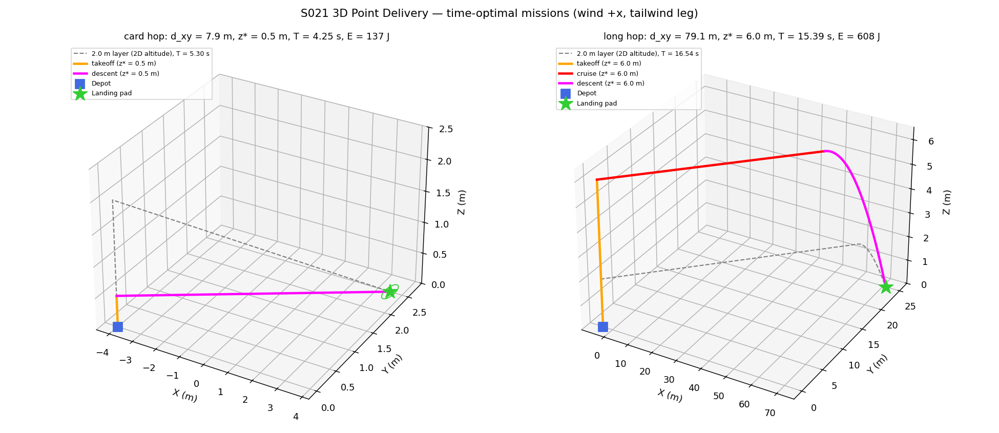
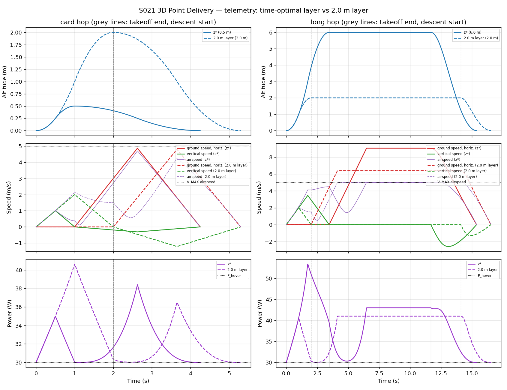
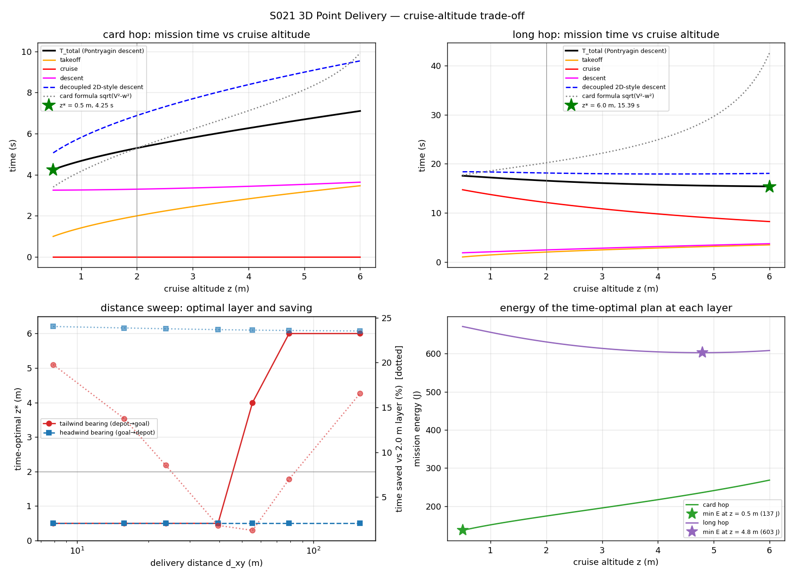
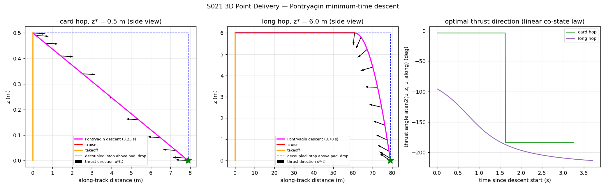
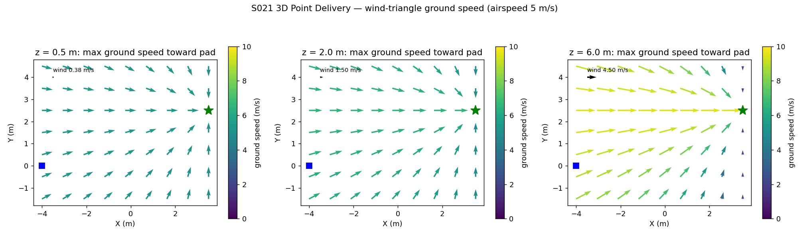
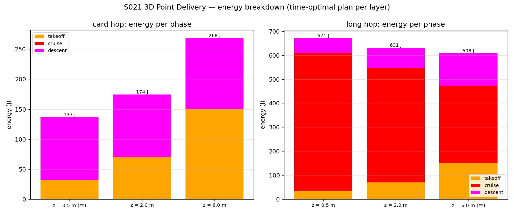
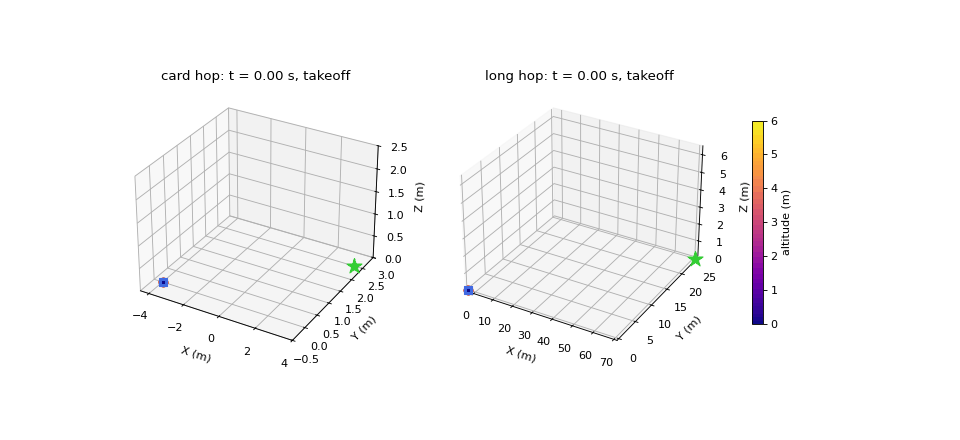

# S021 3D Point Delivery

**Domain**: Logistics & Delivery | **Difficulty**: ⭐⭐ | **Status**: ✅ Completed

---

## Problem Definition

**Setup**: A delivery drone takes off from a ground depot at (−4.0, 0.0, 0.0) m and must land softly on a ground pad at (3.5, 2.5, 0.0) m (horizontal distance 7.906 m). The 2D S021 starts already at a fixed 2.0 m cruise layer and drops vertically. Here the whole mission is flown in 3D:

| Phase | Model |
|-------|-------|
| **Takeoff** | vertical bang-bang climb from z = 0 to the cruise layer, $\|u_z\| \le a_{z,max}$ |
| **Cruise** | level flight along the depot→pad bearing; horizontal acceleration $\le a_{max}$, ground speed capped by the wind triangle (airspeed $\le v_{max}$) |
| **Descent** | Pontryagin minimum-time 3D transfer to the pad with $\|\mathbf{u}\| \le a_{max}$ and zero touchdown velocity, started at the cruise instant that minimises total time |
| **Land** | touchdown check: within $r_{land}$, $z \le 0.05$ m, speed $< v_{land,max}$ |

The wind blows along +x and grows linearly with altitude, so it is mostly a **tailwind** on the depot→pad bearing. The cruise layer $z_{cruise}$ is chosen on the card's 56-point grid (0.5–6.0 m) to minimise total mission time.

**Key question (from the card)**: is there a cruise altitude that trades a longer climb against a faster, wind-assisted cruise?

To test that question properly, the same optimisation is also run on:

- a **long hop** that is 10× the card distance on the same bearing (79.057 m);
- the **reverse bearing** (headwind);
- a **distance sweep** from 1× to 20× the card distance.

Every layer is compared against two baselines: the **2D 2.0 m layer** flown through the same pipeline, and a **decoupled 2D-style descent** (stop above the pad, then drop vertically). The model is deterministic (no random numbers), so no Monte-Carlo is needed.

---

## Mathematical Model

### Wind, drag and power

$$v_{wind}(z) = v_{wind,0}\,\frac{z}{z_{ref}}\ (\text{along } +x), \qquad k_{drag}(z) = k_0\,(1 + \alpha_z z)$$

$$P = P_{hover} + k_{drag}(z)\,\|\mathbf{v} - \mathbf{v}_{wind}(z)\|^3 + m g\,\max(\dot z, 0), \qquad E = \int P\,dt$$

### Wind-triangle ground speed (corrected from the card)

With $\hat{\mathbf d}$ the unit bearing, $w_\parallel = \mathbf w\cdot\hat{\mathbf d}$ and $w_\perp = \|\mathbf w - w_\parallel\hat{\mathbf d}\|$, the fastest ground speed along $\hat{\mathbf d}$ with airspeed $v_{max}$ is

$$v_{gnd}(z) = w_\parallel + \sqrt{v_{max}^2 - w_\perp^2}$$

The card's $\sqrt{v_{max}^2 - v_{wind}^2}$ ignores the wind direction and treats a tailwind as a penalty. For the card bearing, $\hat{\mathbf d} = (0.9487, 0.3162)$, so the tailwind leg gets 5.354 / 6.400 / 9.062 m/s at z = 0.5 / 2.0 / 6.0 m. The card's formula gives 4.986 / 4.770 / 2.179 m/s instead.

### Takeoff (bang-bang)

$$T_{takeoff} = 2\sqrt{z_{cruise}/a_{z,max}}$$

(The card's formula is correct.)

### Pontryagin minimum-time descent

The dynamics are $\ddot{\mathbf p} = \mathbf u$ with $\|\mathbf u\| \le a_{max}$. Minimising $H = 1 + \boldsymbol\lambda_p^\top\dot{\mathbf p} + \boldsymbol\lambda_v^\top\mathbf u$ gives

$$\mathbf u^*(t) = -a_{max}\,\frac{\boldsymbol\lambda_v(t)}{\|\boldsymbol\lambda_v(t)\|}, \qquad \boldsymbol\lambda_v(t) = \mathbf c - \mathbf b\,t$$

The initial velocity and the remaining displacement both lie in the vertical plane through the bearing, so the cross-track co-state is zero and the problem is planar (along-track, z). Writing $\boldsymbol\lambda_v = \sigma\hat{\mathbf e} + \mathbf c_\perp$ with $\sigma = \mathbf c\cdot\hat{\mathbf e} - \|\mathbf b\|t$ and $q = \|\mathbf c_\perp\|$, the velocity and position integrals are closed-form:

- $\int \sigma/\sqrt{\sigma^2+q^2}\,d\sigma = \sqrt{\sigma^2+q^2}$
- $\int d\sigma/\sqrt{\sigma^2+q^2} = \operatorname{asinh}(\sigma/q)$

Shooting therefore solves 4 equations ($a(T) = s$, $z(T) = 0$, $\dot a(T) = \dot z(T) = 0$) in 4 unknowns (direction of $\mathbf c$, $\mathbf b$, $T$) with no integration error.

### Mission time

The descent starts $\tau$ seconds into the cruise. The cruise accelerates at $a_{max}$ up to $v_{gnd}(z)$ and then holds that speed. The total mission time is

$$T_{total}(z) = 2\sqrt{z/a_{z,max}} + \min_{\tau}\big[\tau + T_3(z, \tau)\big]$$

The minimum is taken over descent starts whose whole descent keeps the 3D airspeed $\le v_{max}$. The search uses 21 candidate starts within 30 m of the pad and 6 spread over the leg, then a bounded 1D refinement around the best one, pulled back to the airspeed-feasibility boundary if needed. Then

$$z^* = \arg\min_{z} T_{total}(z)$$

### Baselines

- **Decoupled 2D-style descent**: level flight that stops above the pad (bang-bang, capped at $v_{gnd}$), then a vertical bang-bang drop. Its time is $T = 2\sqrt{z/a_{z,max}} + T_h + 2\sqrt{z/a_{max}}$.
- **Card-literal formula**: $2\sqrt{z/a_{z,max}} + d_{xy}/\sqrt{v_{max}^2 - w^2} + 2\sqrt{z/a_{max}}$. This is shown only to compare the card's own model.

### Invariants asserted in the code

For all 112 logged missions the code asserts:

- z ≥ 0 and z ≤ 8 m;
- 3D airspeed ≤ 5 m/s;
- the acceleration bound of each phase;
- the landing condition (radius, height, speed).

Shooting solutions are accepted only if the terminal residual is below 1e-8.

---

## Key Parameters

| Parameter | Value | Source |
|-----------|-------|--------|
| Depot / pad | (−4.0, 0.0, 0.0) / (3.5, 2.5, 0.0) m, $d_{xy}$ = 7.906 m | card |
| Max airspeed $v_{max}$ | 5.0 m/s (3D, relative to the air) | card ("max horizontal speed"), reinterpreted |
| Takeoff vertical acceleration $a_{z,max}$ | 2.0 m/s² | card |
| 3D acceleration bound $a_{max}$ | 3.0 m/s² (descent, and cruise acceleration) | card (descent); cruise use added |
| Cruise-altitude grid | 0.5–6.0 m, 56 points (0.1 m) | card |
| Flight envelope | 0 ≤ z ≤ 8.0 m ($z_{min}$ = 0.5 m applies to the cruise layer) | card |
| Landing: $r_{land}$, touchdown height, $v_{land,max}$ | 0.20 m, 0.05 m, 0.3 m/s | card |
| Log rate | 48 Hz (Δt = 1/48 s) | card |
| $P_{hover}$ | 30 W | card |
| $k_0$, $\alpha_z$ | 0.08 kg/m, 0.05 1/m | card |
| $v_{wind,0}$ at $z_{ref}$ | 1.5 m/s at 2.0 m, along +x | card |
| Mass $m$, $g$ | 0.5 kg, 9.81 m/s² | card |
| 2D baseline layer | 2.0 m | 2D S021 (added) |
| Long hop | 10× card distance on the same bearing: pad at (71.0, 25.0, 0.0) m, 79.057 m | added |
| Distance sweep | factors 1, 2, 3, 5, 7, 10, 20 on both bearings; 12-point (0.5 m) altitude grid | added |
| Descent-start grid | 21 points within 30 m of the pad, plus 6 points over the whole leg, then a bounded refinement | added |
| Energy quadrature | 4 midpoint substeps per 1/48 s step | added |
| Direct-method cross-check | 30 piecewise-constant segments, SLSQP | added |

### Deviations from the scenario card

| Card | Implementation | Reason |
|------|----------------|--------|
| $v_{gnd} = \sqrt{v_{max}^2 - v_{wind}^2}$ and a cruise command $v_{max}\hat{\mathbf d} - v_{wind}\hat{\mathbf x}$ | wind triangle $v_{gnd} = w_\parallel + \sqrt{v_{max}^2 - w_\perp^2}$ with airspeed exactly $v_{max}$ | The card's formula is direction-blind: it slows a tailwind leg. Its command also has airspeed above $v_{max}$. The card is corrected. |
| $v_{max}$ = "max horizontal speed" | cap on the 3D **airspeed**, checked in every phase | The wind can only change ground speed if $v_{max}$ is an air-relative limit. |
| Cruise is velocity-controlled (instantaneous jump to $v_{gnd}$) | cruise accelerates at $a_{max}$ = 3 m/s² up to $v_{gnd}$ | An instantaneous velocity jump is free kinetic energy that the optimiser would exploit. It is also inconsistent with the 3 m/s² descent bound. |
| Cruise to the waypoint above the pad, then descend; $T_{total} = T_{to} + d_{xy}/v_{gnd} + T_3$ | the descent start $\tau$ is optimised; $T_{total} = T_{to} + \tau + T_3(\tau)$ | A descent that starts from cruise speed directly above the pad must overshoot and come back. |
| Descent ignores wind | the descent dynamics still ignore wind (as in the card), but descent starts whose airspeed exceeds $v_{max}$ are rejected | physical sanity; no layer in any run was infeasible |
| 6-state shooting | planar 4-unknown shooting with closed-form linear-tangent integrals | exact because the cross-track co-state is zero; verified by the direct-method cross-check |
| Euler integration at 48 Hz | exact closed-form states for every phase, sampled at 48 Hz | no integration drift. The landing error is therefore 0.000 mm by construction and is only a check, not a metric. |
| Altitude bounds [0.5, 8.0] m | $z_{min}$ = 0.5 m applies to the cruise layer; the flight envelope is [0, 8] m | Takeoff and landing are at z = 0. The card is clarified. |
| Expected output: "less wind drag at high altitudes" | drag is *higher* at altitude ($k_{drag}$ grows with z, and cruise airspeed is always 5 m/s); the high-altitude benefit is tailwind ground speed | card statement wrong; the card is corrected |
| Card hop only | added long hop (10×), reverse bearing and a distance sweep | For the card hop, every layer has a zero-length cruise, so the card's trade-off cannot appear there (see results). |
| Wind-field slice at $z^*$ | slices at 0.5, 2.0 and 6.0 m (the $z^*$ of both hops, plus the 2D layer) | contrast |
| Four phases with a green landing star | the card hop has no cruise phase in any layer, so its plot shows takeoff and descent only | result of the optimisation, not a code choice |

---

## Simulation Results

Both runs printed byte-identical output, and every output file was byte-identical (SHA-256).

### Card hop (7.906 m, tailwind bearing)

| Layer | $T_{total}$ | Takeoff | Cruise | Descent | Energy | Max airspeed |
|-------|------------|---------|--------|---------|--------|--------------|
| **z\* = 0.5 m** | **4.250 s** | 1.000 s | 0.000 s | 3.250 s | **136.57 J** | 4.690 m/s |
| 2.0 m (2D layer) | 5.297 s | 2.000 s | 0.000 s | 3.297 s | 174.25 J | 4.265 m/s |
| Decoupled descent at 0.5 m | 5.063 s | 1.000 s | 3.247 s level | 0.816 s vertical | — | — |

| z (m) | 0.5 | 1.0 | 2.0 | 3.0 | 4.0 | 5.0 | 6.0 |
|---|---|---|---|---|---|---|---|
| $T_{total}$ (s) | 4.250 | 4.674 | 5.297 | 5.807 | 6.265 | 6.694 | 7.102 |
| Energy (J) | 136.6 | 151.1 | 174.3 | 195.4 | 217.1 | 240.9 | 268.4 |
| Decoupled (s) | 5.063 | 5.816 | 6.880 | 7.696 | 8.385 | 8.991 | 9.539 |

Energy at z\* breaks down as follows:

- by phase: takeoff 32.48 J, descent 104.09 J;
- by term: hover 127.50 J, drag 6.62 J, climb 2.45 J.

Landing error is 0.000 mm and touchdown speed 0.000 mm/s (by construction).

### Long hop (79.057 m, tailwind bearing)

| Layer | $T_{total}$ | Takeoff | Cruise | Descent | Descent start | Energy |
|-------|------------|---------|--------|---------|---------------|--------|
| **z\* = 6.0 m** | **15.385 s** | 3.464 s | 8.217 s | 3.704 s | 18.277 m before the pad at 9.062 m/s | 608.17 J |
| 2.0 m (2D layer) | 16.543 s | 2.000 s | 12.103 s | 2.439 s | 8.418 m before the pad at 6.400 m/s | 630.68 J |
| Decoupled descent at 6.0 m | 18.037 s | 3.464 s | 11.744 s level | 2.828 s vertical | — | — |

| z (m) | 0.5 | 1.0 | 2.0 | 3.0 | 4.0 | 5.0 | 6.0 |
|---|---|---|---|---|---|---|---|
| $T_{total}$ (s) | 17.556 | 17.193 | 16.543 | 16.062 | 15.728 | 15.511 | 15.385 |
| Energy (J) | 671.2 | 656.0 | 630.7 | 613.8 | 604.6 | 602.7 | 608.2 |
| Decoupled (s) | 18.366 | 18.326 | 18.118 | 17.971 | 17.917 | 17.944 | 18.037 |

Energy at z\* breaks down as follows:

- by phase: takeoff 149.53 J, cruise 323.97 J, descent 134.67 J;
- by term: hover 461.56 J, drag 117.19 J, climb 29.43 J.

The maximum airspeed is 5.000 m/s, reached at the cap during the cruise.

### Distance sweep (12-point altitude grid)

| Distance factor | $d_{xy}$ (m) | Tailwind z\* | Tailwind T\* / T(2.0 m) | Tailwind saving | Headwind z\* | Headwind T\* / T(2.0 m) | Headwind saving |
|---|---|---|---|---|---|---|---|
| 1 | 7.91 | 0.5 | 4.250 / 5.297 s | 19.8 % | 0.5 | 4.261 / 5.607 s | 24.0 % |
| 2 | 15.81 | 0.5 | 5.744 / 6.661 s | 13.8 % | 0.5 | 5.963 / 7.831 s | 23.9 % |
| 3 | 23.72 | 0.5 | 7.221 / 7.896 s | 8.6 % | 0.5 | 7.666 / 10.055 s | 23.8 % |
| 5 | 39.53 | 0.5 | 10.174 / 10.367 s | 1.9 % | 0.5 | 11.072 / 14.504 s | 23.7 % |
| 7 | 55.34 | **4.0** | 12.670 / 12.837 s | 1.3 % | 0.5 | 14.477 / 18.952 s | 23.6 % |
| 10 | 79.06 | 6.0 | 15.385 / 16.543 s | 7.0 % | 0.5 | 19.586 / 25.625 s | 23.6 % |
| 20 | 158.11 | 6.0 | 24.109 / 28.894 s | 16.6 % | 0.5 | 36.613 / 47.866 s | 23.5 % |

At the 7× tailwind distance, T(z) for z = 0.5 … 6.0 m is 13.127, 13.036, 12.930, 12.837, 12.765, 12.714, 12.683, **12.670**, 12.674, 12.693, 12.725 and 12.768 s. No layer was infeasible in any sweep.

### Solver checks

- **Shooting vs the direct method** (30 piecewise-constant segments): card hop T₃ = 3.2499 vs 3.2499 s; long hop 3.7038 vs 3.7042 s. The direct method is slightly slower because its control is piecewise-constant.
- **Card hop from rest at 0.5 m**: the analytic straight-line bang-bang time $2\sqrt{D/a_{max}}$ is 3.2499 s, identical to the shooting result.
- 15228 shooting solves were warm-started and 20 needed a multistart.

### Key findings

- **The card's altitude trade-off does not exist for the card's own mission.** For the 7.9 m hop, $T_{total}(z)$ increases monotonically, and the time-optimal layer sits on the grid's lower bound, z\* = 0.5 m. Flying low saves 1.048 s (19.8 %) and 37.68 J compared with the 2D 2.0 m layer.
- **Why there is no cruise on the card hop.** None of the 56 layers has a cruise phase: the optimum starts the descent the instant the climb ends. A level cruise at $a_{max}$ is one of the controls the minimum-time transfer may already use, so it can never beat the transfer, unless the airspeed cap binds. It never binds on this short hop: the peak airspeed is 4.690 m/s at z\*.
- **The wind has no effect on the card-hop time.** It only lowers the airspeed, and so the drag power.
- **The card hop's descent is straight.** It is a rest-to-rest straight-line bang-bang (thrust along the straight line, then flipped by 180° at mid-time), not the curved descent the card expects.
- **The trade-off appears only on long tailwind legs, and it is mostly bang-bang.** The cruise term $d_{xy}/v_{gnd}(z)$ grows with distance, and $v_{gnd}$ rises with z (9.062 m/s at 6 m vs 6.400 m/s at 2 m). The optimum therefore jumps from 0.5 m (≤ 39.5 m) to 6.0 m (≥ 79 m).
- **Why the optimum is rarely interior.** The takeoff time $2\sqrt{z/a_{z,max}}$ is *concave* in z, so an interior minimum needs a convex cruise gain that balances it closely. That happens only near the switch: at 7× the optimum is 4.0 m, on a very flat curve (12.670 s vs 12.768 s at 6 m).
- **On the headwind bearing the lowest layer always wins** (z\* = 0.5 m at every distance). The wind there only costs ground speed (0.524 m/s at 6 m).
- **The card's own formula picks 0.5 m even for the long tailwind hop.** It treats the tailwind as a penalty, so it would choose the wrong layer: 0.5 m instead of 6.0 m (17.556 s instead of 15.385 s).
- **Where drag matters: energy, not time.** On the long hop the energy-optimal layer is 4.8 m (602.55 J), not the time-optimal 6.0 m (608.17 J).
  - Above 4.8 m, the extra drag power ($k_{drag}$ grows with z at a fixed 5 m/s cruise airspeed) and the climb energy $mgz$ outweigh the hover energy saved by the shorter flight.
  - On the card hop, time and energy agree (both at 0.5 m).
- **The Pontryagin descent gives the real 3D gain.** Blending braking and descent saves 0.813 s on the card hop (4.250 vs 5.063 s) and 2.652 s on the long hop (15.385 vs 18.037 s) compared with the decoupled stop-then-drop.
  - On the long hop the descent is genuinely curved. It starts 18.277 m before the pad at 9.062 m/s, with the thrust first pointing almost straight down (right panel of the descent figure). The thrust then rotates continuously to brake and finally pushes back-and-up, following the linear co-state law.
  - Because the decoupled descent penalises altitude more, its best layer on the long hop is an interior 4.1 m (17.916 s), while the Pontryagin optimum stays at 6.0 m.
- **Comparison with 2D.** The 2D S021 reports 2.917 s, but it starts already at 2 m and changes velocity instantaneously. The full ground-to-ground 3D mission at the same 2.0 m layer takes 5.297 s, and the time-optimal 3D mission takes 4.250 s.

---

## Output Files

### 3D Trajectories

Time-optimal missions for both hops. Phases: takeoff in orange, cruise in red, descent in magenta. The depot is the blue square and the pad the green star. The grey dashed line is the same mission flown on the 2D 2.0 m layer.

### Telemetry

Altitude, speeds (horizontal ground speed, vertical speed, airspeed against the 5 m/s cap) and power over time. Solid lines are z\*, dashed lines the 2.0 m layer. Grey vertical lines mark the end of takeoff and the start of the descent.

### Cruise-Altitude Trade-off

- Top: $T_{total}(z)$ split into takeoff, cruise and descent, with the decoupled baseline and the card-literal formula; the star marks z\*.
- Bottom left: optimal layer vs distance on both bearings. The dotted lines (right axis) show the % saving against the 2.0 m layer.
- Bottom right: mission energy vs layer.

### Pontryagin Descent

Side views of the descent. The arrows show the optimal thrust direction, and the blue dashed line is the decoupled stop-then-drop path. The right panel shows the unwrapped thrust angle over time: a single 180° flip for the card hop's rest-to-rest transfer, and a smooth rotation for the long hop.

### Wind-Triangle Ground-Speed Field

The maximum ground-speed vector toward the pad from each point at z = 0.5, 2.0 and 6.0 m, coloured by magnitude. The black arrow is the wind.

### Energy Breakdown

Energy per phase for the time-optimal plan at z = 0.5, 2.0 and 6.0 m on both hops.

### Animation

Both time-optimal missions side by side. The trail is coloured by altitude. There are 186 frames: every 4th of 740 logged samples, at 15 fps. The card hop holds at the pad after landing at 4.25 s.

---

## Extensions

1. Allow a curved takeoff that climbs while moving (relax the vertical-climb phase). On the card hop this removes most of the altitude penalty.
2. Add the airspeed cap as a state constraint inside the optimal-control problem, instead of rejecting infeasible descent starts.
3. Include wind and drag in the descent dynamics, and add thrust-limited airspeed $v_{max}(z) \propto 1/\sqrt{k_{drag}(z)}$ so that drag also affects time.
4. Find the time–energy Pareto front over $z_{cruise}$ for the long hop (the time optimum is 6.0 m, the energy optimum 4.8 m).
5. Add stochastic (Dryden) gusts and pick the layer that minimises expected time over a Monte-Carlo.

---

## Related Scenarios

- Base 2D version: [S021 Point Delivery](../../../../scenarios/02_logistics_delivery/S021_point_delivery.md)
- 3D card: [S021 3D Upgrade — Point Delivery](../../../../scenarios/02_logistics_delivery/3d/S021_3d_point_delivery.md)
- Follow-ups: [S022 Obstacle Avoidance Delivery](../../../../scenarios/02_logistics_delivery/S022_obstacle_avoidance_delivery.md), [S023 Moving Landing Pad](../../../../scenarios/02_logistics_delivery/S023_moving_landing_pad.md)
- Wind: [S024 Wind Compensation](../../../../scenarios/02_logistics_delivery/S024_wind_compensation.md), [S024 3D Upgrade — Wind Compensation](../../../../scenarios/02_logistics_delivery/3d/S024_3d_wind_compensation.md)
