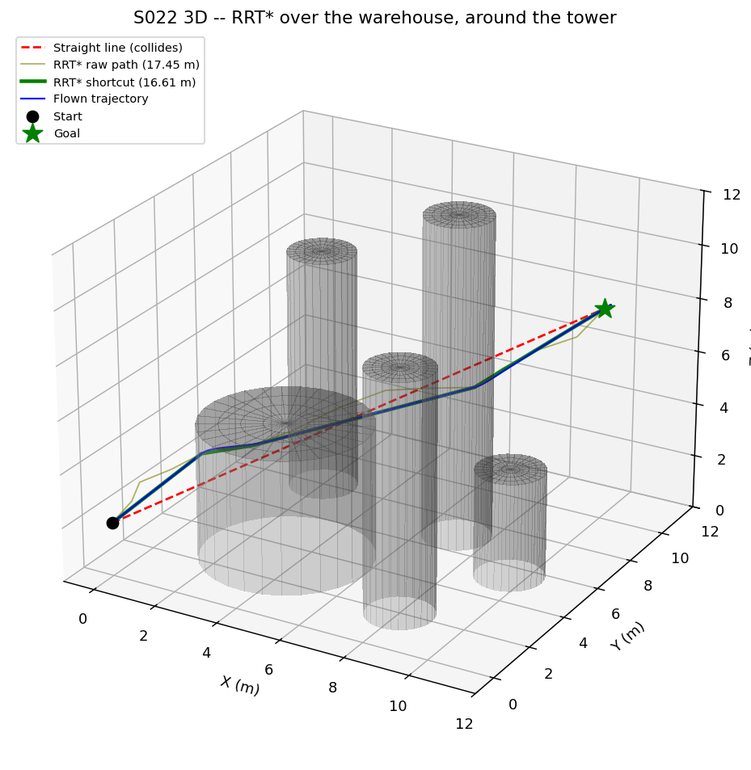
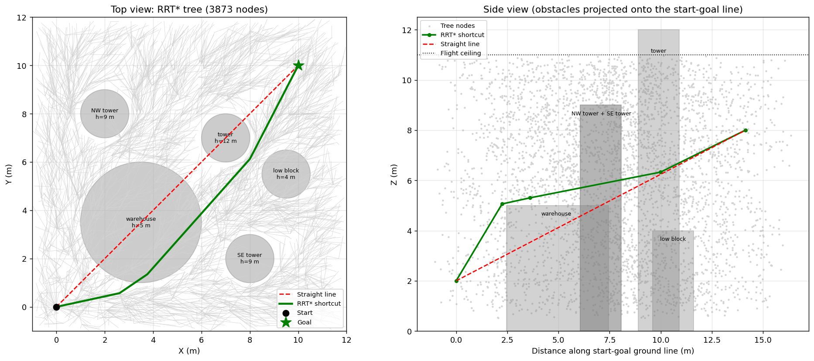
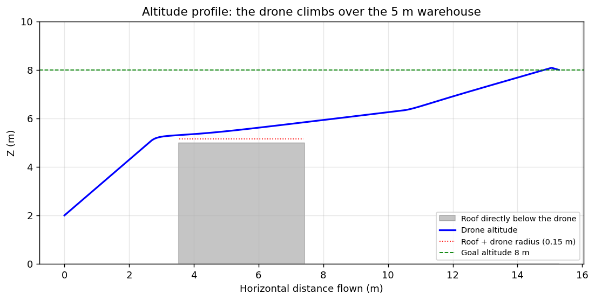
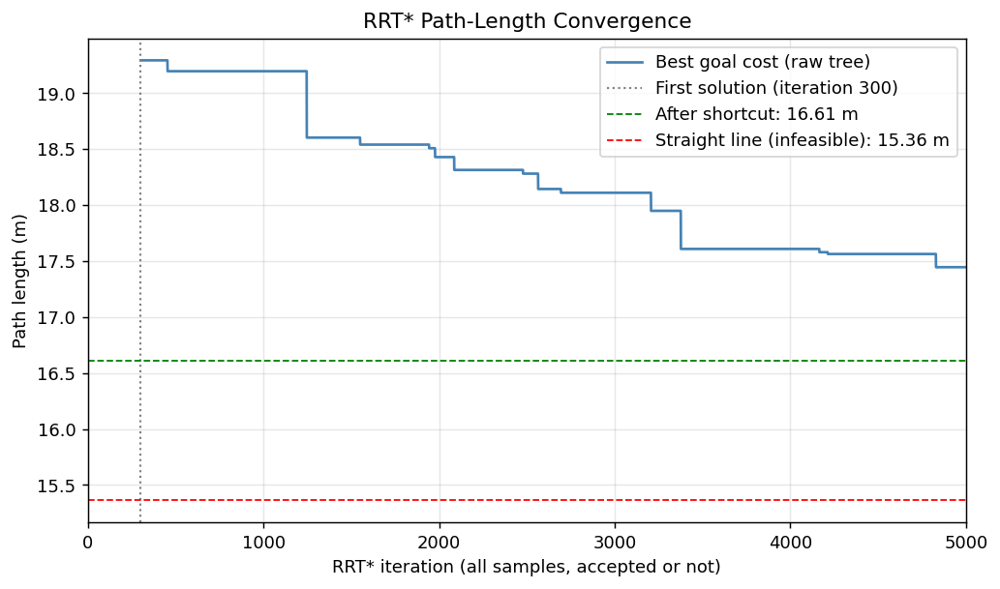
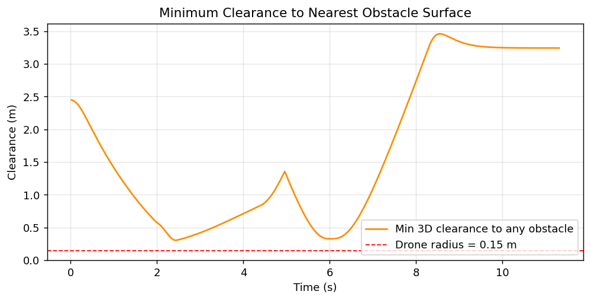
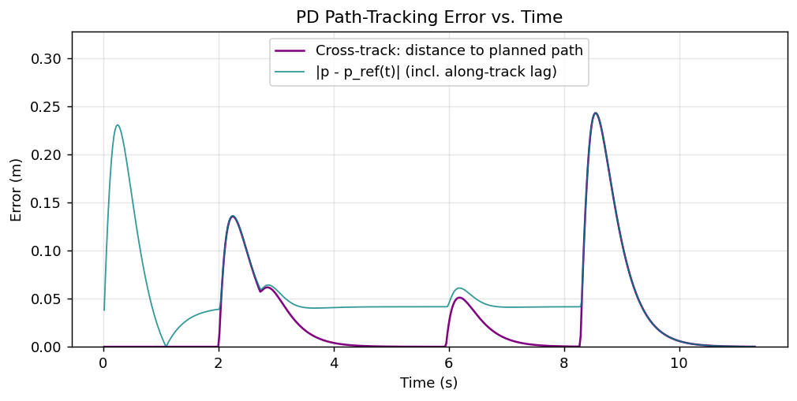
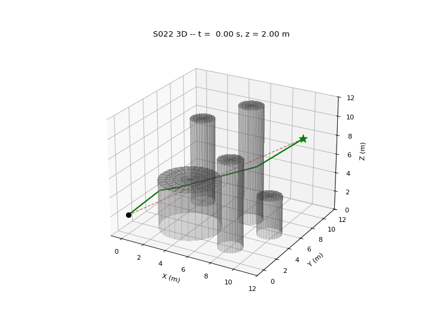

# S022 3D Obstacle Avoidance Delivery

**Domain**: Logistics & Delivery | **Status**: ✅ Completed

---

## Problem Definition

**Setup**: A delivery drone flies from a depot at (0, 0, 2) m to an elevated drop zone at (10, 10, 8) m (the card's start and goal) through five finite-height cylindrical buildings. Two of them block the direct line:

- a wide, low **warehouse** (r = 2.5 m, h = 5 m) that is cheaper to fly **over** than around;
- a **tower** (h = 12 m) taller than the 11 m flight ceiling, which can only be flown **around**.

The planner works in full (x, y, z), so it has to trade climbing against lateral detours.

**Objective**: Find a collision-free, near-shortest 3D path with RRT* (5000 iterations, 0.5 m step, 0.5 m goal tolerance), shorten it with a greedy shortcut pass, and fly it with a PD controller.

---

## Mathematical Model Summary

**Collision model.** Each obstacle is a vertical cylinder $(c_x, c_y, r, h)$ inflated by the drone radius $r_d$ in both directions. A segment $\mathbf{q}_a\mathbf{q}_b$ collides when the part of it with $z \le h + r_d$ comes within $r + r_d$ of the cylinder axis horizontally. The segment is clipped at $z = h + r_d$ first, so a segment that climbs over a roof is accepted once it is high enough.

**RRT\*.** The planner uses these steps:

- Steering: $\mathbf{q}_{new} = \mathbf{q}_{nearest} + \min(\eta, d)\,\hat{\mathbf{u}}$.
- Near radius: $r_n = \min\!\left(\gamma (\log n / n)^{1/3},\ R_{max}\right)$.
- Choose-parent and rewire use the Euclidean cost.
- After every rewire, the cost change is **propagated to the whole subtree**, so every node's stored cost equals its true cost-to-root. The script asserts this; the maximum error is $7\times10^{-15}$ m.

A tree node within the goal tolerance that has a free edge to the goal becomes a goal candidate. The best goal cost is recorded after **every** iteration, including rejected samples.

**PD tracking.** A reference point moves along the shortcut path at $v_{ref}$ with unit tangent $\hat{\mathbf{t}}$:
$$\mathbf{a} = K_p(\mathbf{p}_{ref}(t) - \mathbf{p}) + K_d(v_{ref}\hat{\mathbf{t}} - \mathbf{v}),\quad \|\mathbf{a}\| \le a_{max}$$

**Tracking metric.** The cross-track error is the distance from the drone to the planned polyline, $e_\perp(t) = \min_{\mathbf{x}\in\text{path}}\|\mathbf{p}(t) - \mathbf{x}\|$. The time-indexed error $\|\mathbf{p} - \mathbf{p}_{ref}(t)\|$ is also reported; it adds the along-track lag to the cross-track error.

**Clearance.** Clearance is the 3D distance to the cylinder surface: $\sqrt{\max(0,\rho - r)^2 + \max(0, z - h)^2}$, where $\rho$ is the horizontal distance to the axis.

---

## Key Parameters

| Parameter | Value |
|-----------|-------|
| Start / goal | (0, 0, 2) m / (10, 10, 8) m |
| Straight-line distance | 15.36 m |
| Sampling volume | x, y ∈ [-1, 12] m, z ∈ [0.5, 11] m (ceiling 11 m) |
| Obstacles (cx, cy, r, h) | warehouse (3.5, 3.5, 2.5, 5); tower (7, 7, 1, 12); NW tower (2, 8, 1, 9); SE tower (8, 2, 1, 9); low block (9.5, 5.5, 1, 4) |
| Max RRT* iterations | 5000 |
| Step size η | 0.5 m |
| Goal tolerance | 0.5 m |
| γ_RRT* / near-radius cap R_max | 12.0 / 1.5 m |
| Goal sampling bias | 10 % |
| Drone radius r_d | 0.15 m |
| Reference speed v_ref | 2.0 m/s |
| PD gains K_p / K_d | 16 s⁻² / 8 s⁻¹ (critically damped) |
| Acceleration limit a_max | 8 m/s² |
| Settling time after the reference ends | 3.0 s |
| Control rate | 48 Hz |
| Random seed | 0 (`np.random.default_rng`) |

### Deviations from the scenario card

| Item | Card | Code | Reason |
|------|------|------|--------|
| Obstacle layout | "finite-height cylinders, some shorter than the goal altitude" (no layout given) | 5 cylinders as in the table above | designed so that the direct line is blocked by one obstacle that is worth overflying and one that is too tall to overfly; both 3D behaviours are exercised |
| Near radius | not specified (2D card caps it at η) | $\min(\gamma(\log n/n)^{1/3}, 1.5\text{ m})$ | with a cap at η = 0.5 m the ball holds only about 2 nodes at this tree density, so rewiring would almost never happen; at 1.5 m the RRT* cost still improves after the first solution (19.29 → 17.45 m) |
| Tracking controller | "PD controller" | PD acceleration controller chasing a moving reference, with velocity feed-forward and an acceleration limit | the card gives no gains; K_d = 2√K_p for critical damping |
| Planning time | — | not printed | wall-clock time is machine-dependent and would make the console output non-reproducible |
| Original 2D comparison | the card says 2D S022 uses "infinite-height cylinders" | — | inaccurate: 2D S022 uses finite cylinders, but restricts flight to z ∈ [1, 5] m with start and goal at 2 m, so it can only route around obstacles. The card text is corrected. |

---

## Simulation Results

Console output of `python src/02_logistics_delivery/3d/s022_3d_obstacle_avoidance.py`. Two runs gave byte-identical output.

| Metric | Value |
|--------|-------|
| Straight line collision-free | ❌ No (blocked by the warehouse and the tower) |
| RRT* iterations / accepted nodes | 5000 / 3872 |
| Final near radius | 1.500 m (cap active) |
| First solution | iteration 300, cost 19.29 m |
| Final best RRT* cost = raw path length | 17.45 m (max stale node cost 7.1e-15 m) |
| Shortcut path | 5 waypoints, **16.61 m** |
| Detour ratio | **1.081** |
| Shortcut path collision-free | ✅ Yes |
| Flight altitude range | 2.00–8.09 m |
| Warehouse overflight | 93 samples above the roof, min 0.310 m above it |
| Min 3D clearance to any obstacle | **0.305 m** (> 0.15 m drone radius) |
| Cross-track error (distance to path) | RMS **0.0575 m**, max 0.2433 m |
| Time-indexed error \|p − p_ref(t)\| | RMS 0.0775 m, max 0.2433 m |
| Final distance to goal | 0.0001 m |
| Flight duration | 8.31 s reference + 3.0 s settling |

Shortcut waypoints (x, y, z) in metres: (0, 0, 2) → (2.61, 0.57, 5.06) → (3.76, 1.35, 5.30) → (8.00, 6.13, 6.33) → (10, 10, 8).

**What the path does.** The drone climbs from 2 m to just above the warehouse roof plus drone radius (5.15 m). It crosses the warehouse's southern part at 5.31–5.84 m, passes between the 12 m tower and the 9 m SE tower, and then climbs to the 8 m drop zone. This is genuinely 3D. Going around the 2.5 m-radius warehouse would cost more horizontal distance than the extra climb. Flying over the tower is impossible because it rises above the 11 m ceiling. The detour costs 8.1 % over the infeasible straight line.

**Planner.** With cost propagation fixed, the reported best cost equals the length of the extracted raw path (17.45 m); before the fix the reported cost was stale. The convergence plot is indexed by all 5000 iterations; accepted nodes are no longer used as the x-axis. The tree keeps improving after the first solution (19.29 → 17.45 m). The greedy shortcut then removes the remaining RRT* zig-zag (17.45 → 16.61 m).

**Tracking.** The cross-track error is close to zero on straight segments. It peaks only at the three corners: 0.136 m at the climb-out corner (≈ 2.25 s), 0.051 m at the second corner (≈ 6.2 s) and 0.243 m at the last corner (≈ 8.5 s). There the PD controller rounds the corner, because the reference turns instantly while the acceleration is limited. The time-indexed error also includes:

- a 0.23 m start-up lag while the drone accelerates from rest;
- a steady 0.042 m offset, which is one control period of reference motion (2.0 m/s × 1/48 s): the error is measured after the reference has advanced.

The old script reported a 4.83 m "tracking RMSE". That was the distance to the *next waypoint*, not a tracking error.

---

## Output Files

### 3D Path

The straight line (dashed red) cuts through the warehouse and the tower. The RRT* raw path is olive, the shortcut path green and the flown trajectory blue:

### RRT* Tree

Left: top view of all 3873 tree nodes. Right: side view, with node altitudes and the obstacles projected onto the start–goal ground line. The shortcut path rises above the 5 m warehouse roof:

### Altitude Profile

Drone altitude against horizontal distance flown. The grey area is the roof directly below the drone, and the red dotted line is roof + drone radius:

### Path Convergence

Best goal cost after each of the 5000 iterations, with the first solution, the shortcut length and the infeasible straight-line length marked:

### Obstacle Clearance

Minimum 3D clearance to any obstacle surface. The minimum is 0.305 m, above the 0.15 m drone radius:

### Tracking Error

Cross-track error (purple) and time-indexed error (teal):

### Animation

3D flight, 150 frames:

---

## Extensions

1. Compare the 3D planner with the altitude-limited 2D planner on the same layout to quantify the benefit of overflight.
2. Add an energy-aware cost (climbing costs more than level flight) and see whether the planner still prefers to overfly the warehouse.
3. Use Informed RRT* to keep improving the path after the first solution.
4. Replace the point mass with the 6-DOF rigid-body model (`src/base/rigid_body_drone.py`) and re-measure corner tracking.

---

## Related Scenarios

- Original: [S022 Obstacle Avoidance Delivery](../../../../scenarios/02_logistics_delivery/S022_obstacle_avoidance_delivery.md)
- 3D card: [S022 3D Upgrade — Obstacle Avoidance Delivery](../../../../scenarios/02_logistics_delivery/3d/S022_3d_obstacle_avoidance.md)
- See also: [S043 Confined Space Exploration](../../../../scenarios/03_environmental_sar/S043_confined_space.md)
