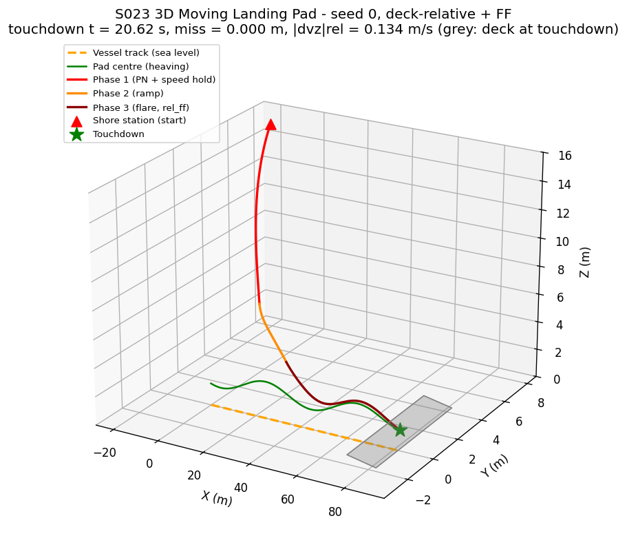
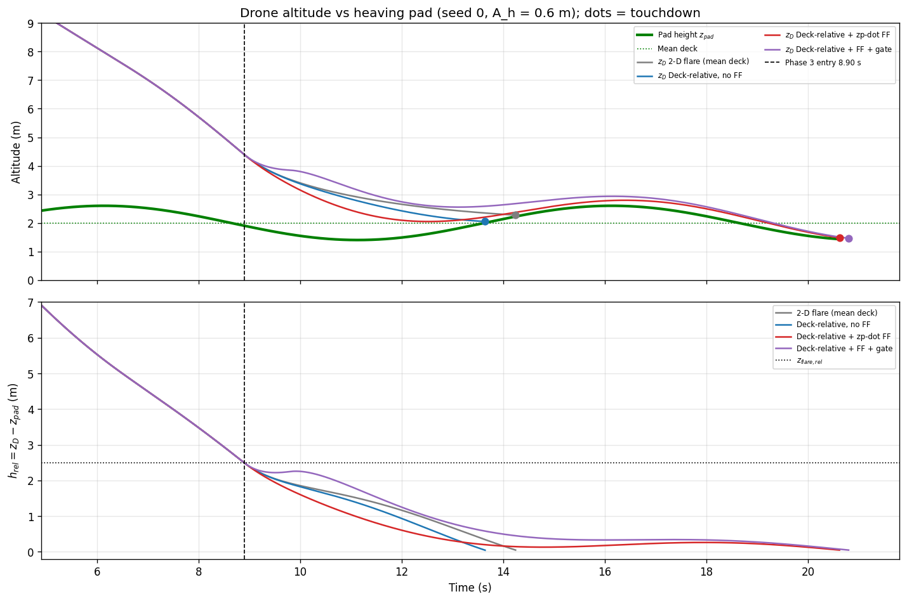
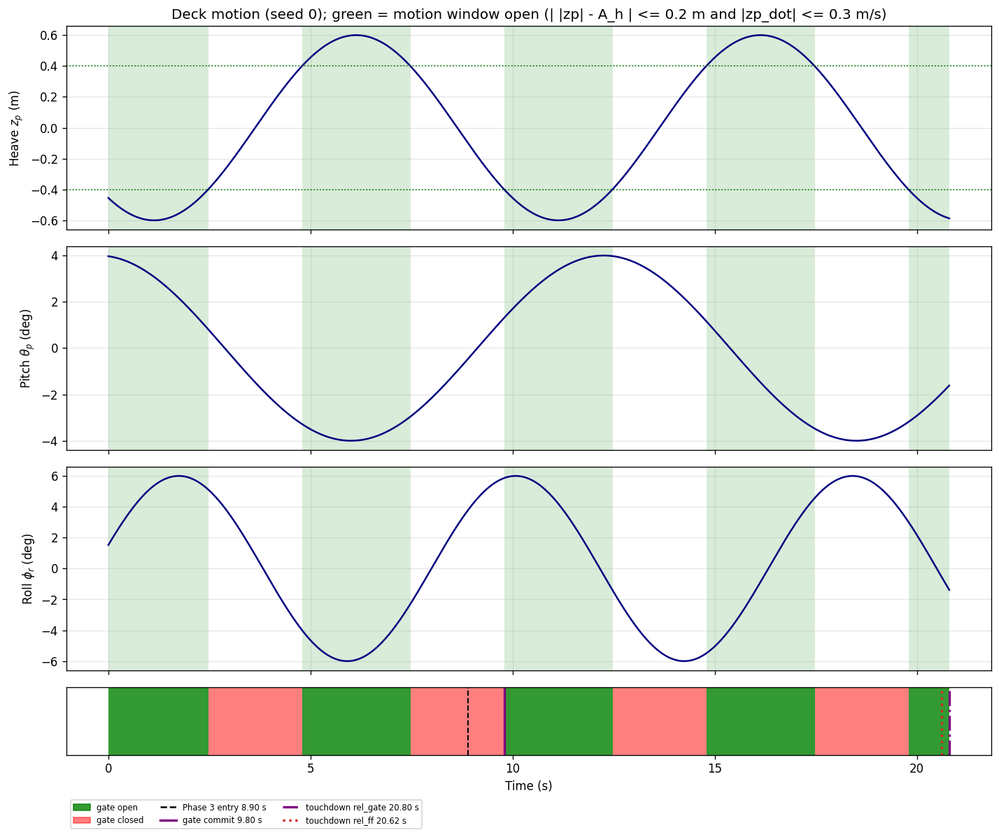
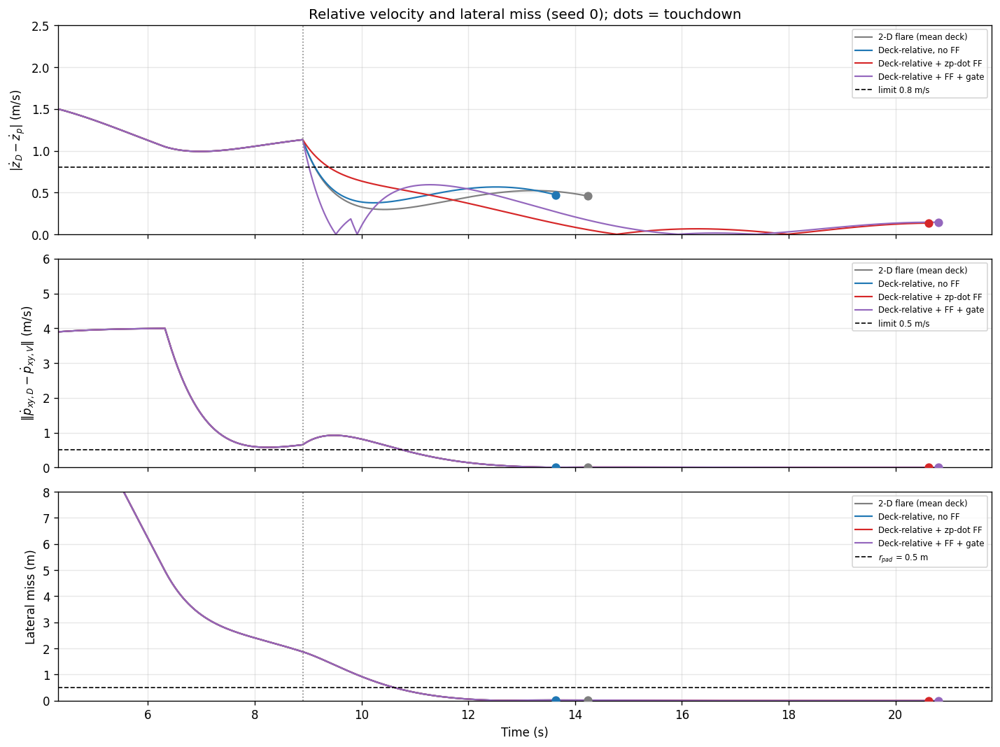
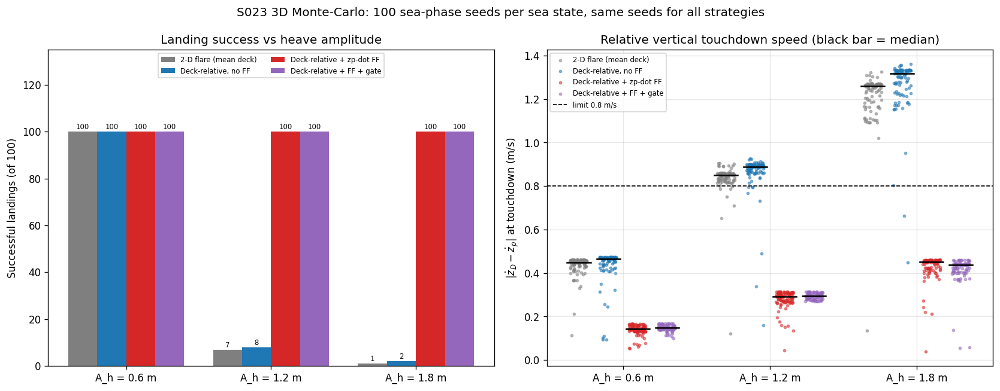
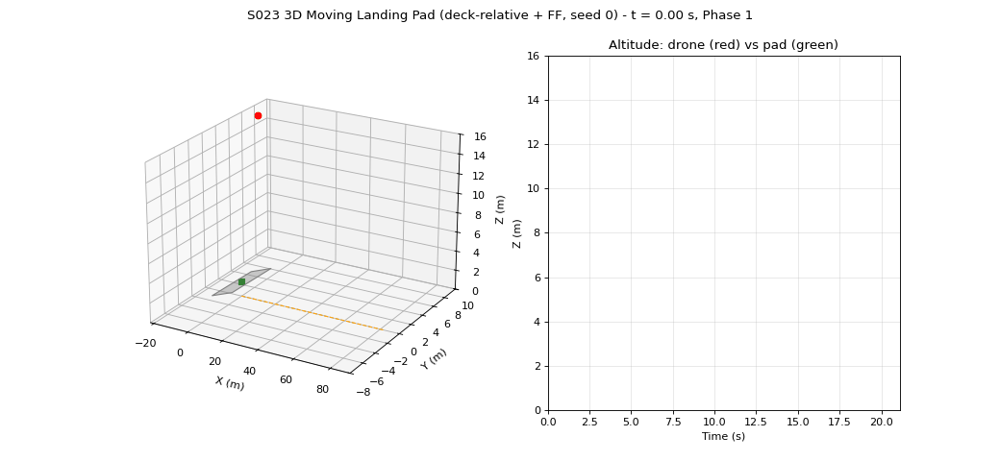

# S023 3D Moving Landing Pad

**Domain**: Logistics & Delivery | **Difficulty**: ⭐⭐⭐ | **Status**: ✅ Completed

---

## Problem Definition

**Setup**: A delivery drone leaves a shore station at (−20, 8, 15) m, starting at rest. It must land on a pad on a vessel that sails along +x at 4 m/s. Unlike the 2-D S023 truck, whose pad is fixed at $z = 0$, the vessel's deck moves:

- it **heaves** vertically, $z_p(t) = A_h\sin(2\pi f_h t + \phi_h)$, around a mean deck height of 2 m;
- it **pitches** and **rolls**, which tilt the deck plane.

The drone receives the pad state with a 0.04 s (2-step) telemetry delay.

Guidance has three latched phases:

1. **Intercept**: 3-D proportional navigation toward the predicted ramp-entry point, which is 4 m astern of the pad at 7.5 m altitude.
2. **Approach ramp**: a straight line from the entry point to the pad, defined in the pad frame so that it rides the heaving deck.
3. **Flare**: the final descent onto the deck.

**Key question**: Is it necessary to track the live deck height, and in particular to feed forward the heave rate $\dot z_p$, to land softly on a heaving deck? And does a motion-window gate help? Four Phase-3 vertical laws are compared. Phases 1–2 are shared and bit-identical for every law, and every law sees the same sea phases for a given seed:

| Strategy | Phase-3 vertical law |
|----------|----------------------|
| **2-D flare (mean deck)** | The 2-D S023 law: $\dot z_{cmd} = -v_{land}\tanh\big((z_D - \bar z_{deck})/z_{flare,rel}\big)$. It treats the deck as static at its mean height. |
| **Deck-relative, no FF** | $\dot z_{cmd} = -v_{land}\tanh(h_{rel}/z_{flare,rel})$, where $h_{rel} = z_D - z_{pad}$ uses the live pad height |
| **Deck-relative + FF** | as above, plus the heave-rate feed-forward: $\dot z_{cmd} = -v_{land}\tanh(h_{rel}/z_{flare,rel}) + \dot z_p$ (card law, corrected) |
| **Deck-relative + FF + gate** | Holds 2.5 m above the mean deck until the motion window opens, then commits to the FF law (card's full design) |

---

## Mathematical Model

**Deck**: the pad centre is $\mathbf{p}_{pad}(t) = (v_V t,\ 0,\ \bar z_{deck} + z_p(t))$ and its velocity is $\dot{\mathbf{p}}_{pad} = (v_V,\ 0,\ \dot z_p)$. The pitch and roll angles are $\theta_p = A_\theta\sin(2\pi f_\theta t + \phi_\theta)$ and $\phi_r = A_\phi\sin(2\pi f_r t + \phi_r^0)$. The pad sits at the vessel's rotation centre ($\mathbf{d}_{offset} = 0$), as the card's pad-velocity formula implies. Pitch and roll therefore tilt the deck plane, with normal $\hat{\mathbf{n}} \propto (-\theta_p,\ \phi_r,\ 1)$, but they do not move the pad. Contact is detected against this tilted plane under the drone, $z_{surf}(x,y) = z_{pad} + \theta_p(x - x_{pad}) - \phi_r(y - y_{pad})$, when $z_D - z_{surf} \le 0.05$ m.

**Drone**: a double integrator, $\dot{\mathbf{v}} = \mathbf{a}$, with $\|\mathbf{a}\| \le 5$ m/s² and $\|\mathbf{v}\| \le 8$ m/s.

**Telemetry**: the pad state is measured at $t - \tau_s$. Every strategy compensates the delay with the same constant-velocity extrapolation, $\hat{\mathbf{p}}_{pad} = \mathbf{p}_{pad}(t-\tau_s) + \dot{\mathbf{p}}_{pad}(t-\tau_s)\,\tau_s$.

**Phase 1** is taken from the fixed 2-D S023. The fixed-point intercept predictor is iterated to $10^{-6}$ s. The command is $\mathbf{a} = N V_c\dot{\hat{\boldsymbol\lambda}}$ plus an along-LOS speed hold $K_{ax}(v_{max} - \mathbf{v}\cdot\hat{\boldsymbol\lambda})$. The aim point is the predicted ramp-entry point, 4 m astern of the pad at $z = 7.5$ m.

**Phase 2** starts when $d_{xy} \le r_{approach}$ and $z_D \le z_{ramp}$. The entry offset $\mathbf{r}_e = \mathbf{p}_D - \hat{\mathbf{p}}_{pad}$ is latched; the ramp angle is $\gamma = \arctan(r_{e,z}/\|\mathbf{r}_{e,xy}\|)$, and the code asserts $\gamma \ge \gamma_{min}$. The command point is $\hat{\mathbf{p}}_{pad} + (L/L_e)\mathbf{r}_e$, which equals the card's corrected $\mathbf{p}_{pad} - L\hat{\mathbf{d}}_{ramp}$. The ramp length shrinks as $L = L_e - V_{app}(t - t_e)$. The drone tracks the command point with $\mathbf{a} = K_p(\mathbf{r}_{cmd} - \mathbf{r}) + K_v(\mathbf{v}_{rel,cmd} - \mathbf{v}_{rel})$ in the pad frame.

**Phase 3** starts when $d_{xy} \le r_{flare}$ and $h_{rel} \le z_{flare,rel}$. The lateral law is $\mathbf{a}_{xy} = K_p(\hat{\mathbf{p}}_{pad,xy} - \mathbf{p}_{D,xy}) + K_v(\hat{\dot{\mathbf{p}}}_{pad,xy} - \mathbf{v}_{D,xy})$. The vertical law is $a_z = K_{z,r}(\dot z_{cmd} - \dot z_D)$, with $\dot z_{cmd}$ from the strategy table above.

**Motion window** (corrected, see Deviations): the window is open when $\big||z_p| - A_h\big| \le \delta_{heave}$ **and** $|\dot z_p| \le \dot z_{gate}$.

**Success**: all of the following at contact:

- on the deck, with $\|\mathbf{p}_{xy,D} - \mathbf{p}_{xy,pad}\| \le r_{pad}$;
- $|\dot z_D - \dot z_p| \le v_{land,max}$;
- $\|\dot{\mathbf{p}}_{xy,D} - \dot{\mathbf{p}}_{xy,V}\| \le \Delta v_{max}$.

**Asserted invariants** (every step): the drone is never below the deck or sea surface, $0 \le z \le 20$ m, $\|\mathbf{v}\| \le v_{max}$ and $\gamma \ge \gamma_{min}$. Every Monte-Carlo run touches down, always in Phase 3. The Phase-3 entry time is identical for all four strategies on every seed.

---

## Key Parameters

| Parameter | Value | Source |
|-----------|-------|--------|
| Vessel speed $v_V$ | 4.0 m/s along +x | card |
| Heave amplitude $A_h$ / frequency $f_h$ | 0.6 m / 0.10 Hz | card |
| Pitch amplitude / frequency | 4° / 0.08 Hz | card amplitude; frequency picked from the card's 0.08–0.12 Hz range |
| Roll amplitude / frequency | 6° / 0.12 Hz | card amplitude; frequency picked from the card's 0.08–0.12 Hz range |
| Initial phases $\phi_h, \phi_\theta, \phi_r^0$ | uniform on $[0, 2\pi)$, drawn from `default_rng(seed)` | added |
| Drone max speed / acceleration | 8.0 m/s / 5.0 m/s² | card |
| PN constant $N$ | 3 | card |
| Min approach angle $\gamma_{min}$ | 6° | card |
| Phase 1→2: $z_{ramp}$ / $r_{approach}$ | 8.0 m / 5.0 m | card |
| Phase 2→3: $z_{flare,rel}$ / $r_{flare}$ | 2.5 m (also the tanh scale) / 2.5 m | card / added (the card gives no value) |
| Motion window $\delta_{heave}$ / $\dot z_{gate}$ | 0.2 m / 0.3 m/s | card (gate formula corrected) |
| Pad radius $r_{pad}$ | 0.5 m | card |
| Max relative touchdown vertical speed $v_{land,max}$ | 0.8 m/s (also the flare's max commanded rate) | card |
| Max horizontal velocity mismatch $\Delta v_{max}$ | 0.5 m/s | card |
| Sensor latency $\tau_s$ | 0.04 s (2 steps) | card |
| Time step | 0.02 s (50 Hz) | card |
| Altitude range | 0–20 m (asserted) | card |
| Mean deck height $\bar z_{deck}$ | 2.0 m above sea level | added: the card's $z_p$ has zero mean, and the deck must stay inside $z \ge 0$ |
| Deck footprint | 12 m × 6 m around the pad | added |
| Drone start | (−20, 8, 15) m, at rest; vessel starts at x = 0 | added (2-D S023 start) |
| Phase-1 aim point | 4 m astern of the predicted pad, $z$ = 7.5 m | added |
| Ramp closing speed $V_{app}$ | 1.5 m/s | added |
| Gated hold height $z_{hold}$ | 2.5 m above the mean deck | added (the card gives no value) |
| Gains $K_p$ / $K_v$ / $K_{z,r}$ / $K_{ax}$ | 1.2 / 1.8 / 2.0 / 1.0 s⁻¹ | 2-D S023 values (the card gives none) |
| Predictor tolerance | $10^{-6}$ s, max 100 iterations | 2-D S023 fix |
| Contact threshold | 0.05 m above the deck plane | 2-D S023 value |
| Simulation budget | 60 s | added |
| Monte-Carlo | 100 sea-phase seeds (0–99) for each of $A_h$ = 0.6, 1.2, 1.8 m; showcase seed 0 | added |

### Deviations from the scenario card

| Card | Implementation | Reason |
|------|----------------|--------|
| Gate $\lvert z_p\rvert \le \delta_{heave}$ and $\lvert\dot z_p\rvert \le \dot z_{gate}$ | $\big\lvert\lvert z_p\rvert - A_h\big\rvert \le \delta_{heave}$ and $\lvert\dot z_p\rvert \le \dot z_{gate}$ (near crest or trough) | The literal gate is open **0.0 %** of the time: wherever $\lvert z_p\rvert \le 0.2$ m, $\lvert\dot z_p\rvert \ge 0.355$ m/s > 0.3 m/s. The card text asks for a near-crest/near-trough gate. The card is corrected. |
| $\dot h_{rel,cmd} = -v\tanh(\cdot) + \dot z_p$, compared with $\dot z_D - \dot z_p$ | $\dot z_{D,cmd} = -v\tanh(\cdot) + \dot z_p$, compared with $\dot z_D$ | The card form counts $\dot z_p$ twice (it drives $\dot z_D \to 2\dot z_p - v\tanh$). The card is corrected. |
| Ramp command $\mathbf{p}_{pad} + L\hat{\mathbf{d}}_{ramp}$ | $\mathbf{p}_{pad} - L\hat{\mathbf{d}}_{ramp}$ (implemented as $(L/L_e)\mathbf{r}_e$) | Sign error: the card's point lies ahead of and below the pad. The card is corrected. |
| Ramp $L(t) = \lVert\mathbf{p}_D - \mathbf{p}_{pad}\rVert$ | $L(t) = L_e - V_{app}(t - t_e)$ | With $L$ equal to the current range, the command point moves with the drone and never pulls it down the ramp |
| "one-step" latency (text) vs 0.04 s = 2 steps (table) | 2 steps, with constant-velocity compensation | The table value is used; the card text is corrected. Without compensation the mean lateral miss is 0.157 m instead of 0.003 m. |
| $\gamma \ge 6°$ is a design constraint | Ramp angle taken from the entry geometry and asserted ≥ 6° | It **never binds**: the entry geometry gives 38.6–56.7° over all 300 runs |
| Phase-3 hold height $z_{hold}$, $r_{flare}$, gains, start position | Values listed in the parameter table as "added" | The card gives no values |
| Pad offset $\mathbf{d}_{offset}$ | 0: the pad is at the rotation centre | This is what the card's $\dot{\mathbf{p}}_{pad} = (v_V, 0, \dot z_p)$ assumes. With it, pitch and roll only tilt the deck, and their measured effect on contact is negligible (see results). |
| "the flare controller … risks a hard contact during a **downward** heave cycle" | Measured: every hard contact happens with the deck **rising** | 93/93, 92/92, 99/99 and 98/98 hard contacts have $\dot z_p > 0$ |
| Single scenario run | Showcase seed + 100-seed Monte-Carlo × 3 sea states; two baselines (2-D flare, no FF) and the gate on/off | Needed to test the card's FF and gate claims fairly |
| Output files (card list) | The deck-motion plot and the motion-window timing bar share `deck_motion.png`; relative velocity and lateral miss share `relative_velocity.png`; `monte_carlo.png` is added | Layout |

---

## Simulation Results

Both runs printed byte-identical output and wrote byte-identical files.

### Motion-window check (card sea state)

- Maximum heave rate: $2\pi f_h A_h$ = **0.377 m/s**.
- Where $|z_p| \le 0.2$ m, the heave rate is at least 0.355 m/s, so the literal card gate is open **0.0 %** of the time.
- The corrected gate is open 53.5 % of the time at $A_h$ = 0.6 m, 26.1 % at 1.2 m and 17.1 % at 1.8 m.

### Showcase (seed 0, $A_h$ = 0.6 m)

Phases (heave, pitch, roll) = (4.002, 1.695, 0.257) rad. Phase 1→2 starts at 6.32 s with a ramp angle of 46.2°. Phase 2→3 starts at 8.90 s for every strategy.

| Strategy | Touchdown | Miss | $\lvert\dot z_D - \dot z_p\rvert$ | $\lvert\dot z_D\rvert$ (absolute) | $\Delta v_{xy}$ | Deck-normal speed | $z_p$ | $\dot z_p$ | Gate at contact | Result |
|----------|-----------|------|------|------|------|------|------|------|------|------|
| 2-D flare (mean deck) | 14.24 s | 0.016 m | 0.457 m/s | 0.108 m/s | 0.008 m/s | 0.454 m/s | +0.22 m | +0.350 m/s | shut | OK |
| Deck-relative, no FF | 13.64 s | 0.019 m | 0.472 m/s | 0.095 m/s | 0.002 m/s | 0.469 m/s | +0.00 m | +0.377 m/s | shut | OK |
| Deck-relative + FF | 20.62 s | 0.000 m | **0.134 m/s** | 0.253 m/s | 0.000 m/s | 0.134 m/s | −0.57 m | −0.119 m/s | open | OK |
| Deck-relative + FF + gate | 20.80 s | 0.000 m | 0.144 m/s | 0.222 m/s | 0.000 m/s | 0.144 m/s | −0.59 m | −0.078 m/s | open | OK |

- The gated drone held for 0.90 s and committed at 9.80 s.
- Deck tilt at the FF touchdown was 2.02°.
- The deck-plane height under the drone differed from the pad-centre height by +0.00 cm.
- The relative speed against the contact point was 0.134 m/s, the same as against the pad centre.

### Monte-Carlo (100 sea-phase seeds per sea state, the same seeds for every strategy)

| $A_h$ (max heave rate) | Strategy | Success | $\lvert\dot z_D-\dot z_p\rvert$ mean ± std | max | # > 0.8 m/s | Max $\lvert\dot z_D\rvert$ (absolute) | Max miss | Max $\Delta v_{xy}$ | Touchdown mean ± std | Gate open at contact |
|---|---|---|---|---|---|---|---|---|---|---|
| 0.6 m (0.377 m/s) | 2-D flare | 100/100 | 0.434 ± 0.048 | 0.464 | 0 | 0.245 | 0.048 | 0.125 | 15.26 ± 2.25 s | 14 |
| | No FF | 100/100 | 0.436 ± 0.080 | 0.475 | 0 | 0.102 | 0.051 | 0.129 | 15.04 ± 2.22 s | 9 |
| | **FF** | 100/100 | **0.139 ± 0.025** | 0.167 | 0 | 0.320 | 0.009 | 0.008 | 17.96 ± 2.05 s | 73 |
| | FF + gate | 100/100 | 0.147 ± 0.013 | 0.168 | 0 | 0.268 | 0.009 | 0.008 | 18.55 ± 2.21 s | 80 |
| 1.2 m (0.754 m/s) | 2-D flare | **7/100** | 0.836 ± 0.080 | 0.905 | 93 | 0.406 | 0.316 | 0.414 | 14.68 ± 2.46 s | 2 |
| | No FF | **8/100** | 0.863 ± 0.101 | 0.928 | 92 | 0.175 | 0.339 | 0.435 | 14.30 ± 2.43 s | 2 |
| | **FF** | **100/100** | 0.279 ± 0.043 | 0.315 | 0 | 0.680 | 0.019 | 0.019 | 15.87 ± 2.29 s | 42 |
| | FF + gate | 100/100 | 0.294 ± 0.013 | 0.315 | 0 | 0.419 | 0.015 | 0.008 | 18.99 ± 2.62 s | 79 |
| 1.8 m (1.131 m/s) | 2-D flare | **1/100** | 1.216 ± 0.126 | 1.326 | 99 | 0.526 | 0.550 | 0.602 | 14.56 ± 2.59 s | 0 |
| | No FF | **2/100** | 1.268 ± 0.131 | 1.361 | 98 | 0.234 | 0.604 | 0.640 | 14.13 ± 2.59 s | 0 |
| | **FF** | **100/100** | 0.427 ± 0.061 | 0.461 | 0 | 1.034 | 0.045 | 0.124 | 14.79 ± 2.41 s | 29 |
| | FF + gate | 100/100 | 0.417 ± 0.064 | 0.461 | 0 | 0.717 | 0.014 | 0.054 | 19.89 ± 3.01 s | 77 |

Head-to-head on the same seeds:

| $A_h$ | Lower relative contact speed | Earlier touchdown |
|---|---|---|
| 0.6 m | FF beats no FF 96/100, FF beats 2-D 99/100, no FF beats 2-D 18/100, gate beats FF 3/100 | FF beats no FF 43/100, FF beats 2-D 46/100, FF beats gate 41/100 |
| 1.2 m | FF beats no FF 99/100, FF beats 2-D 99/100, no FF beats 2-D 11/100, gate beats FF 19/100 | 61/100, 65/100, 54/100 |
| 1.8 m | FF beats no FF 100/100, FF beats 2-D 99/100, no FF beats 2-D 10/100, gate beats FF 66/100 | 72/100, 75/100, 60/100 |

**Other diagnostics**

- **Shared Phases 1–2.** The ramp angle is 46.1–52.0° (0.6 m), 42.6–54.5° (1.2 m) and 38.6–56.7° (1.8 m). Phase 3 starts at 8.90–9.56 s, 8.60–9.98 s and 8.24–10.50 s.
- **Phase-3 duration with FF.** The mean is 8.78 s, 6.69 s and 5.62 s.
- **Gated hold before commit.** The mean is 0.56 s, 1.49 s and 2.18 s; the maximum is 2.32 s, 3.68 s and 4.16 s. At $A_h$ = 1.8 m, in 3/100 runs the gate never opened before the deck rose into the *holding* drone. All three contacts were soft (max 0.139 m/s) and pass the criteria.
- **Deck tilt (FF runs).** The deck-plane height differs from the pad-centre height by at most 0.07 cm, 0.14 cm and 0.33 cm. The relative vertical speed against the contact point differs from the speed against the pad centre by at most 0.0003, 0.0007 and 0.0015 m/s. The maximum deck-normal speed is 0.167, 0.314 and 0.460 m/s.
- **Latency compensation (FF, 0.6 m).** The mean lateral miss is 0.003 m with compensation and 0.157 m without it, matching $v_V\tau_s$ = 0.16 m.

### Key findings

- **Heave feed-forward: the card's claim holds, but not at the card's own sea state.** At $A_h$ = 0.6 m every strategy lands, including the 2-D law that ignores the heave. The heave rate (0.377 m/s at most) is under half of the 0.8 m/s limit. The FF still lowers the relative contact speed from about 0.43 to 0.14 m/s (96/100 and 99/100 head-to-head wins). The FF becomes **critical** once the heave rate approaches the limit: at 1.2 m the success rate is 100/100 with FF against 7–8/100 without it, and at 1.8 m it is 100/100 against 1–2/100.
- **Why the non-FF laws fail: the deck rises into the drone.** Both non-FF laws command a descent rate that goes to zero near the deck, so the drone almost hovers. The contact speed is then roughly the deck's rise rate plus a small residual descent: 0.434 / 0.836 / 1.216 m/s against maximum heave rates of 0.377 / 0.754 / 1.131 m/s. Every hard contact (93, 92, 99 and 98 of them) occurs with $\dot z_p > 0$. This contradicts the card's "downward heave cycle" wording.
- **Tracking the live deck height alone does not help.** "Deck-relative, no FF" is no better than the 2-D flare: it beats it on contact speed in only 18, 11 and 10 of 100 seeds. The relative height is the right *reference*, but without the rate feed-forward the rate loop cannot follow the deck.
- **The FF residual grows with the heave.** It is 0.139, 0.279 and 0.427 m/s. The first-order rate loop ($K_{z,r}$ = 2 s⁻¹) lags a sinusoidal command. The lag error is about $\dot z_{p,max}\,\omega/\sqrt{K^2+\omega^2}$ = 0.11, 0.23 and 0.34 m/s, which accounts for most of the residual. Adding a $\ddot z_p$ feed-forward would remove it (extension 2).
- **The FF is slower at the card's sea state.** It takes 17.96 s against 15.04–15.26 s. Near the deck, the tanh command is small and the FF lag error keeps $h_{rel}$ at about 0.15–0.3 m for several seconds (see `altitude_tracking.png`). The FF is faster at the larger sea states (61–75/100 head-to-head wins), where the other laws are struck by the deck early.
- **The motion-window gate gives no real benefit.** At the card's sea state it is slightly *worse* on contact speed: it beats the plain FF law in only 3/100 seeds and lands 0.59 s later on average. At 1.8 m it wins 66/100, but the mean gain is 0.010 m/s (0.417 vs 0.427), and it lands 5.1 s later. The gate times the *start* of the flare, not the touchdown. The flare lasts 5.6–8.8 s (mean, by sea state), about one heave period, so the gate does not choose the contact phase directly. It does push more contacts into the window: from 73 to 80 of 100 at 0.6 m and from 29 to 77 at 1.8 m. The contact speed hardly changes, though, because with the FF the heave phase at contact hardly matters.
- **An absolute vertical-speed criterion would be wrong in 3D.** The FF law's absolute $|\dot z_D|$ reaches 1.034 m/s at 1.8 m, which would fail the 2-D S023 limit (1.0 m/s) even though the relative contact speed is at most 0.461 m/s. The failing 2-D-flare contacts have an absolute speed of at most 0.526 m/s and would pass it. Only the relative criterion separates soft landings from hard ones.
- **Pitch and roll are inert here.** The pad is at the rotation centre and the lateral miss is ≤ 0.05 m for the FF law. The tilt therefore changes the contact height by ≤ 0.33 cm and the contact-point speed by ≤ 0.0015 m/s. The tilt-related claims in the card (a sloped surface that changes the acceptable contact velocity) have no measurable effect in this setup. An off-centre pad (extension 4) would be needed to see one.
- **The 6° minimum approach angle never binds.** The entry cone ($z \le 8$ m, $d_{xy} \le 5$ m) gives ramps of 38.6–56.7°.

---

## Output Files

### 3D Trajectory

Seed 0, deck-relative + FF law. Phase 1 is red, Phase 2 (ramp) orange and Phase 3 (flare) dark red. The vessel track at sea level is orange dashed, the heaving pad-centre trace is green, and the grey patch is the deck at touchdown:

### Altitude Tracking

Top: drone altitude for all four laws against the heaving pad height; the dots mark touchdown. Bottom: relative height $h_{rel}$. The non-FF laws hit the deck as it rises (≈ 13.6–14.2 s). The FF laws ride the deck down and touch at ≈ 20.6–20.8 s.

### Deck Motion and Motion Window

Heave, pitch and roll for seed 0. The motion window is shaded green. The bottom bar shows the gate open (green) or closed (red), the Phase-3 entry, the gate commit and the two FF touchdowns:

### Relative Velocity and Lateral Miss

Relative vertical speed $|\dot z_D - \dot z_p|$, horizontal velocity mismatch and lateral miss for all four laws (seed 0), with the success thresholds:

### Monte-Carlo

Left: successful landings out of 100 for each sea state. Right: relative vertical contact speed for every run, with the median as a black bar and the 0.8 m/s limit dashed:

### Animation

Seed 0, deck-relative + FF. Left: 3-D view with the tilting deck. Right: drone and pad altitude. 130 frames (every 8th of 1032 samples) are played at 20 fps:

---

## Extensions

1. Add a heave-acceleration feed-forward $\ddot z_p$ (or a faster rate loop) to remove the 0.14–0.43 m/s FF lag residual.
2. Make the motion window gate the predicted *touchdown* time, not the flare start, for example by timing the commit one flare duration before the next calm window.
3. Put the pad off the rotation centre (for example, a stern helideck), so that pitch and roll move the pad vertically and the tilt terms matter.
4. Use an irregular (JONSWAP) sea, and fit a short-window predictor for $\hat z_p(t+\tau)$.
5. Add abort and go-around when the window closes during the flare.

---

## Related Scenarios

- Base 2D version: [S023 Moving Landing Pad](../../../../scenarios/02_logistics_delivery/S023_moving_landing_pad.md)
- 3D card: [S023 3D Upgrade — Moving Landing Pad](../../../../scenarios/02_logistics_delivery/3d/S023_3d_moving_landing_pad.md)
- Prerequisite: [S021 Point Delivery](../../../../scenarios/02_logistics_delivery/S021_point_delivery.md)
- Related: [S024 Wind Compensation](../../../../scenarios/02_logistics_delivery/S024_wind_compensation.md), [S039 Offshore Platform Exchange](../../../../scenarios/02_logistics_delivery/S039_offshore_platform_exchange.md), [S022 3D Upgrade — Obstacle Avoidance Delivery](../../../../scenarios/02_logistics_delivery/3d/S022_3d_obstacle_avoidance.md)
