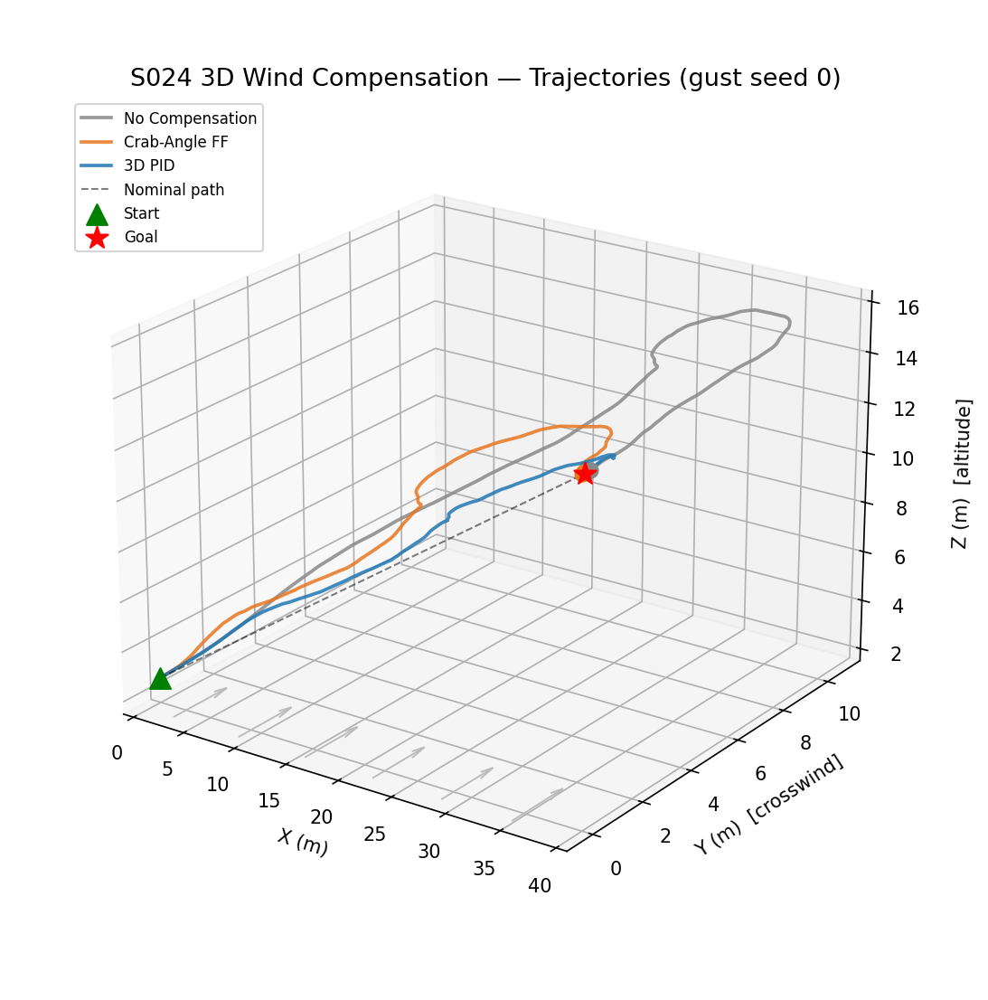
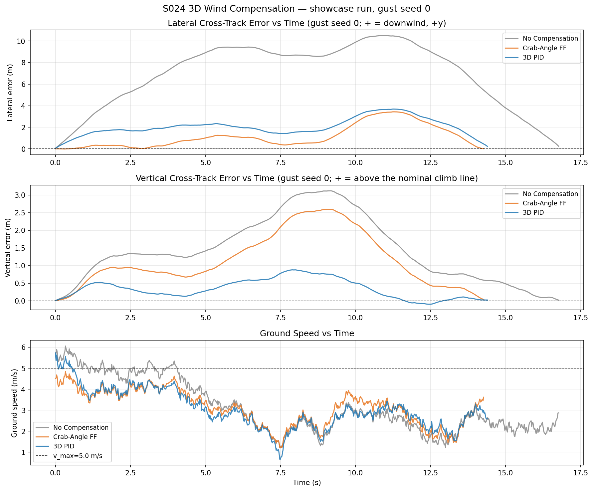
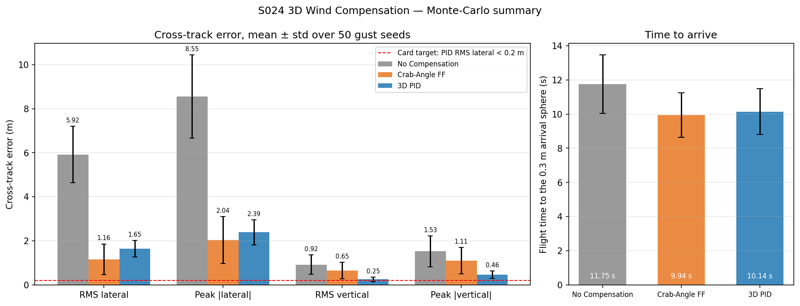
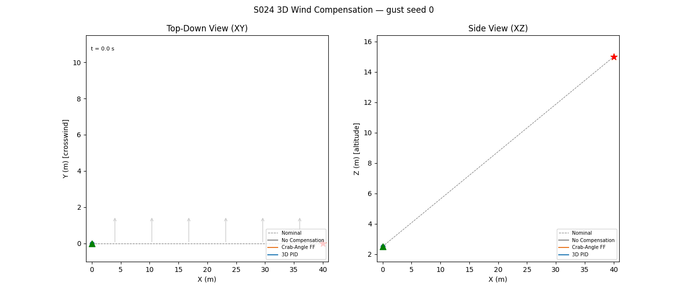

# S024 3D Wind Compensation

**Domain**: Logistics & Delivery | **Difficulty**: ⭐⭐⭐ | **Status**: ✅ Completed

---

## Problem Definition

**Setup**: A delivery drone flies from a ground-level start at (0, 0, 2.5) m to a rooftop waypoint at (40, 0, 15) m in full 3D. A persistent wind blows the whole way:

- a horizontal crosswind in +y, 2.5 m/s on average;
- a vertical updraft in +z, 0.4 m/s on average;
- correlated Gauss–Markov gusts in all three axes.

A run ends when the drone enters the 0.3 m arrival sphere.

Three guidance strategies are compared:

1. **No Compensation**: aim at the goal in 3D at every step (pure pursuit) and ignore the wind.
2. **Crab-Angle FF**: rotate the heading by the analytic crab angle to cancel the mean crosswind, and tilt the pitch to cancel the mean updraft. There is no feedback.
3. **3D PID**: two PID loops on the lateral and vertical cross-track errors from the nominal straight climb line, added to the goal-pointing airspeed.

**Key question**: Which strategy keeps the drone closest to the nominal 3D climb line, and which arrives fastest? The answer comes from a showcase gust seed and a 50-seed Monte-Carlo. Every strategy sees the same gusts for a given seed.

---

## Mathematical Model

### Ground Velocity Kinematics (3D)

$$\dot{\mathbf{p}} = \mathbf{v}_{air} + \mathbf{w}(t), \quad \|\mathbf{v}_{air}\| \le v_{max}$$

### Wind Model

$$\mathbf{w}(t) = \bar{\mathbf{w}} + \mathbf{w}_g(t), \quad \bar{\mathbf{w}} = [0,\; \bar{w}_y,\; \bar{w}_z]^\top$$

$$\mathbf{w}_{g,k+1} = e^{-\Delta t/\tau_g}\,\mathbf{w}_{g,k} + \sqrt{1 - e^{-2\Delta t/\tau_g}}\begin{bmatrix}\sigma_h\,\varepsilon_x\\\sigma_h\,\varepsilon_y\\\sigma_v\,\varepsilon_z\end{bmatrix}, \quad \varepsilon \sim \mathcal{N}(0, 1)$$

### Cross-Track Errors

With $\hat{\mathbf{d}}_0$ the unit vector from $\mathbf{p}_0$ to $\mathbf{p}_{goal}$:

$$\mathbf{p}_\perp = (\mathbf{p} - \mathbf{p}_0) - [(\mathbf{p} - \mathbf{p}_0)\cdot\hat{\mathbf{d}}_0]\,\hat{\mathbf{d}}_0, \qquad e_{lat} = \mathbf{p}_\perp\cdot\hat{\mathbf{e}}_y,\quad e_{vert} = \mathbf{p}_\perp\cdot\hat{\mathbf{e}}_z$$

### Strategies

- **No compensation**: $\mathbf{v}_{air} = v_{max}\hat{\mathbf{d}}$, where $\hat{\mathbf{d}}$ points from the current position to the goal.
- **Crab FF**: $\alpha = \arcsin(-\bar{w}_y/v_{max})$ and $\beta = \arcsin(-\bar{w}_z/v_{max})$. The command is
  $\mathbf{v}_{air} = v_{max}[\cos(\gamma+\beta)\cos(\psi+\alpha),\ \cos(\gamma+\beta)\sin(\psi+\alpha),\ \sin(\gamma+\beta)]$, rescaled to $v_{max}$. Here $\psi$ and $\gamma$ are the current bearing and elevation to the goal.
- **3D PID**: $u_{lat} = k_{p}e_{lat} + k_{i}\int e_{lat} + k_{d}\dot e_{lat}$, and $u_{vert}$ in the same way. The command is
  $\mathbf{v}_{air} = \mathrm{clip}(v_{max}\hat{\mathbf{d}} - u_{lat}\hat{\mathbf{n}}_{lat} - u_{vert}\hat{\mathbf{e}}_z,\ v_{max})$. The integrators are clipped to ±10 m·s.

### Metrics

- **Cross-track error**: RMS and peak of $e_{lat}$ and $e_{vert}$ over the flight.
- **Flight time**: time to enter the 0.3 m arrival sphere.
- **Final distance**: printed only as an arrival check. Every run stops at its first step inside 0.3 m, so the final distance is 0.20–0.30 m for every strategy by construction and cannot rank them.

---

## Key Parameters

| Parameter | Value |
|-----------|-------|
| Max airspeed $v_{max}$ | 5.0 m/s |
| Mean crosswind $\bar{w}_y$ | 2.5 m/s |
| Mean updraft $\bar{w}_z$ | 0.4 m/s |
| Horizontal gust std $\sigma_h$ | 0.8 m/s |
| Vertical gust std $\sigma_v$ | 0.3 m/s |
| Gust correlation time $\tau_g$ | 1.5 s |
| Control rate | 48 Hz (Δt = 1/48 s) |
| Start / goal | (0, 0, 2.5) m / (40, 0, 15) m (3D distance 41.9 m) |
| Arrival radius $r_{land}$ | 0.3 m (3D) |
| Lateral PID gains $(k_p, k_i, k_d)$ | 1.2, 0.05, 0.3 |
| Vertical PID gains $(k_p, k_i, k_d)$ | 1.5, 0.04, 0.2 |
| PID integrator clip | ±10 m·s |
| Timeout $T_{max}$ | 90 s |
| Showcase gust seed | 0 |
| Monte-Carlo | 50 gust seeds (0–49), identical gusts for every strategy |

### Deviations from the scenario card

| Item | Card | Code | Reason |
|------|------|------|--------|
| Comparison metric / bar chart | `lateral_bar.png` shows RMS lateral, RMS vertical and the final 3D miss distance | Monte-Carlo mean ± std of RMS and peak lateral and vertical error, plus flight time; the final distance is printed only as an arrival check | the 0.3 m stop rule makes the final miss 0.20–0.30 m for every strategy by construction, so it cannot discriminate |
| Statistics | single run | showcase seed 0 **plus** a 50-seed Monte-Carlo | one gust realisation is not representative: seed 0 is a slow, strong-wind realisation (see below) |
| Altitude-varying wind shear | listed under "What Changes in 3D" | not implemented: the mean wind is constant with altitude | the card's own Extension 1 describes shear as future work, and its maths section uses a constant $\bar{\mathbf{w}}$ |
| Drone dynamics | Roles mention "first-order velocity dynamics" | the airspeed command is applied instantly (kinematic), as in the card's equations | follows the card's maths section |
| Output path | `outputs/02_logistics_delivery/s024_3d_wind_compensation/` | `outputs/02_logistics_delivery/3d/s024_3d_wind_compensation/` | 3D variants live under `3d/`; the card is corrected |

---

## Simulation Results

Both runs printed byte-identical output.

**Showcase run (gust seed 0)**

| Strategy | Flight time | Path length | RMS lateral | Peak \|lateral\| | Mean lateral | RMS vertical | Peak \|vertical\| | Final dist. (arrival check) |
|----------|------------|-------------|-------------|------------------|--------------|--------------|-------------------|-----------------------------|
| No Compensation | 16.79 s | 52.6 m | 7.536 m | 10.495 m | +6.924 m | 1.694 m | 3.119 m | 0.245 m |
| Crab-Angle FF | **14.29 s** | 44.6 m | **1.530 m** | **3.433 m** | +1.126 m | 1.393 m | 2.595 m | 0.292 m |
| 3D PID | 14.42 s | **43.8 m** | 2.195 m | 3.687 m | +2.045 m | **0.439 m** | **0.878 m** | 0.277 m |

During the crab-FF flight on seed 0, the mean wind was (−0.975, +3.069, +0.327) m/s. The nominal mean is (0, +2.5, +0.4) m/s. Seed 0 therefore had about a 1 m/s headwind gust and a stronger-than-average crosswind, so all three strategies are slower than average on this seed.

**Monte-Carlo, 50 gust seeds (mean ± std)**

| Strategy | Flight time | RMS lateral | Peak \|lateral\| | Mean signed lateral | RMS vertical | Final dist. range | Arrived |
|----------|------------|-------------|------------------|---------------------|--------------|-------------------|---------|
| No Compensation | 11.75 ± 1.72 s | 5.922 ± 1.275 m | 8.549 ± 1.892 m | +5.350 m | 0.924 ± 0.443 m | 0.239–0.299 m | 50/50 |
| Crab-Angle FF | **9.94 ± 1.31 s** | **1.163 ± 0.697 m** | **2.045 ± 1.064 m** | +0.217 m | 0.653 ± 0.380 m | 0.197–0.297 m | 50/50 |
| 3D PID | 10.14 ± 1.34 s | 1.649 ± 0.375 m | 2.386 ± 0.565 m | +1.548 m | **0.254 ± 0.097 m** | 0.199–0.299 m | 50/50 |

Head-to-head results on the same seeds:

- Crab FF has a lower RMS lateral error than PID in 43/50 seeds.
- PID has a lower RMS vertical error than crab FF in 50/50 seeds.

**Findings**

- **The card's lateral target is not met.** The card expects the 3D PID to bring the lateral RMS below 0.2 m. That happens in **0/50 seeds**; the best seed gives 0.808 m and the mean is 1.649 m. The vertical target (< 0.3 m) is met in 35/50 seeds, with a mean of 0.254 m. No gains were retuned to reach the targets.
- **Laterally, the PID is worse than plain crab FF.** With the card's gains the lateral loop is essentially proportional. To hold its line against the mean wind, the drone needs about 2.5 m/s of upwind airspeed. A P-loop with $k_p = 1.2$ s⁻¹ only produces that from a standing error of $\bar{w}_y/k_p \approx 2.1$ m. The re-aim at the goal supplies a little of it, and $k_i = 0.05$ adds less than 1 m/s within a 10 s flight. The PID therefore flies with a persistent downwind offset: mean signed lateral error +1.548 m over 50 seeds, and +2.045 m on seed 0. Crab FF cancels the mean wind exactly in open loop, so its mean signed error is only +0.217 m. Its 1.163 m RMS comes from gusts alone, which it does not react to. A larger $k_i$, or crab FF plus PID, would remove the PID offset.
- **Vertically, the PID is best.** It is the only strategy with feedback on altitude, so it holds the climb line to 0.254 m RMS. That is 2.6× better than crab FF (0.653 m), whose pitch offset cancels only the *mean* updraft and leaves vertical gusts uncorrected.
- **Why the no-compensation drift stays bounded.** The no-compensation drone drifts 8.5 m on average at peak (10.5 m on seed 0), not wind × time. Wind × time would be 2.5 m/s × 16.79 s ≈ 42 m on seed 0. The drone re-aims at the goal every step (pure pursuit). As soon as it is blown downwind, its heading gains an upwind component, so the drift saturates and then shrinks back to zero at the goal. The cost is a curved, longer path (52.6 m vs 43.8–44.6 m on seed 0) flown partly into the wind. It is also the slowest strategy: 11.75 s vs 9.94 s for crab FF over 50 seeds.
- **Arrival time.** Crab FF is fastest, PID is 0.2 s slower and no compensation is 1.8 s slower (Monte-Carlo means). Sanity check: crab FF cancels a 2.5 m/s crosswind at 5 m/s airspeed, which leaves $\sqrt{5^2 - 2.5^2} \approx 4.33$ m/s along track. 41.9 m / 4.33 m/s ≈ 9.7 s, consistent with the 9.94 s mean.
- **Final distance is not a performance metric.** All 150 Monte-Carlo runs arrive, with final distances between 0.197 and 0.299 m: each run stops at its first step inside the 0.3 m sphere. The previous README's statement that "all arrive within 0.3 m" is true by construction and does not rank the strategies.

---

## Output Files

### 3D Trajectories

Seed-0 trajectories: no compensation in grey, crab FF in orange and PID in blue. The dashed line is the nominal climb line, and the arrows on the ground plane show the +y crosswind:

### Cross-Track Error and Ground Speed

Seed-0 time series of the lateral error (positive = downwind, +y), the vertical error (positive = above the nominal climb line) and the ground speed:

### Monte-Carlo Summary

Left: RMS and peak lateral and vertical cross-track error, as mean ± std over 50 seeds. The red dashed line is the card's 0.2 m PID lateral target. Right: flight time to the arrival sphere.

### Animation

Seed-0 run, top-down (XY) and side (XZ) views:

---

## Extensions

1. Combine crab FF with the PID, so that the feedback only has to fight gusts. Raise $k_i$ to remove the standing lateral offset.
2. Add an altitude-varying wind-shear profile $w(z) = w_{ref}(z/z_{ref})^{1/7}$ and update the feed-forward at each altitude.
3. Estimate the mean wind online (recursive least squares) instead of assuming it is known.
4. Compare energy, $\int \|\mathbf{v}_{air}\|^2 dt$, as well as time, for the three strategies.

---

## Related Scenarios

- Prerequisites: [S021 Point Delivery](../../../../scenarios/02_logistics_delivery/S021_point_delivery.md), [S022 Obstacle Avoidance Delivery](../../../../scenarios/02_logistics_delivery/S022_obstacle_avoidance_delivery.md)
- Base 2D version: [S024 Wind Compensation](../../../../scenarios/02_logistics_delivery/S024_wind_compensation.md)
- 3D card: [S024 3D Upgrade — Wind Compensation](../../../../scenarios/02_logistics_delivery/3d/S024_3d_wind_compensation.md)
- Follow-ups: [S025 Payload CoG Offset](../../../../scenarios/02_logistics_delivery/S025_payload_cog_offset.md), [S034 Weather Rerouting](../../../../scenarios/02_logistics_delivery/S034_weather_rerouting.md)
