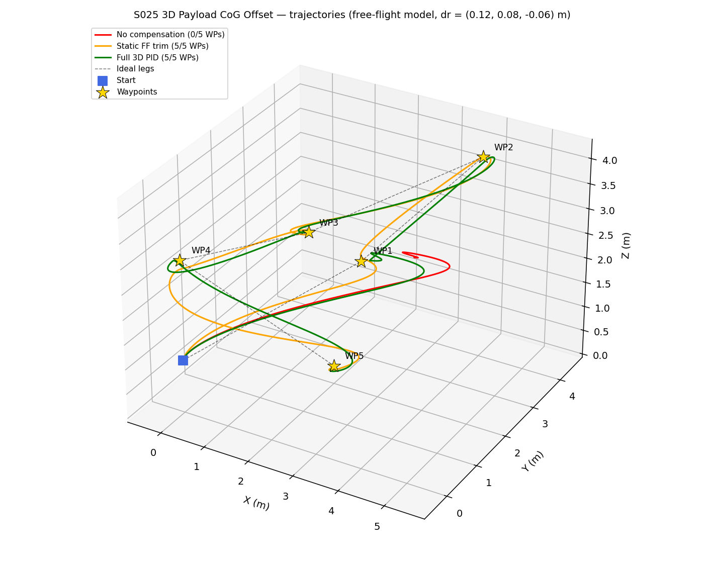
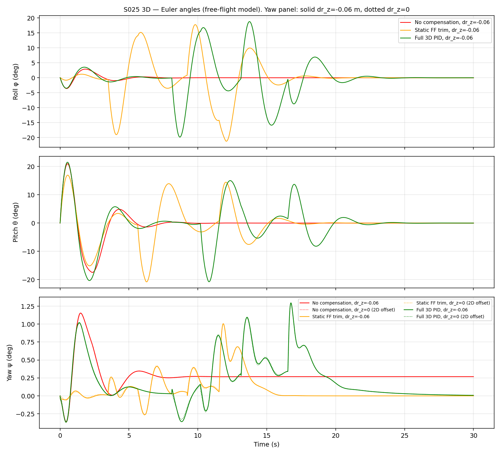
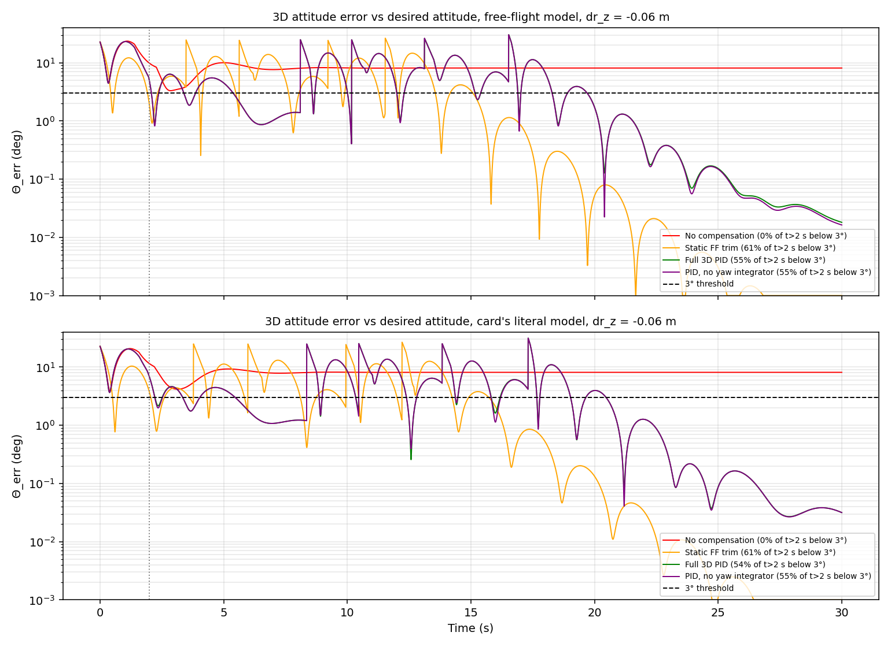
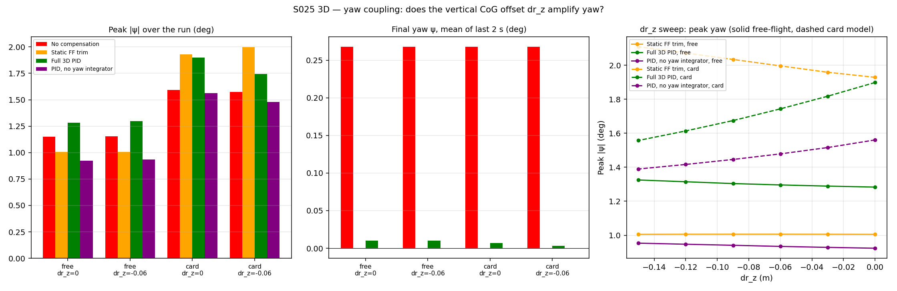
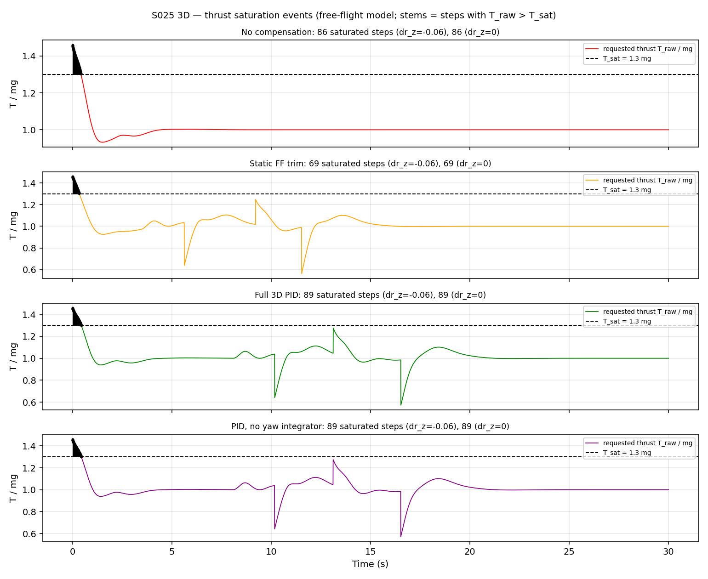
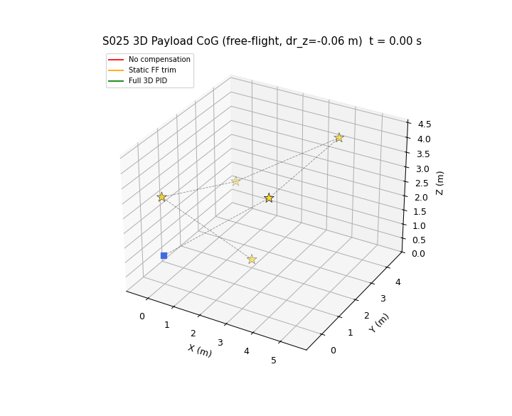

# S025 3D Payload CoG Offset

**Domain**: Logistics & Delivery | **Difficulty**: ⭐⭐⭐ | **Status**: ✅ Completed

---

## Problem Definition

**Setup**: A 2.3 kg quadrotor (1.5 kg airframe + 0.8 kg payload) carries a payload whose CoG sits at the full 3D offset $\Delta\mathbf{r} = (+0.12,\ +0.08,\ -0.06)$ m from the airframe centre. The payload hangs 6 cm below the motor plane. The drone starts at (0, 0, 1) m and flies five waypoints at mixed altitudes: two climbs, a level leg and two descents. Each waypoint must be entered within 0.15 m:

| Leg | Waypoint | Type |
|-----|----------|------|
| 1 | WP1 (4, 0, 4) m | climb +3.0 m |
| 2 | WP2 (4, 4, 4) m | level |
| 3 | WP3 (0, 4, 1.5) m | descent −2.5 m |
| 4 | WP4 (0, 0, 3) m | climb +1.5 m |
| 5 | WP5 (2, 2, 0.3) m | descent −2.7 m (delivery) |

Four attitude controllers run under the same cascaded position → attitude loop:

1. **No compensation**: PD on the attitude error in roll, pitch and yaw. The yaw reference is 0.
2. **Static FF trim**: the same PD, plus the constant hover trim $-\boldsymbol\tau_{hover}$. This is equivalent to trimming the attitude reference by $-\boldsymbol\tau_{hover}/K_P$.
3. **Full 3D PID**: PD plus integrators on roll, pitch and yaw, each with an anti-windup clip.
4. **PID, no yaw integrator** (added ablation): integrators on roll and pitch only. This tests the card's claim that a yaw integrator is required when $\Delta r_z \ne 0$.

**Key question (card)**: Does the vertical offset $\Delta r_z$ amplify yaw coupling compared with the 2D baseline ($\Delta r_z = 0$)? To answer it, every controller is run with $\Delta r_z = 0$ and with $\Delta r_z = -0.06$ m, and a sweep $\Delta r_z = 0 \ldots -0.15$ m is added. The simulation is deterministic (no random inputs), so each configuration needs only one run.

---

## Mathematical Model

**Body frame**: right-handed, x forward, y left, z up, ZYX Euler angles $(\phi, \theta, \psi)$.

**Rigid body about the system CoM.** The full inertia tensor is the airframe inertia plus the payload treated as a point mass (parallel-axis theorem, reduced mass $\mu = m_{air}m_{pay}/m$):

$$\mathbf{I}_{cm} = \mathrm{diag}(0.015, 0.015, 0.025) + \mu\left(\|\Delta\mathbf{r}\|^2\mathbf{I}_3 - \Delta\mathbf{r}\Delta\mathbf{r}^T\right)$$

$$\mathbf{I}_{cm}\dot{\boldsymbol\omega} = \boldsymbol\tau_{cmd} + \boldsymbol\tau_{dist} - \boldsymbol\omega\times\mathbf{I}_{cm}\boldsymbol\omega, \qquad \dot{\boldsymbol\eta} = W(\phi,\theta)\,\boldsymbol\omega \ \text{(full ZYX kinematics matrix)}$$

$$m\ddot{\mathbf{p}} = T\,R(\boldsymbol\eta)\,\hat{\mathbf{e}}_z - mg\,\hat{\mathbf{e}}_z$$

Because $\Delta r_z \ne 0$, the tensor has products of inertia $I_{xz} = +0.00376$ and $I_{yz} = +0.00250$ kg·m². With $\Delta r_z = 0$ both are zero. These products are the physical path by which $\Delta r_z$ couples roll and pitch into yaw.

**Disturbance torque.** Two models are run:

| Model | $\boldsymbol\tau_{dist}$ | Hover value | Depends on $\Delta r_z$? | Yaw component |
|-------|--------------------------|-------------|--------------------------|---------------|
| **free-flight** (primary) | $-\mathbf{r}_c\times(T\hat{\mathbf{e}}_z)$ with $\mathbf{r}_c = (m_{pay}/m)\Delta\mathbf{r}$. Thrust acts at the geometric centre, which is offset from the CoM. | $(-m_{pay}g\Delta r_y,\ +m_{pay}g\Delta r_x,\ 0) = (-0.628,\ +0.942,\ 0)$ N·m, scaled by $T/mg$ | no | always 0 |
| **card's literal** (secondary) | $\Delta\mathbf{r}\times m_{pay}R^T(0,0,-g)^T$: the payload-weight moment about the geometric centre | same at hover | yes, through $\pm m_{pay}g\Delta r_z\sin(\cdot)$ on **roll and pitch** (a pendulum stiffness of 0.471 N·m/rad, restoring for $\Delta r_z<0$) | $-m_{pay}g(\Delta r_x\sin\phi\cos\theta + \Delta r_y\sin\theta)$, independent of $\Delta r_z$ |

The card's model ignores the d'Alembert term of the accelerating geometric centre. In free flight, gravity has no moment about the CoM, so the only offset torque comes from thrust. Neither model has a $\Delta r_z$ term in the yaw torque.

**Position loop** (all controllers):

$$\mathbf{a}_d = K_{p,pos}(\mathbf{p}_{wp}-\mathbf{p}) - K_{d,pos}\mathbf{v}$$

The desired thrust direction is $\mathbf{a}_d + g\hat{\mathbf{e}}_z$. It gives $\phi_d$ and $\theta_d$ (each clipped to ±25°), and $\psi_d = 0$. The thrust is

$$T = \mathrm{clip}\!\left(\frac{m(g+a_{d,z})}{\cos\phi\cos\theta},\ 0,\ T_{sat}\right)$$

**Attitude loop.** The SO(3) error is $\mathbf{e}_R = \tfrac12(R_d^TR - R^TR_d)^\vee$, and $\boldsymbol\eta_{err} = -\mathbf{e}_R$. The control law is

$$\boldsymbol\tau_{cmd} = \mathrm{clip}\!\left(K_P\boldsymbol\eta_{err} - K_D\boldsymbol\omega + K_I\mathbf{s} + \boldsymbol\tau_{ff},\ \pm5\ \text{N·m}\right), \qquad \dot{\mathbf{s}} = \boldsymbol\eta_{err},\ |s_i|\le s_{max,i}$$

For the static FF trim, $\boldsymbol\tau_{ff} = -\boldsymbol\tau_{hover}$, which equals the reference trim $(+4.50°,\ -6.74°,\ 0)$ times $K_P$.

**Metric.** $\Theta_{err}$ is the geodesic angle between $R$ and the desired $R_d$ (untrimmed): $\arccos\big((\mathrm{tr}(R_d^TR)-1)/2\big)$.

---

## Key Parameters

| Parameter | Value |
|-----------|-------|
| Airframe / payload / total mass | 1.50 / 0.80 / 2.30 kg |
| Airframe inertia $(I_{xx}, I_{yy}, I_{zz})$ | (0.015, 0.015, 0.025) kg·m² (payload added by parallel axis) |
| CoG offset $\Delta\mathbf{r}$ | (+0.12, +0.08, −0.06) m |
| Hover disturbance torque (x, y, z) | (−0.628, +0.942, 0) N·m |
| Position gains $K_{p,pos}$, $K_{d,pos}$ | 1.5, 1.8 |
| Attitude gains $K_P$, $K_D$, $K_I$ | 8.0, 3.0, 2.0 |
| Anti-windup $s_{max}$ (roll, pitch / yaw) | 0.5 / 0.3 rad·s |
| Max reference tilt | 25° |
| Thrust saturation $T_{sat}$ | 1.3 mg = 29.33 N |
| Torque command clip | ±5 N·m |
| Control rate | 200 Hz (Δt = 5 ms) |
| Start / waypoints | (0, 0, 1) m / 5 waypoints listed above, z ∈ [0.3, 4.0] m |
| Waypoint reach radius | 0.15 m |
| Simulation time | 30 s fixed. After WP5 the drone keeps holding WP5. |
| Attitude success threshold | $\Theta_{err} < 3°$ for t > 2 s |
| Steady-state window | last 2 s (28–30 s) |
| Switch-transient window (exSw metric) | 2 s after each WP1–WP4 capture |
| $\Delta r_z$ sweep | 0, −0.03, −0.06, −0.09, −0.12, −0.15 m |
| Altitude bounds | [0.2, 6.0] m (checked: all 48 runs stay in [0.210, 4.098] m) |

### Deviations from the scenario card

| Card | Implementation | Reason |
|------|----------------|--------|
| $\boldsymbol\tau_{dist} = \Delta\mathbf{r}\times m_{pay}R^T\mathbf{g}$ (payload-weight moment about the geometric centre) | Primary: free-flight thrust-offset torque about the CoM. The card's formula is run as a second model. | The card's moment about the geometric centre omits the d'Alembert term. In free flight, gravity has no moment about the CoM. Running both models shows that the conclusions do not depend on this choice. |
| Yaw torque $\tau_z = +m_{pay}g(\Delta r_x\phi - \Delta r_y\theta)$, "yaw gain $m_{pay}g\Delta r_z = 0.471$ N·m/rad" | Cross product evaluated as written: $\tau_z = -m_{pay}g(\Delta r_x\sin\phi\cos\theta + \Delta r_y\sin\theta)$. The 0.471 N·m/rad term acts on roll and pitch. | Card arithmetic error: $\Delta r_z$ does not appear in the z-component of $\Delta\mathbf{r}\times\mathbf{f}$. The card has been corrected. |
| Hover torques printed as +0.628 (roll) / −0.942 (pitch) | −0.628 / +0.942 in the right-handed x-fwd/y-left/z-up frame | The card's own cross product gives these signs. The physical direction is the same: the payload side dips. |
| Inertia diag(0.015, 0.015, 0.025) | Airframe diagonal plus payload point mass via the parallel-axis theorem (full tensor with $I_{xy}, I_{xz}, I_{yz}$) | With a diagonal tensor, $\Delta r_z$ has no path into yaw at all. The products of inertia are the physical coupling. |
| Thrust direction $(-\sin\theta,\ \sin\phi\cos\theta,\ \cos\phi\cos\theta)$ | $R\,\hat{\mathbf{e}}_z$, which at $\psi = 0$ is $(\cos\phi\sin\theta,\ -\sin\phi,\ \cos\phi\cos\theta)$ | The card's vector is $R^T\hat{\mathbf{e}}_z$ (the world z-axis in body coordinates), not the thrust direction in the world frame. The card has been corrected. |
| $\theta_{ref} = -m a_{cmd,x}/T$, $\phi_{ref} = +m a_{cmd,y}/T$ | $\theta_{ref} = \operatorname{atan2}(b_x, b_z)$, $\phi_{ref} = \arcsin(-b_y/\lVert\mathbf{b}\rVert)$ with $\mathbf{b} = \mathbf{a}_{cmd} + g\hat{\mathbf{z}}$; small-angle form $+m a_x/T$, $-m a_y/T$ | The card's signs follow from its wrong thrust vector and would push the drone away from the waypoint. The card has been corrected. |
| PID on Euler differences, but the text asks for a "rotation-matrix formulation" | SO(3) error $\mathbf{e}_R$ for all controllers. $\Theta_{err}$ is the geodesic angle. | Follows the card's "What changes in 3D" text. For small angles, $\mathbf{e}_R$ is close to the card's Euler differences. |
| No compensation: "PD on roll and pitch only; yaw reference fixed at 0" | PD on all three axes, with yaw reference 0 | The card's sentence is self-contradictory. A yaw PD matches the 2D implementation, and it keeps the comparison about the integrators and the trim. |
| FF trim $(1/K_p)(-\tau/I)$ | $-\tau_{hover}/K_P$, applied as the constant torque $-\tau_{hover}$ | Unit error, the same one that was fixed in the 2D script ($\tau/I$ is an acceleration, not an angle). The card has been corrected. |
| Three controllers | Four. "PID, no yaw integrator" is added. | Tests the card's "yaw integrator required" claim directly. |
| 5 waypoints at mixed altitudes, no coordinates given | Start (0, 0, 1) m and WP1–WP5 as listed above | The card gives no coordinates. |
| 2D baseline comparison | Every controller is also run with $\Delta r_z = 0$, and the $\Delta r_z$ sweep (card Extension 1) is included | The card's objective asks for the comparison against the 2D baseline. |
| $T_{sat} = 29.4$ N; $mg/\cos^2 25° \approx 1.21\,mg$ | 29.33 N; 1.217 mg | Card arithmetic. The card has been corrected. |
| Thrust saturation "caused by the $\Delta r_z$ coupling" | Saturation is recorded, but it comes from the vertical position command | See the results. |
| — | Torque clip ±5 N·m (taken from 2D). No state clamps in the plant: the 2D clamped tilt, rate and speed. | State clamps are non-physical. Instead, invariants are asserted: z > 0, finite state, \|θ\| < 80°, 0 ≤ T ≤ T_sat. |
| Output path not given | `outputs/02_logistics_delivery/3d/s025_3d_payload_cog/` | 3D variants live under `3d/`. |

---

## Simulation Results

Both runs printed byte-identical output, and all output files were identical. Runtime was about 115 s.

### Main comparison, free-flight model

Angles are in degrees. Θ statistics are over t > 2 s. "exSw" is the share of t > 2 s with Θ < 3° after excluding the 2 s following each WP1–WP4 switch. Steady-state values (SS) are the mean of the last 2 s.

| Controller | $\Delta r_z$ | WPs | Mission time | Θ < 3° | exSw | Θ RMS | Θ peak | Θ SS | Peak \|ψ\| | Final ψ (SS) | Saturated steps | Steady position error |
|-----------|-------------|-----|--------------|--------|------|-------|--------|------|-----------|--------------|-----------------|-----------------------|
| No compensation | 0 | 0/5 | timeout | 0.0 % | 0.0 % | 8.04 | 10.04 | 8.134 | 1.152 | +0.2679 | 86 | 0.935 m |
| No compensation | −0.06 | 0/5 | timeout | 0.0 % | 0.0 % | 8.04 | 10.04 | 8.134 | 1.154 | +0.2679 | 86 | 0.935 m |
| Static FF trim | 0 | 5/5 | 15.38 s | 60.8 % | 83.2 % | 6.23 | 26.52 | 0.000 | 1.005 | +0.0000 | 69 | 0.000 m |
| Static FF trim | −0.06 | 5/5 | **15.37 s** | 60.9 % | 83.3 % | 6.24 | 26.52 | 0.000 | 1.006 | +0.0000 | 69 | 0.000 m |
| Full 3D PID | 0 | 5/5 | 20.00 s | 54.7 % | 72.9 % | 6.54 | 30.33 | 0.028 | 1.283 | +0.0102 | 89 | 0.003 m |
| Full 3D PID | −0.06 | 5/5 | 20.00 s | 54.7 % | 72.9 % | 6.54 | 30.33 | 0.028 | 1.296 | +0.0102 | 89 | 0.003 m |
| PID, no yaw I | 0 | 5/5 | 20.00 s | 54.7 % | 72.9 % | 6.54 | 30.37 | 0.026 | 0.924 | −0.0000 | 89 | 0.003 m |
| PID, no yaw I | −0.06 | 5/5 | 20.00 s | 54.7 % | 72.9 % | 6.54 | 30.37 | 0.026 | 0.934 | −0.0000 | 89 | 0.003 m |

**Waypoint capture times** ($\Delta r_z = -0.06$, free-flight):

| Controller | Captured | Capture times |
|-----------|----------|---------------|
| No compensation | 0/5 | none |
| Static FF trim | 5/5 | 3.48, 5.63, 9.22, 11.54, 15.37 s |
| Full 3D PID | 5/5 | 8.11, 10.18, 13.12, 16.53, 20.00 s |
| PID, no yaw integrator | 5/5 | 8.10, 10.18, 13.12, 16.52, 20.00 s |

### Main comparison, card's literal model

| Controller | $\Delta r_z$ | WPs | Mission time | Θ < 3° | exSw | Θ peak | Θ SS | Peak \|ψ\| | Final ψ (SS) | Saturated steps |
|-----------|-------------|-----|--------------|--------|------|--------|------|-----------|--------------|-----------------|
| No compensation | 0 / −0.06 | 0/5 / 0/5 | timeout | 0.0 % / 0.0 % | 0.0 % / 0.0 % | 10.67 / 11.42 | 8.134 / 8.134 | 1.592 / 1.573 | +0.2679 / +0.2679 | 80 / 78 |
| Static FF trim | 0 / −0.06 | 5/5 / 5/5 | 15.42 / 16.02 s | 60.3 % / 61.4 % | 82.5 % / 84.4 % | 26.15 / 26.80 | 0.000 / 0.000 | 1.929 / 1.997 | +0.0000 / −0.0000 | 66 / 65 |
| Full 3D PID | 0 / −0.06 | 5/5 / 5/5 | 20.19 / 20.66 s | 53.9 % / 54.4 % | 71.3 % / 72.6 % | 30.36 / 31.48 | 0.051 / 0.034 | 1.899 / 1.744 | +0.0071 / +0.0030 | 82 / 80 |
| PID, no yaw I | 0 / −0.06 | 5/5 / 5/5 | 20.18 / 20.66 s | 54.0 % / 54.6 % | 71.5 % / 72.8 % | 30.40 / 31.48 | 0.050 / 0.034 | 1.561 / 1.479 | +0.0000 / +0.0000 | 82 / 80 |

### $\Delta r_z$ sweep: peak |ψ| (deg) and mission time

| Model, controller | 0 | −0.03 | −0.06 | −0.09 | −0.12 | −0.15 |
|-------------------|---|-------|-------|-------|-------|-------|
| free, Static FF | 1.005 / 15.38 s | 1.006 / 15.38 s | 1.006 / 15.37 s | 1.006 / 15.36 s | 1.006 / 15.35 s | 1.005 / 15.34 s |
| free, Full 3D PID | 1.283 / 20.00 s | 1.289 / 20.00 s | 1.296 / 20.00 s | 1.304 / 19.98 s | 1.315 / 19.98 s | 1.325 / 19.96 s |
| free, PID no yaw I | 0.924 / 20.00 s | 0.929 / 20.00 s | 0.934 / 20.00 s | 0.941 / 19.98 s | 0.947 / 19.98 s | 0.953 / 19.96 s |
| card, Static FF | 1.929 / 15.42 s | 1.959 / 15.71 s | 1.997 / 16.02 s | 2.035 / 16.33 s | 2.072 / 16.63 s | 2.109 / 16.93 s |
| card, Full 3D PID | 1.899 / 20.19 s | 1.818 / 20.39 s | 1.744 / 20.66 s | 1.675 / 20.98 s | 1.614 / 21.29 s | 1.558 / 21.62 s |
| card, PID no yaw I | 1.561 / 20.18 s | 1.516 / 20.39 s | 1.479 / 20.66 s | 1.446 / 20.97 s | 1.417 / 21.30 s | 1.390 / 21.62 s |

Every run in the sweep reaches 5/5 waypoints. Steady (final) yaw stays within ±0.0104° for every FF and PID run in the sweep.

### Key findings

- **The card's central 3D claim does not hold.** The card expects $\Delta r_z$ to amplify yaw coupling, and expects the "2D PID [to] diverge for any meaningful $\Delta r_z$". In the free-flight model, going from $\Delta r_z = 0$ to −0.06 m changes peak |ψ| by a factor of ×1.00–×1.01 for every controller (for example, full PID 1.283° → 1.296°). Even at −0.15 m it changes by only 3 % (1.325°). Final yaw is unchanged. In the card's own literal model, $\Delta r_z$ *reduces* the PID's peak yaw (1.899° → 1.744° at −0.06, 1.558° at −0.15). Nothing diverges: every controller except no compensation completes 5/5 waypoints at every $\Delta r_z$ down to −0.15 m. The reason is structural. $\Delta r_z$ never enters the yaw torque, in either model. Its only path into yaw is through the products of inertia $I_{xz}$ and $I_{yz}$, and they are small: 0.00376 and 0.00250 kg·m², against $I_{zz} = 0.03585$.
- **A yaw integrator is not required, and it makes peak yaw worse.** With $\Delta r_z = -0.06$, the full PID has a peak |ψ| of 1.296° (free) and 1.744° (card model). The ablation without a yaw integrator has 0.934° and 1.479°. Final yaw is +0.0102° with the yaw integrator and −0.0000° without it. In free flight there is no steady yaw torque, so the integrator only collects transient error and releases it as overshoot. Peak |ψ| never exceeds 2.109° in any printed configuration.
- **The card's "FF has nonzero yaw error, PID drives it to zero" is not observed.** The static FF trim ends at +0.0000° yaw in both models. The full PID ends at +0.0102° (free). The only clearly nonzero final yaw is no compensation, +0.2679°. That value is identical in both models and for both $\Delta r_z$, so it is not a disturbance. No compensation hovers with a combined 4.5° roll and 6.7° pitch reference offset, and with such an offset the yaw component of the SO(3) error $\mathbf{e}_R$ is zero at a slightly nonzero ψ. It is a geometric property of the error metric.
- **Where $\Delta r_z$ does matter: roll and pitch stiffness in the card's model.** In the card's literal model, $\Delta r_z = -0.06$ adds a restoring pendulum stiffness of 0.471 N·m/rad to roll and pitch. This resists the tilts the position loop asks for and slows the mission: FF takes 15.42 → 16.02 s (16.93 s at −0.15), and PID takes 20.19 → 20.66 s (21.62 s). In the free-flight model, where this term does not exist, $\Delta r_z$ changes mission time by at most 0.04 s.
- **The genuine 3D effect is the altitude change, through thrust.** In free flight the offset torque scales with $T/mg$, so the climb and descent legs change the disturbance. During the FF run, $T/mg$ ranges over 0.563–1.300. The static hover trim is therefore off by up to 0.494 N·m on the vertical legs. The PID's pitch integrator hits its clip for 199 steps (≈ 1 s): $K_I s_{max} = 1.00$ N·m, but at $T_{sat}$ the pitch disturbance is 1.224 N·m. Both effects appear equally with $\Delta r_z = 0$. They are effects of the altitude profile, not of $\Delta r_z$.
- **Thrust saturation is not caused by $\Delta r_z$.** Saturation occurs only in the first 0.34–0.44 s of the 3 m climb to WP1. There the vertical position command $K_{p,pos}\times 3$ m = 4.5 m/s² asks for about 1.46 mg. The counts are identical for $\Delta r_z = 0$ and −0.06 in the free-flight model: 86/86, 69/69, 89/89 and 89/89. In the card model they differ by at most 2 steps.
- **Controller ranking.** As in 2D, no compensation never captures WP1. It hovers 0.935 m away, near the small-angle prediction $g(\tau/K_P)/K_{p,pos}$ = (0.770, 0.513) m, i.e. 0.925 m. Its steady attitude-tracking error is 8.134°. The static FF trim (perfect knowledge) is fastest: 5/5 in 15.37 s. The PID needs no model, but it winds up slowly ($K_I/K_P = 0.25$ s⁻¹). WP1 takes 8.11 s instead of 3.48 s, and the full mission takes 20.00 s.
- **The card's success criterion (Θ < 3° for all t > 2 s under the full PID) is not met by any controller.** The full PID has Θ < 3° for 54.7 % of t > 2 s. Excluding the 2 s after each waypoint switch, the figure is 72.9 %. Peaks reach 30.33°. Two causes:
  - Each waypoint switch steps the attitude reference by up to 25°.
  - The card's gains give an overdamped attitude loop. With $I_{xx} = 0.0202$, the roots of $I s^2 + K_D s + K_P$ are about −2.7 and −146 rad/s, so the attitude lags a moving reference by several degrees.

  At steady hover, the criterion is met easily: Θ = 0.028° (PID) and 0.000° (FF).

---

## Output Files

### 3D Trajectories

Free-flight model, $\Delta r_z = -0.06$ m. No compensation (red) stalls about 0.9 m from WP1. The FF trim (orange) and the full PID (green) reach all five gold-star waypoints. The PID makes a wide sideways excursion on the first climb while its integrator winds up:

### Attitude Time Series

Roll, pitch and yaw for no compensation, FF and PID (free-flight model). In the yaw panel, solid lines are $\Delta r_z = -0.06$ m and dotted lines are $\Delta r_z = 0$. The two sets lie on top of each other, so $\Delta r_z$ does not change the yaw response. Yaw stays within about ±1.3°. No compensation settles at +0.27°, and FF and PID return to 0:

### 3D Attitude Error

$\Theta_{err}(t)$ on a log scale for all four controllers, with the 3° threshold dashed and the 2 s settling time dotted. Top: free-flight model. Bottom: card's literal model. Every waypoint switch produces a 20–30° spike. No compensation stays at about 8°, while FF and PID decay below 0.1° within about 5 s of finishing the mission:

### Yaw Comparison

Left: peak |ψ| for each controller under the four combinations of model and $\Delta r_z$. Middle: final yaw (mean of the last 2 s). Only no compensation (+0.27°) and the full PID (≤ 0.010°) are visibly nonzero; the FF and no-yaw-integrator bars are zero. Right: the $\Delta r_z$ sweep. Peak yaw is flat in the free-flight model and decreases with $|\Delta r_z|$ for the PID controllers in the card model:

### Thrust Saturation

Requested thrust $T_{raw}/mg$ against $T_{sat} = 1.3\,mg$, free-flight model, $\Delta r_z = -0.06$. Stems mark the saturated steps, which are all in the first 0.44 s of the climb to WP1. The panel titles give the saturated-step counts for $\Delta r_z = -0.06$ and for $\Delta r_z = 0$; they are identical:

### Animation

3D view of no compensation, FF and PID (free-flight model, $\Delta r_z = -0.06$). It has 121 frames, one every 50 samples (0.25 s) of the 6001-sample, 30 s run, played at 20 fps (5× real time):

---

## Extensions

1. Combine the FF trim with a thrust-scaled schedule, $\boldsymbol\tau_{ff} = -(T/mg)\boldsymbol\tau_{hover}$, which removes the 0.494 N·m residual on the vertical legs. Raise $s_{max}$ so that the integrator can supply the 1.224 N·m needed at $T_{sat}$.
2. Model payload-mass uncertainty (±20 %) so that the static trim is wrong, and compare FF + integrator with integrator alone.
3. Add a mid-flight payload shift (a step in $\Delta\mathbf{r}$) and measure the PID's recovery time.
4. Retune the attitude loop (for example with LQR on the full inertia tensor) to remove the slow −2.7 rad/s pole, then check whether the 3° criterion becomes reachable between waypoint switches.
5. Replace the point-mass payload with a cable-suspended pendulum, where $\Delta r_z$ becomes a real dynamic degree of freedom (follow-on to S026 3D).

---

## Related Scenarios

- Base 2D version: [S025 Payload CoG Offset](../../../../scenarios/02_logistics_delivery/S025_payload_cog_offset.md)
- 3D card: [S025 3D Upgrade — Payload CoG Offset](../../../../scenarios/02_logistics_delivery/3d/S025_3d_payload_cog.md)
- Prerequisite: [S021 Point Delivery](../../../../scenarios/02_logistics_delivery/S021_point_delivery.md)
- Disturbance rejection reference: [S024 3D Upgrade — Wind Compensation](../../../../scenarios/02_logistics_delivery/3d/S024_3d_wind_compensation.md)
- Follow-ups: [S026 Cooperative Heavy Lift](../../../../scenarios/02_logistics_delivery/S026_cooperative_heavy_lift.md), [S026 3D Upgrade — Cooperative Heavy Lift](../../../../scenarios/02_logistics_delivery/3d/S026_3d_cooperative_heavy_lift.md)
