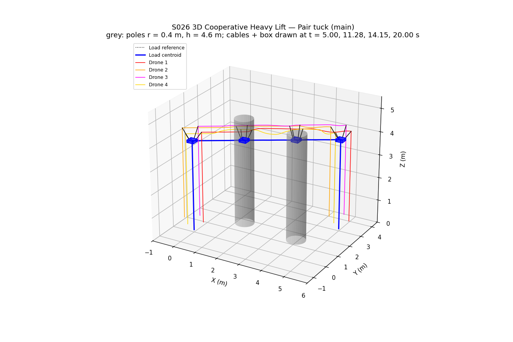
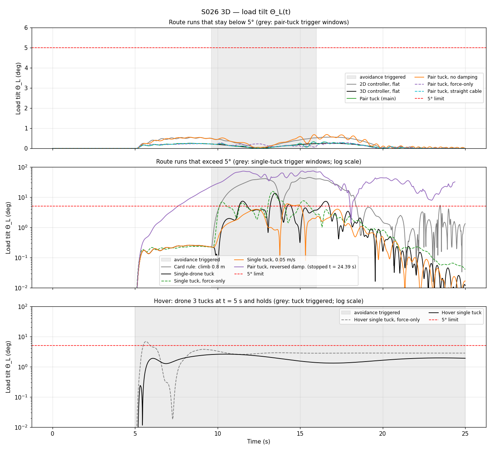
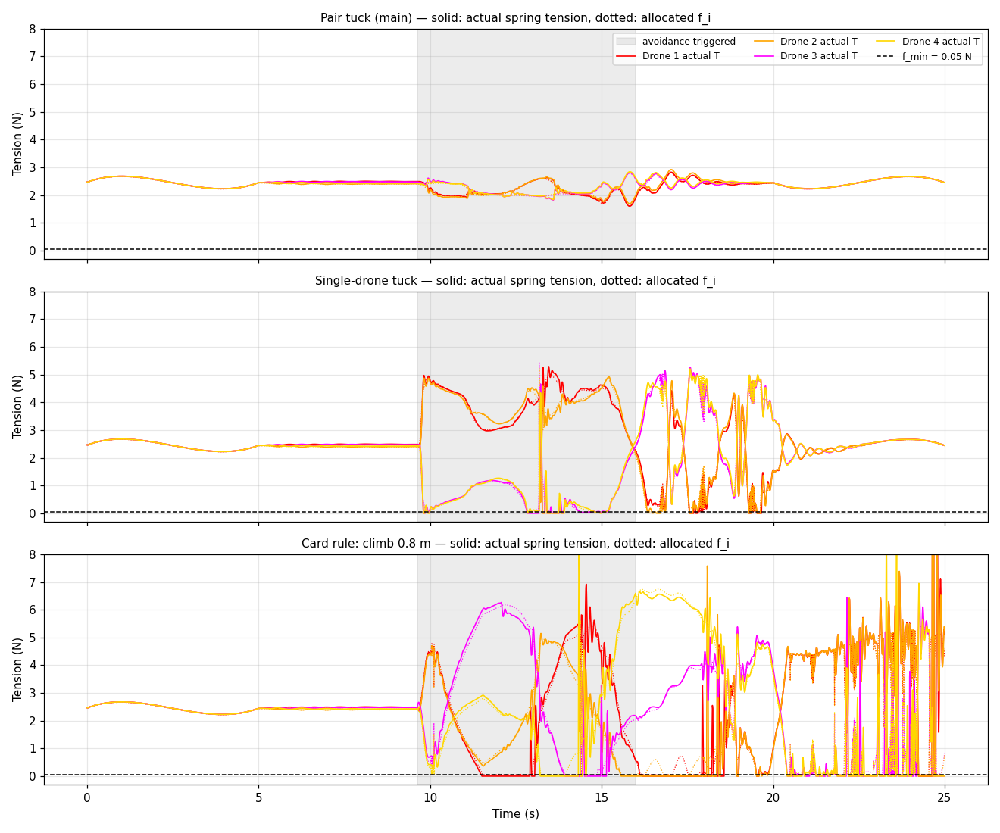
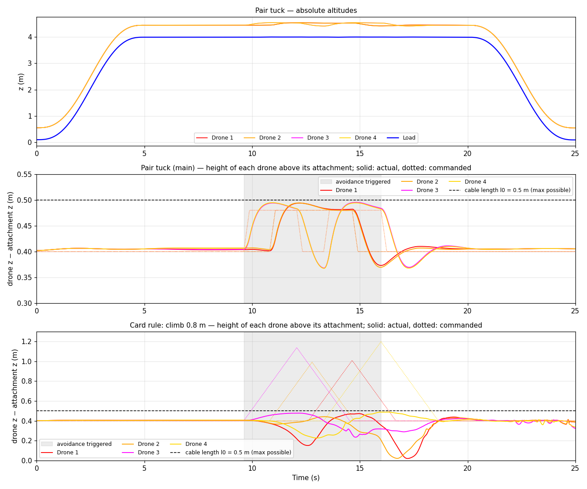
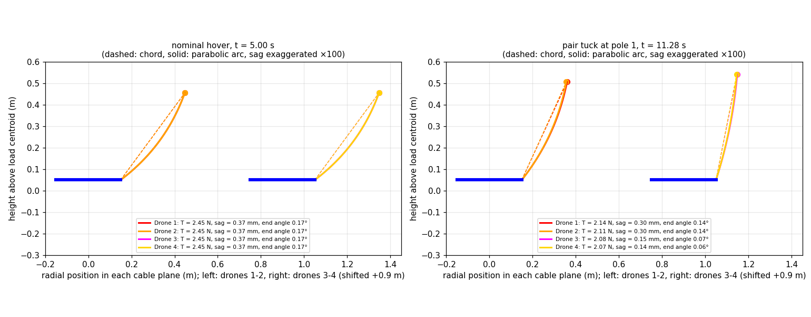
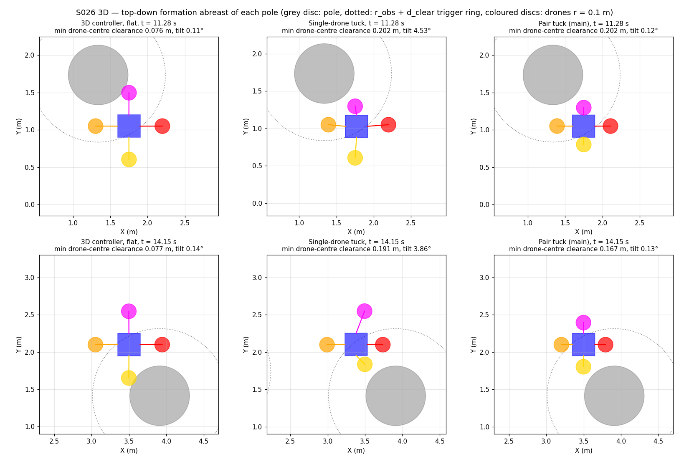
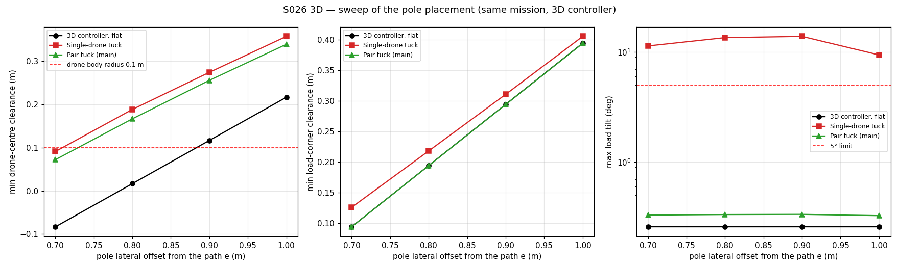
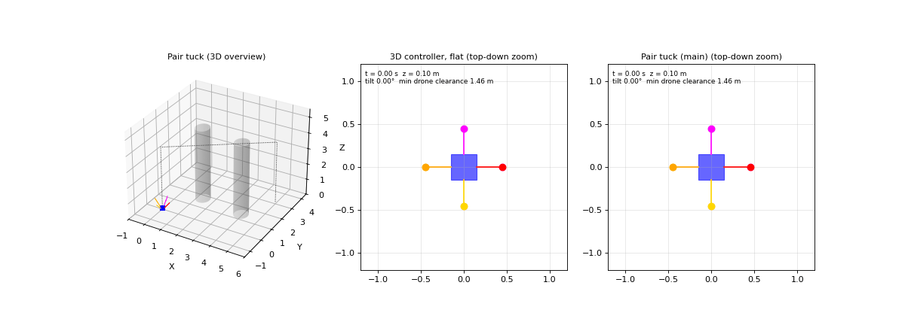

# S026 3D Cooperative Heavy Lift

**Domain**: Logistics & Delivery | **Difficulty**: ⭐⭐⭐⭐ | **Status**: ✅ Completed

---

## Problem Definition

**Setup**: $N = 4$ quadrotors carry a rigid box ($m_L = 0.8$ kg, half-lengths $a = b = 0.15$ m, $c = 0.05$ m) on four cables of rest length $l_0 = 0.5$ m. The mission is:

- lift the box from $\mathbf{q}_0 = (0, 0, 0.1)$ m to $z_d = 4$ m (0–5 s);
- cruise to $\mathbf{q}_{goal} = (5, 3, 4)$ m (5–20 s);
- descend to $(5, 3, 0.1)$ m (20–25 s).

Two poles (cylinders of radius $r_{obs} = 0.4$ m and height 4.6 m) stand beside the cruise leg. Pole 1 is 0.8 m to the left of the path at 35 % of the leg, and pole 2 is 0.8 m to the right at 70 %. The box itself passes 0.19 m from each pole. The outer drones of the flat cross would hit them.

**What the 3D card adds over the 2D S026**: the 2D version treats the load as a non-rotating point mass on straight, massless cables, with one fixed formation geometry. Here:

1. the load is a **6-DOF rigid body** (it can tilt);
2. the cables have **weight** (catenary sag, parabolic approximation);
3. the tension allocation uses the card's **6-row force + moment matrix**;
4. a **swing-damping** term feeds the load tilt back into the drone setpoints;
5. drones change **altitude individually** to get past the poles.

**Questions**: Can individual drone altitude changes get the formation past the poles while the load tilt stays below 5° and no cable goes slack? Does the QP "compensate by adjusting cable tension, preventing load tilt", as the card claims? How much do the catenary model and the damping matter?

Eleven configurations fly the same deterministic mission (no random inputs, so no Monte Carlo is needed). A sweep of the pole offset checks that the conclusions do not depend on where the poles are placed. Two extra **hover** runs separate the static question (can tension redistribution level the load when one drone tucks?) from the cruise dynamics: the box hovers at (0, 0, 4) m for 25 s with no poles, and drone 3 tucks at t = 5 s and stays tucked.

| Run | Avoidance | Allocation | Damping | Cable model in the controller |
|---|---|---|---|---|
| 2D controller, flat | none (flat cross) | force rows only (2D S026 method) | off | straight chord |
| 3D controller, flat | none | 6-row wrench | on | catenary |
| Card rule: climb 0.8 m | triggered drone climbs $\Delta z_{step} = 0.8$ m | wrench | on | catenary |
| Single-drone tuck | triggered drone climbs 0.08 m along its cable sphere | wrench | on | catenary |
| **Pair tuck (main)** | the triggered drone **and its opposite partner** tuck | wrench | on | catenary |
| Single tuck, force-only | single-drone tuck | force rows only | on | catenary |
| Single tuck, 0.05 m/s | single-drone tuck at a 0.05 m/s tuck rate (instead of 0.3 m/s) | wrench | on | catenary |
| Pair tuck, force-only | pair tuck | force rows only | on | catenary |
| Pair tuck, no damping | pair tuck | wrench | off | catenary |
| Pair tuck, reversed damp. | pair tuck | wrench | sign reversed | catenary |
| Pair tuck, straight cable | pair tuck | wrench | on | straight chord |
| Hover single tuck | hover mission; drone 3 tucks at t = 5 s and holds | wrench | on | catenary |
| Hover single tuck, force-only | as above | force rows only | on | catenary |

The physics is the same in every run: 6-DOF load, cable weight, and stiff unilateral cables.

---

## Mathematical Model

### Physics (1 kHz, semi-implicit Euler)

- **Cable $i$** runs from the attachment point $\mathbf{a}_i = \mathbf{q} + R_L\mathbf{b}_i$ to drone $\mathbf{p}_i$. Its chord is $\boldsymbol\delta_i = \mathbf{p}_i - \mathbf{a}_i$, with length $L_i$ and unit vector $\hat{\boldsymbol\delta}_i$. As in the 2D script, it is a stiff spring-damper that can only pull: $T_i = \max(0, k_c(L_i - l_0) + c_c\dot L_i)$ if $L_i > l_0$, and $T_i = 0$ otherwise.
- **Cable weight** (parabolic catenary): half of each cable's weight, $\tfrac12\mu g l_0$, hangs on each end.
  - Force on the load: $T_i\hat{\boldsymbol\delta}_i - \tfrac12\mu g l_0\hat{\mathbf z}$.
  - Force on the drone: $-T_i\hat{\boldsymbol\delta}_i - \tfrac12\mu g l_0\hat{\mathbf z}$.
  - To first order, the load-end force has the card's sagged bottom direction $\hat{\mathbf c}_i^{bot}$.
  - Mid-span sag perpendicular to the chord: $\mu g\cos\beta_i\,L_i^2/(8T_i)$, where $\beta_i$ is the chord's elevation.
- **Load**:
  - Translation: $m_L\ddot{\mathbf q} = \sum_i(T_i\hat{\boldsymbol\delta}_i - \tfrac12\mu g l_0\hat{\mathbf z}) - m_L g\hat{\mathbf z}$.
  - Rotation (Euler's equations): $\mathbf I_L\dot{\boldsymbol\omega} + \boldsymbol\omega\times\mathbf I_L\boldsymbol\omega = R_L^T\sum_i (R_L\mathbf b_i)\times\mathbf F_i$.
  - Attitude: quaternion, integrated with the exact exponential map.
  - Inertia (uniform cuboid): $\mathbf I_L = \tfrac{m_L}{3}\,\mathrm{diag}(b^2+c^2,\ a^2+c^2,\ a^2+b^2)$.
- **Drones**: point masses, $m_d\ddot{\mathbf p}_i = \mathbf u_i - m_d g\hat{\mathbf z} + \mathbf F^{cable}_{i}$, with vector thrust limited to $\|\mathbf u_i\| \le T_{max}$.

### Controller (100 Hz)

- **Allocation**: bounded least squares with $f_i \ge f_{min}$. The objective is

$$\min_{\mathbf f \ge f_{min}}\ \|\mathbf A_F\mathbf f - m_L(g\hat{\mathbf z} + \ddot{\mathbf q}_{ref})\|^2 + w_M\,\Big\|\tfrac{1}{r_a}\mathbf A_M\mathbf f\Big\|^2 + \epsilon\|\mathbf f\|^2$$

  - $\mathbf A_F = [\hat{\mathbf c}_1 \cdots \hat{\mathbf c}_4]$ holds the force rows.
  - $\mathbf A_M = [(R_L\mathbf b_i)\times\hat{\mathbf c}_i]$ holds the moment rows, scaled by the attachment radius $r_a = 0.15$ m so that they are in newtons. They are the card's 6-row matrix.
  - Wrench allocation uses $w_M = 1$; force-only allocation (the 2D method) uses $w_M = 0$. The regulariser is $\epsilon = 10^{-4}$.
  - The catenary model uses $\hat{\mathbf c}_i = \hat{\mathbf c}_i^{bot} = \mathrm{normalise}(\hat{\boldsymbol\delta}_i - \tfrac{\mu g l_0}{2 f_i^{prev}}\hat{\mathbf z})$. The straight-cable model uses $\hat{\mathbf c}_i = \hat{\boldsymbol\delta}_i$.
- **Drone PD with tension feed-forward**:

$$\mathbf u_i = m_d\big(\ddot{\mathbf q}_{ref} + K_p(\mathbf p_i^{des} - \mathbf p_i) + K_d(\dot{\mathbf p}_i^{des} - \dot{\mathbf p}_i) + g\hat{\mathbf z}\big) + f_i\hat{\boldsymbol\delta}_i\ [+\ \tfrac12\mu g l_0\hat{\mathbf z}]$$

  - The setpoint is $\mathbf p_i^{des} = \mathbf q_{ref} + \mathbf d_i + \Delta z_i^{damp}\hat{\mathbf z}$.
  - The bracketed cable-weight term is included only in the catenary model.
- **Formation slot**: $\mathbf d_i = (r_i\hat{\mathbf e}_i,\ c + h_i)$, with $h_i = h_c + \Delta z_i$.
  - Flat cross: $r_i = s = a + \sqrt{l_0^2 - h_c^2} = 0.45$ m.
  - Tuck: the drone moves along its cable sphere, $r_i = a + \sqrt{l_0^2 - h_i^2}$.
  - Climb (card rule): $r_i = s$ is kept and only the height changes.
  - $\Delta z_i$ moves toward its target at $\pm 0.3$ m/s. The target is $\Delta z_{tuck}$ (or $\Delta z_{step}$) while the drone's **nominal flat slot** is within $r_{obs} + d_{clear} = 0.9$ m of a pole centre (horizontal distance), and 0 otherwise. In pair mode the opposite drone takes the same target.
- **Swing damping**:
  - $\delta_i = (R_L\mathbf b_i)_z - b_{i,z}$ is how far attachment $i$ has dropped because of the tilt.
  - The setpoint offset is $\Delta z_i^{damp} = -\sigma K_\eta\,\delta_i/r_a$, and its rate $-\sigma K_\eta\dot\delta_i/r_a$ is added to $\dot{\mathbf p}_i^{des}$. Through $K_p$ and $K_d$ this gives tilt stiffness and tilt damping.
  - $\sigma = +1$ levels the load (a drone whose attachment drops climbs). The "reversed" run uses $\sigma = -1$.

### Statics of a single-drone tuck

Take the opposite pair (3, 4) with cable angles $\alpha_3 \neq \alpha_4$ from vertical, and a level load. Their attachments are at $\pm r_a$ on the top face.

- Force balance along $y$ needs $f_3\sin\alpha_3 = f_4\sin\alpha_4$.
- Zero roll moment needs $f_3(r_a\cos\alpha_3 - c\sin\alpha_3) = f_4(r_a\cos\alpha_4 - c\sin\alpha_4)$. Cables 1 and 2 lie in the $x$–$z$ plane through the centroid, so they cannot contribute to it.

With $\alpha_3 \neq \alpha_4$ both hold only for $f_3 = f_4 = 0$. That **is** a solution of the full 6-row system: pair 1–2 then carries the whole load, $f_1 = f_2 = m_L g/(2\cos\alpha) = 4.905$ N, and the roll moment is zero. Roll stays pendulum-stable because the 1–2 attachments sit $c = 0.05$ m above the centre of mass. So **one asymmetric pair does not force a tilt**: redistributing tension levels the load statically by unloading that pair. With $f_{min} = 0.05$ N the wrench allocator returns $\mathbf f = (4.850, 4.850, 0.050, 0.050)$ N, which leaves a 0.0160 N force residual and a 0.0020 N·m moment residual. The force-only (2D) allocator instead spreads the load over all four cables and leaves a 0.2759 N·m roll moment.

An exact level solution no longer exists when **both** pairs are asymmetric: by the same argument each asymmetric pair can be balanced only by unloading it, and both pairs cannot be unloaded. A pair tuck (both drones of a pair moving together) keeps every pair symmetric, so the allocation never has to shift the load between pairs. (An earlier version of this README said the single-pair case was impossible because it ignored the $f_3 = f_4 = 0$ solution; that was wrong.)

---

## Key Parameters

| Parameter | Value | Source |
|---|---|---|
| Drones $N$ | 4 | card |
| Load mass / half-lengths | 0.8 kg / (0.15, 0.15, 0.05) m | card |
| Load inertia $(I_{xx}, I_{yy}, I_{zz})$ | (0.00667, 0.00667, 0.0120) kg·m² | **corrected** (card: 0.0006, 0.0006, 0.0012) |
| Drone mass / thrust limit | 0.5 kg / 15 N | **changed** (card 0.027 kg; 2D fix) / added |
| Cable rest length $l_0$ / density $\mu$ | 0.5 m / 0.005 kg/m | card |
| Cable stiffness / damping | 1000 N/m / 5 N·s/m | added (2D values) |
| Attachment points $\mathbf b_i$ | $(\pm0.15, 0, +0.05)$, $(0, \pm0.15, +0.05)$ m (top-face edge midpoints) | added |
| Formation radius $s$ / cable height $h_c$ | 0.45 m / 0.40 m (nominal cable angle 36.87°) | **corrected** $s$ (card 0.6 m); $h_c$ card |
| $f_{min}$ | 0.05 N | card |
| Swing-damping gain $K_\eta$ | 0.3 m/rad | card |
| PD gains $K_p, K_d$ | 4.0, 2.0 (+ $\ddot{\mathbf q}_{ref}$ feed-forward) | card |
| Moment-row weight $w_M$ / regulariser $\epsilon$ | 1 / $10^{-4}$ | added |
| Pole radius / clearance $d_{clear}$ | 0.4 m / 0.5 m (trigger ring 0.9 m) | card |
| Pole height / placement | 4.6 m / 35 % and 70 % of the cruise leg, ±0.8 m lateral | added (card: unspecified) |
| Card climb step $\Delta z_{step}$ | 0.8 m | card (geometrically infeasible, see below) |
| Tuck climb $\Delta z_{tuck}$ | 0.08 m (radius 0.45 → 0.29 m, cable angle 36.9° → 16.3°) | added; must be < $l_0 - h_c$ = 0.1 m |
| Climb / return rate | 0.3 m/s | card |
| Slow tuck rate (one extra run) | 0.05 m/s | added |
| Hover runs | load held at (0, 0, 4) m for 25 s, no poles; drone 3 tucks from t = 5 s | added |
| Drone body radius (collision check only) | 0.10 m | added |
| Control / physics step | 0.01 s / 0.001 s | card $\Delta t$ / added sub-steps |
| Mission | lift 0–5 s, cruise 5–20 s, descend 20–25 s (quintic) | card total 25 s; split added |
| Pole-offset sweep | 0.7, 0.8, 0.9, 1.0 m | added |

### Deviations from the scenario card

| Card | Implementation | Reason |
|---|---|---|
| $(I_{xx}, I_{yy}, I_{zz}) = (0.0006, 0.0006, 0.0012)$ "computed from a uniform cuboid" | (0.00667, 0.00667, 0.0120) kg·m² | the card's arithmetic is wrong: $\tfrac{0.8}{3}(0.15^2 + 0.05^2) = 0.00667$, so it is off by about 10×; card corrected |
| Formation radius $s = 0.6$ m | 0.45 m | with $l_0 = 0.5$ m and $h_c = 0.4$ m, $s = 0.6$ m needs a 0.60 m cable (the same fix as the 2D card); card corrected |
| Drone mass 0.027 kg | 0.5 kg, $\|\mathbf u\| \le 15$ N | a 27 g drone cannot pull a 2.47 N cable (2D fix); card corrected |
| Catenary relation $l_0 = \lambda\sinh(\cdot)\,2/\cosh(\cdot)$ | not used (parabolic approximation); correct form $\sqrt{l_0^2 - d_v^2} = 2\lambda\sinh(d_h/2\lambda)$ | the card's equation is wrong; card corrected |
| Sag $= \mu g d^2/(8f)$ | $\mu g\cos\beta\,d^2/(8f)$ (perpendicular to the chord) | the card omits the chord inclination; at hover this gives 0.373 mm, not 0.621 mm; card corrected |
| Inextensible catenary cables | stiff unilateral spring-dampers with the cable weight split half to each end; the allocator uses the card's $\hat{\mathbf c}^{bot}$ | lets a cable really go slack (as in 2D); the weight split reproduces $\hat{\mathbf c}^{bot}$ to first order |
| $\Delta z_{step} = 0.8$ m, "remaining drones compensate via the QP, preventing load tilt" | run exactly as specified ("Card rule"); also added single-drone tuck (route and hover) and pair tuck | a drone cannot rise more than $l_0 - h_c = 0.1$ m above its slot without lifting its side of the load. The QP part of the claim holds statically for one asymmetric pair (it unloads that pair, see the model section) and at hover (max tilt 2.61°), but not for a single-drone tuck flown along the route (13.52°); card annotated |
| Avoidance trigger on $\mathbf p_i^{xy}$ | trigger on the drone's nominal flat slot from the reference | deterministic, and avoids chatter (a tucking drone would leave the ring and untrigger itself) |
| Damping $\Delta\mathbf p_i = -K_\eta\,\boldsymbol\eta\times\hat{\mathbf z}\cdot s_i$ | $\Delta z_i = -K_\eta\delta_i/r_a$ plus its rate in the velocity setpoint | the card's formula has units of m² and does not fix the direction. Read literally (unit $s_i$, vertical offset) it gives the reversed sign, which crashes the load here (see results). Without a rate term it would not damp |
| $\mathbf A\mathbf f = \mathbf b_{rhs}$ with $\mathbf b_{rhs} = (0, 0, m_L g, 0, 0, 0)$ | bounded least squares (wrench) with $m_L\ddot{\mathbf q}_{ref}$ in the force rows | 6 equations and 4 unknowns: an exact solution exists only for symmetric geometry; acceleration feed-forward as in the 2D fix |
| Scalar thrust $T_i = f_i/\cos\alpha_i + m_d g$ | vector thrust with tension feed-forward | the drone must also supply the horizontal cable pull (2D fix) |
| Lift from the ground, mission success for $t > t_{lift}$ | the box starts suspended at $\mathbf q_0$ and ends hovering at (5, 3, 0.1) m; the 5° criterion is applied to the whole mission | no ground-contact model for a rotating box; the lowest box corner is asserted to stay above $z = 0$ |
| Pole height and placement unspecified | 4.6 m tall, ±0.8 m from the path; the offset is swept over 0.7–1.0 m | taller than the formation, so climbing over is not an option; at 0.8 m the box clears the poles but the flat cross does not |
| $\mathbf F_{wind}$ in the load equation | 0 | the card gives no wind (wind gust is its Extension 2) |
| Expected output: tilt, tensions, altitudes, sag, top-down, 3D | all produced, plus an obstacle-offset sweep | — |

---

## Simulation Results

All numbers come from the script's printed output. Two runs gave byte-identical stdout and output files. Run time: about 4 minutes (231–244 s, measured while other scripts were running).

**Setup checks** (printed): static tension share 2.4678 N (including half the cable weight). The hover sag is 0.373 mm, and the bottom-end direction deviates from the chord by 0.171°. A climb above the slot with a level load and a taut cable is limited to $l_0 - h_c$ = 0.10 m, against the card's 0.8 m. With one pair tucked, the predicted static split is 2.010 N (flat pair) / 2.412 N (tucked pair). The load reference passes pole 1 at t = 11.28 s and pole 2 at t = 14.15 s.

**Static allocation with drone 3 tucked** (printed, level load, the load weight only):

| Allocator | $f_1, f_2, f_3, f_4$ | Force residual | Roll-moment residual |
|---|---|---|---|
| Wrench (6 rows) | 4.850, 4.850, 0.050, 0.050 N | 0.0160 N | 0.0020 N·m |
| Force-only (2D) | 2.291, 2.291, 3.136, 1.464 N | 0.0003 N | 0.2759 N·m |
| Exact $f_3 = f_4 = 0$ | 4.905, 4.905, 0, 0 N | 0 | 0 |

### Main comparison (pole offset 0.8 m)

| Run | Max tilt | Tilt RMS (cruise) | \|ω\| RMS (cruise) | Time > 5° | T min / max | Slack samples | Max load error | Min clearance drone / cable / load | Max drone rise | Status |
|---|---|---|---|---|---|---|---|---|---|---|
| 2D controller, flat | 0.57° | 0.407° | 0.23 °/s | 0 s | 2.215 / 2.68 N | 0 | 0.024 m | **0.018** / 0.018 / 0.194 m | 0.008 m | completed |
| 3D controller, flat | 0.26° | 0.185° | 0.11 °/s | 0 s | 2.222 / 2.68 N | 0 | 0.012 m | **0.017** / 0.017 / 0.194 m | 0.007 m | completed |
| Card rule: climb 0.8 m | **45.25°** | 22.661° | 31.94 °/s | 8.20 s | 0.000 / 18.18 N | 1025 | 0.493 m | 0.066 / **0.035** / 0.104 m | 0.088 m | completed |
| Single-drone tuck | **13.52°** | 3.431° | 13.28 °/s | 1.89 s | 0.000 / 5.29 N | 150 | 0.123 m | 0.188 / 0.188 / 0.218 m | 0.090 m | completed |
| **Pair tuck (main)** | **0.33°** | 0.191° | 0.31 °/s | 0 s | 1.598 / 2.92 N | **0** | 0.012 m | **0.167** / 0.167 / 0.194 m | 0.095 m | completed |
| Single tuck, force-only | 15.56° | 3.940° | 11.95 °/s | 2.50 s | 1.749 / 2.99 N | 0 | 0.102 m | 0.184 / 0.184 / 0.249 m | 0.079 m | completed |
| Single tuck, 0.05 m/s | 6.07° | 2.173° | 5.46 °/s | 0.96 s | 0.000 / 4.97 N | 25 | 0.098 m | **0.081** / 0.081 / 0.206 m | 0.087 m | completed |
| Pair tuck, force-only | 0.30° | 0.192° | 0.32 °/s | 0 s | 1.809 / 2.73 N | 0 | 0.012 m | 0.167 / 0.167 / 0.194 m | 0.095 m | completed |
| Pair tuck, no damping | 0.70° | 0.427° | 0.68 °/s | 0 s | 1.156 / 3.42 N | 0 | 0.012 m | 0.167 / 0.167 / 0.194 m | 0.095 m | completed |
| Pair tuck, reversed damp. | 74.07° | 41.500° | 80.29 °/s | 16.69 s | 0.000 / 15.52 N | 1236 | 0.320 m | 0.180 / 0.180 / 0.105 m | 0.108 m | **stopped t = 24.39 s: load hit the ground** |
| Pair tuck, straight cable | 0.33° | 0.190° | 0.31 °/s | 0 s | 1.616 / 2.91 N | 0 | 0.024 m | 0.167 / 0.167 / 0.194 m | 0.095 m | completed |

How to read the table:

- **Clearance** is measured from the drone *centre*, from the closest of 11 points along each cable chord, and from the box corners, to the pole surface. With a 0.10 m drone body, any drone value below 0.10 m is a collision.
- **Cable clearance** equals the drone clearance in every run except the card's climb rule. There the cable passes 0.035 m from a pole while the drone centre is 0.066 m away, because the climbing drone's cable runs underneath it. In all other runs the closest cable point is its drone end.
- **Max drone rise** is the largest height of a drone above its attachment, minus $h_c = 0.4$ m.
- **Thrust.** The script records the *demanded* thrust before the 15 N clip and counts the clipped samples. No run is ever clipped (0 samples in every run, including the hover runs). The largest demand is 12.58 N (reversed damping); the pair tuck needs 7.69 N.

### Pole-offset sweep (3D controller)

| Offset $e$ | Flat: drone clr / tilt | Single tuck: drone clr / tilt | Pair tuck: drone clr / tilt | Load clr (flat / pair) |
|---|---|---|---|---|
| 0.7 m | **−0.083 m** / 0.26° | 0.091 m / 11.37° | 0.072 m / 0.33° | 0.094 / 0.094 m |
| 0.8 m | 0.017 m / 0.26° | 0.188 m / 13.52° | 0.167 m / 0.33° | 0.194 / 0.194 m |
| 0.9 m | 0.117 m / 0.26° | 0.274 m / 13.88° | 0.256 m / 0.34° | 0.294 / 0.294 m |
| 1.0 m | 0.217 m / 0.26° | 0.358 m / 9.42° | 0.339 m / 0.33° | 0.394 / 0.394 m |

### Single-drone tuck: hover vs route

**Hover** (box held at (0, 0, 4) m, drone 3 tucks 0.08 m at 0.3 m/s from t = 5 s and holds to t = 25 s):

| Run | Max tilt | Tilt in the last 5 s | T min | Slack samples | Final $T_1 \ldots T_4$ |
|---|---|---|---|---|---|
| Hover single tuck (wrench) | **2.61°** at t = 10.47 s | 1.64–1.96° (mean 1.87°) | 0.078 N | 0 | 3.032, 3.032, 1.667, 1.699 N |
| Hover single tuck, force-only | **6.84°** at t = 5.66 s | 2.82° (constant) | 2.100 N | 0 | 2.184, 2.184, 2.471, 2.414 N |

- Right after the tuck the wrench allocator does what the statics predict. At t = 5.50 s it has shifted the load onto pair 1–2 (f = 4.650, 4.650, 0.197, 0.215 N) and the tilt is 0.18°.
- The closed loop then drifts to a slightly tilted equilibrium (1.86° at t = 6.00 s) with pair 3–4 carrying about 1.7 N again, rather than staying at the level, unloaded solution. I did not isolate the cause; the drones are soft position-controlled points, and the allocator re-solves on the tilted geometry every step. It stays below 5° throughout.
- The force-only allocator ignores the roll moment. It overshoots to 6.84° and settles at 2.82°.

**Route** (single-drone tuck, from the printed asymmetry analysis):

| Run | One pair asymmetric | Both pairs asymmetric | Max tilt (state at the peak) | Max tilt in one-pair samples / both-pair samples |
|---|---|---|---|---|
| Single-drone tuck (0.3 m/s) | 3.53 s | 3.10 s | 13.52° at t = 13.49 s; dz = (0.080, 0, 0, 0.051) m, T = (4.95, 3.41, 0.00, 0.00) N | 10.37° / 13.52° |
| Single tuck, force-only | 3.53 s | 3.10 s | 15.56° at t = 13.35 s | 15.46° / 15.56° |
| Single tuck, 0.05 m/s | 2.54 s | 5.42 s | 6.07° at t = 14.23 s | 4.02° / 6.07° |

Along the route the trigger ring passes over different arms in turn (drone 3, then 2, then 1 and 4). For 3.10 s one drone of *each* pair is off its slot, and then no level solution exists. Every change of which pair is asymmetric also makes the allocator move the load between pairs within the 0.27 s tuck: from the 2.47 N hover share towards the static split above (4.85 N on the symmetric pair, 0.05 N on the asymmetric one). The tilt is assigned to a state sample, but it lags the trigger changes, so the one-pair/both-pair split is only indicative. Slowing the tuck to 0.05 m/s cuts the peak from 13.52° to 6.07°, which shows the excursion is mainly dynamic. The slow tuck has a cost, though: the drone has not finished moving in when it reaches the pole, and its centre passes 0.081 m from it, a body collision.

### Key findings

1. **The card's climb rule fails.** The commanded climb is up to 0.8 m above the slot (dotted lines in the altitude plot), but the drones rise at most **0.088 m** above the nominal 0.4 m: a 0.5 m cable cannot reach further. The climbing drone simply pulls its side of the box up.
   - Result: **45.25° tilt**, 1025 samples with a slack cable, tension spikes to 18.18 N and a 0.493 m load tracking error.
   - Clearance is not gained either. The drone centre still passes 0.066 m from the pole, and the cable 0.035 m: the cable runs under the drone, so climbing over a pole that is taller than the formation is impossible.
2. **"The QP compensates, preventing load tilt" holds statically and at hover, but not for a single-drone tuck flown along the route.**
   - Statically it is true for one asymmetric pair: the 6-row allocator unloads that pair (f = 4.850, 4.850, 0.050, 0.050 N) and leaves only a 0.0020 N·m moment.
   - At hover the single tuck stays below 5°: 2.61° peak, settling at 1.64–1.96°. Here the 6-row allocator clearly beats the force-only one (6.84° peak, 2.82° steady).
   - Along the route the same 0.08 m single-drone tuck tilts the box to **13.52°**. The tilt exceeds 5° for 1.89 s, and 150 samples have a slack cable. This is a dynamic effect of tucking during cruise, not a static impossibility:
     - the trigger moves from arm to arm, so the allocator keeps shifting the load between pairs;
     - for 3.10 s both pairs are asymmetric, and then no level solution exists (the peak falls in such an interval);
     - a slower 0.05 m/s tuck cuts the peak to 6.07°, but then a drone body hits a pole (0.081 m clearance).
   - On the route the 6-row allocator does only a little better than the force-only one (13.52° vs 15.56°). The 5° limit is broken at every pole offset in the sweep (9.42–13.88°).
3. **Tucking both drones of a pair works.** The pair tuck keeps the tilt at **0.33°**, has no slack cable (minimum tension 1.598 N), and raises the worst drone clearance from 0.017 m (flat cross: a body collision) to 0.167 m.
   - Across the sweep the pair tuck stays at 0.33–0.34° and gains 0.122–0.155 m of drone clearance over the flat cross.
   - At $e = 0.7$ m it is still not enough: 0.072 m is less than the 0.10 m drone body. At that offset the flat cross runs its drone centre 0.083 m *inside* the pole.
   - Neither the flat cross nor the pair tuck ever reaches the card's 0.5 m clearance, because the box itself passes only 0.194 m from the poles. A 2D alternative is to shift the whole path sideways; it was not simulated.
   - The single-drone tuck gives slightly more drone clearance than the pair tuck (0.188 vs 0.167 m), because the tilted box swings away from the pole. It pays for that with the 13.52° tilt.
4. **Uneven upper/lower tension split (card claim) — confirmed, but only briefly.** At this placement the trigger ring catches drones of both pairs at each pole, so for most of the avoidance all four drones tuck together, and the tensions stay equal (2.07–2.14 N at t = 11.28 s).
   - Exactly one pair is tucked for 3.01 s in total. At t = 12.90 s, for example, the tucked (steeper) pair carries 2.472 / 2.478 N and the flat pair 1.989 / 1.993 N.
   - The static minimum-norm prediction is 2.412 / 2.010 N.
5. **Swing damping matters, and its sign is critical.** With the levelling sign, the pair-tuck tilt is 0.33° max and 0.191° RMS. Without damping it is 0.70° and 0.427° RMS, and the angular-rate RMS is 0.68 vs 0.31 °/s.
   - With the reversed sign (one literal reading of the card's formula), the attitude loop goes unstable: the tilt reaches 74.07°, the cables go slack, and the box hits the ground at t = 24.39 s.
6. **6-DOF vs the 2D point-mass model.** The 2D model predicts zero tilt by construction. The rigid box actually tilts 0.26–0.57° in the plain flat cruise, from the acceleration of the reference and the top-face attachment.
   - The 2D controller in full 3D physics (force-only allocation, no damping, straight cables) tilts about twice as much as the 3D controller (0.57° vs 0.26°) and has twice the tracking error (0.024 vs 0.012 m).
   - The 6-row allocation changes nothing when the geometry is symmetric (pair tuck: 0.33° wrench vs 0.30° force-only).
7. **The catenary is negligible for these cables.** The sag is 0.371 mm median and 0.641 mm max, and the end-angle deviation is 0.17°.
   - Ignoring the cable weight in the controller (straight-cable run) leaves the tilt unchanged (0.33°).
   - It roughly doubles the RMS load error (0.0172 vs 0.0085 m): the box hangs about 9 mm lower (final z 0.083 vs 0.092 m). The cause is the unmodelled cable weight, 4 × 0.5 × 0.005 × 9.81 × 0.5 ≈ 0.049 N, sagging the soft-PD drones.
8. **Physical checks.** No run ever demands more than the 15 N thrust limit: the clipped-sample count is 0 in every run. The lowest box corner stays at 0.032 m or above in every completed run. The reversed-damping run is stopped at ground contact and the contact sample is discarded, so its lowest recorded corner is 0.001 m and nothing is ever below ground. The final load positions are (5.000, 3.000, 0.092) m for the pair tuck and 0.083 m for the straight-cable and 2D runs. The steady 8–17 mm sag below the reference comes from the soft drone PD ($m_d K_p$ = 2 N/m).

---

## Output Files

### 3D Trajectory (pair tuck)

Drone paths (red, orange, magenta and gold) and the box (blue) at the lift top, abreast of each pole and at the end of the cruise. The poles are grey:

### Load Tilt

Top: route runs that stay below 5°, with the pair-tuck trigger windows shaded. Middle (log scale): the card's climb rule, the single-drone tuck (both allocators, and the 0.05 m/s tuck) and the reversed damping, with the single-tuck trigger windows shaded. Bottom (log scale): the hover single tuck, wrench (solid) and force-only (dashed), with the tuck held from t = 5 s:

### Cable Tensions

Actual spring tension (solid) and allocated $f_i$ (dotted). Top: pair tuck, all cables between 1.6 and 2.9 N. Middle: single-drone tuck; the asymmetric pair is driven to $f_{min}$ and goes slack. Bottom: the card's climb rule:

### Altitude Profiles

Top: absolute altitudes for the pair tuck. Middle: each drone's height above its attachment for the pair tuck. It is commanded 0.48 m and reaches up to 0.495 m, with dips to 0.37 m when the drones untuck between the poles. Bottom: the card rule, commanded up to 1.2 m but physically capped by the 0.5 m cable:

### Cable Sag

Chord (dashed) and parabolic catenary arc (solid, sag exaggerated ×100), at nominal hover (t = 5.00 s) and at pole 1 with all four drones tucking (t = 11.28 s). The true sags are 0.14–0.37 mm:

### Formation Top-Down

The flat cross, the single-drone tuck and the pair tuck abreast of pole 1 (t = 11.28 s) and pole 2 (t = 14.15 s). The titles give the drone-centre clearance and tilt at that instant. Note that the flat run's minimum over the whole mission is 0.017 m, reached at a different time:

### Pole-Offset Sweep

Minimum drone-centre clearance, minimum box clearance and maximum tilt against the pole's lateral offset:

### Animation

Left: 3D overview of the pair-tuck run. Middle and right: top-down zooms that follow the box for the flat cross and the pair tuck. There are 101 frames (every 25th control step, last frame = t = 25 s) at 10 fps:

---

## Extensions

1. Combine the pair tuck with a small lateral path offset, and compare it with a pure 2D lateral detour on time and clearance.
2. Wind gust during the tuck (card Extension 2): check whether the pair tuck keeps the tilt below 5°.
3. Six drones in a hexagon: a single drone can then tuck with its two neighbours compensating, which removes the pair constraint.
4. A rate-only (derivative) damping term, or an LQR on the linearised tilt dynamics, in place of the setpoint-offset law.
5. Heavier cables ($\mu$ = 0.02 kg/m and above) to find where the catenary correction starts to matter for tilt and not just for the steady sag.

---

## Related Scenarios

- Base 2D version: [S026 Cooperative Heavy Lift](../../../../scenarios/02_logistics_delivery/S026_cooperative_heavy_lift.md)
- 3D card: [S026 3D Upgrade — Cooperative Heavy Lift](../../../../scenarios/02_logistics_delivery/3d/S026_3d_cooperative_heavy_lift.md)
- Obstacle avoidance reference: [S022 3D Upgrade — Obstacle Avoidance Delivery](../../../../scenarios/02_logistics_delivery/3d/S022_3d_obstacle_avoidance.md)
- Cargo escort 3D: [S028 3D Upgrade — Cargo Escort Formation](../../../../scenarios/02_logistics_delivery/3d/S028_3d_cargo_escort.md)
- Payload CoG offset (asymmetric load): [S025 Payload CoG Offset](../../../../scenarios/02_logistics_delivery/S025_payload_cog_offset.md)
