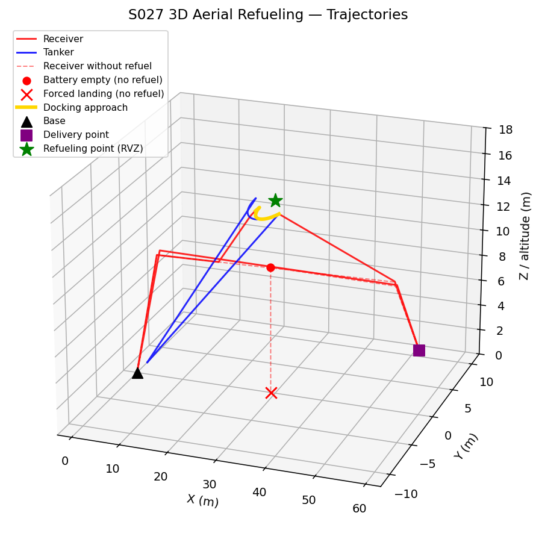
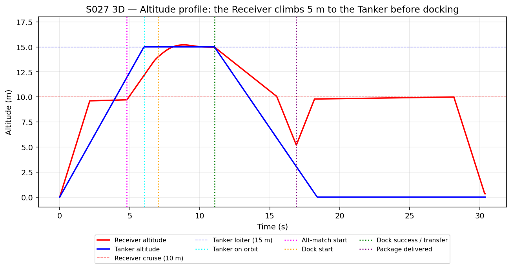
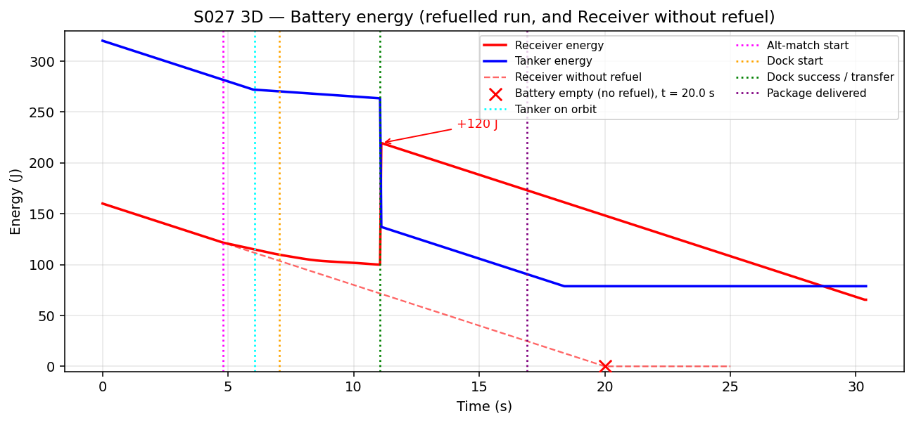
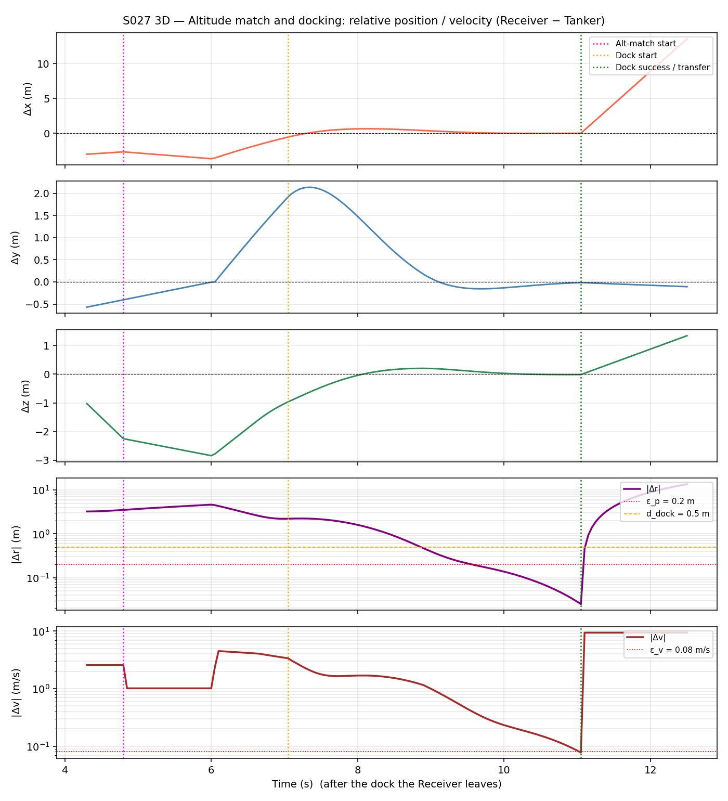
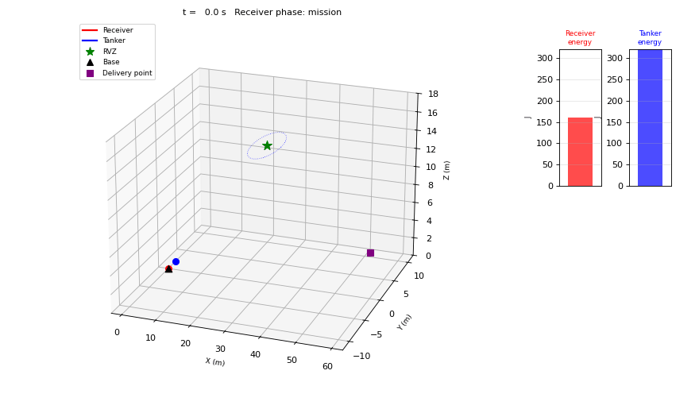

# S027 3D Aerial Refueling Relay

**Domain**: Logistics & Delivery | **Difficulty**: ⭐⭐⭐ | **Status**: ✅ Completed

---

## Problem Definition

A delivery drone (Receiver, red) flies a 3D waypoint mission: climb-out to a 10 m cruise, descent to a 5 m delivery point 60 m away, and return to base. The route is 136.50 m long, but the Receiver's battery covers only 100 m. The card's range trigger detects this and launches a Tanker (blue) from the base.

1. The Tanker flies to a loiter orbit around the route midpoint at 15 m, 5 m above the Receiver's cruise altitude.
2. The Receiver captures the rendezvous horizontally, then climbs to the Tanker's altitude (altitude-match phase).
3. It soft-docks in all three axes, receives energy and resumes its waypoint mission.
4. The Tanker returns to base.

A second run without refuelling shows the forced landing that the trigger predicts. When a drone's battery is empty it stops drawing energy and makes an emergency descent straight down at 2 m/s to the ground (forced landing).

---

## Mathematical Model

**Battery and range trigger** (card):

$$\dot{E} = -(k_f\|\mathbf{v}\|^2 + k_h), \qquad d_{rem} = \frac{E}{k_f V^2 + k_h}\,V$$

Refuelling is requested when $d_{rem} < d_{route,remaining} + d_{margin}$. In 3D, $d_{target} + d_{base}$ is the length of the rest of the waypoint route.

**Tanker loiter** (loiter time $t_\ell$ counted from orbit entry):

- position $\mathbf{p}_T = \mathbf{w}_{rvz} + R_{orb}[\cos\phi, \sin\phi, 0]$, with $\phi = \omega t_\ell + \pi$ and $\omega = V_{T,orb}/R_{orb}$;
- acceleration $\mathbf{a}_T = -R_{orb}\omega^2[\cos\phi, \sin\phi, 0]$, computed analytically from the same $t_\ell$.

The Tanker flies at cruise speed to the orbit entry point (the side of the circle facing the base) and starts the orbit there.

**Altitude match**: horizontal approach to $\mathbf{w}_{rvz}$ at 3.5 m/s plus $v_z = \mathrm{clip}(K_{alt}(z_T - z_R), \pm v_{z,max})$, until $|z_R - z_T| < \delta_z$.

**3D docking** (acceleration command, $\Delta\mathbf{r} = \mathbf{p}_R - \mathbf{p}_T$, $\Delta\mathbf{v} = \mathbf{v}_R - \mathbf{v}_T$):

$$\mathbf{u}_R = \begin{cases} -K_p\Delta\mathbf{r} - K_d\Delta\mathbf{v} + \mathbf{a}_T & \|\Delta\mathbf{r}\| > d_{dock}\\ -K_{p2}\Delta\mathbf{r} - K_{d2}\Delta\mathbf{v} + \mathbf{a}_T & \|\Delta\mathbf{r}\| \le d_{dock}\end{cases}$$

The dock succeeds when $\|\Delta\mathbf{r}\| < \epsilon_p$ and $\|\Delta\mathbf{v}\| < \epsilon_v$, checked on the recorded state of both drones before either is advanced. Then $E_R \mathrel{+}= \Delta E_{xfer}$ and $E_T \mathrel{-}= \Delta E_{xfer}(1 + \eta_{loss})$.

---

## Key Parameters

| Parameter | Value |
|-----------|-------|
| Time step / horizon | 0.05 s / 120 s |
| Cruise speed and speed limit $V$ | 5.0 m/s (both drones) |
| Tanker loiter speed / radius | 2.0 m/s / 4.0 m |
| Receiver cruise / Tanker loiter altitude | 10 m / 15 m |
| Receiver route (waypoints) | (0,0,0) → (5,0,10) → (55,0,10) → (60,0,5) delivery → (55,0,10) → (5,0,10) → (0,0,0); 136.50 m |
| Rendezvous point $\mathbf{w}_{rvz}$ ($\alpha$ = 0.5) | (30, 0, 15) m |
| Tanker launch pad | (0, 2, 0) m |
| Capture radius $d_{cap}$ (horizontal) | 12 m |
| Altitude match: $K_{alt}$ / $v_{z,max}$ / $\delta_z$ / horizontal speed | 1.2 s⁻¹ / 2.0 m/s / 1.0 m / 3.5 m/s |
| $k_f$ / $k_h$ | 0.3 W·s²/m² / 0.5 W (cruise power 8.0 W = 1.6 J/m) |
| Receiver / Tanker initial energy | 160 J / 320 J (card ×4) |
| Energy transferred / loss | 120 J (card ×4) / 5 % |
| Range margin | 5 m |
| $d_{dock}$ / $\epsilon_p$ / $\epsilon_v$ | 0.5 m / 0.20 m / 0.08 m/s |
| Approach gains $(K_p, K_d)$ / soft-dock gains $(K_{p2}, K_{d2})$ | (2.0, 1.5) / (4.0, 2.5) |
| Waypoint arrival radius | 0.5 m |
| Emergency descent speed (empty battery) | 2.0 m/s |

### Deviations from the scenario card

| Item | Card | Code | Reason |
|------|------|------|--------|
| Energies | $E_{0,R}$ = 40 J, $E_{0,T}$ = 80 J, $\Delta E_{xfer}$ = 30 J | 160 J, 320 J, 120 J (×4) | at 1.6 J/m, 40 J is only 25 m of range: the Receiver could not even reach the 30 m RVZ, and an 80 J Tanker could not fly out and back. ×4 makes refuelling necessary (100 m < 136.5 m) and sufficient. ×3, the 2D factor, is not enough on the longer 3D route: the Receiver would hold 59.88 + 90 = 149.88 J after the dock, but the rest of the mission costs 219.88 − 65.48 = 154.40 J. The card is updated. |
| Soft-dock law | $\mathbf{u} = -K_{p2}\Delta\mathbf{r} - K_{d2}\Delta\mathbf{v}$ (no feed-forward) | $+\,\mathbf{a}_T$ in both phases | without it the PD lags the circling Tanker by a constant 0.268 m > ε_p and **never docks** (checked in the script, see Results), as the 2D fix also found |
| Refuel trigger timing | "requests refueling when predicted range falls below threshold" during the mission | fires at t = 0 | with these energies the full route is out of range from the start (100 m < 141.5 m incl. margin), so the trigger launches the Tanker at take-off, as the card's "launches simultaneously" setup implies |
| Tanker start | same base | pad at (0, 2, 0) m | 2 m beside the Receiver so the two tracks stay distinguishable |
| Receiver speed during docking | not specified | clipped to $V$ = 5 m/s | same limit as every other phase |
| Empty battery | not specified | the drone stops drawing energy and descends straight down at 2 m/s (kinematic) to z = 0 | a simplification: a real multirotor with an empty battery would fall or rely on a reserve; this shows where it ends up instead of freezing it in mid-air |

---

## Simulation Results

Console output of `python src/02_logistics_delivery/3d/s027_3d_aerial_refueling.py`. Two runs produced byte-identical output.

| Metric | Value |
|--------|-------|
| Route / energy needed | 136.50 m, 218.4 J at 1.6 J/m |
| Receiver range at take-off | 100.0 m |
| Refuel trigger | t = 0.00 s ($d_{rem}$ 100.0 m < need 141.5 m) |
| Altitude match start | t = 4.80 s (Receiver at 9.72 m; Tanker still climbing, 11.97 m) |
| Tanker on orbit | t = 6.05 s |
| Docking start | t = 7.05 s, \|Δr\| 2.218 m (Δz −0.965 m), \|Δv\| 3.371 m/s |
| **Dock success** | **t = 11.05 s** (docking 4.00 s), \|Δr\| 0.0249 m, \|Δv\| 0.0776 m/s (tol 0.2 m / 0.08 m/s) |
| Energy before transfer | Receiver 99.88 J, Tanker 263.43 J |
| Energy after transfer | Receiver 219.88 J, Tanker 137.43 J |
| Package delivered | t = 16.90 s |
| Tanker home | t = 18.40 s, final energy 78.77 J |
| Receiver home | t = 30.35 s, final energy 65.48 J, 139.31 m flown |
| Min range margin after refuel ($d_{rem}$ − need, need includes 5 m) | 34.60 m |
| Max Tanker step | 0.250 m per 0.05 s = V·Δt (no teleport) |
| **Without refuelling** | battery empty at t = 20.00 s at (29.06, 0, 9.85) m after 100.00 m of 136.50 m (package delivered, on the way home); emergency descent at 2 m/s, forced landing at t = 24.95 s at (29.06, 0, 0) m |
| **Without the a_T feed-forward** | never docks: the Receiver docks from 7.05 s until its battery is empty at 64.75 s, with a steady \|Δr\| of 0.268 m (> ε_p) |

**Energy checks**

- **Tanker at dock.** The pad-to-entry leg is √(26² + 2² + 15²) = 30.1 m, which costs 48.1 J at 1.6 J/m. Five seconds of orbiting at 2 m/s costs 5.0 s × 1.7 W = 8.5 J. That leaves 320 − 48.1 − 8.5 = 263.4 J ✓. After the transfer: 263.43 − 120 × 1.05 = 137.43 J ✓.
- **Tanker home.** The return leg costs 137.43 − 78.77 = 58.66 J, which is 36.7 m at 1.6 J/m. At 5 m/s that takes 7.3 s, consistent with 11.05 → 18.40 s ✓.
- **Receiver without refuelling.** 160 J / 1.6 J/m = 100 m. The outbound route to the delivery point is 75.3 m, so the battery runs out about 25 m back along the return cruise, at x = 29 m ✓. The 9.85 m descent at 2 m/s takes 4.9 s, matching the landing at 24.95 s ✓.
- **Refuelled Receiver.** It ends with 65.48 J, less than it started with, and its range margin never drops below 34.60 m.

**Docking.** The receiver starts the altitude match 12 m before the RVZ, while still at its cruise altitude. It climbs at up to 2 m/s while closing horizontally, and switches to the docking law when it is within δ_z = 1 m of 15 m. The PD law with Tanker-acceleration feed-forward then removes the remaining 2.2 m offset and 3.4 m/s velocity difference in 4.0 s. The velocity tolerance (0.08 m/s) is the binding condition. In `docking_detail.png`, |Δr| is below ε_p about 1.5 s before |Δv| drops below ε_v at 11.05 s. By then |Δr| is 0.025 m.

**What was wrong before.** The old script evaluated the Tanker's next loiter velocity at the absolute time `t + DT`, while the loiter itself used the time since orbit entry. The resulting |a_T| was about 80 m/s² instead of 1.0 m/s², and the soft-dock law had no feed-forward at all, so it never docked (minimum gap 3.9 m). The energies (40/80 J) ran out after 5.6 s and 23.6 s, but both drones kept flying. The refuel trigger at t = 0 was never printed, because of an `if 0.0:` guard. The Tanker also jumped 2.53 m onto its orbit.

---

## Output Files

### 3D Trajectory

The Receiver is red and the Tanker blue; the gold segment is the docking approach. The dashed red line is the Receiver without refuelling: its battery empties at the red dot, and it descends vertically to its forced landing (×):

### Altitude Profile

The Receiver climbs from its 10 m cruise to the Tanker's 15 m loiter altitude before docking. It then descends to the 5 m delivery point and returns at 10 m:

### Energy Levels

Battery energy of both drones, with the +120 J transfer at the dock. The no-refuel Receiver (dashed) reaches 0 J at 20.0 s:

### Docking Detail

Δx, Δy, Δz, |Δr| and |Δv| (Receiver − Tanker) from the altitude-match start to just after the dock, with ε_p, ε_v and d_dock marked:

### Animation

3D view of both drones with the loiter circle and energy bars:

---

## Extensions

1. Add GPS altitude noise (σ_z = 0.3 m) and re-tune $K_{alt}$ and the dock tolerances.
2. Replace the loiter with a straight Tanker track, so the Receiver must intercept a moving 3D target.
3. Sweep the Tanker altitude $z_T$ and add a climb-energy term to find the cheapest rendezvous altitude.
4. Use a two-Tanker chain at different altitudes for a longer route.

---

## Related Scenarios

- Original: [S027 Aerial Refueling Relay](../../../../scenarios/02_logistics_delivery/S027_aerial_refueling_relay.md)
- 3D card: [S027 3D Upgrade — Aerial Refueling Relay](../../../../scenarios/02_logistics_delivery/3d/S027_3d_aerial_refueling.md)
- Follow-ups: [S028 Cargo Escort Formation](../../../../scenarios/02_logistics_delivery/S028_cargo_escort_formation.md), [S036 Last-Mile Relay](../../../../scenarios/02_logistics_delivery/S036_last_mile_relay.md)
