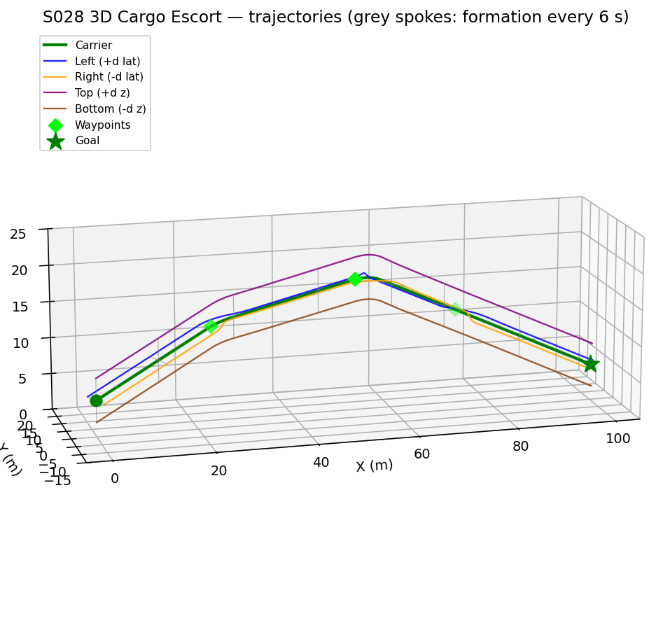
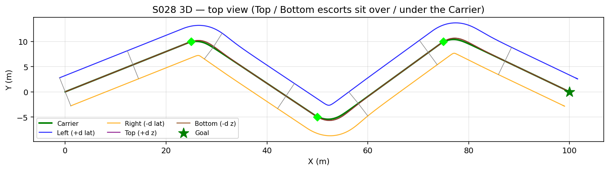
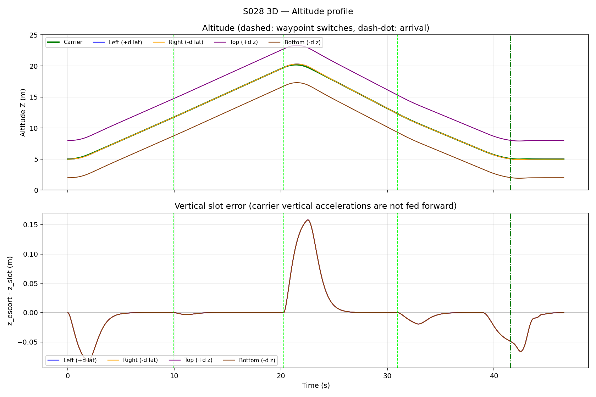
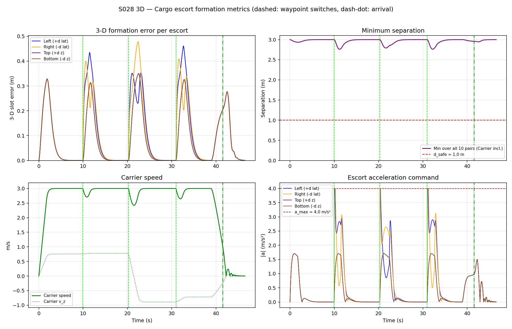
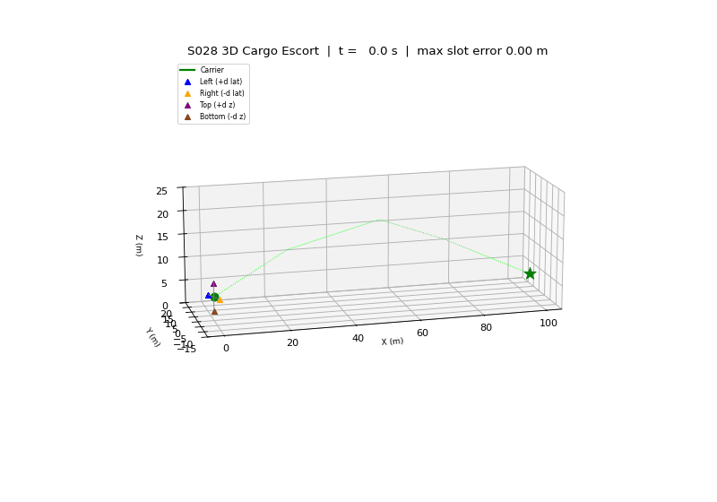

# S028 3D Cargo Escort Formation

**Domain**: Logistics & Delivery | **Difficulty**: ⭐⭐⭐ | **Status**: ✅ Completed

---

## Problem Definition

A cargo drone (Carrier, green) flies a 5-waypoint mission that climbs from 5 m to 20 m and descends back to 5 m, with two left and two right turns. Four escorts keep the card's 3D diamond around it:

- **Left / Right**: ±d along the Carrier's lateral axis.
- **Top / Bottom**: ±d in z.

The offset is d = 3 m.

**Objective**: keep the RMS 3D formation error (escort-to-slot distance) small during the mission, keep every pair of drones at least $d_{safe}$ apart (Carrier included), and bring the Carrier to the goal.

---

## Mathematical Model

**Slots** (card): $\mathbf{s}_i = \mathbf{p}_C + R_z(\psi)\,\mathbf{f}_i$, with $\mathbf{f}_i \in \{[0,\pm d,0], [0,0,\pm d]\}$.

The yaw $\psi$ is the Carrier's horizontal velocity heading. It is **held**:

- when the horizontal speed is below 0.2 m/s;
- after arrival.

**Carrier**: an acceleration-limited point mass that tracks a speed command toward the active waypoint, $\mathbf{a}_C = \mathrm{clip}(K_{vc}(\mathbf{v}_{des} - \mathbf{v}_C), a_C)$.

- $\|\mathbf{v}_{des}\| = 3$ m/s on all legs.
- On the last leg, $\|\mathbf{v}_{des}\| = \min(3, \sqrt{2 \cdot 0.5\,a_C\,\mathrm{dist}})$, so that it brakes to a stop.
- Intermediate waypoints switch at 1.0 m.
- Arrival is declared at 0.3 m from the goal. The same radius is used for the PASS/FAIL check.

**Escorts** (card: PD position control): double-integrator point masses with

$$\mathbf{a}_i = \mathrm{clip}\Big(K_{p}(\mathbf{s}_i - \mathbf{p}_i) + K_{d}(\dot{\mathbf{s}}_i - \mathbf{v}_i) + \sum_{j \ne i} K_{rep}\frac{d_{safe} - d_{ij}}{d_{ij}}\hat{\mathbf{r}}_{ij}\big|_{d_{ij} < d_{safe}},\ a_{max}\Big),$$

where:

- $\dot{\mathbf{s}}_i$ is the slot velocity (finite difference, so it includes the yaw-rate term);
- the repulsion sum runs over **all** other drones, the Carrier included;
- there is no acceleration feed-forward, so every Carrier acceleration produces a transient slot error of order $a/K_p$.

**Metrics**:

- 3D formation error $\|\mathbf{p}_i - \mathbf{s}_i\|$. Its RMS is reported for the **mission** (take-off to arrival) and for the 5 s **hold** after arrival, separately.
- Vertical slot error $z_i - z_{s,i}$.
- Minimum separation over all 10 pairs.

---

## Key Parameters

| Parameter | Value |
|-----------|-------|
| Escorts / formation offset d | 4 (Left, Right, Top, Bottom) / 3.0 m |
| Carrier waypoints | (0,0,5) → (25,10,12) → (50,−5,20) → (75,10,12) → (100,0,5) m; 116.1 m, altitude 5–20 m |
| Carrier cruise speed / acceleration limit / speed gain | 3.0 m/s / 1.5 m/s² / 3.0 s⁻¹ |
| Waypoint switch radius / arrival radius | 1.0 m / 0.3 m |
| Escort PD gains $K_p$ / $K_d$ | 4.0 s⁻² / 4.0 s⁻¹ (critically damped) |
| Escort speed / acceleration limit | 6.0 m/s / 4.0 m/s² |
| Repulsion gain / $d_{safe}$ | 3.0 / 1.0 m |
| Heading-hold speed | 0.2 m/s |
| Time step / hold after arrival / safety horizon | 1/48 s / 5 s / 80 s |

### Deviations from the scenario card

| Item | Card | Code | Reason |
|------|------|------|--------|
| Escort dynamics | "PD position control" | double integrator with PD on the slot error, slot-velocity feed-forward, no acceleration feed-forward, 4 m/s² limit | the card gives no gains or dynamics; with velocity commands plus feed-forward (the old script), the error is zero by construction |
| Carrier dynamics | not specified | acceleration-limited speed tracking (1.5 m/s²), braking on the last leg | gives smooth turns and a stop without overshoot; an overshoot would reverse the velocity heading and swap the Left and Right slots |
| Separation / repulsion | not in the 3D card (2D S028 uses $d_{safe}$ = 1 m) | $d_{safe}$ = 1 m, all pairs including the Carrier, escorts also repelled by the Carrier | same fix as 2D S028 |
| Mission length | — | run ends 5 s after arrival | the old run idled for 34 s after arrival (T_MAX = 45 s) and diluted the RMS |

The old script did not follow the card: it had 3 escorts at ±1–2 m offsets and altitudes of 2–5.5 m. It now matches the card on the number of escorts, d and the altitude range.

---

## Simulation Results

Console output of `python src/02_logistics_delivery/3d/s028_3d_cargo_escort.py`. Two runs gave byte-identical output.

| Metric | Value |
|--------|-------|
| Waypoint switches | t = 9.96, 20.27, 30.98 s |
| Carrier arrival (within 0.3 m) | ✅ t = 41.56 s, error 0.281 m; 0.000 m at the end of the 5 s hold |
| Heading change during the hold | 0.00° (held at rest) |
| **RMS 3D formation error, mission (0–41.56 s)** | **0.1565 m** |
| RMS 3D formation error, 5 s hold after arrival | 0.1389 m |
| RMS 3D formation error, whole run | 0.1547 m |
| Min separation, all pairs (Carrier included) | ✅ **2.7609 m** (Carrier – Right), d_safe = 1.0 m |
| Min separation, escort pairs only | 4.2291 m (Right – Bottom) |
| Steps with repulsion active | 0 of 2236 |
| Steps with an escort at the 4 m/s² limit | 33 |

| Escort | Mission RMS | Mission max | Vertical RMS | Max \|Δz\| |
|--------|-------------|-------------|--------------|------------|
| Left (+d lat) | 0.1747 m | 0.4611 m | 0.0387 m | 0.1582 m |
| Right (−d lat) | 0.1738 m | 0.4788 m | 0.0387 m | 0.1581 m |
| Top (+d z) | 0.1364 m | 0.3504 m | 0.0387 m | 0.1581 m |
| Bottom (−d z) | 0.1364 m | 0.3504 m | 0.0387 m | 0.1581 m |

**Where the error comes from.** Between manoeuvres the error decays to zero, because the slot-velocity feed-forward handles constant-velocity flight exactly. It rises only while the Carrier accelerates:

- **Take-off.** A 1.5 m/s² acceleration gives a quasi-static lag of $a/K_p$ = 1.5/4 ≈ 0.375 m; the transient peaks at about 0.33 m.
- **The three waypoint turns.** The Left and Right slots swing with the yaw, so those escorts see the largest errors (0.46–0.48 m) and briefly saturate at 4 m/s² (33 steps in total).
- **Final braking.** This error carries into the hold: the hold RMS of 0.1389 m is the escorts catching up after the Carrier stops, and it decays to zero.

**Metrics that are identical by construction.**

- **Vertical error.** All four escorts have the *same* vertical error (RMS 0.0387 m, peak 0.158 m at WP2, where the climb rate flips from +0.78 to −0.9 m/s). The card rotates the offsets by yaw only, so the z component of every slot is $z_C$ + const. All four escorts therefore see the same vertical reference and, having the same dynamics, the same vertical error. The one exception is a difference below 0.0001 m in max |Δz| for Left (0.1582 m vs 0.1581 m). It appears because the acceleration clamp scales all three axes together while Left saturates in a turn.
- **Top and Bottom 3D errors are identical.** Their offsets lie along the yaw axis, so their slots are $\mathbf{p}_C \pm d\hat{\mathbf{z}}$ and do not rotate. Their error is pure Carrier-acceleration lag.
- **The old 0.003 m vertical error.** The old script commanded the escorts' velocity directly and fed forward the Carrier velocity. With no dynamics, the error was guaranteed to be near zero.

**Separation.** The minimum over all pairs is Carrier – Right at 2.76 m. That is 3 m minus the transient slot error in a turn, well above $d_{safe}$. The repulsion term never activates (0 steps), so this run does not exercise it. The old README reported 3.15 m from escort pairs only; including the Carrier, the true minimum in the old script was 1.81 m.

**Fixes compared with the old script.**

- The Carrier is now included in the separation check.
- The heading is held at rest. The old script reset it to +x when the Carrier stopped, which made the formation error jump from 0.001 m to 0.40 m at arrival.
- The RMS is computed over the mission. The old 0.27 m was diluted by 34 s of idling; over its own mission the old RMS was 0.55 m.
- The arrival check uses the same 0.3 m radius as the stop rule. The old run printed "Carrier arrived: True" next to "[FAIL] arrived", because it stopped at 0.5 m and checked against 0.3 m.

---

## Output Files

### 3D Trajectory

The Carrier (green) and the four escorts, with grey spokes from the Carrier to each escort every 6 s:

### Top-down XY View

The Left and Right escorts swing wide or tight in the turns. The Top and Bottom escorts are hidden directly over and under the Carrier:

### Altitude Profile

Top: altitudes of all drones. Bottom: vertical slot error, which is the same for all four escorts (the curves overlap):

### Formation Metrics

The panels show:

- 3D slot error per escort;
- minimum separation over all 10 pairs;
- Carrier speed and $v_z$;
- escort acceleration commands.

Waypoint switches are dashed and arrival is dash-dot.

### Animation

3D view with Carrier–escort spokes and the current maximum slot error:

---

## Extensions

1. Add Carrier-acceleration feed-forward ($\ddot{\mathbf{s}}_i$) to remove the turn and climb transients.
2. Rotate the offsets with the flight-path angle (pitch) as well, so that the Top and Bottom slots tilt during climbs.
3. Add wind gusts that differ between drones, as in 2D S028, to stress the vertical pair.
4. Use sharper turns or lower $d$ to activate the repulsion term and test $d_{safe}$.

---

## Related Scenarios

- Original: [S028 Cargo Escort Formation](../../../../scenarios/02_logistics_delivery/S028_cargo_escort_formation.md)
- 3D card: [S028 3D Upgrade — Cargo Escort Formation](../../../../scenarios/02_logistics_delivery/3d/S028_3d_cargo_escort.md)
- See also: [S011 Swarm Encirclement](../../../../scenarios/01_pursuit_evasion/S011_swarm_encirclement.md)
