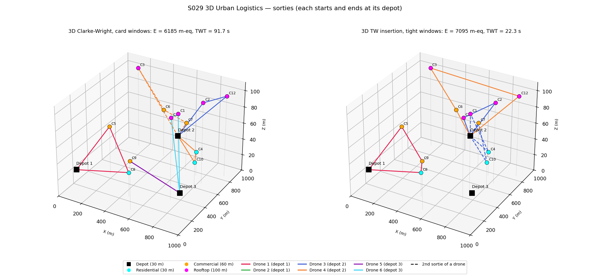
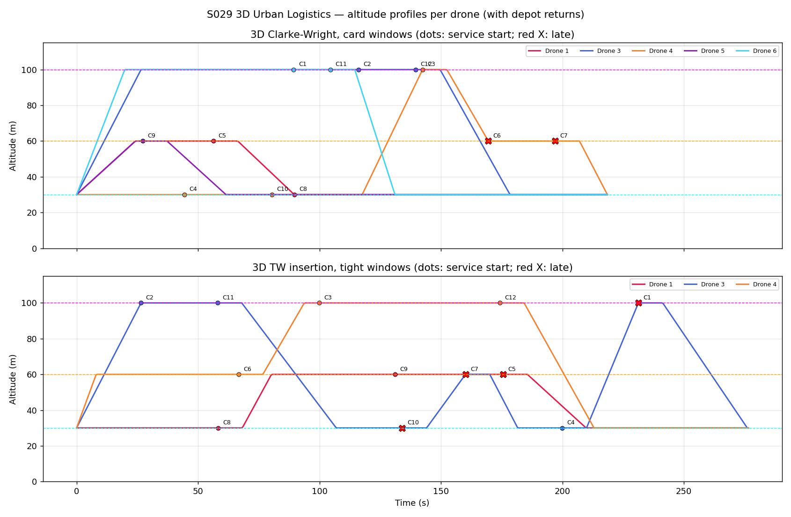
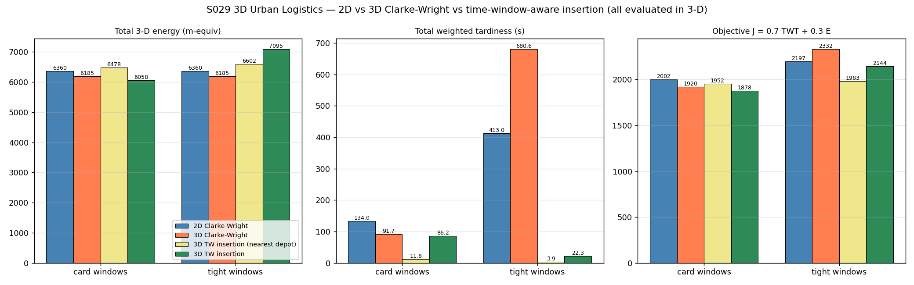
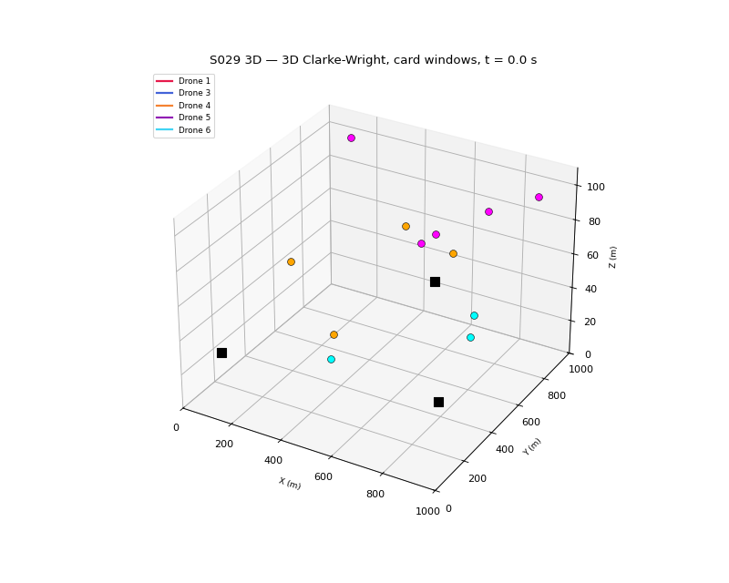

# S029 3D Urban Logistics Scheduling

**Domain**: Logistics & Delivery | **Difficulty**: ⭐⭐⭐⭐ | **Status**: ✅ Completed

---

## Problem Definition

**Setup**: 3 depots at 30 m serve 12 customers spread over a 1000 × 1000 m grid. Each customer's zone sets its delivery altitude: 30 m for residential (3 customers), 60 m for commercial (4) and 100 m for rooftop (5). The fleet has 6 drones, 2 per depot.

A drone may fly several **sorties**. Every sortie starts and ends at the drone's own depot, and must respect:

- the 3.0 kg payload capacity (asserted in the script for every sortie);
- the 5000 m-equivalent energy budget.

Each customer has a time window $[e_c, l_c]$. A drone that arrives early waits until $e_c$. Service after $l_c$ counts as tardiness.

**Objective** (card): minimise $J = \alpha\,\text{TWT} + (1-\alpha)\,E_{3D}$ with $\alpha = 0.7$.

**Strategies compared** (all evaluated in true 3D, with 3D flight times and 3D energy):

1. **2D Clarke-Wright**: savings and feasibility computed on flat geometry, so altitude is ignored when planning.
2. **3D Clarke-Wright**: savings and feasibility use the card's 3D energy metric.
3. **3D TW insertion**: a time-window-aware heuristic for the card's objective $J$. It inserts customers in order of their deadline, each at the cheapest place over the allowed drones, sorties and positions. A relocate local search follows. It runs in two variants:
   - **nearest depot**: each customer may only go to a drone of its nearest depot. This is the same freedom Clarke-Wright has, so this variant isolates the effect of time-window awareness;
   - **any depot**: all 6 drones are allowed. This adds the freedom to serve a customer from a farther depot.

Two instances are used:

- **card**: the card's time windows (seed 42);
- **tight**: the same customers with narrower windows (seed 2029), to test the time-window-aware planner.

---

## Mathematical Model

**Leg energy** (card): $E_{ij} = \|\mathbf{p}_j - \mathbf{p}_i\|_3 + \gamma\,|z_j - z_i|$, with $\gamma = 1.5$.

**Clarke-Wright savings** (per depot, customers grouped by nearest depot): $S_{ij} = E_{d,i} + E_{d,j} - E_{i,j}$. Merges keep each route's orientation. A merge is accepted only if the merged sortie satisfies $\sum q_c \le Q$ and $E_{sortie} \le E_{max}$. The 2D variant uses the horizontal distance instead of $E$.

**Sortie assignment** (Clarke-Wright): each depot's sorties go, in order, to whichever of its two drones is free first. The drone returns to the depot between sorties.

**Timing**: legs are flown in 3D at 15 m/s.

- Service starts at $s_c = \max(\text{arrival}, e_c)$ and lasts 10 s.
- $\text{TWT} = \sum_c w_c \max(0, s_c - l_c)$, with $w_c = 1$.

**TW insertion**: customers are taken in increasing $l_c$. Each goes to the feasible insertion (an existing sortie, or a new sortie) that increases $J$ least. A relocate local search then moves single customers while $J$ decreases.

---

## Key Parameters

| Parameter | Value |
|-----------|-------|
| Depots | (100,100,30), (500,900,30), (900,200,30) m |
| Customers | 12, x, y ~ U[50, 950] m, zone ~ uniform over 3 types (seed 42) |
| Zone altitudes | Residential 30 m, Commercial 60 m, Rooftop 100 m |
| Drones | 6 (2 per depot), several sorties allowed |
| Speed | 15 m/s (3D) |
| Payload capacity Q | 3.0 kg per sortie |
| Energy budget $E_{max}$ | 5000 m-equivalent per sortie |
| Altitude penalty γ | 1.5 |
| Service time | 10 s |
| Card windows | $e_c$ ~ U[0, 120] s, width ~ U[60, 180] s |
| Tight windows | $e_c$ ~ U[0, 240] s, width ~ U[20, 60] s (seed 2029) |
| Tardiness weight $w_c$ | 1 for every customer |
| Objective weight α | 0.7 |
| Demand | U[0.3, 1.5] kg |
| Plot / animation time step | 0.5 s (the schedule itself is event-based) |

### Deviations from the scenario card

| Item | Card | Code | Reason |
|------|------|------|--------|
| Objective | "minimise weighted tardiness plus 3D energy, re-solved with Clarke-Wright" | Clarke-Wright (2D and 3D) builds routes from energy savings only; $J$ is reported for all strategies, and a third strategy (TW insertion) optimises $J$ directly | Clarke-Wright savings cannot express time windows or α. The TW insertion strategy uses both, as the card's objective requires (the 2D fix added the same strategy). |
| Tardiness weights | $w_c$ in the TWT formula, no distribution given | $w_c = 1$ | not specified on the card |
| Tight-window instance | — | added (seed 2029 windows, same customers) | shows when time-window awareness pays off; as in 2D S029 |
| Multiple sorties per drone | "6 drones serve all customers" | a drone may fly several sorties, each returning to its depot | depot 2 has more sorties than drones; the old script chained them without a return and overloaded a drone (4.4 kg against 3.0 kg) |
| 2D baseline timing | — | 2D plans are flown and timed in true 3D | the old script timed them on flat geometry |
| Solver | — | heuristics only (no exact VRPTW) | no MILP / OR-Tools solver in the environment |
| Depot choice | not specified | Clarke-Wright and nearest-depot TW insertion use each customer's nearest depot; any-depot TW insertion may use any depot | the any-depot variant serves C5 and C8 (card windows) and C1, C9 and C11 (tight windows) from a non-nearest depot. Part of its difference from Clarke-Wright therefore comes from depot freedom, not from time windows; the nearest-depot variant separates the two effects. |

---

## Simulation Results

Console output of `python src/02_logistics_delivery/3d/s029_3d_urban_logistics.py`. Two runs gave byte-identical output. All 12 customers are served in every case. The largest sortie load is 2.74 kg and the largest sortie energy 1982.9 m-eq, so every sortie respects Q = 3.0 kg and E_max = 5000.

### Card time windows (earliest 15.6–116.1 s, width ≈ 60.9–159.9 s)

| Metric | 2D Clarke-Wright | 3D Clarke-Wright | TW insertion, nearest depot | TW insertion, any depot |
|--------|------------------|------------------|-----------------------------|-------------------------|
| Total 3D energy | 6359.8 m-eq | 6185.3 m-eq | 6477.6 m-eq | **6057.9 m-eq** |
| Total weighted tardiness | 134.0 s (2 late) | 91.7 s (2 late) | **11.8 s** (2 late) | 86.2 s (3 late) |
| Objective J (α = 0.7) | 2001.7 | 1919.8 | 1951.6 | **1877.7** |
| Makespan | 239.7 s | **218.5 s** | 232.9 s | 275.7 s |
| Sorties / drones used | 6 / 5 | 6 / 5 | 6 / 4 | 5 / 3 |
| Customers from a non-nearest depot | none | none | none | C5, C8 |
| Max sortie load | 2.45 kg | 2.39 kg | 2.32 kg | 2.74 kg |
| Total climb + descent | 680 m | **540 m** | 600 m | **540 m** |
| Extra time from altitude changes | 5.96 s (0.08–2.03 s per leg) | 3.18 s (0.08–0.67 s per leg) | 3.38 s (0.08–0.67 s per leg) | 3.19 s (0.05–0.67 s per leg) |

Plans (drone: sorties separated by |):

- 2D CW: drone1 C5-C8; drone3 C2-C10; drone4 C4-C12 | C3-C6-C7; drone5 C9; drone6 C1-C11.
- 3D CW: drone1 C5-C8; drone3 C2-C12; drone4 C4-C10 | C3-C6-C7; drone5 C9; drone6 C1-C11.
- TW insertion, nearest depot: drone1 C5-C8; drone3 C7-C10 | C6-C3-C4; drone4 C2-C12; drone5 C9 | C11-C1.
- TW insertion, any depot: drone3 C7-C10 | C6-C3-C5-C4; drone4 C2-C12; drone5 C8-C9 | C1-C11.

3D CW vs 2D CW: energy −2.7 %, TWT −42.3 s (−31.6 %).

### Tight time windows (earliest 9.2–191.8 s, width ≈ 20.6–56.4 s)

| Metric | 2D Clarke-Wright | 3D Clarke-Wright | TW insertion, nearest depot | TW insertion, any depot |
|--------|------------------|------------------|-----------------------------|-------------------------|
| Total 3D energy | 6359.8 m-eq | **6185.3 m-eq** | 6601.9 m-eq | 7095.3 m-eq |
| Total weighted tardiness | 413.0 s (6 late) | 680.6 s (6 late) | **3.9 s** (1 late) | 22.3 s (4 late) |
| Objective J (α = 0.7) | 2197.1 | 2332.0 | **1983.3** | 2144.2 |
| Makespan | 244.2 s | 313.9 s | **227.4 s** | 276.1 s |
| Sorties / drones used | 6 / 5 | 6 / 5 | 6 / 5 | 5 / 3 |
| Customers from a non-nearest depot | none | none | none | C1, C9, C11 |

3D CW vs 2D CW: energy −2.7 %, TWT +267.6 s (+64.8 %).

TW insertion local search:

| | Card windows | Tight windows |
|---|---|---|
| Nearest depot | J 2191.5 → 1951.6 in 4 moves | J 2072.7 → 1983.3 in 2 moves |
| Any depot | J 2050.8 → 1877.7 in 4 moves | no improving move (J 2144.2) |

### Findings

- **Altitude-aware savings pair customers by altitude.** The 2D planner pairs rooftop C12 with residential C4, and rooftop C2 with residential C10. The 3D planner pairs the two rooftops (C2-C12) and the two residential stops (C4-C10). Total climb plus descent drops from 680 m to 540 m, and the 3D energy drops by 2.7 % (6359.8 → 6185.3 m-eq).
- **The late deliveries come from sortie queueing, not from climbing.** On the card windows, 3D Clarke-Wright is late only at C6 (52.1 s) and C7 (39.5 s). Depot 2 has three sorties but two drones, so drone 4 flies C3-C6-C7 only after returning from C4-C10 (see the altitude profiles). Climbing adds just 0.08–0.67 s per altitude-change leg, 3.18 s for the whole plan. The old README blamed "4.7 s per rooftop ascent", which matches neither the data nor the geometry. The old script's only late customer, C9 (43.3 s), was late because sorties were chained without returning to the depot.
- **Clarke-Wright tardiness is luck.** On the tight windows, 3D Clarke-Wright is *later* than 2D (680.6 vs 413.0 s). The C3-C6-C7 sortie is now queued behind the longer C2-C12 rooftop sortie, and C4-C10 replaces C4-C12, which makes C10 late. Neither planner looks at the windows.
- **Time-window awareness alone** is measured by the nearest-depot TW insertion, which has the same depot freedom as Clarke-Wright.
  - **Tight windows**: it clearly pays off. TWT falls from 680.6 s to 3.9 s (1 late customer), and J from 2332.0 to 1983.3, the best of all four strategies. Energy rises 6.7 % (6185.3 → 6601.9 m-eq).
  - **Card windows**: it does *not* beat 3D Clarke-Wright on J (1951.6 vs 1919.8). It cuts TWT from 91.7 s to 11.8 s, worth 0.7 × 79.9 = 55.9, but spends 292.3 m-eq more energy, costing 0.3 × 292.3 = 87.7. With these mostly loose windows, Clarke-Wright's energy-optimal routes are hard to beat.
- **Free depot choice, not time windows, explains the card-window result.** The any-depot TW insertion has the lowest J on the card windows (1877.7) and the lowest energy (6057.9 m-eq). It serves C5 from depot 2 and C8 from depot 3 instead of their nearest depot 1, and accepts more tardiness than the nearest-depot variant (86.2 vs 11.8 s). The earlier README credited this result to time-window awareness, which was wrong.
- **More freedom does not guarantee a better heuristic result.** On the tight windows the any-depot variant is *worse* than the nearest-depot one: J 2144.2 vs 1983.3, TWT 22.3 vs 3.9 s, energy 7095.3 vs 6601.9 m-eq. Its greedy deadline-order insertion uses depot freedom early (C1, C9, C11 from non-nearest depots). The one-customer relocate search then finds no improving move, so it stays in a worse local optimum. Both are heuristics, not optimal VRPTW solutions.
- **Capacity now holds.** Every sortie returns to its depot. The old script concatenated a depot's routes into one drone path, and drone 3 carried 4.4 kg against a 3.0 kg limit. The script now asserts `max load ≤ Q_MAX`; the largest load is 2.74 kg.
- The old "Tardiness change: +4333170755.0%" came from dividing by a zero 2D tardiness. The relative change is now printed only when the 2D TWT is positive.

---

## Output Files

### 3D Route Map

Left: 3D Clarke-Wright on the card windows. Right: nearest-depot TW insertion on the tight windows. Customers are coloured by zone. The dashed lines are a drone's second or later sorties; every sortie returns to its depot:

### Altitude Profiles

Per-drone altitude against time, including waits, service and depot returns. Top: 3D Clarke-Wright on the card windows. Bottom: nearest-depot TW insertion on the tight windows. The dots mark service start, and red crosses mark late deliveries:

### Strategy Comparison

Total 3D energy, total weighted tardiness and the card objective J for the four strategies on both instances:

### Animation

3D Clarke-Wright on the card windows, all drones flying at the same time (110 frames):

---

## Extensions

1. Add swap and 2-opt moves, or whole-sortie relocation, to the local search.
2. Sweep α and γ to trace the (energy, tardiness) Pareto front.
3. Add altitude-dependent wind or air-density power models.
4. Enforce 10 m vertical separation between drones in the same x–y neighbourhood.

---

## Related Scenarios

- Original: [S029 Urban Logistics Scheduling](../../../../scenarios/02_logistics_delivery/S029_urban_logistics_scheduling.md)
- 3D card: [S029 3D Upgrade — Urban Logistics Scheduling](../../../../scenarios/02_logistics_delivery/3d/S029_3d_urban_logistics.md)
- Follow-ups: [S030 Multi-Depot Delivery](../../../../scenarios/02_logistics_delivery/S030_multi_depot_delivery.md), [S031 Path De-confliction](../../../../scenarios/02_logistics_delivery/S031_path_deconfliction.md)
