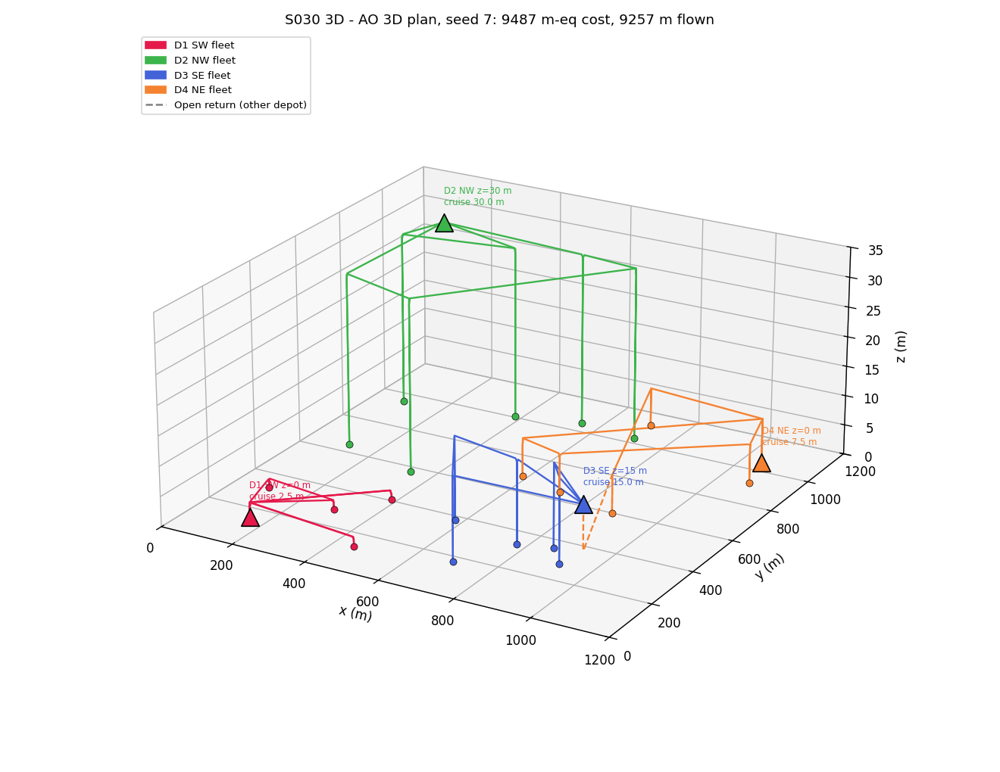
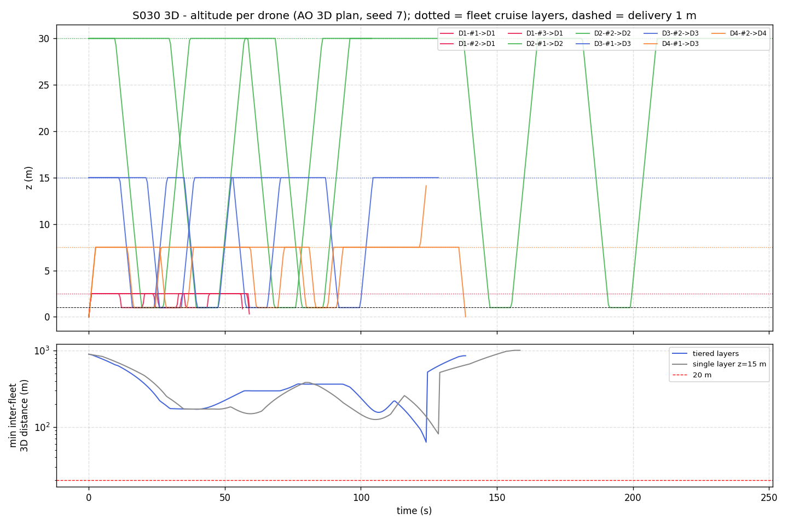
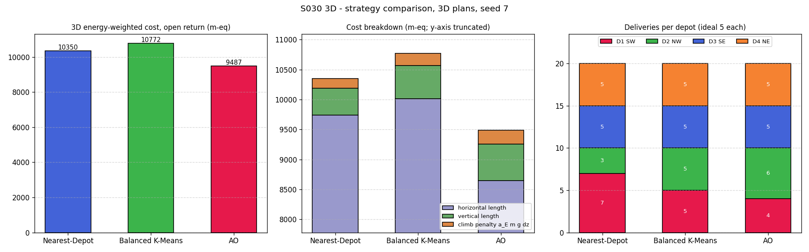
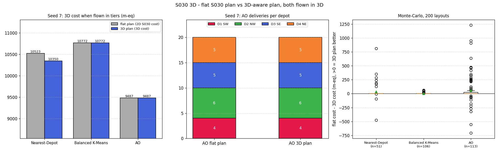
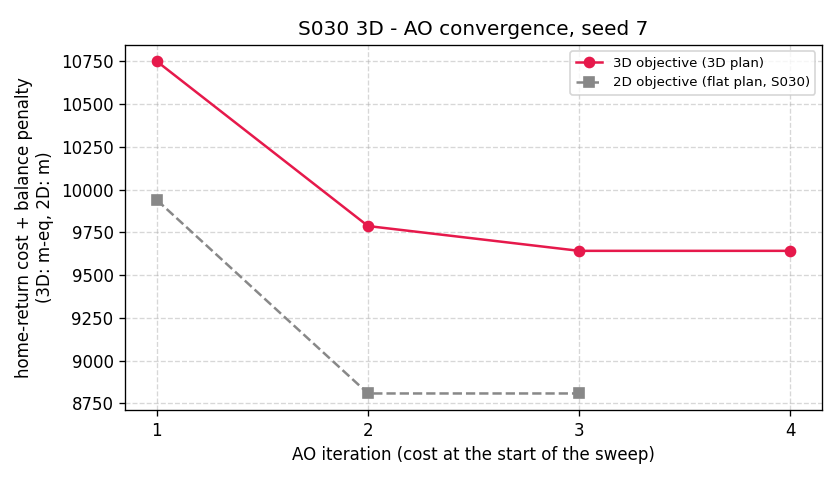
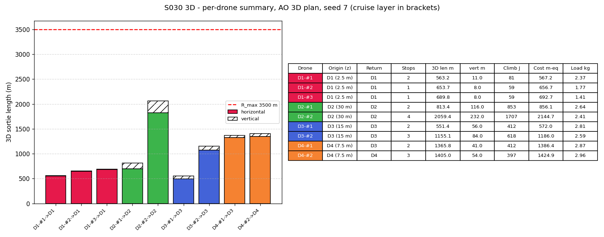
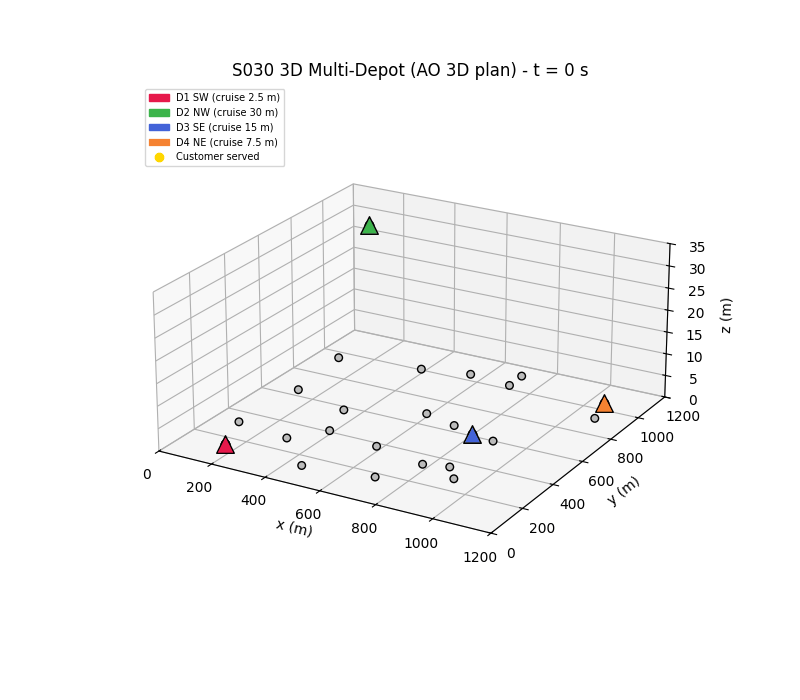

# S030 3D Multi-Depot Delivery

**Domain**: Logistics & Delivery | **Difficulty**: ⭐⭐⭐⭐ | **Status**: ✅ Completed

---

## Problem Definition

**Setup**: The S030 network (4 depots, 10 drones with fleet $F = [3, 2, 3, 2]$, inventory $I = [25, 18, 25, 20]$ kg, 20 customers from seed 7) is placed in a $1200 \times 1200 \times 35$ m volume. The depots keep their corner positions but sit on three altitude tiers:

| Depot | $(x, y)$ m | Depot altitude | Fleet cruise layer |
|-------|-----------|----------------|--------------------|
| D1 SW | (150, 150) | 0 m (ground) | 2.5 m |
| D2 NW | (150, 1050) | 30 m (rooftop) | 30 m |
| D3 SE | (1050, 150) | 15 m (mid-level) | 15 m |
| D4 NE | (1050, 1050) | 0 m (ground) | 7.5 m |

All customers are delivered at $z = 1$ m. Each drone flies one open-route sortie: it leaves its home depot, serves its customers, and lands at any depot with a free docking slot.

**Altitude-zone routing** (card): every horizontal leg is flown at the fleet's cruise layer. Altitude changes are vertical moves at the nodes:

- take-off climb from a ground depot to the layer;
- at each customer, a descent to 1 m, an 8 s delivery hover and a re-climb;
- at the landing depot, a final climb or descent to the depot altitude.

**Strategies** (same as 2D S030, now on the 3D cost):

1. **Nearest-Depot**: each customer goes to the depot with the cheapest 3D out-and-back cost.
2. **Balanced K-Means**: depot-anchored K-Means on 3D positions, with a cap of 5 customers per cluster.
3. **Alternating Optimisation (AO)**: single-customer moves that lower the 3D home-return cost plus the balance penalty.

**Key 3D question** (card): do altitude tiers change the partition decisions relative to the flat S030 solution, and do the tiered cruise layers keep fleets apart? Every strategy is planned twice:

- a **flat plan**, which uses the 2D S030 cost and is exactly the S030 solution;
- a **3D plan**, which uses the 3D cost.

Both plans are flown and scored in 3D. The card's seed 7 is the showcase. A 200-layout Monte-Carlo (customer seeds 0–199) checks whether it is typical; every strategy and both planners see the same layout.

---

## Mathematical Model

### 3D leg cost (altitude-zone path)

For a drone of fleet $m$ (cruise layer $z_c$) flying from node $a$ (altitude $z_a$) to node $b$:

$$L_{ab} = |z_c - z_a| + d^{xy}_{ab} + |z_b - z_c|, \qquad \Delta z^{+}_{ab} = \max(z_c - z_a, 0) + \max(z_b - z_c, 0)$$

$$c_{ab} = L_{ab} + \alpha_E\, m_{drone}\, g\, \Delta z^{+}_{ab}$$

Only climbs are charged energy; descents are free but still count as path length. With $\alpha_E m_{drone} g = 0.05 \times 1.5 \times 9.81 = 0.7358$ m-eq per metre of climb, one extra customer stop (descend to 1 m, then re-climb) costs $2(z_c - 1) + 0.7358\,(z_c - 1)$:

| Fleet | Cruise layer | Extra cost per stop |
|-------|--------------|---------------------|
| D1 | 2.5 m | 4.1 m-eq |
| D2 | 30 m | 79.3 m-eq |
| D3 | 15 m | 38.3 m-eq |
| D4 | 7.5 m | 17.8 m-eq |

### Objective and constraints

$$\min \sum_k \sum_{(a,b) \in \text{route}_k} c_{ab} \;+\; \lambda \sum_m (n_m - \bar n)^2$$

The constraints are the same as in 2D S030, with the range now on the 3D path:

- per sortie: payload $\le Q$ and 3D path length $\sum L_{ab} \le R_{max}$;
- per depot: at most $F_m$ sorties (one per drone) and cargo $\le I_m$.

Routes inside a depot use nearest-neighbour packing plus 2-opt, with a first-fit-decreasing fallback, as in 2D S030.

Within one fleet the per-stop vertical cost is a constant. The 3D cost therefore never changes the *order* of customers inside a sortie. It can only change **which depot** serves a customer, and **where a drone lands**.

### Open-route return

Landing depots are chosen by an optimal assignment of sorties to docking slots (slots = fleet size, `linear_sum_assignment`). It maximises the total saving $c_{last,\delta(k)} - c_{last,m}$ subject to the 3D range limit. The landing leg includes any climb to a higher-tier depot, so returning to the rooftop is penalised.

### Vertical separation check

The drones are flown on a 0.5 s grid at 14 m/s horizontally and 3 m/s vertically. A **loss of separation (LoS)** is a sample where two airborne drones of *different* fleets are less than 20 m apart horizontally and less than 5 m apart vertically. The tiered flight is compared with the same plan flown on one shared 15 m layer.

---

## Key Parameters

| Parameter | Value |
|-----------|-------|
| Volume | 1200 × 1200 × 35 m |
| Depot altitudes | D1 0 m, D2 30 m, D3 15 m, D4 0 m |
| Fleet cruise layers | D1 2.5 m, D2 30 m, D3 15 m, D4 7.5 m |
| Customer altitude | 1 m |
| Fleet / inventory | [3, 2, 3, 2] drones, [25, 18, 25, 20] kg |
| Customers | 20, U[100, 1100]² m, demand U(0.3, 1.8) kg, seed 7 (total 21.81 kg) |
| Drone mass $m_{drone}$, $g$ | 1.5 kg, 9.81 m/s² |
| Energy-to-distance factor $\alpha_E$ | 0.05 m/J |
| Payload $Q$ / range $R_{max}$ | 3.0 kg / 3500 m of 3D path per sortie |
| Horizontal speed $v$ | 14 m/s |
| Vertical speed $v_z$ | 3 m/s (added) |
| Service time per stop | 8 s (from 2D S030) |
| Balance weight $\lambda$ | 50 m²/delivery² |
| AO $\varepsilon_{AO}$ / max iterations | 1.0 / 50 |
| Balanced K-Means cap / max iterations | 5 customers / 100 (from 2D S030) |
| Vertical separation $\Delta z_{sep}$ | 5 m |
| LoS horizontal radius | 20 m (added) |
| Single-layer counterfactual altitude | 15 m (added) |
| Flight sampling step | 0.5 s |
| Monte-Carlo | 200 customer layouts, seeds 0–199 |

### Deviations from the scenario card

| Card | Implementation | Reason |
|------|----------------|--------|
| D1 and D4 share tier 0 m; the separation is "automatically satisfied"; same-tier fleets are offset by ±2.5 m | D1 cruises at 2.5 m and D4 at 7.5 m | ±2.5 m around 0 m puts one fleet underground (−2.5 m), and two fleets on one tier are not automatically separated. The card is corrected. |
| $E_{stop} = 2\,m g (z_c - 1)$ per stop | only the re-climb is charged: $m g (z_c - 1)$ | the card's own arc-cost rule makes descents free; charging them twice is inconsistent. The card is corrected. |
| Arc cost $d^{3D}_{ij}$ (straight line) plus a separate per-stop term and a $2(z_c-1)$ range term | cost and range computed on the actual altitude-zone path (vertical, horizontal, vertical) | this is the card's own altitude-zone routing model. It counts each vertical metre exactly once and covers depot legs, where the depot and cruise altitudes differ. |
| Return choice: $d^{3D}_{last,m} + \alpha_E m g \max(z_m - 1, 0)$, nearest free slot drone by drone | joint slot assignment that maximises the total saving on the altitude-zone path cost, with a 3D range check | same rule as the fixed 2D S030 (joint assignment). The path cost includes the climb from the cruise layer to the depot. |
| Vertical moves are instantaneous ("not time-penalised") | vertical moves at 3 m/s | instantaneous altitude changes would teleport the drone in the flight simulation and the GIF. This changes only the makespan, not the cost. The card is corrected. |
| K-Means "evaluated on 3D arc costs" | K-Means clusters 3D positions, then routes and scores on the 3D cost | K-Means is a geometric clustering; the 2D S030 balanced variant (size cap 5) is kept |
| Route seeding by 3D Clarke-Wright savings, "executed exactly as in S030" | nearest-neighbour packing plus 2-opt on the 3D cost, with a first-fit-decreasing fallback for the fleet limit | the fixed 2D S030 does not use Clarke-Wright either (its README lists this deviation); keeping its route builder makes the flat-vs-3D comparison differ only in the cost model. The card now notes this. |
| Service time, K-Means cap and iteration limit, fleet-limit packing | taken from the fixed 2D S030 | the 3D card says "as in S030" |
| Per-drone "energy used" | climb energy $m g \Delta z^{+}$ (J) and energy-weighted cost (m-eq) | the card defines no cruise power model, only the climb energy |
| Single showcase run | showcase seed 7 plus a 200-layout Monte-Carlo, plus a separation check against a single-layer counterfactual | one layout cannot show whether the 3D cost changes decisions in general |

---

## Simulation Results

Both runs printed byte-identical output and produced byte-identical files. Runtime is about 2 min 40 s.

**Regression check.** Planned with the flat cost and scored with the 2D metric, the code reproduces 2D S030 exactly:

- Nearest-Depot 9839.0 m;
- Balanced K-Means 10012.5 m;
- AO 8646.8 m, with deliveries per depot [4, 6, 5, 5].

### Showcase (card seed 7): 3D plans

| Strategy | 3D cost, open return (m-eq) | Objective (home cost + penalty) | 3D length (horizontal + vertical) | Climb energy | Deliveries/depot | Sorties/depot |
|----------|------|------|------|------|------|------|
| Nearest-Depot | 10350.3 | 10750.3 | 10186.5 m (9741.5 + 445.0) | 3274 J | [7, 3, 5, 5] | [3, 2, 3, 2] |
| Balanced K-Means | 10771.6 | 10771.6 | 10567.5 m (10012.5 + 555.0) | 4083 J | [5, 5, 5, 5] | [3, 2, 3, 2] |
| **AO** | **9486.7** | **9641.9** | **9256.8 m** (8646.8 + 610.0) | 4598 J | [4, 6, 5, 5] | [3, 2, 2, 2] |

- All plans are feasible. The largest sortie load is 2.96 kg (limit 3.0 kg) and the longest 3D sortie is 2230.3 m (Balanced K-Means; limit 3500 m).
- AO converges in 4 sweeps: 10750.3 → 9787.0 → 9641.9 → 9641.9. It rejected 74 candidate partitions as infeasible, all on the fleet limit.
- The open-route saving is 55.2 m-eq (D4-#1 lands at D3). In 2D it was 60.7 m. Landing at D3 now needs a 7.5 → 15 m climb (7.5 m of path plus a 5.5 m-eq climb penalty) but saves the 7.5 m descent to D4, so the saving is 60.7 − 5.5 = 55.2.
- Cost check for AO: 9256.8 m of path plus 0.7358 × (4598 J / 14.715 N) = 9256.8 + 229.9 = 9486.7 m-eq.

### Flat plan vs 3D plan, both flown in 3D (seed 7)

| Strategy | Flat plan | 3D plan | Saving of the 3D plan | Customers reassigned |
|----------|-----------|---------|-----------------------|----------------------|
| Nearest-Depot | 10522.9 | 10350.3 | +172.7 m-eq (+1.64%) | c13: D2 → D1 |
| Balanced K-Means | 10771.6 | 10771.6 | 0.0 | none |
| AO | 9486.7 | 9486.7 | 0.0 | none |

**On the card's own layout, the altitude tiers do not change the AO solution.** AO with 3D costs starts from a different point: the 3D Nearest-Depot moves c13 from rooftop D2 to ground D1, at objective 10750.3. It still converges to exactly the flat S030 partition [4, 6, 5, 5], with the same routes and the same open return. Rooftop D2 keeps 6 customers even though each D2 stop costs 79.3 m-eq against 4.1 m-eq for D1. AO tried moving each customer to every other depot, and no move lowered the 3D objective (distance + balance penalty) while staying feasible.

Only Nearest-Depot reacts on seed 7. Customer 13 is nearly equidistant between D1 and D2, so the 3D per-stop cost tips it to D1. That lowers the flown cost by 172.7 m-eq, but it raises the balance penalty (100 → 400), so the 3D Nearest-Depot *objective* is worse (10750.3 vs 10622.9).

### Monte-Carlo, 200 customer layouts (same layout for every strategy and both planners)

Saving = flat-plan cost − 3D-plan cost, both scored on the 3D open-return cost. Wins, ties and losses are counted for the 3D plan, with a tie meaning |diff| ≤ 0.5 m-eq. Counting only exact ties (diff = 0) gives the same split for Nearest-Depot (7/41/3) and Balanced K-Means (13/93/0) and 35/66/12 for AO: one AO layout falls inside the 0.5 m-eq band with a 0.244 m-eq gain for the 3D plan.

| Strategy | Layouts compared | Mean ± std saving | Median | Min / max | Wins / ties / losses | Objective W/T/L | Layouts with any reassignment |
|----------|------|------|------|------|------|------|------|
| Nearest-Depot | 51 | +31.5 ± 153.2 m-eq (+0.32%) | 0.0 | −477.0 / +814.4 | 7 / 41 / 3 | 5 / 41 / 5 | 10 (max 1 customer) |
| Balanced K-Means | 106 | +3.4 ± 11.0 m-eq (+0.03%) | 0.0 | 0.0 / +61.3 | 13 / 93 / 0 | 0 / 106 / 0 | 0 |
| AO | 113 | +57.8 ± 232.2 m-eq (+0.65%) | 0.0 | −708.6 / +1233.1 | 34 / 67 / 12 | 24 / 75 / 14 | 38 (max 6 customers) |

Every infeasible plan fails on the fleet limit. Summed over both planners, the depot-level failure counts are 352 (Nearest-Depot), 208 (Balanced K-Means) and 229 (AO), with 0 inventory and 0 range failures.

**Findings**

- **The 3D tiers change the AO partition in only a minority of layouts, and the effect is small.** AO reassigns at least one customer in 38/113 comparable layouts and ties the flat plan in 67. The mean gain is 0.65% of the flown 3D cost. The direction is the expected one: rooftop D2 serves fewer customers (mean 4.52 → 4.32). The reason is scale: the largest per-stop altitude cost (79 m-eq at D2) is small next to the 400–2000 m sorties, so it only tips customers that are nearly equidistant between depots.
- **The 3D-aware AO is not always better.** It loses on flown cost in 12 layouts (worst −708.6 m-eq) and on its own objective in 14. AO is a local search that starts from Nearest-Depot, so the 3D run and the flat run can end in different local optima. A changed start explains only part of the losses: the 3D cost changes the Nearest-Depot start in 7 of the 12 flown-cost losses and 9 of the 14 objective losses (and in 15 of the 34 wins). In the other 5 flown-cost losses both runs start from the same partition; the different cost function then leads the greedy moves to a different local optimum, which happens to fly worse. Either way the losses come from the local search, which does not find the 3D optimum, not from the 3D cost model itself.
- **Balanced K-Means is blind to the tiers.** Its partition never changes (0/106 layouts), because a 15–30 m height offset barely changes Euclidean distances of hundreds of metres. It gains a little (13 wins, +3.4 m-eq on average) only from the 3D-aware choice of landing depot.
- **Most random layouts are infeasible under the S030 fleet limit.** One sortie per drone means depot $m$ can carry at most $F_m Q$ = 6–9 kg, and every recorded failure is a fleet-limit failure. Nearest-Depot is infeasible in 143 (flat) and 146 (3D) of 200 layouts. Comparisons therefore use only the layouts where both plans are feasible.

### Vertical separation

On seed 7, no loss of separation occurs in the AO plan, either with tiered layers or on a single 15 m layer. The closest approach between fleets is 63.1 m tiered and 81.1 m on one layer, so this layout does not discriminate.

Over the 118 layouts with a feasible 3D AO plan:

| Flight | Layouts with any LoS | LoS pairs (mean per layout) | LoS samples |
|--------|----------------------|-----------------------------|-------------|
| Tiered layers (card) | 4 | 0.03 | 10 (8 in a vertical transition, 2 during a delivery hover) |
| Single 15 m layer | 14 | 0.13 | 123 |

Tiered layers have fewer LoS pairs than the single layer in 13 layouts, the same number in 102 and more in 3.

**The card's claim holds only partly.** The code asserts that two cruising drones of different fleets are never less than 5 m apart vertically. That part is guaranteed, and tiering removes most conflicts (10 vs 123 samples). It is not "separation without collision logic", though. Every remaining LoS involves a drone outside its layer: 8 samples with a drone descending or climbing through other layers, and 2 with a drone hovering at 1 m for a delivery. D1's 2.5 m layer is within 5 m of the 1 m delivery altitude, so a cruising D1 drone is never vertically separated from a delivering drone.

### Per-Drone Summary (AO, 3D plan, seed 7)

| Drone | Origin (cruise layer) | Return | Stops | 3D length (m) | Vertical (m) | Climb energy (J) | Cost (m-eq) | Load (kg) |
|-------|------|------|------|------|------|------|------|------|
| D1-#1 | D1 (2.5 m) | D1 | 2 | 563.2 | 11.0 | 81 | 567.2 | 2.37 |
| D1-#2 | D1 (2.5 m) | D1 | 1 | 653.7 | 8.0 | 59 | 656.7 | 1.77 |
| D1-#3 | D1 (2.5 m) | D1 | 1 | 689.8 | 8.0 | 59 | 692.7 | 1.41 |
| D2-#1 | D2 (30 m) | D2 | 2 | 813.4 | 116.0 | 853 | 856.1 | 2.64 |
| D2-#2 | D2 (30 m) | D2 | 4 | 2059.4 | 232.0 | 1707 | 2144.7 | 2.41 |
| D3-#1 | D3 (15 m) | D3 | 2 | 551.4 | 56.0 | 412 | 572.0 | 2.81 |
| D3-#2 | D3 (15 m) | D3 | 3 | 1155.1 | 84.0 | 618 | 1186.0 | 2.59 |
| D4-#1 | D4 (7.5 m) | **D3** | 2 | 1365.8 | 41.0 | 412 | 1386.4 | 2.87 |
| D4-#2 | D4 (7.5 m) | D4 | 3 | 1405.0 | 54.0 | 397 | 1424.9 | 2.96 |

Sanity check for D2-#2: 4 stops × 29 m re-climb = 116 m of climb, and 1.5 kg × 9.81 m/s² × 116 m = 1707 J. Its vertical path is 4 × 2 × 29 = 232 m. Makespan is 239.9 s, against 162.5 s in 2D. Both are set by D2-#2: 1827.4 m / 14 m/s + 4 × 8 s = 162.5 s in 2D. In 3D its 232 m of vertical travel at 3 m/s adds 77.3 s.

---

## Output Files

### 3D Trajectories (AO, 3D plan, seed 7)

Each fleet flies on its own layer: D2 (green) at 30 m, D3 (blue) at 15 m, D4 (orange) at 7.5 m and D1 (red) at 2.5 m. Each customer stop is a vertical drop to 1 m. The dashed orange leg is D4-#1's open return to D3, which ends with a climb to D3's 15 m pad:

### Altitude Time-Series and Inter-Fleet Separation

Top: $z(t)$ per drone, with the cruise layers dotted and the 1 m delivery altitude dashed. Bottom: the minimum 3D distance between drones of different fleets over time, for tiered layers vs a single 15 m layer. On seed 7 neither curve reaches the 20 m line:

### Strategy Comparison and Load Balance (3D plans, seed 7)

Left: 3D energy-weighted cost. Middle: cost split into horizontal length, vertical length and climb penalty (y-axis truncated). Right: deliveries per depot:

### Flat S030 Plan vs 3D Plan

Left: seed-7 3D cost of the flat and 3D plans. Middle: AO deliveries per depot, the same for both plans on seed 7. Right: Monte-Carlo distribution of the saving of the 3D plan over 200 layouts (box = quartiles, triangle = mean; most values are exactly 0):

### AO Convergence

The 3D objective per sweep (10750.3 → 9787.0 → 9641.9 → 9641.9) and the flat S030 run (9939.0 → 8807.5 → 8807.5, in m):

### Per-Drone Summary

3D sortie length (horizontal plus hatched vertical) against $R_{max}$, with the per-drone table:

### Animation

All 9 AO sorties flown simultaneously in 3D, coloured by origin depot; customers turn gold when served. 97 frames at 10 fps, one frame every 2.5 s of the 239.9 s flight:

---

## Extensions

1. Let AO also choose each depot's cruise layer, trading climb cost against separation (card Extension 1). Move D1 above 6 m so that its layer is separated from the delivery altitude.
2. Replace the single-customer AO moves with a multi-start or swap neighbourhood, so that the 3D plan can no longer lose to the flat plan.
3. Allow several sorties per drone (multiple waves) so that more random layouts are feasible and the inventory limit can bind.
4. Add an altitude-dependent wind layer $\mathbf{w}(z)$ (card Extension 4), which would make the layer choice matter for horizontal legs as well.

---

## Related Scenarios

- Original 2D version: [S030 Multi-Depot Delivery](../../../../scenarios/02_logistics_delivery/S030_multi_depot_delivery.md)
- 3D card: [S030 3D Upgrade — Multi-Depot Delivery](../../../../scenarios/02_logistics_delivery/3d/S030_3d_multi_depot.md)
- Other 3D logistics upgrades: [S029 3D Upgrade — Urban Logistics Scheduling](../../../../scenarios/02_logistics_delivery/3d/S029_3d_urban_logistics.md), [S027 3D Upgrade — Aerial Refueling Relay](../../../../scenarios/02_logistics_delivery/3d/S027_3d_aerial_refueling.md)
- Follow-ups: [S031 Path De-confliction](../../../../scenarios/02_logistics_delivery/S031_path_deconfliction.md)
