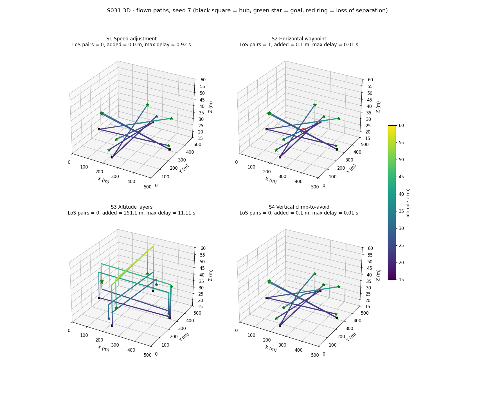
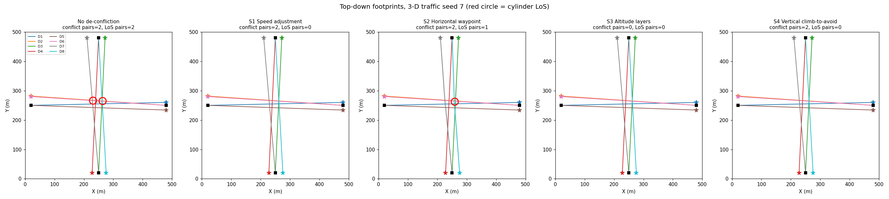
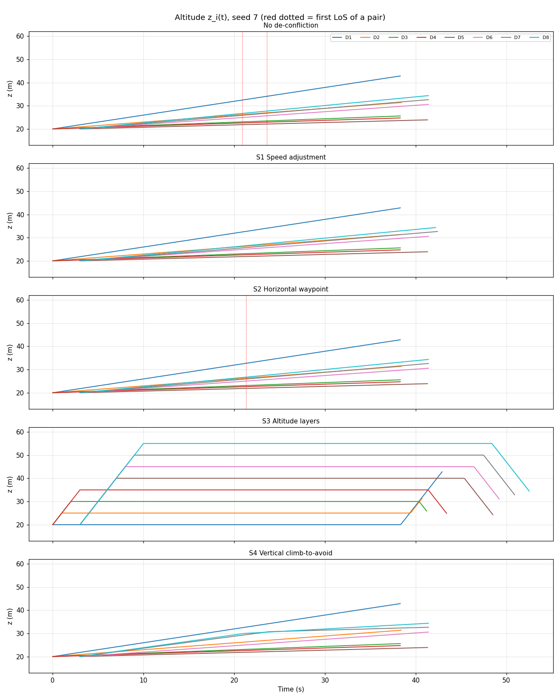
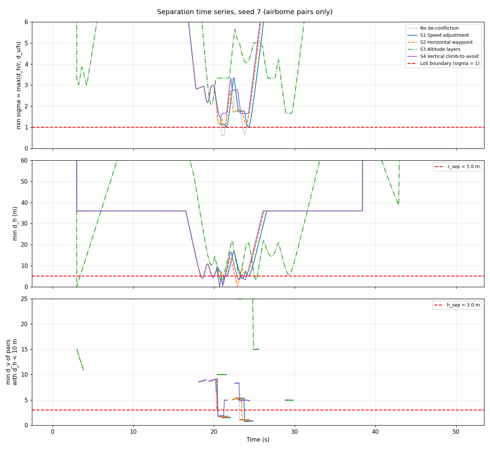
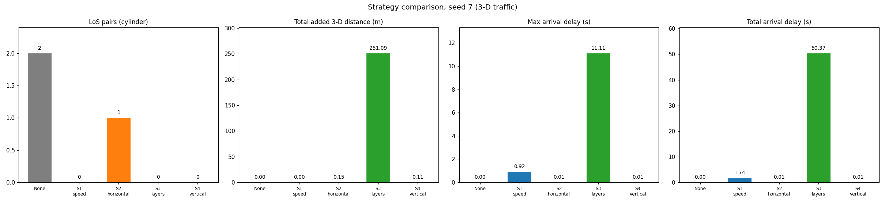
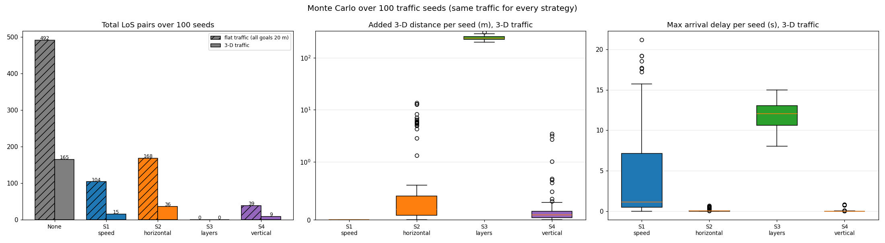
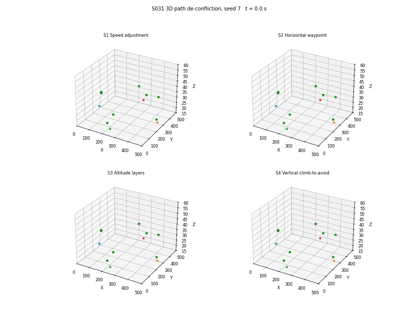

# S031 3D Path De-confliction

**Domain**: Logistics & Delivery | **Difficulty**: ⭐⭐⭐ | **Status**: ✅ Completed

---

## Problem Definition

**Setup**: 8 delivery drones fly straight 3D routes in a 500 × 500 m urban airspace column, $z \in [15, 60]$ m, at 12 m/s. The traffic is the same as in the fixed 2D S031: four edge hubs, two drones per hub, the second wave launching 3 s after the first, and goals on the opposite edge. The routes funnel through the centre. The hubs are at 20 m. The new 3D element is that every goal has its own altitude, drawn from $U[15, 50]$ m, so each nominal path is a sloped 3D segment.

Separation is a **cylinder**. A loss of separation (LoS) is $d_h < r_{sep} = 5$ m **and** $d_v < h_{sep} = 3$ m.

**Strategies** (all on the same traffic, plus a baseline with no de-confliction):

1. **S1 Speed adjustment**: the lower-priority drone slows down while a conflict is predicted.
2. **S2 Horizontal waypoint**: the lower-priority drone inserts a lateral avoidance waypoint (the 2D method).
3. **S3 Altitude layers**: each drone is pre-assigned its own altitude layer, with $\Delta z = 5$ m.
4. **S4 Vertical climb-to-avoid** (new in 3D): the lower-priority drone inserts a waypoint straight above or below its predicted conflict position, then flies directly to its goal.

**Key 3D questions**:

- Do the varied goal altitudes remove conflicts that exist on the flat 2D traffic?
- Is S4 cheaper than the other strategies?
- Does S3 give zero conflicts?

The seed-7 instance is shown in detail. Its horizontal layout is identical to 2D S031. A 100-seed Monte Carlo, with the same traffic for every strategy, gives the spread and win counts. It is run on the 3D traffic and on the same traffic flattened to $z = 20$ m (the 2D situation).

---

## Mathematical Model

**Nominal path**: $\mathbf{p}_i(t) = \mathbf{o}_i + v\,(t - t_{launch,i})\,\hat{\mathbf{u}}_i$, with $\hat{\mathbf{u}}_i = (\mathbf{g}_i - \mathbf{o}_i)/\|\mathbf{g}_i - \mathbf{o}_i\|_3$.

**4D cylinder conflict test (exact)**: for a pair with relative motion $\Delta\mathbf{p} + \Delta\mathbf{v}\,t$:

- the horizontal interval $\{t : d_h(t) < r\}$ solves a quadratic;
- the vertical interval $\{t : |\Delta p_z + \Delta v_z t| < h\}$ is linear;
- a **conflict** is declared when the two intervals overlap inside $(0, T_{horizon}]$ and the horizontal-CPA time, clamped into the overlap, is $> 0$.

A pair that is already inside the cylinder and is moving apart is therefore not flagged, the same rule as the 2D $t_{CPA} > 0$. Detection runs every step at the nominal commanded speed.

**S1**: the yielding drone (larger index) flies at the highest $v' \in [v_{min}, v]$, scanned downwards in 0.25 m/s steps, for which the enlarged cylinder $(r_{sep} + \delta, h_{sep} + \delta)$ is not hit. The speed is recomputed every step, so the drone resumes $v$ once no conflict is predicted.

**S2**: $\mathbf{w} = \mathbf{p}_{mid}(t_c) + (r_{sep} + \delta)\,\hat{\mathbf{n}}^{xy}$. Here $\hat{\mathbf{n}}^{xy} \perp \Delta\mathbf{v}_{xy}$ points to the side the yielder already passes on, and $w_z$ is the yielder's own predicted altitude at $t_c$.

**S3**: $z_i = 20 + 5(i-1)$ m, giving 20–55 m. The drone climbs vertically at its hub, cruises level, and climbs or descends vertically to its goal altitude. The card formula for $\Delta L^{(3)}$ was corrected; see the deviations table below.

**S4**: $\Delta z_{avoid} = \text{sign}(\delta_z)\,(h_{sep} + \delta - |\delta_z|)$, with $\text{sign}(0) = +1$, and $\mathbf{w}_{vert} = \mathbf{p}_i(t_c) + [0, 0, \Delta z_{avoid}]^\top$. If $\mathbf{w}_{vert}$ would leave $[15, 60]$ m, the drone passes on the other side instead.

**Common rules**:

- Lower index means higher priority.
- In S2 and S4, a drone holds at most one active avoidance waypoint, as in the 2D fix.
- Speed along any segment is $\min(v, V_{z,max}/|u_z|)$, with $V_{z,max} = 5$ m/s. Nominal paths are never limited by this; the script asserts it.

**Metrics**:

- conflict and LoS events are counted as distinct pairs, airborne drones only;
- normalised separation $\sigma = \max(d_h/r_{sep}, d_v/h_{sep})$, where LoS means $\sigma < 1$;
- added distance = flown 3D path length − $\|\mathbf{g}_i - \mathbf{o}_i\|_3$;
- delay = arrival time − ($t_{launch}$ + $\|\mathbf{g}_i - \mathbf{o}_i\|_3 / v$).

**Invariants asserted**: altitude stays in [15, 60] m at every step, all drones arrive, added distance ≥ 0, and delay ≥ −Δt.

---

## Key Parameters

| Parameter | Value |
|-----------|-------|
| Fleet size $N$ | 8 |
| Cruise speed $v$ | 12.0 m/s |
| Minimum speed $v_{min}$ (S1) | 4.0 m/s |
| Speed scan step (S1) | 0.25 m/s |
| Climb / descent rate limit $V_{z,max}$ (added) | 5.0 m/s |
| Horizontal separation $r_{sep}$ | 5.0 m |
| Vertical separation $h_{sep}$ | 3.0 m |
| Margin $\delta_{margin}$ | 2.0 m |
| Look-ahead $T_{horizon}$ | 30 s |
| Time step $\Delta t$ | 0.1 s |
| Simulation cap | 200 s |
| Airspace | 500 × 500 m, $z \in [15, 60]$ m |
| Hubs (depots) | (20, 250), (480, 250), (250, 20), (250, 480) m at 20 m, 2 drones each |
| Goals | opposite edge (20 m inset), offset U(−40, 40) m along the edge; altitude U[15, 50] m |
| Second-wave launch delay | 3.0 s (D5–D8) |
| Altitude layers (S3) | $z_{base}$ = 20 m, $\Delta z$ = 5 m, giving 20–55 m |
| Showcase seed | 7 (same x-y layout as 2D S031) |
| Monte Carlo | seeds 0–99, every strategy on the same traffic, 3D and flat (all goals at 20 m) |

---

## Implementation

```
src/02_logistics_delivery/3d/s031_3d_path_deconfliction.py
```

```bash
conda activate drones
python src/02_logistics_delivery/3d/s031_3d_path_deconfliction.py
```

Runtime was 372–380 s (about 6 min) while four other simulations ran on the same machine. Most of it is the 1000-run Monte Carlo. Two runs gave byte-identical console output and output files.

---

## Results

### Seed 7: flat traffic (2D situation) vs 3D traffic

Seed-7 goal altitudes: D1 42.9, D2 31.4, D3 25.6, D4 24.7, D5 23.9, D6 30.6, D7 32.7, D8 34.4 m. The 3D route lengths are 460.3–461.9 m.

| Strategy | Flat: LoS pairs | Flat: added (m) | Flat: max delay (s) | 3D: conflict pairs | 3D: LoS pairs | 3D: min σ | 3D: added (m) | 3D: max delay (s) | 3D: total delay (s) |
|---|---:|---:|---:|---:|---:|---:|---:|---:|---:|
| No de-confliction | 6 | 0.00 | 0.00 | 2 | 2 (D6–D7, D6–D8) | 0.59 | 0.00 | 0.00 | 0.00 |
| S1 Speed adjustment | 0 | 0.00 | 9.06 | 2 | 0 | 1.01 | 0.00 | 0.92 | 1.74 |
| S2 Horizontal waypoint | 2 (D5–D8, D6–D8) | 0.80 | 0.04 | 2 | 1 (D6–D8) | 0.98 | 0.15 | 0.01 | 0.01 |
| S3 Altitude layers | 0 | 280.00 | 14.00 | 0 | 0 | 1.67 | 251.09 | 11.11 | 50.37 |
| S4 Vertical climb-to-avoid | 1 (D3–D8) | 0.44 | 0.01 | 2 | 0 | 1.47 | 0.11 | 0.01 | 0.01 |

The flat rows for the baseline, S1 and S2 reproduce the fixed 2D S031 exactly: 6 LoS pairs, S1 delay 9.06 s, S2 0.8 m added with LoS on D5–D8 and D6–D8. This confirms that the 3D detector reduces to the 2D one at a single altitude.

**Which of the six flat-traffic LoS pairs survive in 3D** (measured at each pair's closest horizontal approach, 3D baseline):

| Pair | t (s) | $d_h$ (m) | $d_v$ (m) | Result |
|---|---:|---:|---:|---|
| D1–D3 | 19.9 | 4.47 | 8.96 | separated vertically |
| D1–D4 | 18.5 | 4.12 | 8.75 | separated vertically |
| D3–D8 | 20.7 | 0.08 | 3.60 | separated vertically |
| D5–D8 | 23.1 | 3.35 | 5.47 | separated vertically |
| D6–D7 | 23.8 | 3.39 | 1.12 | LoS |
| D6–D8 | 21.1 | 1.46 | 1.79 | LoS |

- **S4** resolved both remaining conflicts with climbs of +3.89 m (D7 over D6) and +3.21 m (D8 over D6). These offsets are $h_{sep} + \delta - |\delta_z|$ at the predicted conflict, about 5 m minus the baseline $d_v$ in the table above (1.12 m and 1.79 m). The extra distance was 0.07 m and 0.04 m.
- **S2** left D6–D8 as a marginal LoS: $d_h$ = 4.90 m and $d_v$ = 1.68 m at 21.3 s. The waypoint offset $\hat{\mathbf{n}}^{xy}$ is perpendicular to the *relative* velocity, not to D8's own track. With D6 and D8 crossing at about 90°, roughly 70 % of the 7 m offset lies along D8's track. The waypoint was placed at (257.66, 258.65, 26.78) m for a predicted conflict at t = 21.11 s, and D8 reached it at 21.47 s. Much of the offset became delay instead of a 7 m sideways move, so the realised miss distance is only 4.90 m. S4's waypoints sit directly above the predicted positions and are reached on time (21.12 s and 23.81 s, against predicted 21.11 s and 23.80 s).
- **S1** is LoS-free, but $\sigma_{min} = 1.01$, so the 2 m margin is not kept. As in 2D, the drone resumes $v$ as soon as the nominal-speed prediction clears.
- Per-drone S3 added distance is 11.24–55.40 m and delay 2.26–11.11 s. D8 has the highest layer (55 m).

### Monte Carlo, 100 seeds (same traffic for every strategy)

| Strategy | Flat: LoS pairs (seeds with LoS) | 3D: LoS pairs (seeds with LoS) | 3D added distance, mean / median / max (m) | 3D max delay, mean / median / max (s) |
|---|---|---|---|---|
| No de-confliction | 492 (100/100) | 165 (86/100) | 0 | 0 |
| S1 Speed adjustment | 104 (61/100) | 15 (13/100) | 0 / 0 / 0 | 4.38 / 1.13 / 21.20 |
| S2 Horizontal waypoint | 168 (84/100) | 36 (29/100) | 1.46 / 0.18 / 13.74 | 0.10 / 0.01 / 0.69 |
| S3 Altitude layers | 0 (0/100) | 0 (0/100) | 241.80 / 239.06 / 309.96 | 11.92 / 12.03 / 14.98 |
| S4 Vertical climb-to-avoid | 39 (33/100) | 9 (8/100) | 0.21 / 0.08 / 3.47 | 0.03 / 0.00 / 0.82 |

On flat traffic, S2 adds 4.44 / 1.84 / 18.91 m (mean / median / max), S4 0.74 / 0.33 / 6.15 m, and S3 exactly 280 m. S1's max delay there is 13.35 / 15.37 / 29.47 s.

**Paired comparisons on the 3D traffic** (number of seeds where the first strategy is lower / equal / higher):

| Comparison | Lower | Equal | Higher |
|---|---:|---:|---:|
| S4 vs S2, added distance | 70 | 14 | 16 |
| S4 vs S2, LoS pairs | 27 | 68 | 5 |
| S4 vs S1, LoS pairs | 10 | 85 | 5 |
| S4 vs S1, max delay | 85 | 14 | 1 |
| S4 vs S3, added distance | 100 | 0 | 0 |
| S4 vs S3, max delay | 100 | 0 | 0 |

- Seeds where both S2 and S4 have 0 LoS: 66. On those seeds S4 adds less distance on 41, the same on 14 and more on 11. The median added distance is 0.06 m for S4 vs 0.13 m for S2.
- Of the 86 seeds whose 3D baseline has at least one LoS, the number brought to 0 LoS is: S1 73, S2 57, S3 86, S4 78.

### Key findings

- **Altitude variety alone removes most conflicts.** The goal altitudes spread the drones vertically by the time they reach the centre. Baseline LoS pairs drop from 492 (flat) to 165 (3D), with fewer pairs on 99 of 100 seeds and equal on 1. On seed 7, four of the six 2D LoS pairs pass with $d_v$ = 3.6–9.0 m, even though D3–D8 come within 0.08 m horizontally.
- **S3 gives zero conflicts, as the card expects**: 0 LoS on all 100 seeds, in 3D and flat. On seed 7 it has 0 flagged conflicts and $\sigma_{min}$ = 1.67, which is the layer spacing divided by $h_{sep}$ (5/3). It is by far the most expensive strategy: 241.8 m mean added distance and 11.9 s mean max delay.
  - The 5 m/s climb limit dominates its delay: 35 m of vertical travel for the top layer takes 7 s instead of 2.9 s.
  - The cylinder standard (3 m vertical) allows 5 m spacing instead of the 2D sphere's 7 m. On flat traffic this cuts the layer cost from 392 m (2D) to 280 m.
- **S4 is the best reactive strategy in this test, but mainly on safety, not distance.** On the 3D traffic it leaves 9 LoS pairs, against 36 for S2 and 15 for S1. Its delays stay small, like S2's: worst-seed max delay 0.82 s for S4 and 0.69 s for S2, against 21.20 s for S1.
- **"S4 has the lowest added distance" holds only in a limited sense.**
  - S1 never changes the path, so its added distance is 0 by construction. S1 pays in delay instead.
  - Among the path-changing strategies, S4 adds less than S2 on 70 of 100 seeds. But both are tiny: medians 0.08 m vs 0.18 m on routes of about 460 m. The distance difference is operationally irrelevant.
  - The real gain is that a 5 m vertical offset closes the cylinder with a shorter manoeuvre than a 7 m lateral one, and it does not move the drone into crossing traffic.
- **S4 is not always safe**: it leaves LoS on 8 of 100 seeds (3D) and 33 of 100 (flat). These cases were not analysed one by one. A likely cause is the one-active-waypoint rule shared with S2: a drone ignores further conflicts until its first waypoint is reached. That rule caused S2's residual LoS in 2D S031. Card extension 3 (cascading re-detection) is the fix to try.
- **S1 does not keep its margin.** $\sigma_{min}$ = 1.01 on seed 7, and 15 LoS pairs remain on the 3D Monte Carlo. Re-planning from the nominal speed every step lets drones speed up again too early, the same behaviour documented in 2D.

---

## Output Files

### 3D flown paths (seed 7)

Colour shows altitude, black squares are hubs, green stars are goals, and red rings mark LoS. S3 shows the vertical climbs at the hubs and the vertical legs to each goal altitude:



### Top-down footprints (seed 7)

All five runs from above, for direct comparison with the 2D S031 map. At this scale the horizontal footprints look almost identical. S2's waypoint lies 7 m from the predicted conflict midpoint, S4 moves only vertically, and both add under 0.2 m of path. The differences between strategies are in altitude and timing:



### Altitude time series (seed 7)

$z_i(t)$ per strategy:

- S3 shows flat bands with vertical transitions.
- S4 shows small kinks where D7 and D8 climb a few metres around t ≈ 20–24 s.
- The other strategies follow the sloped nominal profiles.
- Red dotted lines mark the first LoS of a pair.



### Separation time series (seed 7)

- **Top**: minimum normalised separation σ. LoS means σ < 1.
- **Middle**: minimum horizontal separation $d_h$.
- **Bottom**: minimum vertical separation among pairs that are horizontally within 10 m. The minimum $d_v$ over *all* pairs is near 0 most of the time and says nothing about safety.

S4's $d_h$ drops close to 0 while its $d_v$ stays near 5 m. S3 has $d_h \approx 0$ at t = 3 s, when D8 launches under D4, which is still climbing at the same hub with $d_v$ = 15 m:



### Strategy comparison (seed 7)



### Monte Carlo (100 seeds)

- **Left**: total LoS pairs, flat (hatched) vs 3D traffic.
- **Middle**: added 3D distance per seed (symlog scale).
- **Right**: max arrival delay per seed.



### Animation

The four strategies in 3D, seed 7, every 4th step (133 frames, 10 fps):



---

### Deviations from the scenario card

| Card | Implementation | Reason |
|------|----------------|--------|
| All drones depart from one depot (250, 250, 20) | 4 edge hubs at 20 m, 2 drones each, second wave +3 s, goals on the opposite edge (2D S031 fix); goal altitudes U[15, 50] m as on the card | Rays from one point at equal speed always diverge, so the card's traffic has no conflict at all, in 3D as in 2D. The card now carries a correction note. |
| Conflict = 3D $t_{CPA}$, then test $d_h$, $d_v$ at that instant | Exact interval test: overlap of $\{d_h < r\}$ and $\{d_v < h\}$ inside $(0, T_{horizon}]$ | The cylinder can be violated at a time other than the 3D CPA, because the 3D CPA minimises $d_h^2 + d_v^2$, not the cylinder metric. The exact test is the "4D check" the card describes. |
| S1: bisection on $v'$; $\Delta T = L/v' - L/v$ | Descending scan in 0.25 m/s steps; $v'$ applies only while a conflict is predicted; delay measured | The required clearance is not monotonic in $v'$ (2D fix). The card's ΔT formula assumes $v'$ for the whole route. |
| S2: $w_z = p_{mid,z}$ | $w_z$ = yielder's own predicted altitude at $t_c$ | The midpoint altitude pulls the yielder halfway toward the intruder vertically, which reduces vertical separation in 3D. |
| S3: $\Delta L^{(3)}$ = vertical legs only | Flown path measured; card formula corrected to include $\|\mathbf{g}-\mathbf{o}\|_h - \|\mathbf{g}-\mathbf{o}\|_3$ | The level cruise is shorter than the sloped nominal path, so the card formula overstated the cost by up to ~1 m per drone. |
| S4: $\text{sign}(\delta_z)$ | $\text{sign}(0) = +1$; if out of [15, 60] m, pass on the other side | With $\delta_z = 0$ the card formula gives no avoidance at all. The card is updated. |
| — | Climb / descent rate limit $V_{z,max} = 5$ m/s (added) | 12 m/s vertical flight is not realistic for delivery drones. It only affects S3's vertical legs and steep S4 waypoints. Nominal paths are unaffected (asserted). |
| — | At most one active avoidance waypoint per drone (S2, S4); no cascading re-check | Same rule as 2D S031. Cascading is card extension 3. |
| $d_{v,\min}(t)$ plot | min $d_v$ over pairs with $d_h < 10$ m, plus a normalised σ panel | The minimum $d_v$ over all pairs is about 0 almost always (unrelated pairs at similar altitude). |
| Conflict count | Distinct drone pairs flagged / in LoS (airborne only) | As in 2D S031. Per-step counts inflate the number. |
| — | No-de-confliction baseline, flat-traffic variant, 100-seed Monte Carlo | They show how much conflict exists, what 3D altitudes change against 2D, and the spread. |
| Altitude colour gradient | Paths drawn as points coloured by z | Matches "altitude encoded in colour"; per-drone colours are used in the other plots. |

---

## Extensions

1. Cascading re-detection: allow several queued avoidance waypoints, and re-check after every manoeuvre, to remove S4's residual multi-drone LoS.
2. Keep the margin in S1 by holding $v'$ until the enlarged cylinder clears, rather than re-planning from the nominal speed.
3. Energy-optimal vertical avoidance with $P_{climb} = m g v_z/\eta$, comparing climb against descent.
4. A 3D VO / ORCA reactive planner in $(v_x, v_y, v_z)$.
5. Scale with fleet size $N \in \{8, 16, 32\}$. S3's layer stack grows as $N\,\Delta z$ and soon exceeds the 45 m column.

---

## Related Scenarios

- Original 2D card: [S031 Path De-confliction](../../../../scenarios/02_logistics_delivery/S031_path_deconfliction.md) ([2D results](../../s031_path_deconfliction/README.md))
- 3D card: [S031 3D Upgrade — Path De-confliction](../../../../scenarios/02_logistics_delivery/3d/S031_3d_path_deconfliction.md)
- 3D references: [S022 3D Upgrade — Obstacle Avoidance Delivery](../../../../scenarios/02_logistics_delivery/3d/S022_3d_obstacle_avoidance.md), [S028 3D Upgrade — Cargo Escort Formation](../../../../scenarios/02_logistics_delivery/3d/S028_3d_cargo_escort.md)
- Follow-ups: [S032 Charging Queue](../../../../scenarios/02_logistics_delivery/S032_charging_queue.md), [S033 Online Order Insertion](../../../../scenarios/02_logistics_delivery/S033_online_order_insertion.md)
