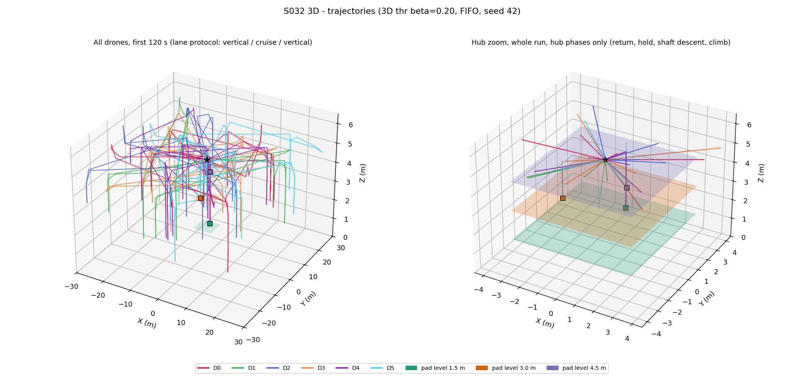
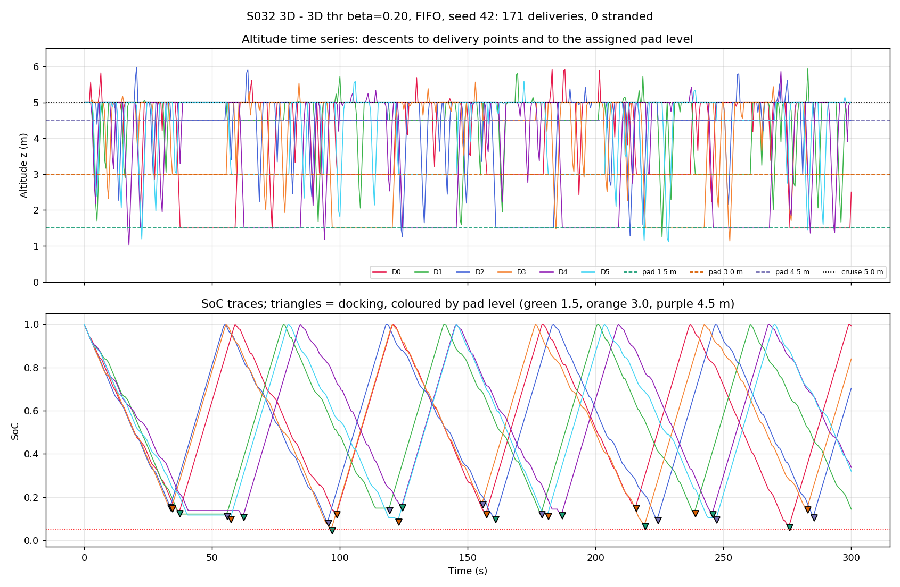
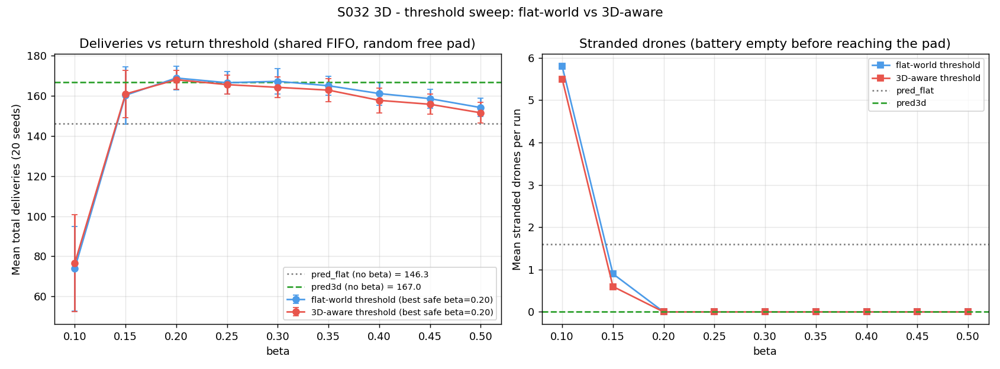
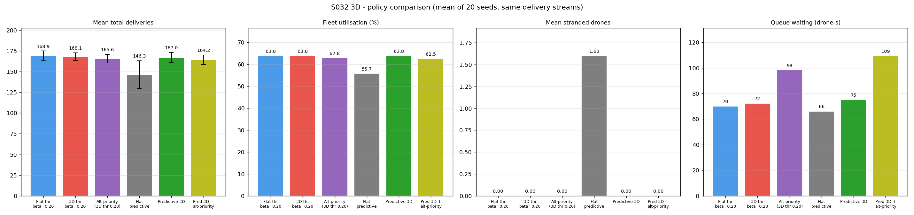
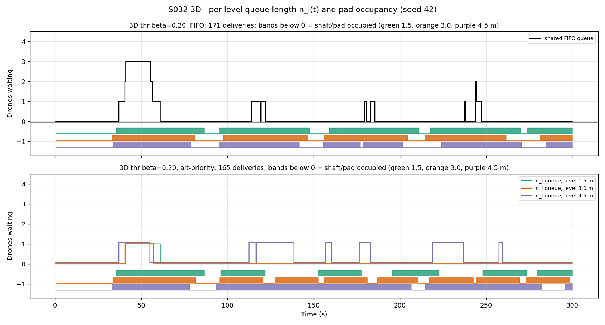
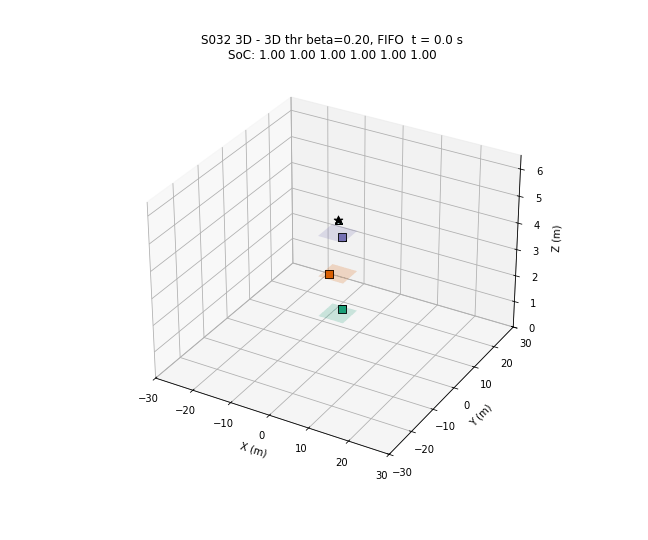

# S032 3D Charging Queue

**Domain**: Logistics & Delivery | **Difficulty**: ⭐⭐⭐ | **Status**: ✅ Completed

---

## Problem Definition

**Setup**: 6 delivery drones work a 60 × 60 m city block for 300 s. Delivery points are 3D: x, y ~ U[−30, 30] m and z ~ U[1, 6] m. The hub has **3 stacked charging levels** at z = 1.5, 3.0 and 4.5 m, with one pad per level. Drones cruise at z = 5 m.

As in the fixed 2D S032, drones fly **multi-drop sorties**. After a delivery they go straight on to the next one and return to the hub only when their return rule says so. A drone whose battery reaches 0 before it is on a pad is **stranded**: it is out of service for the rest of the run, and its parcel goes back into the queue.

**Lane protocol** (card): every leg is flown in three parts:

1. vertical to the cruise altitude;
2. horizontal at cruise altitude;
3. vertical to the target altitude.

A returning drone flies to the hub hold point (0, 0, 5) and is assigned a pad there. It then flies 2 m to the top of that pad's vertical shaft and descends to the pad. After a full charge it climbs the shaft back to cruise. The shaft is released only when the climbing drone is back at cruise, so a shaft never holds a climbing and a descending drone at the same time (asserted every step).

**Key question** (card): does adding the vertical energy term to the return decision and to pad assignment deliver more parcels than flat-world rules?

**Return rules** (all use the same delivery streams, 20 seeds):

1. **Flat-world threshold** (card policy 1): abort and return as soon as SoC ≤ β. β is swept from 0.10 to 0.50.
2. **3D-aware threshold** (card policy 2): return as soon as SoC − E_vert,return(i) ≤ β, where E_vert,return is the vertical part of the cheapest 3D return. β is swept from 0.10 to 0.50.
3. **Flat predictive** (added baseline): return when SoC ≤ the 2D S032 rule α′·d_xy(i, hub) + β_safe, which ignores vertical energy.
4. **Predictive 3D** (card policy 4): return when SoC ≤ min_l s_min^3D(i, l).

**Pad dispatch rules** (each one is tested with the same return rule):

- **FIFO, random free pad** (baseline): one shared FIFO queue. The pad is chosen at random among the free ones, so the choice ignores altitude.
- **FIFO, nearest level** (added): one shared FIFO queue. Of the free pads, the drone takes the one with the shortest descent.
- **Altitude-priority** (card policy 3): one FIFO queue per level. The drone joins level $l^* = \arg\min_l C(i, l)$.

---

## Mathematical Model

**Energy per leg** (card):

$$\Delta s = \frac{\alpha (m_b + m_p) g\, d_{xy} + \gamma (m_b + m_p) g\, |\Delta z|}{E_{cap}}$$

This gives 3.53 × 10⁻³ SoC per horizontal metre and 7.06 × 10⁻³ SoC per vertical metre (γ/α = 2). Climbing and descending cost the same, because the card's formula uses |Δz|.

**3D return feasibility** (card, with the 2 m shaft offset added):

$$s^{3D}_{min}(i,l) = \frac{\alpha m g\,[d_{xy}(i,\text{hub}) + R_{shaft}] + \gamma m g\,[\,|z_i - z_c| + |z_c - z_l|\,]}{E_{cap}} + \beta_{safe}$$

**Flat predictive** (the 2D rule): $s_{min}(i) = \alpha m g\, d_{xy}(i, \text{hub})/E_{cap} + \beta_{safe}$.

**3D-aware threshold**: the drone returns when $s_i - \gamma m g\,(|z_i - z_c| + \min_l |z_c - z_l|)/E_{cap} \le \beta$.

**Worst-case return** from (30, 30, 1) m (printed by the script):

| Return model | SoC needed |
|---|---|
| flat $s_{min}$ | 0.1998 |
| $s^{3D}_{min}$ to the 4.5 m pad | 0.2387 |
| $s^{3D}_{min}$ to the 1.5 m pad | 0.2599 |

The vertical part of that return is 0.0318 to the cheapest level and 0.0530 to the 1.5 m level.

**Altitude-priority cost** (card):

$$C(i,l) = n_l\,\bar t_{chg} + \frac{|z_c - z_l|}{v_z^{max}}$$

- $n_l$ counts the drones waiting for level $l$, plus the drone on the pad.
- $\bar t_{chg} = \overline{(1 - s^{arrive})}/P_{chg}$ is the running mean over the dockings in this run so far. Before the first docking it is 20 s (a prior of 0.8 / P_chg).

**Charging**: $t_{chg} = (1 - s^{arrive}) E_{cap} / P_{chg}$.

**Fleet utilisation**: $\bar u = \frac{1}{N}\sum_i t_{fly,i}/T_{sim}$. Here $t_{fly}$ is the time spent in transit: delivering, returning, descending a shaft or climbing it. Time spent holding in the queue is excluded.

**Pad energy supply**: 3 pads × 0.04 E_cap/s × 300 s = 36 E_cap per run.

---

## Key Parameters

| Parameter | Value |
|-----------|-------|
| Fleet size N | 6 drones |
| Pad levels | 3, one pad each, at z = 1.5, 3.0, 4.5 m |
| Pad shafts | (x, y) at radius R_shaft = 2.0 m from the hub, at 90°, 210°, 330° |
| Hold point | (0, 0, 5.0) m |
| Cruise altitude z_c | 5.0 m |
| Altitude bounds | [0.5, 6.0] m (asserted) |
| Delivery volume | [−30, 30]² × [1.0, 6.0] m |
| Horizontal speed v_h | 8.0 m/s |
| Vertical speed v_z | 2.0 m/s |
| Battery capacity E_cap | 1.0 (normalised) |
| Charging rate P_chg | 0.04 E_cap/s (25 s from empty) |
| α / γ | 1.8 × 10⁻⁴ / 3.6 × 10⁻⁴ m⁻¹ |
| m_body / m_payload | 1.5 / 0.5 kg |
| Safety reserve β_safe | 0.05 |
| β sweep | 0.10 – 0.50 in steps of 0.05 |
| T_sim / DT | 300 s / 0.5 s |
| Prior mean charge time | 20 s (0.8 / P_chg) |
| Monte Carlo | 20 seeds (42–61); the delivery points come from the seed and are the same for every rule. A separate stream (seed + 10000) is used only for the random free-pad choice. |
| Pre-drawn delivery points | 800 per seed (the script asserts that this is enough) |

---

## Implementation

```bash
conda activate drones
python src/02_logistics_delivery/3d/s032_3d_charging_queue.py
```

The run takes about 61 s: 502 simulations plus a 151-frame GIF, measured while other simulations were running on the machine. Two runs gave byte-identical console output and output files.

The script asserts these invariants every step:

- SoC stays in [0, 1];
- every drone's z stays in [0.5, 6];
- a charging drone is on its own pad;
- no drone occupies two pads, and no shaft holds two drones;
- every flight segment is purely horizontal or purely vertical.

---

## Results

### Threshold sweep (mean ± std over 20 seeds; shared FIFO, random free pad)

| β | Flat threshold: deliveries | Flat: stranded per run (seeds with any) | 3D-aware threshold: deliveries | 3D-aware: stranded per run (seeds) |
|---|---:|---:|---:|---:|
| 0.10 | 73.9 ± 21.1 | 5.80 (20) | 76.5 ± 24.3 | 5.50 (20) |
| 0.15 | 160.3 ± 14.3 | 0.90 (12) | 161.0 ± 11.7 | 0.60 (11) |
| 0.20 | **168.9 ± 5.8** | 0.00 | **168.1 ± 4.7** | 0.00 |
| 0.25 | 166.6 ± 5.5 | 0.00 | 165.7 ± 4.8 | 0.00 |
| 0.30 | 167.3 ± 6.5 | 0.00 | 164.3 ± 5.1 | 0.00 |
| 0.35 | 165.1 ± 4.6 | 0.00 | 162.9 ± 5.9 | 0.00 |
| 0.40 | 161.2 ± 5.7 | 0.00 | 157.8 ± 6.1 | 0.00 |
| 0.45 | 158.7 ± 4.8 | 0.00 | 155.8 ± 5.0 | 0.00 |
| 0.50 | 154.2 ± 4.6 | 0.00 | 151.6 ± 5.2 | 0.00 |

For both rules, β\* = β\*_safe = 0.20. β\*_safe is the best β with no stranded drone in any seed.

### Policy comparison (mean of 20 seeds)

| Policy | Deliveries | Utilisation | Stranded (seeds) | Aborted | Charge visits | Queue wait (drone-s) | Vertical share of energy |
|---|---:|---:|---:|---:|---:|---:|---:|
| Flat threshold β = 0.20 | 168.9 ± 5.8 | 63.8 % | 0.00 (0) | 26.55 | 27.05 | 70.2 | 17.9 % |
| 3D-aware threshold β = 0.20 | 168.1 ± 4.7 | 63.8 % | 0.00 (0) | 26.65 | 27.20 | 72.4 | 17.9 % |
| Altitude-priority (3D threshold 0.20) | 165.6 ± 5.1 | 62.8 % | 0.00 (0) | 26.05 | 26.85 | 98.3 | 17.8 % |
| Flat predictive | 146.3 ± 16.7 | 55.7 % | 1.60 (17) | 21.05 | 19.60 | 66.1 | 17.3 % |
| **Predictive 3D** | 167.0 ± 6.1 | 63.8 % | 0.00 (0) | 23.75 | 24.25 | 75.0 | 17.6 % |
| Predictive 3D + altitude-priority | 164.2 ± 5.8 | 62.5 % | 0.00 (0) | 23.45 | 24.40 | 109.5 | 17.4 % |

**Two extra tests:**

- The 2D-tuned flat threshold β = 0.15, flown in 3D, gives 160.3 deliveries and 0.90 stranded drones per run (12 of 20 seeds).
- With the vertical energy switched off (γ = 0 in both physics and planning, predictive 3D rule), there are 184.4 ± 6.1 deliveries and 0.00 stranded.

### Pad dispatch (same return rule and same seeds)

| Return rule | Dispatch | Deliveries | Queue wait (drone-s) | Pad idle while a drone waited (pad-s) | Dockings per level 1.5 / 3.0 / 4.5 m | Pad busy 1.5 / 3.0 / 4.5 m |
|---|---|---:|---:|---:|---|---|
| 3D threshold 0.20 | FIFO, random pad | 168.1 ± 4.7 | 72.4 | 0.0 | 9.00 / 9.00 / 9.20 | 66 / 67 / 65 % |
| 3D threshold 0.20 | FIFO, nearest level | 167.3 ± 4.4 | 72.3 | 0.0 | 8.95 / 9.05 / 9.60 | 64 / 66 / 67 % |
| 3D threshold 0.20 | Altitude-priority | 165.6 ± 5.1 | 98.3 | 28.0 | 7.55 / 9.05 / 10.25 | 55 / 67 / 73 % |
| Predictive 3D | FIFO, random pad | 167.0 ± 6.1 | 75.0 | 0.0 | 8.05 / 8.10 / 8.10 | 66 / 66 / 65 % |
| Predictive 3D | FIFO, nearest level | 167.2 ± 5.7 | 75.6 | 0.0 | 8.00 / 8.00 / 8.85 | 66 / 65 / 65 % |
| Predictive 3D | Altitude-priority | 164.2 ± 5.8 | 109.5 | 31.7 | 6.60 / 8.15 / 9.65 | 53 / 65 / 75 % |

Both FIFO variants show 0.0 pad-s of idle pad time while a drone waited. This holds by construction: a shared queue hands a freed pad straight to the next drone. The column is a diagnostic for the altitude-priority rule, not a comparison metric.

### Paired differences in deliveries (same seeds)

| Comparison | Mean ± std | Wins / ties / losses (of 20) |
|---|---:|---|
| 3D threshold − flat threshold (each at best safe β = 0.20) | −0.8 ± 5.0 | 11 / 0 / 9 |
| 3D threshold − flat threshold, both at β = 0.15 | +0.7 ± 14.3 | 8 / 1 / 11 |
| **Predictive 3D − flat predictive** | **+20.7 ± 17.1** | **17 / 0 / 3** |
| Predictive 3D − 3D threshold (β = 0.20) | −1.1 ± 7.1 | 9 / 0 / 11 |
| Altitude-priority − FIFO random (3D threshold) | −2.5 ± 5.0 | 3 / 3 / 14 |
| FIFO nearest − FIFO random (3D threshold) | −0.8 ± 4.8 | 5 / 2 / 13 |
| Altitude-priority − FIFO nearest (3D threshold) | −1.8 ± 3.3 | 3 / 6 / 11 |
| Altitude-priority − FIFO random (predictive 3D) | −2.9 ± 4.9 | 6 / 1 / 13 |
| γ off − γ on (predictive 3D) | +17.4 ± 5.9 | 20 / 0 / 0 |

### Recorded runs (seed 42, 3D threshold β = 0.20)

These runs are used for the plots and the animation.

| Dispatch | Deliveries | Stranded | Dockings per level | Max waiting | z range |
|---|---:|---:|---|---:|---|
| FIFO | 171 | 0 | 9 / 9 / 9 | 3 | 1.02–5.97 m |
| Altitude-priority | 165 | 0 | 7 / 9 / 11 | 3 | 1.02–5.97 m |

### Key Findings

- **The feasibility check must include vertical energy (card claim holds).** The flat predictive rule is the 2D S032 rule. It ignores the climb back to cruise (up to 4 m, 0.028 SoC), the descent to the pad and the 2 m shaft offset, so its 0.05 reserve is not enough. It strands 1.60 drones per run, in 17 of 20 seeds. The predictive 3D rule strands none and delivers 20.7 ± 17.1 more parcels (17 of 20 seeds better).
- **The 2D-tuned threshold no longer works in 3D.** In 2D, β\* = 0.15 was just enough for the 42 m flight home from the farthest corner. In 3D, β = 0.15 strands drones in 12 of 20 seeds. The safe optimum moves to β = 0.20 for both threshold rules.
- **The 3D-aware threshold gains nothing over the flat threshold once β is tuned** (−0.8 ± 5.0, 11/0/9). The rule's vertical correction is at most 0.032 SoC, smaller than one step of the β grid (0.05). After β is re-tuned in 3D, the flat rule's extra margin already covers the vertical return. The correction matters only when β is *not* tuned in 3D. Even then, at β = 0.15 the 3D-aware rule still strands drones in 11 seeds: its correction assumes the cheapest pad level and omits the 2 m shaft offset and the one-step overshoot. The predictive 3D rule, which uses the full $s^{3D}_{min}$, is the safe untuned option, and it is statistically tied with the tuned thresholds (−1.1 ± 7.1).
- **Altitude-priority queuing is worse than a shared FIFO (card claim does not hold).** It loses 2.5 ± 5.0 deliveries with the 3D threshold (14 of 20 seeds worse) and 2.9 ± 4.9 with predictive 3D (13 of 20 worse). The cause is that it commits each drone to one level's queue. A pad on another level can free up first and then sit idle: 28.0 pad-s per run, against 0 for a shared queue. Queue wait rises from 72.4 to 98.3 drone-s. The card's cost also favours the top level (4.5 m busy 73 % vs 1.5 m busy 55 %). The saving it buys is small: the descent to 4.5 m instead of 1.5 m saves 3 m each way: 3 s of vertical flight and 0.042 SoC per round trip, which is about 1 s of charging. That is much less than a typical 20 s charge.
- **Choosing the nearest free level in a shared FIFO does not help either** (−0.8 ± 4.8; 5/2/13). Its gain per visit is below the noise between seeds.
- **The cost of the third dimension**: vertical flight takes 17–18 % of all battery energy, consistent with a rough estimate of about 3.4 m of vertical travel per delivery leg (0.024 SoC) against about 31 m horizontal (0.11 SoC), i.e. 18 %. Switching γ off raises deliveries from 167.0 to 184.4 (+17.4 ± 5.9, all 20 seeds better).
- **Charging is the bottleneck.** The pads supply at most 36 E_cap per run. Utilisation is about 64 % with three pads, against 51 % in 2D with two pads, and the SoC traces show drones queueing at the hold point.

### Figures

**3D trajectories.** Left: all six drones over the first 120 s, showing vertical / cruise / vertical legs. Right: hub zoom of the whole run, showing only the return, hold, shaft descent and climb phases, with the pad-level planes:



**Altitude and SoC time series.** Top: z_i(t) for all six drones, with the pad levels and the cruise altitude. Bottom: SoC traces. The triangles mark dockings and are coloured by pad level. The flat parts of the SoC traces are drones holding in the queue:



**Threshold sweep.** Flat-world vs 3D-aware threshold, with the two predictive rules as horizontal lines. Left: deliveries. Right: stranded drones:



**Policy comparison.** Deliveries (± std), utilisation, stranded drones and queue wait:



**Per-level queues.** Seed 42. Top: shared FIFO. Bottom: altitude-priority, with one queue per level. The coloured bands below zero show when each pad is occupied. In the bottom panel a drone waits for the 4.5 m pad while the 1.5 m pad is free, for example at t ≈ 222–237 s:



**Animation.** Seed 42, 3D threshold β = 0.20 with FIFO dispatch, 151 frames, one frame every 2 s of simulated time. The marker shape shows the state: ^ climbing or delivering, v returning or descending, o holding, s charging. The title shows each drone's SoC:



### Deviations from the scenario card

| Card | Implementation | Reason |
|------|----------------|--------|
| P_chg = 0.25 E_cap/s | 0.04 E_cap/s | Same fix as 2D S032: at 0.25 a full charge takes 4 s, the pads are never a bottleneck and there is no queue to study. |
| Pads at $\mathbf{p}_{pad,l} = (0, 0, z_l)$, stacked on one vertical line | Each level has its own shaft at 2 m from the hub (90°, 210°, 330°) | A drone descending to 1.5 m would pass through the 3.0 m and 4.5 m pads. $s^{3D}_{min}$ includes the extra 2 m. |
| Return rule after a delivery only (2D card) / unspecified (3D card) | Multi-drop sorties with a mid-leg abort for all four rules, as in the fixed 2D S032 | With a return after every delivery no threshold ever binds (2D finding) |
| "Altitude-priority queue" as a separate policy | A dispatch rule, tested with both the 3D threshold (β = 0.20) and predictive 3D, against a shared FIFO with random or nearest free pad | Return rule and queue rule are independent decisions. Pairing them separates the two effects. |
| $t_{queue}(l) = n_l \bar t_{chg}$, "typical arrival SoC" | $n_l$ = drones waiting for level l plus the drone on that pad. $\bar t_{chg}$ = running mean of this run's dockings, with a 20 s prior | The card does not define "typical" |
| 3D-aware threshold "includes vertical leg energy in $s_{min}^{3D}$" | Returns when SoC − E_vert,return ≤ β, with E_vert,return for the cheapest pad level | This keeps a swept β, which the card's flat-vs-3D sweep needs |
| "Descent is cheaper but non-zero" (text) | Climb and descent cost the same | The card's formula uses \|Δz\| |
| Power model P = α m g v_h + γ m g \|v_z\| | Used as given, so holding at the hold point costs no energy | The card has no hover term. A real multirotor burns energy while holding, which would penalise queueing more. |
| Greedy policy (2D S032) | Not run | The 3D card does not list it |
| Flat predictive rule | Added | It is the direct test of "ignoring vertical energy" in the feasibility check |
| FIFO nearest-level dispatch | Added | It separates "prefer the high pad" from "commit to a per-level queue" |
| Single run | 20 seeds, same delivery streams for every rule, paired differences | Single-run differences are within noise |
| Initial state not given | All six drones start at the hold point with full batteries | as in 2D, where drones start at base, fully charged |
| — | Collision avoidance outside the shafts is not modelled. Holding drones share the hold point. | The card's lane protocol covers only the hub shafts. |

---

## Extensions

1. Add a hover-power term so that holding in the queue costs energy, and re-run the dispatch comparison.
2. Make altitude-priority work-conserving: let a waiting drone switch to any pad that frees first.
3. Sweep the number of pad levels L ∈ {1, 2, 3, 4} (card extension).
4. Add wind shear by altitude layer, so that the choice of cruise altitude matters.
5. Use the full $s^{3D}_{min}$ (worst pad level) inside a threshold rule and sweep a finer β grid (0.01 steps).

---

## Related Scenarios

- Original: [S032 Charging Queue](../../../../scenarios/02_logistics_delivery/S032_charging_queue.md)
- 3D card: [S032 3D Upgrade — Charging Queue](../../../../scenarios/02_logistics_delivery/3d/S032_3d_charging_queue.md)
- See also: [S027 Aerial Refueling Relay](../../../../scenarios/02_logistics_delivery/S027_aerial_refueling_relay.md), [S021 Point Delivery](../../../../scenarios/02_logistics_delivery/S021_point_delivery.md)
- Follow-ups: [S033 Online Order Insertion](../../../../scenarios/02_logistics_delivery/S033_online_order_insertion.md), [S040 Fleet Load Balancing](../../../../scenarios/02_logistics_delivery/S040_fleet_load_balancing.md)
