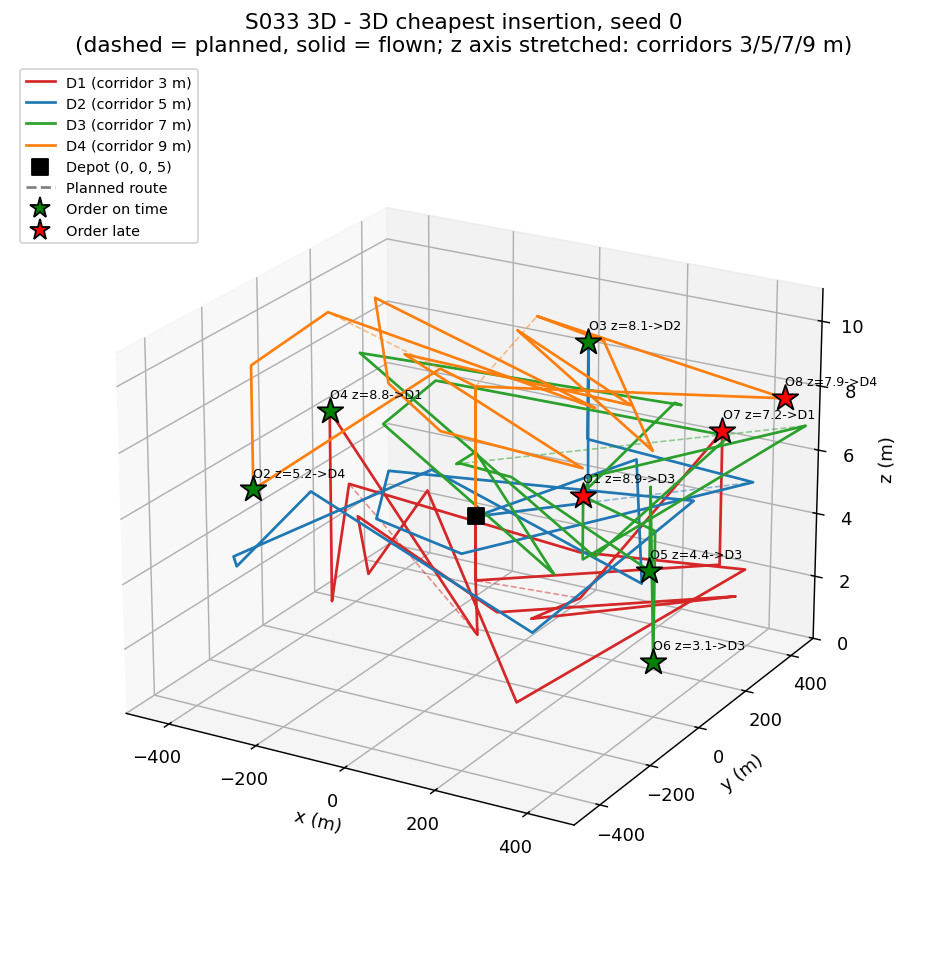
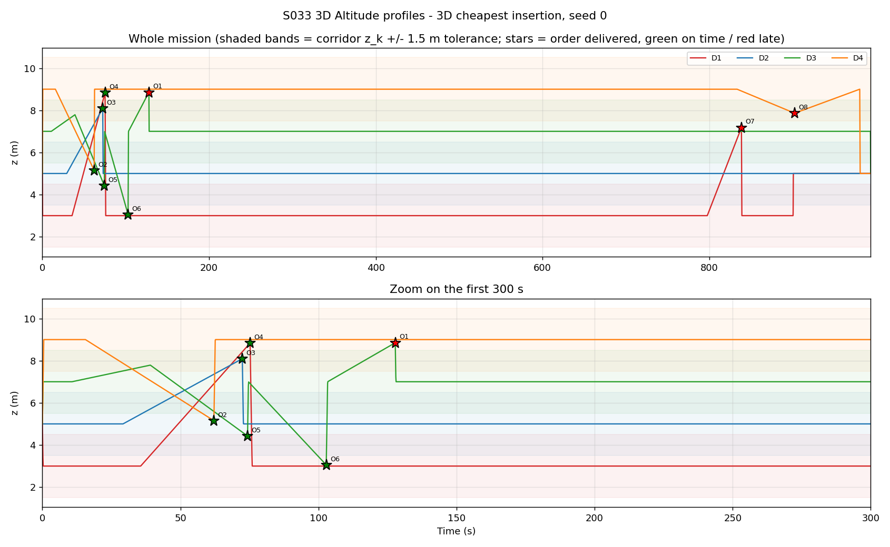
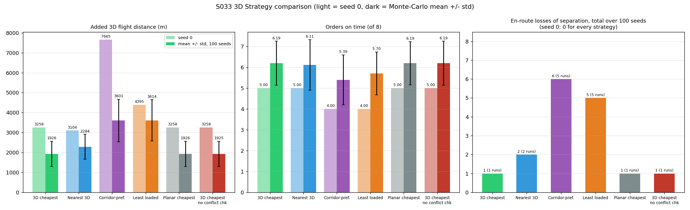
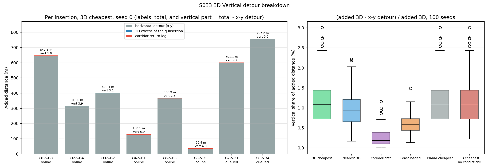
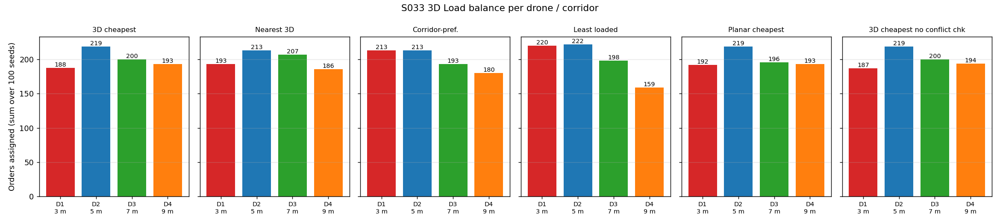
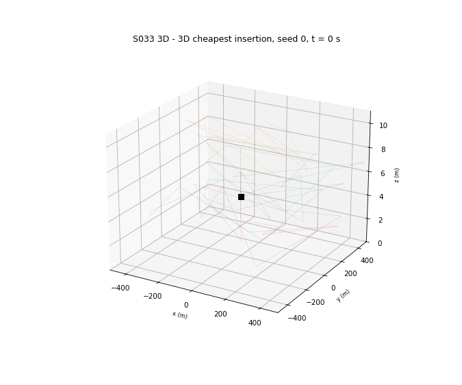

# S033 3D Online Order Insertion

**Domain**: Logistics & Delivery | **Difficulty**: ⭐⭐⭐⭐ | **Status**: ✅ Completed

---

## Problem Definition

**Setup**: 4 drones leave the depot pad at (0, 0, 5) m at t = 0 on pre-planned routes of 12 waypoints each, then return to the pad. The arena is 1000 × 1000 m. Each drone owns an altitude corridor: D1 3 m, D2 5 m, D3 7 m, D4 9 m. Its planned waypoints lie in that corridor. A drone climbs or descends vertically above the pad to reach its corridor, and back at the end.

Between t = 10 s and 80 s, 8 online orders arrive. Each order is a full 3D delivery point $\mathbf{q} = (x, y, z_{new})$ with $z_{new} \in [1.5, 10]$ m. Its deadline is the arrival time + the nearest drone's 3D ETA (on the planned routes) + 30 s.

The dispatcher splices each order into one drone's remaining 3D route without stopping any drone. An insertion must pass three checks:

1. **battery**: the new remaining route fits the remaining range;
2. **deadline**: the predicted arrival at $\mathbf{q}$ is before the deadline;
3. **corridor conflict**: the candidate's projected trajectory keeps $|\Delta z| \ge 1.5$ m or horizontal distance $\ge 20$ m to every other drone over $[t_{now}, t_{arrive} + 30\text{ s}]$.

If $|z_{new} - z_k| > 1.5$ m, a corridor-return waypoint $(x_{new}, y_{new}, z_k)$ follows $\mathbf{q}$. If no drone passes all three checks, the order is **queued**: it goes before the final pad return of the drone that finishes earliest and has the battery, and is served late.

**Key 3D question**: does pricing the vertical detour, the corridor penalty and the corridor-conflict pre-screen change what the dispatcher does, compared with a dispatcher that only looks at x-y?

**Strategies** (same 100 instances for every strategy):

| Strategy | Drone chosen among the feasible ones |
|---|---|
| **3D cheapest** (card proposal) | min $\Delta^{3D}_{k,i^*} + \phi_k$ |
| **Nearest 3D** | smallest 3D distance from the drone's current position to $\mathbf{q}$ |
| **Corridor-preferred** | corridor $z_k$ closest to $z_{new}$ (tie: min $\Delta^{3D} + \phi$) |
| **Least loaded** | fewest remaining stops |
| **Planar cheapest** (2D baseline, added) | min x-y detour $\Delta^{xy}$, no $\phi$; feasibility still checked in 3D |
| **3D cheapest, no conflict check** (ablation, added) | as 3D cheapest, without check 3 |

For every strategy, a drone's slot is its cheapest slot (by that strategy's cost metric: $\Delta^{3D}$, or $\Delta^{xy}$ for the planar baseline) that passes all checks.

---

## Mathematical Model

**3D insertion cost** (card):

$$\Delta^{3D}_{k,i} = \|\mathbf{w}_i - \mathbf{q}\| + \|\mathbf{q} - \mathbf{w}_{i+1}\| - \|\mathbf{w}_i - \mathbf{w}_{i+1}\|$$

The card's vertical term $\Delta^{z}_{k,i} = |z_i - z_q| + |z_q - z_{i+1}| - |z_i - z_{i+1}|$ is printed as a diagnostic only. It is not a part of $\Delta^{3D}$: on long legs, altitude offsets add in quadrature, so $\Delta^{3D} - \Delta^{xy}$ is much smaller than $\Delta^{z}$ (seed 0, O4: $\Delta^{z}$ = 11.67 m, $\Delta^{3D} - \Delta^{xy}$ = 0.09 m). The 3D card was corrected on this point.

**Corridor penalty**: $\phi_k = \gamma \max(0, |z_{new} - z_k| - \Delta z_{tol})$, with $\gamma = 1.2$ and $\Delta z_{tol} = 1.5$ m.

**True added length** (used for the battery check and reported as "added 3D distance"): the length of $[\mathbf{w}_i, \mathbf{q}, \mathbf{w}^{ret}, \mathbf{w}_{i+1}]$ minus $\|\mathbf{w}_{i+1} - \mathbf{w}_i\|$. It includes the corridor-return leg, which $\Delta^{3D}$ leaves out and $\phi_k$ approximates.

**Feasibility**:

- battery: $L_k + \Delta^{true}_{k,i} \le B^{rem}_k$;
- deadline: $t_{now} + (\text{route length to } \mathbf{w}_i + \|\mathbf{w}_i - \mathbf{q}\|)/v \le t_{deadline}$;
- conflict: no step $t \in [t_{now}, t_{arrive} + 30]$ (0.1 s grid) where $|z_k - z_j| < h_{sep}$ and $\|(x,y)_k - (x,y)_j\| < r_{sep}$, for every other drone $j$ on its current route. Points within 20 m of the pad are excluded, since all drones share the pad.

**Losses of separation (LoS)** are measured in the simulation at every 0.1 s step with the same $h_{sep}$ / $r_{sep}$ test. They are reported separately for the pad area (radius 20 m), where all four drones take off and land together.

---

## Key Parameters

| Parameter | Value | Source |
|-----------|-------|--------|
| Fleet size K | 4 | card |
| Cruise speed v | 8.0 m/s | card |
| Full battery range $B_{full}$ | 10 000 m | card |
| Initial battery | $B_{full}$ × U(0.75, 1.0) | added (as 2D S033) |
| Arena (x, y) | [−500, 500]² m | card |
| Corridors $z_k$ | 3, 5, 7, 9 m (D1–D4) | card |
| Delivery altitude $z_{new}$ | U(1.5, 10) m | card |
| Corridor tolerance $\Delta z_{tol}$ | 1.5 m | card |
| Corridor penalty γ | 1.2 | card |
| $h_{sep}$ / $r_{sep}$ | 1.5 m / 20 m | card |
| Conflict-check horizon | $t_{arrive}$ + 30 s | card |
| Pre-planned waypoints per drone | 12 (+ vertical climb / descent above the pad, + pad) | card + added |
| Online orders | 8, arrival U(10, 80) s | card |
| Deadline | arrival + nearest-drone 3D ETA + 30 s | card |
| Depot / pad | (0, 0, 5) m | card |
| Timestep Δt | 0.1 s (simulation, conflict check and LoS monitor) | card |
| Pad area excluded from LoS | 20 m radius | added |
| Monte-Carlo instances | first 100 seeds with a battery-feasible plan (seeds 0–115) | added |
| Plot instance | seed 0 | added |

### Deviations from the scenario card

| Card | Implementation | Reason |
|------|----------------|--------|
| "The original S033 hardcodes z = 2.0 m" | The fixed 2D script already draws waypoint altitudes in U(2, 8) m and uses 3D norms | The card's description of the original is out of date. The 3D variant is compared against a **planar-cost dispatcher** instead. |
| Depot (0, 0, 5) with no take-off procedure | Each drone climbs or descends vertically above the pad to its corridor before its first leg, and does so again before landing | With straight legs from the pad, D1 and D3 would fly hundreds of metres on slanted legs through D2's 5 m band. |
| Planned waypoints: "3D", no altitude given | Planned waypoints lie on the drone's corridor altitude; x-y positions match 2D S033 for the same seed | The card says each drone cruises in its corridor. |
| $z_{new}$ range only | The 2D altitude draw U(2, 8) is mapped affinely onto U(1.5, 10) | Same random stream as 2D, so the x-y layout, batteries and arrival times match 2D S033 seed by seed. |
| Battery check $L_k + \delta_k \le B_k^{rem}$ | $L_k + \Delta^{true} \le B_k^{rem}$, including the corridor-return leg | The card's check ignores the return leg, which can be up to 7.5 m. The script asserts that the battery never goes negative. |
| $i^*_k = \arg\min \Delta$, then check that slot | Each drone's slot is its cheapest slot that passes battery, deadline **and** conflict | This matches 2D S033, which chose the cheapest *feasible* slot. |
| Conflict check against "all other drones" | Only pairs involving the candidate drone. Other drones are assumed to follow their current routes, and the pad area is excluded. | The other pairs do not change with the insertion. Future insertions are unknown. |
| Queued orders: "next available drone" | Appended before the pad return of the earliest-finishing drone with the battery. They are **not** conflict-checked. | As in 2D S033. |
| 4 strategies | 4 card strategies + planar cheapest (2D baseline) + 3D cheapest without the conflict check (ablation). 2D's Random Feasible was dropped. | The two added runs measure the effect of each 3D addition. |
| Least loaded: "smallest remaining $n_k$" | Counts remaining stops (orders, planned waypoints, pad), not corridor-return or climb points | Synthetic waypoints are not load. |
| Single instance | Seed 0 for the plots + 100-instance Monte Carlo | Ranking strategies needs many instances. |
| — | Instances whose plan alone exceeds a drone's initial battery are skipped (16 of seeds 0–115) | With U(0.75, 1) × 10 km of range and ≈ 7 km plans, about 1 seed in 7 cannot fly its own plan. The fixed 2D script draws the same instances (e.g. seeds 11, 12, 14, 19 within its 20 seeds). Since its battery fix (commit ba65499) it trims trailing planned waypoints on those seeds instead of skipping them. On every seed used here the 2D and 3D plans have the same waypoints. |
| Urgency weight $w$ | Not modelled | The card's decision rule never uses it (same as 2D). |
| $\Delta^{3D}$ "subsumes" $\Delta^{z}$ | $\Delta^{z}$ printed as a diagnostic only. The card text was corrected. | The claim is false (see Mathematical Model). |

---

## Simulation Results

Console output of `python src/02_logistics_delivery/3d/s033_3d_online_order.py`. Two runs gave byte-identical console output and output files. Runtime: 251–353 s across four runs (600 full simulations + a 150-frame 3D GIF, with other simulations running at the same time).

### Seed 0 (the instance in the plots)

Planned routes are 6476.2–6899.3 m per drone, with batteries of 8714.6–9886.5 m.

| Strategy | Added 3D distance (m) | x-y detour (m) | Added climb (m) | Online / queued / rejected | On time | Makespan (s) | Lowest final battery (m) | Orders per drone |
|---|---:|---:|---:|---|---:|---:|---:|---|
| 3D cheapest | 3257.6 | 3232.1 | 54.5 | 6 / 2 / 0 | 5/8 | 993.8 | 1086.2 | 2, 1, 3, 2 |
| Nearest 3D | 3103.5 | 3085.2 | 43.4 | 7 / 1 / 0 | 5/8 | 964.8 | 1358.3 | 2, 2, 2, 2 |
| Corridor-preferred | 7665.3 | 7659.2 | 17.2 | 6 / 2 / 0 | 4/8 | 1134.4 | 347.5 | 2, 2, 2, 2 |
| Least loaded | 4394.7 | 4378.7 | 34.2 | 8 / 0 / 0 | 4/8 | 1115.2 | 807.4 | 1, 5, 2, 0 |
| Planar cheapest | 3257.6 | 3232.1 | 54.5 | 6 / 2 / 0 | 5/8 | 993.8 | 1086.2 | 2, 1, 3, 2 |
| 3D cheapest, no conflict check | 3257.6 | 3232.1 | 54.5 | 6 / 2 / 0 | 5/8 | 993.8 | 1086.2 | 2, 1, 3, 2 |

No strategy had an en-route LoS or a conflict-rejected slot on seed 0. Every run had 10 LoS events on the pad area (shared take-off and landing).

Seed-0 insertions of 3D cheapest. "Vertical" is the true added length minus the x-y detour:

| Order | $z_{new}$ (m) | Drone (corridor) | Mode | x-y detour | $\Delta^{3D}$ | card $\Delta^{z}$ | $\phi$ | True added | Vertical |
|---|---:|---|---|---:|---:|---:|---:|---:|---:|
| O1 | 8.85 | D3 (7 m) | online | 645.29 | 645.30 | 3.70 | 0.42 | 647.14 | 1.85 |
| O2 | 5.15 | D4 (9 m) | online | 312.74 | 312.79 | 7.69 | 2.82 | 316.61 | 3.87 |
| O3 | 8.09 | D2 (5 m) | online | 399.00 | 399.03 | 6.19 | 1.91 | 402.11 | 3.11 |
| O4 | 8.84 | D1 (3 m) | online | 124.21 | 124.30 | 11.67 | 5.20 | 130.10 | 5.89 |
| O5 | 4.43 | D3 (7 m) | online | 364.26 | 364.30 | 6.72 | 1.29 | 366.85 | 2.59 |
| O6 | 3.05 | D3 (7 m) | online | 32.45 | 32.56 | 7.89 | 2.94 | 36.43 | 3.98 |
| O7 | 7.18 | D1 (3 m) | queued | 596.92 | 596.97 | 8.35 | 3.21 | 601.13 | 4.21 |
| O8 | 7.86 | D4 (9 m) | queued | 757.24 | 757.25 | 2.28 | 0.00 | 757.25 | 0.01 |

### Monte Carlo: 100 instances

Mean ± std [min, max]. LoS counts are totals over the 100 runs.

| Strategy | Added 3D distance (m) | Added climb (m) | On time (of 8) | Late | Queued | Rejected | Return waypoints | Makespan (s) | En-route LoS (runs) | Conflict-rejected slots / drones |
|---|---:|---:|---:|---:|---:|---:|---:|---:|---|---|
| 3D cheapest | 1926.4 ± 638.4 [811.2, 4577.0] | 44.2 | 6.19 | 1.81 | 0.17 | 0.00 | 5.24 | 971.7 | 1 (1) | 48 / 34 |
| Nearest 3D | 2284.4 ± 627.4 [821.1, 4577.0] | 45.0 | 6.11 | 1.88 | 0.18 | 0.01 | 5.27 | 988.5 | 2 (2) | 46 / 30 |
| Corridor-preferred | 3600.6 ± 1074.1 [1319.0, 7665.3] | 22.1 | 5.39 | 2.60 | 0.28 | 0.01 | 2.42 | 1041.2 | 6 (5) | 51 / 35 |
| Least loaded | 3613.8 ± 1034.1 [1556.9, 6953.2] | 43.2 | 5.70 | 2.29 | 0.37 | 0.01 | 5.35 | 1027.7 | 5 (5) | 57 / 41 |
| Planar cheapest | 1926.1 ± 636.8 [811.2, 4577.0] | 44.5 | 6.19 | 1.81 | 0.17 | 0.00 | 5.29 | 973.0 | 1 (1) | 47 / 34 |
| 3D cheapest, no check | 1924.8 ± 638.5 [811.2, 4577.0] | 44.2 | 6.19 | 1.81 | 0.17 | 0.00 | 5.24 | 971.7 | 1 (1) | — |

"Conflict-rejected slots / drones": slots that passed battery and deadline but failed the conflict check, and drones that lost *all* their battery- and deadline-feasible slots this way. The lowest final battery over all runs is 0.4 m (least loaded), so no drone ran out of battery. Pad-area LoS: about 10 per run for every strategy (1012–1017 in total).

Paired comparison of added 3D distance, 3D cheapest against each other strategy on the same instance:

| 3D cheapest vs | Wins | Ties | Losses | Mean extra distance of the other strategy |
|---|---:|---:|---:|---:|
| Nearest 3D | 67 | 25 | 8 | +358.0 m |
| Corridor-preferred | 97 | 1 | 2 | +1674.2 m |
| Least loaded | 99 | 0 | 1 | +1687.4 m |
| Planar cheapest | 4 | 94 | 2 | −0.3 m |
| 3D cheapest, no conflict check | 0 | 99 | 1 | −1.6 m |

- 3D cheapest and planar cheapest pick a different drone for **8 of 800 orders**, and reach a different outcome in 6 of 100 runs.
- The conflict pre-screen changes the outcome in **1 of 100 runs**.
- Vertical share of the added distance under 3D cheapest: median **1.08 %**, max 3.01 %.

En-route LoS events, all strategies. "Drift" means both drones are within $\Delta z_{tol}$ of their corridor. "In window" means the event lies inside the conflict-check window of an online insertion on one of the two drones:

| Strategy | Seed | Pair | t (s) | Duration (s) | $\lvert z - z_k\rvert$ (m) | Type | Window |
|---|---:|---|---:|---:|---|---|---|
| 3D cheapest | 67 | D3–D4 | 139.7 | 2.3 | 0.00 / 0.56 | drift | outside |
| Nearest 3D | 35 | D1–D4 | 157.3 | 2.8 | 4.51 / 0.00 | excursion | outside |
| Nearest 3D | 67 | D3–D4 | 160.3 | 1.6 | 0.00 / 1.04 | drift | outside |
| Corridor-preferred | 39 | D3–D4 | 242.6 | 4.4 | 0.00 / 1.20 | drift | outside |
| Corridor-preferred | 46 | D1–D2 | 158.5 | 6.4 | 0.02 / 0.70 | drift | outside |
| Corridor-preferred | 60 | D1–D2 | 198.8 | 2.4 | 0.74 / 0.00 | drift | outside |
| Corridor-preferred | 75 | D3–D4 | 234.2 | 1.0 | 0.00 / 0.60 | drift | outside |
| Corridor-preferred | 90 | D1–D2 | 216.8 | 0.8 | 0.94 / 0.00 | drift | outside |
| Corridor-preferred | 90 | D3–D4 | 220.3 | 0.5 | 0.08 / 0.42 | drift | outside |
| Least loaded | 49 | D2–D3 | 827.7 | 1.3 | 0.58 / 0.00 | drift | outside |
| Least loaded | 72 | D1–D2 | 114.6 | 1.0 | 0.00 / 0.83 | drift | in window |
| Least loaded | 90 | D1–D3 | 138.9 | 1.5 | 3.72 / 0.32 | excursion | in window |
| Least loaded | 91 | D2–D3 | 932.7 | 3.0 | 0.00 / 2.74 | excursion | outside |
| Least loaded | 104 | D2–D3 | 156.7 | 3.4 | 0.00 / 1.07 | drift | outside |
| Planar cheapest | 67 | D3–D4 | 139.7 | 2.3 | 0.00 / 0.56 | drift | outside |
| 3D cheapest, no check | 67 | D3–D4 | 147.1 | 2.2 | 0.00 / 0.75 | drift | in window (no check run) |

### Findings

- **The card's 3D expectation mostly does not hold at this scale.** Corridors are 2 m apart and the deliveries span 1.5–10 m, while the legs are hundreds of metres long. Vertical offsets therefore add in quadrature and almost vanish: the vertical part is a median 1.08 % (max 3.01 %) of the added distance under 3D cheapest.
  - The 3D cost and the corridor penalty φ (at most 7.2 m) change the chosen drone for only 8 of 800 orders, compared with a planar dispatcher.
  - Over 100 instances, 3D cheapest and planar cheapest differ by 0.3 m of mean added distance (1926.4 vs 1926.1 m; 4 wins, 94 ties, 2 losses). So pricing altitude buys nothing measurable here.
- **Most of the vertical cost is the corridor-return leg.** On seed 0, the 3D excess of the $\mathbf{q}$ insertion itself is 0.01–0.11 m per order. The climb back to the corridor adds 1.8–5.8 m for the 7 orders that get a return waypoint. This is the part that φ approximates and that the card's $\Delta^{3D}$ leaves out.
- **Cheapest insertion still wins on distance**, as in 2D. Over 100 instances it beats Nearest 3D in 67 runs (8 losses, 25 ties) by 358 m on average, and Least loaded in 99. It also has the most orders on time (6.19 of 8).
- **Corridor preference is expensive and does not avoid conflicts.** It roughly halves the climbing (22.1 vs 44.2 m) and the number of return waypoints (2.42 vs 5.24 per run), but nearly doubles the added distance (3600.6 vs 1926.4 m). It delivers fewer orders on time (5.39) and has the **most** en-route LoS (6 events in 5 runs). It prefers drones whose corridor is within tolerance of $z_{new}$. Such a drone gets no return waypoint and keeps cruising up to 1.5 m off its corridor (next bullet).
- **The card's tolerance and separation values are inconsistent.** Corridors are 2 m apart, but $\Delta z_{tol} + h_{sep}$ = 3 m. A drone more than 0.5 m off its corridor, towards a neighbour, is inside the neighbour's separation band.
  - 13 of the 16 en-route LoS events are of this "drift" kind. Most start after the pre-screen window ($t_{arrive}$ + 30 s) has closed: the drone drifts on its slanted leg after the delivery until its next waypoint, hundreds of metres later.
  - This was noted on the 3D card. The card values are kept.
- **The conflict pre-screen rarely matters and did not prevent the one LoS of 3D cheapest.** It rejected 48 slots over 100 runs but changed the outcome only once (seed 67). There the run with the check and the run without it each had 1 LoS, at t = 139.7 s and 147.1 s respectively. The window is too short to cover drift legs, and it assumes the other drones keep their current routes. Least loaded also has two "in window" events (seeds 72 and 90) even though its slots passed the check. The script does not trace why, so their cause is not analysed here.
- **Battery is never binding during dispatch.** No order was rejected for battery under 3D cheapest. But 16 of the first 116 seeds have a plan that a drone cannot fly on its own initial battery. These are skipped here. The fixed 2D script (battery fix, commit ba65499) instead trims trailing planned waypoints on such seeds so that the plan fits the battery.

---

## Output Files

### 3D Trajectories

Seed 0, 3D cheapest. Dashed lines are the planned routes and solid lines the flown routes. Stars are orders at their true $z_{new}$: green on time, red late. The z axis is stretched, since the corridors are only 2 m apart:

### Altitude Profiles

Seed 0, 3D cheapest. The shaded bands show each corridor ± 1.5 m tolerance; the bands of neighbouring corridors overlap. The plot shows slanted excursion legs to $z_{new}$, vertical corridor-return legs, and the vertical climb and descent above the pad. Stars mark deliveries:

### Strategy Comparison

Added 3D distance and orders on time (seed 0, and the 100-seed mean ± std), plus the total number of en-route LoS events over 100 seeds:

### Vertical Detour Breakdown

Left: each seed-0 insertion split into the x-y detour, the 3D excess of the $\mathbf{q}$ insertion and the corridor-return leg. The two vertical parts are only a few metres, against detours of hundreds of metres. Right: the vertical share of the added distance per run for each strategy (100 seeds):

### Load Balance

Orders assigned per drone (corridor), summed over the 100 instances:

### Animation

Seed 0, 3D cheapest, the whole ≈ 994 s mission in 150 frames. A purple star is an order waiting; a grey star has been delivered:

---

## Extensions

1. Close the drift gap: either require $\Delta z_{tol} + h_{sep} \le$ corridor spacing, or add a return waypoint for every off-corridor delivery. Then extend the pre-screen window to the drone's next corridor waypoint.
2. Re-check the separation of already-inserted orders after each new insertion (the projection of the other drones goes out of date).
3. Scale test: steeper altitude structure (e.g. 30–120 m corridors with short urban legs), where the vertical share of the detour would no longer be about 1 %.
4. Urgency-weighted insertion using the card's $w$.
5. Wind-layered corridors with an altitude-dependent speed $v_k(z)$.

---

## Related Scenarios

- Original 2D version: [S033 Online Order Insertion](../../../../scenarios/02_logistics_delivery/S033_online_order_insertion.md)
- 3D card: [S033 3D Upgrade — Online Order Insertion](../../../../scenarios/02_logistics_delivery/3d/S033_3d_online_order.md)
- Follow-ups: [S034 Weather Rerouting](../../../../scenarios/02_logistics_delivery/S034_weather_rerouting.md), [S035 UTM Simulation](../../../../scenarios/02_logistics_delivery/S035_utm_simulation.md)
- Load balancing: [S040 Fleet Load Balancing](../../../../scenarios/02_logistics_delivery/S040_fleet_load_balancing.md)
